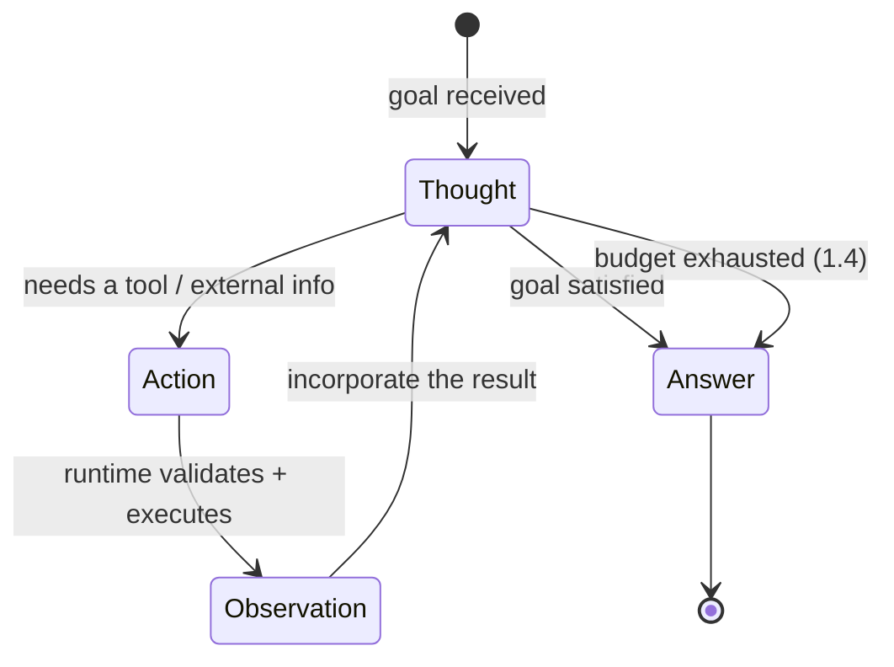
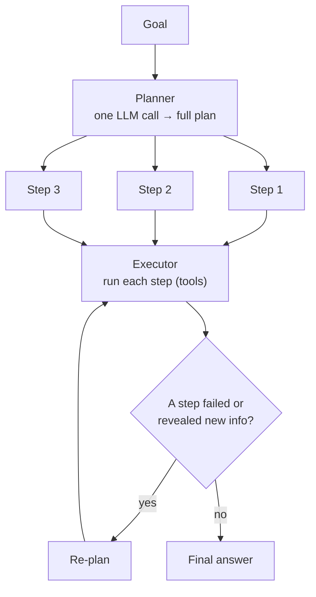
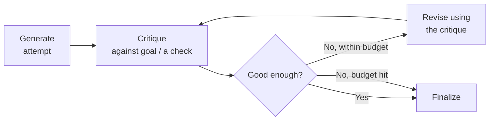

# Module 1 — Core Agentic Architectures and Reasoning Loops

A language model is a function: text in, text out, once. An **agent** is what you get when you wrap that function in a loop that can call tools, observe results, and decide what to do next — repeatedly, until a goal is met. That loop is the entire subject of agentic AI, and this module is about its architecture: how the loop is structured, how it plans, how it corrects itself, and how you stop it from running away.

The temptation is to treat agents as magic — "give the model tools and let it figure it out." That builds impressive demos and unshippable products. A production agent is a piece of *control-flow engineering* wrapped around a probabilistic component. The model provides the reasoning; your architecture provides the structure, the guarantees, and the off-switch. Get the architecture wrong and you get an agent that loops forever, burns your budget, and confidently completes the wrong task.

> **Prerequisites.** The Prompt Engineering course, especially Module 2 (which introduced the ReAct loop, tool validation, and guardrails) and Module 4 (cost budgets, circuit breakers). This module treats those as foundations and goes deeper into the architectural patterns and their trade-offs.

**By the end of this module you will be able to:**

- Model the ReAct loop as an explicit state machine, not a vibe
- Choose between reactive execution and up-front planning from the shape of the task
- Add self-correction that is grounded in real checks, not self-flattery
- Enforce the step, token, and time budgets that keep an autonomous loop bounded

---

## 1.1 The ReAct Framework

The dominant agent architecture is **ReAct** — *Reason + Act* (Yao et al., 2022). It interleaves three kinds of step, repeated until the agent produces a final answer:

- **Thought** — free-text reasoning about the current situation and what to do next.
- **Action** — a structured tool call with arguments.
- **Observation** — the tool's result, appended to the transcript *by your runtime*, not generated by the model.

The reason to interleave reasoning and acting is that each fixes the other's fatal weakness. Reasoning alone (chain-of-thought) cannot gather facts it does not have, so it hallucinates them. Acting alone (blind tool calls) has no plan and cannot recover from a surprising result. ReAct's reasoning *guides* which action to take, and each observation *grounds* the next round of reasoning. Reasoning reduces bad actions; actions reduce hallucinated reasoning.

### The state-machine view

The clearest way to understand — and to *build* — a ReAct agent is as a finite state machine over a growing transcript. The transcript (often called the scratchpad) holds the goal and every Thought, Action, and Observation so far. **The transcript is the state.** The model itself is stateless (Prompt Engineering, Module 2): every iteration, you feed it the *entire* transcript, it emits the next Thought and Action, your runtime executes the action and appends the Observation, and you loop.



Read the transitions carefully, because they define the whole system:

- **Thought → Action** when the model decides it needs external information or an effect. **Thought → Answer** when it decides the goal is met. That branch — "do I act again or am I done?" — is the agent's core decision, made fresh every iteration.
- **Action → Observation** is executed by *you*, not the model. The runtime parses the action, **validates the arguments**, executes the tool, and appends the result. This boundary is where every safety control lives (Prompt Engineering, Module 2): the model *requests*; the runtime *decides and executes*.
- **Observation → Thought** feeds the result back so the next reasoning step is grounded in what actually happened.
- The dashed-in extra transition — **Thought → Answer on budget exhaustion** — is not in the original paper but is mandatory in production (1.4). An agent that can only terminate when *it* decides it is done can decide never.

Here is the loop reduced to its state-machine core. The parsing contract — the model must emit a format you can reliably parse — is what makes it work; structured outputs (Prompt Engineering, Module 2) are the robust way to enforce it.

```python
async def react_agent(call_model, tools: dict, goal: str, max_steps: int = 10) -> str:
    """The ReAct state machine. Transcript is the state; each loop is one
    Thought→Action→Observation transition. Budgets covered properly in 1.4."""
    transcript = f"Goal: {goal}\n"

    for step in range(max_steps):
        # State = full transcript. The model emits the next Thought + Action.
        step_out = await call_model(
            transcript + "\nThought:", stop=["\nObservation:"]
        )
        transcript += f"\nThought:{step_out}"

        # Terminal transition: the model declared it is done.
        if "Final Answer:" in step_out:
            return step_out.split("Final Answer:", 1)[1].strip()

        # Parse the requested action. A malformed action is a correctable
        # observation, never a crash.
        action = parse_action(step_out)  # -> {"tool": str, "args": dict} | None
        if not action or action["tool"] not in tools:
            transcript += "\nObservation: Invalid action. Available tools: " + ", ".join(tools)
            continue

        # Action → Observation: the RUNTIME executes, having validated args.
        try:
            result = await tools[action["tool"]](action["args"])
            transcript += f"\nObservation: {result}"
        except Exception as e:
            transcript += f"\nObservation: Tool error: {e}"

    # Budget backstop: never return nothing.
    return "Stopped: step budget reached. " + await summarize_progress(call_model, transcript)
```

> **Warning.** The most common ReAct bug is not in the reasoning — it is in the parsing. Models drift from the format, wrap actions in prose, or emit slightly malformed JSON, and a brittle parser turns that into a crash mid-run. Treat a parse failure as a *correctable observation* ("I couldn't parse that; emit an action as JSON"), not an exception. Robust agents are lenient parsers with strict validators: forgiving about format, uncompromising about what actually executes.

---

## 1.2 Advanced Planning Patterns

ReAct is fundamentally **reactive**: it decides the next step only *after* seeing the last observation. That adaptivity is its strength — it handles surprises, recovers from errors, explores. But it has real costs baked into the architecture:

- **It is myopic.** With no global plan, it can wander, repeat work, and take inefficient paths toward a goal it only ever considers one step at a time.
- **It is expensive and sequential.** Every step is a full LLM call over the *entire growing transcript*, and each step depends on the last, so nothing parallelizes. A ten-step task is ten sequential calls, each larger than the last.

The alternative is to separate **planning** from **execution**.

### Plan-and-Solve

Plan-and-Solve (Wang et al., 2023) and its Plan-and-Execute descendants split the agent in two. A **planner** takes the goal and produces a complete, multi-step plan up front. An **executor** then carries out each step in order, calling tools as needed. Because the plan exists before execution starts, independent steps can run in parallel and the whole strategy is coherent rather than assembled one myopic step at a time.



```python
async def plan_and_execute(call_model, tools, goal: str) -> str:
    # 1. PLAN: one call produces the whole step list.
    plan = await make_plan(call_model, goal)   # -> ["step 1", "step 2", ...]

    results = []
    for i, step in enumerate(plan):
        # 2. EXECUTE each step. Independent steps could run concurrently.
        outcome = await execute_step(call_model, tools, step, context=results)
        results.append(outcome)
        # 3. RE-PLAN if reality diverged from the plan.
        if outcome.get("failed") or outcome.get("surprising"):
            plan = await replan(call_model, goal, done=results, remaining=plan[i + 1:])
    return await synthesize(call_model, goal, results)
```

### ReWOO: planning without observation

ReWOO (*Reasoning WithOut Observation*) pushes the idea further. The planner writes out *all* the tool calls up front, using variable placeholders for results it does not have yet (`#E1`, `#E2`), the runtime executes those calls — often in parallel — and a final **solver** combines the evidence into an answer. The dramatic win is call count: a classic ReAct task is *one LLM call per step*, while ReWOO is *one plan call plus one solve call*, no matter how many tools run. On a five-tool task that is roughly two model calls instead of six.

The equally dramatic cost: the plan is fixed *before any observation exists*. ReWOO cannot adapt when a tool returns something unexpected, because it has already committed to every subsequent call. It trades adaptivity for efficiency, wholesale.

| | ReAct (reactive) | Plan-and-Solve | ReWOO |
| --- | --- | --- | --- |
| When steps are decided | One at a time, after each result | All up front, executed in order | All up front, before any result |
| Adapts mid-task | **Yes** | Partly (via re-planning) | **No** |
| LLM calls | One per step | One plan + one per step | One plan + one solve |
| Parallelism | None (sequential) | Independent steps can parallelize | High |
| Best for | Unpredictable, exploratory, each step depends on the last | Decomposable tasks, some parallelism | Predictable, decomposable, cost/latency-critical |
| Fails when | Long tasks get expensive; can wander | The plan is a bad hypothesis | Reality differs from the plan at all |

> **Tip.** The decision is about **predictability**. If each step's right move genuinely depends on the previous result — debugging, research, anything exploratory — you need ReAct's adaptivity and you pay for it. If the task decomposes into knowable steps — "fetch these three reports and summarise each" — up-front planning is cheaper, faster, and parallelizable. Most robust production agents are **hybrids**: plan coarsely up front, execute each step reactively, and re-plan when an observation invalidates the plan. Pure ReAct wanders; pure ReWOO shatters on surprise; the middle is where shippable agents live.

---

## 1.3 Reflection and Self-Correction

An agent's first attempt is frequently wrong: a buggy tool call, a flawed reasoning step, an answer that does not actually satisfy the goal. **Reflection** is the architectural pattern that lets an agent evaluate its own intermediate output and revise it *before* committing — a generate → critique → revise cycle instead of a single forward pass.



Two named patterns anchor this:

- **Self-Refine** (Madaan et al., 2023): one agent generates, critiques its own output, and refines — iterating until good enough or out of budget. Simple and single-agent.
- **Reflexion** (Shinn et al., 2023): the agent reflects on a *failed* trajectory — driven by real feedback such as a failing test or a tool error — writes a verbal "lesson" into memory, and retries the whole task with that reflection in context. It is learning from failure across attempts, and it depends on the episodic memory idea from Prompt Engineering (Module 2).

### The line that separates real reflection from theater

This is the part most implementations get wrong. **Grounded reflection — critique based on a real, external signal — is powerful. Ungrounded reflection — the model just "thinking harder" about its own output — is often theater.**

A self-critique is *generated text*, subject to the same fallibility as the original generation (Prompt Engineering, Module 3: a reasoning trace is not a verification). Asked "are you sure?", a model will frequently either cave on a correct answer or reaffirm a wrong one — neither of which is information. The strongest reflection loops close on something the model cannot fake:

- **Run the code** and reflect on the test failures.
- **Validate the output** against a schema and reflect on the validation errors.
- **Execute the tool** and reflect on the actual error message.

Reflection anchored to those real signals genuinely improves results. Reflection anchored to nothing but the model's own second opinion mostly burns calls.

```python
async def reflect_and_revise(call_model, generate, check, goal: str, max_iters: int = 2) -> str:
    """Generate, then critique against a REAL check (tests, a validator, a tool
    result) and revise. Grounded critique beats 'are you sure?' every time."""
    attempt = await generate(goal)

    for _ in range(max_iters):
        signal = await check(attempt)          # e.g. run tests → failures, or validate → errors
        if signal["ok"]:
            return attempt                     # a real check says it passes — done

        # Revise using the concrete failure, not a vague self-doubt.
        attempt = await call_model(
            f"Goal: {goal}\n\nYour attempt:\n{attempt}\n\n"
            f"It failed this check:\n{signal['detail']}\n\nProduce a corrected version."
        )
    return attempt                             # budget hit: return the best we have
```

The TypeScript shape, with a separate **critic** to sidestep self-enhancement bias:

```ts
interface ReflectDeps {
  generate: (goal: string) => Promise<string>;
  // A DIFFERENT model/prompt as critic — a model grading its own work is lenient
  // (Prompt Engineering, Module 3: self-enhancement bias).
  critique: (goal: string, attempt: string) => Promise<{ ok: boolean; feedback: string }>;
  revise: (goal: string, attempt: string, feedback: string) => Promise<string>;
}

export async function reflect(goal: string, deps: ReflectDeps, maxIters = 2): Promise<string> {
  let attempt = await deps.generate(goal);
  for (let i = 0; i < maxIters; i++) {
    const { ok, feedback } = await deps.critique(goal, attempt);
    if (ok) return attempt;
    attempt = await deps.revise(goal, attempt, feedback);
  }
  return attempt; // bounded — never reflect forever
}
```

> **Warning.** Reflection has sharp diminishing returns and real failure modes. Gains largely vanish after one or two iterations; each pass costs LLM calls; and an over-eager reflection loop will **revise a correct answer into a wrong one** or oscillate critique-revise-critique forever. Bound it (1.4), prefer a *separate* critic over pure self-critique (a model grading itself is biased lenient — Prompt Engineering, Module 3), and — above all — ground the critique in a real check. "Reflect until a second model swears it's fine" is not a quality mechanism; "reflect until the tests pass, max three times" is.

---

## 1.4 Execution Budgets and Infinite Loops

Here is the engineering reality every agent tutorial omits: **agents get stuck.** Unlike a single prompt, which terminates when the model stops generating, an agent decides *for itself* when it is finished — and it can decide "never." The failure modes are not edge cases; they are the default outcome of an unbounded loop:

- **Infinite loops** — repeating the same action, oscillating between two states, or calling a tool that fails the same way every time.
- **Runaway cost** — every step is an LLM call over an ever-growing transcript, so an unbounded loop is an unbounded bill (Prompt Engineering, Module 4).
- **No natural termination** — the "am I done?" decision is the model's, and a confused model answers it wrong indefinitely.

The response is defense in depth. No single control suffices; production agents layer all of them.

| Control | Stops | Where to check |
| --- | --- | --- |
| **Step counter** | Runaway iteration | Top of every loop — the hard backstop |
| **Token / cost budget** | The bill | **Before** each model call, not after |
| **Wall-clock timeout** | Slow tools, long chains | Each iteration, against a deadline |
| **Repetition detection** | Loops and oscillation | After parsing each action |
| **Tool circuit breaker** | Hammering a failing tool | After each tool error |

Three principles make these work. **Check the token budget *before* the call**, not after — a call you can't afford is a call you don't make. **Detect repetition** by hashing recent `(action, args)` pairs; a repeat is a signal to break or nudge, because a well-functioning agent does not ask the identical question twice. And **terminate gracefully** — when a budget trips, never crash or return nothing; make one final, bounded "summarise what you found and give the best answer you can" call, or return a clear partial result. A user who waited deserves an honest "I ran out of budget; here's what I found", not a blank.

```python
import time, hashlib

class AgentBudget:
    def __init__(self, max_steps=10, max_tokens=50_000, max_seconds=60):
        self.max_steps, self.max_tokens, self.max_seconds = max_steps, max_tokens, max_seconds
        self.steps = self.tokens = 0
        self.deadline = time.monotonic() + max_seconds
        self.recent: list[str] = []

    def exceeded(self) -> str | None:
        """Return a reason to stop, or None. Checked at the top of every loop."""
        if self.steps >= self.max_steps:      return "step limit"
        if self.tokens >= self.max_tokens:     return "token budget"
        if time.monotonic() >= self.deadline:  return "time limit"
        return None

    def is_repeat(self, action: str, args: dict) -> bool:
        """Oscillation / loop detection: same action+args seen recently."""
        key = hashlib.sha256(f"{action}:{args}".encode()).hexdigest()[:16]
        repeat = key in self.recent
        self.recent = (self.recent + [key])[-5:]  # sliding window of recent actions
        return repeat


async def run_agent(call_model, tools, goal: str, budget: AgentBudget) -> str:
    transcript = f"Goal: {goal}\n"
    breaker: dict[str, int] = {}   # per-tool consecutive failures

    while True:
        reason = budget.exceeded()
        if reason:
            # Graceful termination — one bounded finalize call, never nothing.
            return f"[stopped: {reason}] " + await finalize(call_model, transcript)

        budget.steps += 1
        out = await call_model(transcript + "\nThought:", stop=["\nObservation:"])
        budget.tokens += estimate_tokens(out)  # keep the running total honest
        transcript += f"\nThought:{out}"

        if "Final Answer:" in out:
            return out.split("Final Answer:", 1)[1].strip()

        action = parse_action(out)
        if not action:
            transcript += "\nObservation: Emit a valid action as JSON."
            continue

        # Loop detection: refuse to run the identical action again.
        if budget.is_repeat(action["tool"], action["args"]):
            transcript += "\nObservation: You already tried that and it did not help. Try a different approach."
            continue

        # Circuit breaker: disable a tool that keeps failing this run.
        if breaker.get(action["tool"], 0) >= 3:
            transcript += f"\nObservation: Tool '{action['tool']}' is disabled after repeated failures."
            continue

        try:
            result = await tools[action["tool"]](action["args"])
            breaker[action["tool"]] = 0
            transcript += f"\nObservation: {result}"
        except Exception as e:
            breaker[action["tool"]] = breaker.get(action["tool"], 0) + 1
            transcript += f"\nObservation: Tool error: {e}"
```

The same budget core in TypeScript, for a Node agent runtime:

```ts
export class AgentBudget {
  private steps = 0;
  private tokens = 0;
  private readonly deadline: number;
  private recent: string[] = [];

  constructor(
    private readonly maxSteps = 10,
    private readonly maxTokens = 50_000,
    maxSeconds = 60,
  ) {
    this.deadline = Date.now() + maxSeconds * 1000;
  }

  spend(tokens: number): void {
    this.steps += 1;
    this.tokens += tokens;
  }

  exceeded(): string | null {
    if (this.steps >= this.maxSteps) return "step limit";
    if (this.tokens >= this.maxTokens) return "token budget";
    if (Date.now() >= this.deadline) return "time limit";
    return null;
  }

  isRepeat(action: string, args: unknown): boolean {
    const key = `${action}:${JSON.stringify(args)}`;
    const repeat = this.recent.includes(key);
    this.recent = [...this.recent, key].slice(-5);
    return repeat;
  }
}
```

> **Warning.** Budgets are not a nicety you add later — they are the difference between a demo and a system you can leave running. An unbounded agent *will* eventually loop, and when it does it either hangs a user for minutes or quietly spends real money in a tight cycle of failing tool calls. Every autonomous loop needs a ceiling on steps, on tokens, and on time; the only open question is where you set them. Ship the budgets with the first version, not after the first incident.

---

## Module Recap

- **An agent is a stateless model wrapped in a stateful loop.** The transcript is the state; each iteration is one Thought → Action → Observation transition, with the runtime — not the model — executing and validating actions.
- **ReAct is reactive**: adaptive and robust to surprise, but myopic, sequential, and expensive because every step is a full call over the growing transcript.
- **Up-front planning (Plan-and-Solve, ReWOO) trades adaptivity for efficiency and parallelism.** Choose by predictability; most real agents are hybrids that plan coarsely and execute reactively, re-planning on surprise.
- **Reflection helps only when it is grounded in a real check** — tests, validation, a tool error. Ungrounded "are you sure?" self-critique is theater; use a separate critic and bound the iterations.
- **Budgets are mandatory.** Step counter, token budget checked *before* each call, wall-clock timeout, repetition detection, and a per-tool circuit breaker — layered, with graceful termination that never returns nothing.

## Exercises

1. **Draw your agent's state machine.** Take any agent you have used or built and write out its states and transitions explicitly, including every way it can terminate. If "budget exhausted" is not a transition, you have found a bug.
2. **Reactive vs planned.** Pick two tasks — one exploratory (debug why a test fails) and one decomposable (summarise three named documents). Argue which architecture fits each and estimate the LLM-call count for ReAct vs ReWOO on the decomposable one.
3. **Ground a reflection.** Build a two-iteration reflect-and-revise loop for a code-generation task where the check is *running the tests*. Then replace the check with pure self-critique ("is this correct?") and compare how often each actually fixes a real bug.
4. **Break the loop.** Write an agent whose only tool always returns the same unhelpful result, so a naive loop repeats forever. Add repetition detection and confirm it breaks out; add a step budget and confirm it terminates gracefully with a partial answer rather than hanging.

---

**Next:** *Module 2 — Tool Use and Function Calling*, where the Action half of the loop gets rigorous: designing tool schemas the model uses correctly, validating arguments before execution, structured function-calling, parallel tool calls, and the error-handling contract that lets an agent recover instead of crash.
