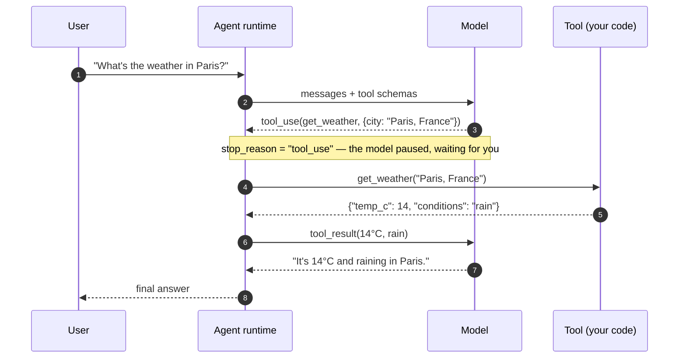
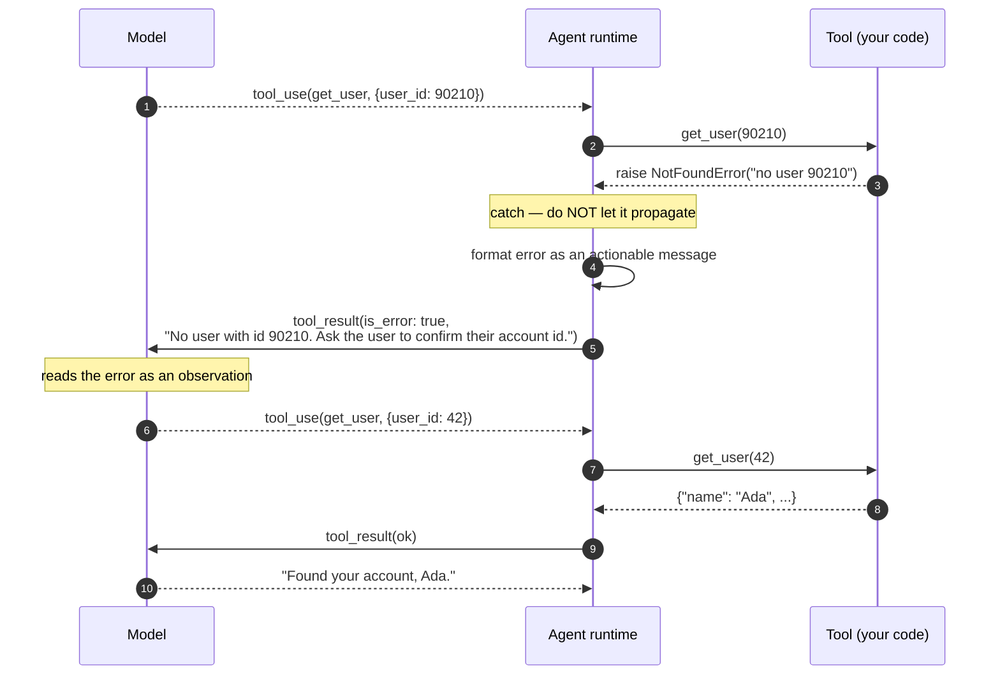
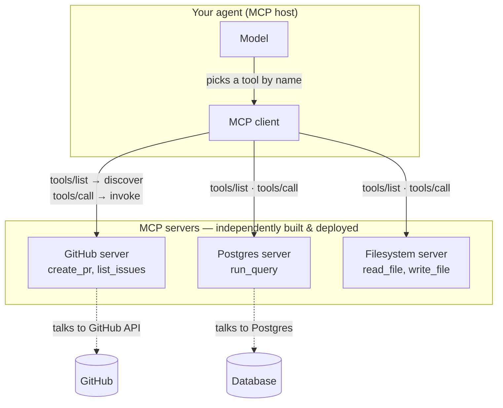

# Tool Use & Function Calling

In Module 1 we built the reasoning loop: the model thinks, **acts**, observes the
result, and thinks again. We waved a hand at the *act* step — "the model calls a
tool" — because the loop is easier to understand when you pretend the mechanism
is free. It is not free. The single most common reason agents fail in production
is not bad reasoning; it is the seam between the model's intent and the code that
runs. The model *wants* to check the weather in Paris, but it emits `{"city":
"Paris, France"}` when your API expects an IATA code, or it invents a `user_id`
that looks plausible and doesn't exist, or the tool throws and the whole run
dies because nobody caught the exception.

This module is about that seam. Getting it right is most of what separates a
demo from a system.

We will cover four things, in order:

- **Function calling mechanics** — how a model is trained to emit structured
  JSON matching a schema instead of prose, and how you control whether it *may*
  call a tool, *must* call one, or must call a *specific* one.
- **Designing bulletproof schemas** — why the tool's description and parameter
  descriptions carry as much weight as your system prompt, and how enums and
  strict typing eliminate a whole class of invalid arguments.
- **Error handling & the feedback loop** — what to do when the model emits a
  malformed call or the tool throws, and how feeding the error back as an
  observation lets the agent correct itself on the next turn.
- **Standardizing with the Model Context Protocol (MCP)** — how MCP decouples
  the model from tool *implementations* so an agent discovers and calls tools at
  runtime instead of hardcoding every integration.

By the end you should be able to look at a flaky agent and know whether the fault
is in the schema, the runner, or the loop.

---

## 2.1 — Function Calling Mechanics

### The problem function calling solves

A base language model produces text. If you want it to "call a tool," the naive
approach is to ask it, in the prompt, to write something you can parse:

> When you need the weather, reply with `ACTION: get_weather(city)`.

This is exactly the ReAct pattern from Module 1, and it *works* — until the model
writes `ACTION: get_weather("Paris")` one turn and `Action: getWeather(city=Paris)`
the next, and your regular expression falls off a cliff. You are asking a
probabilistic text generator to hit an exact syntax every time, and then writing
a parser to forgive it when it doesn't. That parser is where agents go to die.

**Function calling** is the model provider's answer. The model is fine-tuned so
that, given a list of tool definitions, it can emit a dedicated *structured*
output — a tool name plus a JSON arguments object — instead of (or alongside)
free text. The API returns this as a distinct `tool_use` block, not as text you
have to scrape. Under the hood it is **constrained generation**: the same
machinery that powers strict JSON output (Prompt Engineering, Module 2) is
pointed at the tool schema, so the arguments are guaranteed to be
*syntactically* valid JSON that matches the declared shape.

The mental shift: function calling does not give the model new *abilities*. It
gives the **act** step of the ReAct loop a reliable wire format. The model still
decides *what* to do and *what* arguments to use — those can still be wrong (2.2
is entirely about that). What you get for free is that the call will parse.

### The anatomy of a tool definition

A tool is three things: a **name**, a **description**, and a **JSON Schema** for
its inputs.

```json
{
  "name": "get_weather",
  "description": "Get the current weather for a city. Use when the user asks about current conditions or temperature. Do NOT use for forecasts.",
  "input_schema": {
    "type": "object",
    "properties": {
      "city": {
        "type": "string",
        "description": "City and country, e.g. 'Paris, France'"
      },
      "unit": {
        "type": "string",
        "enum": ["celsius", "fahrenheit"],
        "description": "Temperature unit. Defaults to celsius."
      }
    },
    "required": ["city"]
  }
}
```

You pass an array of these alongside the conversation. The model reads them the
way it reads any other context — which is the entire reason 2.2 matters so much.

### What actually happens on a turn

A single tool-calling turn is a round trip through your runtime. The model does
not execute anything; it *requests* execution, your code runs the tool, and you
hand the result back for the model to continue.



Three things to notice, because they trip up everyone the first time:

1. **The model's turn ends at the tool call.** When the API returns a
   `tool_use` block, the response's stop reason is `tool_use`, not `end_turn`.
   The model has *paused mid-thought*. It is your job to run the tool and send
   the result back so it can resume. This is the ReAct loop from Module 1 with a
   guaranteed wire format bolted onto the *act* step.

2. **The transcript is still the state.** Just like Module 1, the model holds no
   memory between requests. You must append the model's `tool_use` block *and*
   your `tool_result` back into the message history before the next call. Drop
   the `tool_use` block and keep only the result, and the next request is
   malformed — the result refers to a call that isn't in the transcript.

3. **You own the execution.** The provider never runs your function. This is a
   feature, not a limitation: your runtime is where you validate arguments, gate
   destructive actions behind approval, apply timeouts, and log — the whole
   safety architecture from Module 1 lives in this gap.

### Controlling *whether* and *which*: tool choice

By default the model decides for itself whether a tool is needed. Sometimes you
want to take that decision away from it. The `tool_choice` parameter is how.

| Mode | The model... | Use it when |
| --- | --- | --- |
| `auto` (default) | Decides whether to call a tool, which one, or to just answer in text. | Open-ended agents — the normal case. The model routes among tools by itself. |
| `any` | **Must** call *some* tool this turn; it cannot answer in plain text. | A tool call is mandatory — e.g. a router that must dispatch to one of several handlers. |
| `tool` (a named tool) | **Must** call *this specific* tool. | You already know which tool is needed. Turns function calling into **guaranteed structured extraction**. |
| `none` | Cannot call any tool; must answer in text. | You want a text answer this turn even though tools are defined. |

The `tool`-forcing mode is worth dwelling on, because it is a technique in
disguise. If you force a single tool whose schema is exactly the shape you want
extracted, you have turned the model into a structured-data extractor with a
validated output contract — no parsing, no "please respond only in JSON" pleading.
This is the same idea as strict structured outputs from the prompting course,
reached through the tool door.

```python
# Force the model to emit exactly this shape — extraction, not conversation.
resp = call_model(
    messages=[{"role": "user", "content": raw_support_email}],
    tools=[EXTRACT_TICKET_TOOL],
    tool_choice={"type": "tool", "name": "extract_ticket"},
)
ticket = resp.tool_calls[0].arguments  # guaranteed to match EXTRACT_TICKET_TOOL's schema
```

> **Honest caveat.** Forcing `any` or a specific tool means the model *will* call
> it even when the honest answer is "I don't have enough information." A forced
> tool call can produce confidently wrong arguments. Force a tool when a call is
> genuinely always correct for this turn; leave it on `auto` when "actually, I
> should ask a clarifying question" is a valid outcome.

### Parallel tool calls

Modern models can emit **multiple** `tool_use` blocks in a single turn — call
`get_weather` and `get_calendar` at once when the two don't depend on each other.
Your runtime executes them (ideally concurrently), then returns **all** the
results together in the next message.

This is the planning parallelism from Module 1 made concrete, and it is a real
latency win: two independent lookups become one round trip instead of two. Two
rules keep it working:

- **Return every result in one message.** If the model made three calls, send
  three results back together. Splitting them across turns — or dropping one —
  corrupts the transcript and, over time, trains the model to stop making
  parallel calls at all.
- **A failed call still needs a result.** If one of the three throws, you send
  back an *error* result for it (2.3), not nothing. Silence is a malformed
  transcript.

Here is a minimal, provider-agnostic runner for one turn — dispatch every call,
collect every result, hand them all back:

```python
def run_turn(messages, tools, tool_registry):
    """One model turn. Returns updated messages; caller loops until no tool calls."""
    resp = call_model(messages=messages, tools=tools, tool_choice="auto")

    # Always append the assistant turn verbatim — tool_use blocks included.
    messages.append(resp.assistant_message)

    if not resp.tool_calls:
        return messages, resp.text  # end_turn — we have a final answer

    results = []
    for call in resp.tool_calls:            # may be >1 (parallel)
        fn = tool_registry.get(call.name)
        if fn is None:
            results.append(tool_error(call.id, f"Unknown tool: {call.name}"))
            continue
        output = fn(**call.arguments)       # your code runs; see 2.3 for the try/except
        results.append(tool_result(call.id, output))

    # ALL results go back in a single user message, each keyed to its call id.
    messages.append({"role": "user", "content": results})
    return messages, None                   # None → caller loops again
```

```typescript
async function runTurn(messages, tools, toolRegistry) {
  const resp = await callModel({ messages, tools, toolChoice: "auto" });

  // Append the assistant turn verbatim — tool_use blocks included.
  messages.push(resp.assistantMessage);

  if (resp.toolCalls.length === 0) {
    return { messages, answer: resp.text }; // end_turn
  }

  // Run independent calls concurrently, preserving order.
  const results = await Promise.all(
    resp.toolCalls.map(async (call) => {
      const fn = toolRegistry[call.name];
      if (!fn) return toolError(call.id, `Unknown tool: ${call.name}`);
      const output = await fn(call.arguments); // see 2.3 for the try/catch
      return toolResult(call.id, output);
    }),
  );

  messages.push({ role: "user", content: results });
  return { messages, answer: null }; // caller loops again
}
```

Notice what this runner does *not* do yet: it trusts `call.arguments` and it
trusts `fn(...)` not to throw. The next two sections fix both — first by making
the arguments harder to get wrong, then by handling the throws when they come
anyway.

---

## 2.2 — Designing Bulletproof Schemas

### The schema is a prompt

Here is the sentence most teams learn the expensive way: **the model chooses
which tool to call, and what arguments to fill in, based on nothing but the tool
names, the descriptions, and the parameter descriptions you wrote.**

The description field is not documentation for the human maintainer. It is a
*prompt* — an instruction the model reads at decision time. A vague description
produces a vague decision. Teams pour hours into their system prompt and then
type `"description": "gets user data"` and wonder why the agent calls the wrong
tool. The tool schema is where a startling amount of agent reliability actually
lives, and it is the most under-invested surface in most codebases.

### The principles

**Name tools by what they do.** `get_weather` is better than `fetch_data`.
`cancel_subscription` is better than `handle_sub`. The name is the first thing
the model matches against intent.

**Write descriptions that say *when* to use — and when not to.** State the
purpose, the trigger condition, and the boundary against neighbouring tools:

> `get_weather` — "Get **current** weather for a city. Use when the user asks
> about conditions or temperature **right now**. Do NOT use for forecasts — call
> `get_forecast` for anything future-dated."

That "do NOT" clause is what stops the model dithering between two tools that
both look plausible. Disambiguation is a description's most valuable job.

**Describe every parameter — with units, format, and examples.** `"date"` is a
trap. `"date": "Departure date in YYYY-MM-DD format, e.g. 2026-03-14"` is a
contract. The model cannot guess your format; tell it.

**Use enums for closed sets.** If a field has a fixed set of legal values, make
it an enum. Under a strict schema, the model *cannot* emit a value outside the
enum — the invalid category is eliminated at generation time, not caught later.

```json
"status": {
  "type": "string",
  "enum": ["open", "pending", "closed"],
  "description": "Ticket status to filter by."
}
```

No more `"in_progress"` when your database only knows `"pending"`. This is the
single highest-leverage schema change you can make.

**Type strictly and mark what's required.** Use `integer` where you mean
integer, list `required` fields explicitly, and — where your provider supports a
**strict** mode — set `additionalProperties: false` so the model cannot invent
extra keys. Strict mode is the tool-side twin of the strict JSON output from the
prompting course: the API guarantees the arguments validate against the schema
exactly.

**Keep the tool set small and sharp.** Every extra tool is another thing the
model can pick wrongly. A menu of thirty overlapping tools has lower routing
accuracy than a menu of eight distinct ones. If two tools could plausibly apply
to the same request, the model will occasionally misroute — merge them, or make
their descriptions carve a hard boundary. (Section 2.4 shows how MCP's dynamic
discovery lets you keep the *available* set large while the *in-context* set
stays small.)

### What schemas can and cannot prevent

Here is the honest limit, and it is important. A strict schema constrains the
**type and category** of an argument. It does **not** constrain its **validity in
the real world.**

An enum stops `"in_progres"`. `additionalProperties: false` stops invented keys.
`"type": "integer"` stops `"forty-two"`. But nothing in the schema stops the
model from emitting `{"user_id": 90210}` when user 90210 does not exist. That
`user_id` is a well-formed integer. It passes every schema check. It is also a
**hallucinated argument** — plausible-looking, syntactically perfect, and wrong.

| Failure | Prevented by schema? | What actually catches it |
| --- | --- | --- |
| `"in_progres"` (typo'd category) | ✅ Enum | Generation-time constraint |
| `"forty-two"` where an int is needed | ✅ Strict typing | Generation-time constraint |
| Extra invented key `"admin": true` | ✅ `additionalProperties: false` | Generation-time constraint |
| Missing required field | ✅ `required` | Generation-time constraint |
| `user_id: 90210` (well-formed, doesn't exist) | ❌ | **Runtime validation against reality** |
| A date in valid format but in the past | ❌ | **Runtime validation / business logic** |

So the schema is your first line of defence, and it eliminates an entire class of
errors cheaply. But the *second* line — checking arguments against the actual
world before you act on them — lives in your tool code, and it feeds directly
into 2.3. A hallucinated `user_id` should not crash your database call; it should
become an *observation* the model can recover from.

### A good schema, in code

Most teams generate JSON Schema from a typed model rather than hand-writing it.
The declaration *is* the schema, which keeps the two from drifting apart.

```python
from enum import Enum
from pydantic import BaseModel, Field

class Status(str, Enum):
    open = "open"
    pending = "pending"
    closed = "closed"

class SearchTickets(BaseModel):
    """Search support tickets. Use when the user asks to find or list tickets
    by status or keyword. Do NOT use to modify a ticket — that's update_ticket."""
    query: str = Field(..., description="Free-text search over ticket titles and bodies.")
    status: Status | None = Field(
        None, description="Optional status filter. Omit to search all statuses."
    )
    limit: int = Field(20, ge=1, le=100, description="Max results, 1–100. Defaults to 20.")

# .model_json_schema() → a strict JSON Schema with the enum, the descriptions,
# and the required/optional split already correct.
```

```typescript
import { z } from "zod";

// The Zod schema is the source of truth; the tool schema is generated from it.
const SearchTickets = z.object({
  query: z.string().describe("Free-text search over ticket titles and bodies."),
  status: z
    .enum(["open", "pending", "closed"])
    .optional()
    .describe("Optional status filter. Omit to search all statuses."),
  limit: z
    .number()
    .int()
    .min(1)
    .max(100)
    .default(20)
    .describe("Max results, 1–100. Defaults to 20."),
});

const searchTicketsTool = {
  name: "search_tickets",
  description:
    "Search support tickets. Use when the user asks to find or list tickets " +
    "by status or keyword. Do NOT use to modify a ticket — that's update_ticket.",
  input_schema: zodToJsonSchema(SearchTickets),
};
```

Every description in there is doing work at the model's decision time. The
`ge=1, le=100` / `.min(1).max(100)` bounds are worth a note: not all providers
enforce numeric ranges at generation time (strict mode typically covers types
and enums, not `minimum`/`maximum`), so treat those as *runtime* validation too
— which is exactly the bridge into the next section.

---

## 2.3 — Error Handling & The Feedback Loop

### The one idea that makes agents robust

An error is not a crash. **An error is an observation.**

This is the single most important sentence in the module. In a normal program, a
tool that throws is a bug that halts execution. In an *agent*, a tool that throws
is a signal — and if you catch it, format it, and feed it back into the
transcript, the model reads it on the next turn and *corrects itself*. This is
the Observation → Thought transition from Module 1, and it is the difference
between a brittle agent and one that recovers. Grounded self-correction (Module
1.3) has to be grounded in *something real* — and a genuine tool error is the
most real signal an agent ever gets.

The happy path — the model calls the tool, it works, the answer flows back — is
easy and everybody builds it. Agents live or die on the *unhappy* path: the tool
that returns a 404, the argument that was well-formed but wrong, the API that
times out. How you handle that path is most of your reliability budget.

### Two classes of failure

Failures come from two directions, and they want different responses.

**1. The model emitted a bad call.**
- *Malformed JSON* — rare with native function calling (the constrained
  generation guarantees valid JSON), common when you're parsing tool calls out
  of free text yourself. If you see this, it's an argument for using real
  function calling.
- *Invalid arguments* — a wrong enum or missing required field is usually caught
  by a strict schema, but *semantic* invalidity (the hallucinated `user_id` from
  2.2) sails through.
- *Calls a tool that doesn't exist* — the model invented a tool name.

**2. The tool itself failed.**
- It threw an exception, timed out, hit a rate limit, or returned a domain error
  (record not found, permission denied, invalid input the schema didn't catch).

### The feedback loop, drawn

Watch what happens when the model calls a real tool with a hallucinated argument.
The tool fails, but the run does not.



The error never reached the user. It reached the *model*, phrased as a fact the
model could act on, and the model recovered. That is the whole game.

### What makes an error message useful *to a model*

A tool result the model can recover from is written for the model, not for your
log aggregator:

- **Specific and actionable.** Not `"error"` but `"date must be YYYY-MM-DD, got
  '14/03/2026'"`. Tell it what was wrong *and* what right looks like.
- **Suggest the fix where you can.** `"No user with id 90210. Confirm the account
  id with the user."` gives the model its next move.
- **Never leak internals.** No stack traces, no secrets, no raw SQL. The model's
  output can reach the user, and a stack trace in the transcript is both a
  security smell and noise that degrades the next decision. (Prompt Engineering,
  Module 2 — the tool boundary is a trust boundary.)
- **Bounded.** Truncate a 4,000-line error dump to the salient lines. Giant
  observations blow your context budget (Module 1's observation-truncation rule)
  and bury the signal.

### Retry, feed back, or break — a decision, not a reflex

Not every error wants the same response. Distinguish **transient** failures from
**semantic** ones.

| Error type | Example | Right response |
| --- | --- | --- |
| Transient / retryable | Timeout, `429` rate limit, `503` | **Retry** the same call with backoff. Don't bother the model — this is infrastructure. |
| Semantic / model-fixable | Bad argument, not-found, wrong enum | **Feed back** as an observation. Retrying the identical call is pointless; the model must change its move. |
| Repeated identical failure | Same bad call, twice, after being told | **Break.** The model is stuck. Trip the circuit breaker (Module 1). |

The last row matters. A tool-error feedback loop can become an *infinite* loop:
the model makes a bad call, you feed the error back, and it makes the *same* bad
call again. This is the repetition failure from Module 1, and the defence is the
same — detect the repeat and terminate gracefully rather than burning your budget
in a circle. Feeding errors back turns failure into recovery *only* when the loop
is bounded.

### A production-ready tool runner

Here is a runner that puts it together: it validates against the schema first,
catches every exception, distinguishes retryable from semantic failures, formats
errors as actionable observations, and never lets a tool throw crash the loop.

```python
import time
from pydantic import ValidationError

RETRYABLE = (TimeoutError, RateLimitError, ConnectionError)

def execute_tool(call, tool_registry, *, max_retries=2):
    """Run one tool call. ALWAYS returns a tool_result — never raises.
    A raised exception here would kill the agent loop; that's the bug we're
    designing out."""
    spec = tool_registry.get(call.name)
    if spec is None:
        # The model invented a tool. Tell it which tools actually exist.
        valid = ", ".join(tool_registry.names())
        return tool_error(call.id, f"Unknown tool '{call.name}'. Available tools: {valid}.")

    # 1. Schema/semantic validation BEFORE side effects (catches the hallucinated arg).
    try:
        args = spec.model.model_validate(call.arguments)
    except ValidationError as e:
        # Feed the validation error back — the model can correct the argument.
        return tool_error(call.id, f"Invalid arguments for {call.name}: {_summarize(e)}")

    # 2. Execute, retrying only transient failures.
    for attempt in range(max_retries + 1):
        try:
            output = spec.fn(args)
            return tool_result(call.id, _truncate(output))
        except RETRYABLE as e:
            if attempt < max_retries:
                time.sleep(2 ** attempt)          # backoff; don't involve the model
                continue
            return tool_error(call.id, f"{call.name} is temporarily unavailable. It timed out after {max_retries + 1} attempts.")
        except DomainError as e:
            # A meaningful business error (not found, forbidden). Feed it back.
            return tool_error(call.id, str(e))    # DomainError messages are written for the model
        except Exception:
            # Unexpected. Log the real cause with the request id; tell the model
            # something safe and generic. Never leak the traceback into the transcript.
            log.exception("tool %s crashed", call.name)
            return tool_error(call.id, f"{call.name} failed unexpectedly. Try a different approach or ask the user for clarification.")
```

```typescript
const RETRYABLE = new Set(["ETIMEDOUT", "RATE_LIMITED", "ECONNRESET"]);

async function executeTool(call, toolRegistry, { maxRetries = 2 } = {}) {
  // ALWAYS resolves to a tool_result — never throws. A throw here kills the loop.
  const spec = toolRegistry[call.name];
  if (!spec) {
    const valid = Object.keys(toolRegistry).join(", ");
    return toolError(call.id, `Unknown tool '${call.name}'. Available tools: ${valid}.`);
  }

  // 1. Validate before side effects — catches the hallucinated argument.
  const parsed = spec.schema.safeParse(call.arguments);
  if (!parsed.success) {
    return toolError(call.id, `Invalid arguments for ${call.name}: ${summarize(parsed.error)}`);
  }

  // 2. Execute, retrying only transient failures.
  for (let attempt = 0; attempt <= maxRetries; attempt++) {
    try {
      const output = await spec.fn(parsed.data);
      return toolResult(call.id, truncate(output));
    } catch (err) {
      if (RETRYABLE.has(err.code) && attempt < maxRetries) {
        await sleep(2 ** attempt * 1000); // backoff — infrastructure, not the model's problem
        continue;
      }
      if (err instanceof DomainError) {
        return toolError(call.id, err.message); // written for the model to read
      }
      if (RETRYABLE.has(err.code)) {
        return toolError(call.id, `${call.name} is temporarily unavailable after ${maxRetries + 1} attempts.`);
      }
      log.error({ err, tool: call.name }, "tool crashed");
      return toolError(call.id, `${call.name} failed unexpectedly. Try a different approach.`);
    }
  }
}
```

The shape to internalise: **validate → execute with bounded retry → format every
failure as an observation → never raise.** A tool runner that can throw is a tool
runner that can kill your agent mid-run. This function is the *act* step of
Module 1's loop, hardened.

---

## 2.4 — Standardizing with the Model Context Protocol (MCP)

### The integration problem MCP solves

Everything so far assumes you hand-write each tool: the schema, the runner, the
implementation. That is fine for three tools. It does not scale.

Say you want your agent to reach GitHub, Slack, a Postgres database, and the
filesystem. For each, you write a tool definition *and* an implementation *and*
you wire it into the agent. Now you build a second agent that needs the same four
integrations — and you write them again, because they were baked into the first
agent's code. `N` agents times `M` tools is `N × M` bespoke integrations, and
every tool is welded to the agent that uses it. Adding a capability means editing
the agent.

The **Model Context Protocol (MCP)** breaks that coupling. It is an open protocol
that separates the agent from the tool *implementation*. Instead of `N × M`, you
get `N + M`: write a GitHub MCP **server** once, and any MCP-capable agent can use
it without knowing how it works.

### Client, server, and discovery

MCP has two roles:

- An **MCP server** exposes a set of capabilities — **tools** (things the model
  can call), plus resources and prompts — over a standard protocol. The server
  owns the implementation: it knows how to talk to GitHub's API; the agent does
  not.
- An **MCP client** lives inside your agent (the "host"). It connects to one or
  more servers, **discovers** what they offer at runtime, and **invokes** them on
  the model's behalf.

The protocol underneath is **JSON-RPC 2.0**. Two methods carry the weight:

- `tools/list` — the client asks a server, "what tools do you have?" The server
  answers with a list of tool definitions: each has a `name`, a `description`,
  and an `inputSchema` — **the exact same three-part shape from 2.1.** An MCP
  tool *is* a function-calling tool; the server just delivers the schema over the
  wire instead of you typing it into your code.
- `tools/call` — the client says, "run this tool with these arguments." The
  server executes it and returns the result.

The connection is established over a **transport**. Two are standard:

| Transport | How it works | Use it for |
| --- | --- | --- |
| **stdio** | The server runs as a local subprocess; client and server talk over stdin/stdout. | Local tools — a filesystem server, a local database, a CLI wrapper. |
| **Streamable HTTP** | The server is a remote HTTP endpoint. | Hosted, shared servers — a company's GitHub or Jira integration reachable over the network. |

The lifecycle is: the client connects, the two sides **negotiate capabilities**
(an `initialize` handshake — who supports what), the client calls `tools/list` to
learn what's available, and from then on it calls `tools/call` as the model
requests tools.

### How the pieces line up



The flow inside the agent:

1. On startup, the client calls `tools/list` on each connected server and
   collects the tool definitions.
2. It converts them into the model's function-calling format (they're already the
   right shape) and passes them as the `tools` array — exactly the array from
   2.1.
3. When the model emits a `tool_use` for, say, `create_pr`, the client routes it
   to the GitHub server via `tools/call`, gets the result, and feeds it back as
   a `tool_result` — exactly the loop from 2.1 and 2.3.

Everything you learned in the first three sections still applies. MCP does not
replace function calling; it **feeds** function calling, sourcing the tool list
from servers instead of your source code.

### Dynamic discovery is the point

The word that matters is **dynamic**. The agent does not hardcode its tools — it
*asks* what's available at runtime. Stand up a new MCP server, point the agent at
it, and the agent gains those tools with **no code change**. Servers can even
advertise that their tool list changed, and the client re-discovers. Tools become
pluggable, reusable, independently deployable units — the same decoupling that
service-oriented architecture brought to backends, applied to agent capabilities.

This is also the escape hatch for 2.2's "keep the tool set small" rule. With a
large library of MCP tools, you don't have to put all of them in the model's
context at once; discovery lets you surface the relevant subset per task and keep
the in-context menu sharp.

### A client that discovers and dispatches

Illustrative shape — discover the server's tools, expose them to the model, route
the model's calls back through `tools/call`. This mirrors the concept; a real
integration uses the official MCP SDKs, and many hosts (IDEs, desktop assistants)
speak MCP for you.

```python
# Illustrative — discover tools from an MCP server, run the agent loop against them.
async def run_agent_with_mcp(mcp_session, user_message):
    # 1. DISCOVER — no hardcoded tool list; ask the server what it offers.
    listed = await mcp_session.list_tools()          # JSON-RPC: tools/list
    tools = [
        {"name": t.name, "description": t.description, "input_schema": t.inputSchema}
        for t in listed.tools
    ]

    messages = [{"role": "user", "content": user_message}]
    while True:
        resp = call_model(messages=messages, tools=tools, tool_choice="auto")
        messages.append(resp.assistant_message)
        if not resp.tool_calls:
            return resp.text

        results = []
        for call in resp.tool_calls:
            try:
                # 2. INVOKE — the model picked a tool; dispatch it to the server.
                out = await mcp_session.call_tool(call.name, call.arguments)  # tools/call
                results.append(tool_result(call.id, out))
            except MCPError as e:
                # Same feedback-loop discipline as 2.3 — errors are observations.
                results.append(tool_error(call.id, f"{call.name} failed: {e}"))
        messages.append({"role": "user", "content": results})
```

```typescript
// Illustrative — same shape in TypeScript.
async function runAgentWithMcp(mcpSession, userMessage) {
  // 1. DISCOVER
  const listed = await mcpSession.listTools(); // tools/list
  const tools = listed.tools.map((t) => ({
    name: t.name,
    description: t.description,
    input_schema: t.inputSchema,
  }));

  const messages = [{ role: "user", content: userMessage }];
  while (true) {
    const resp = await callModel({ messages, tools, toolChoice: "auto" });
    messages.push(resp.assistantMessage);
    if (resp.toolCalls.length === 0) return resp.text;

    const results = await Promise.all(
      resp.toolCalls.map(async (call) => {
        try {
          const out = await mcpSession.callTool(call.name, call.arguments); // tools/call
          return toolResult(call.id, out);
        } catch (e) {
          return toolError(call.id, `${call.name} failed: ${e.message}`); // observation
        }
      }),
    );
    messages.push({ role: "user", content: results });
  }
}
```

### What MCP standardizes — and what it does not

MCP is genuinely useful, and it is young. Be honest about both.

**What you gain:** decoupling (the agent speaks MCP, not GitHub's API), reuse
(write a server once, use it everywhere), and dynamic discovery (add capabilities
without redeploying the agent). The ecosystem of ready-made servers is growing
fast, and major hosts support the protocol.

**What you still own — MCP standardizes the plumbing, not the safety.** Every
guardrail from Module 1 still applies, and a couple sharpen:

- **A server is code you're trusting to execute tools.** An MCP server runs
  actions on your behalf. A malicious or compromised one is a supply-chain
  problem. Vet what you connect.
- **Tool results are untrusted input.** Content coming back from a server can
  carry prompt-injection payloads aimed at your model (Prompt Engineering,
  Module 2). The result of a `tools/call` is data, not instructions — treat it
  that way.
- **Remote servers need auth, and permissions should be least-privilege.** A
  server wired to your database with broad rights is a broad blast radius.
- **The old rules hold.** Validate arguments before acting, bound your execution
  budget, and gate irreversible actions behind approval (Module 1). MCP makes it
  *easier* to add a tool; it does nothing to make an un-guarded tool safe.

MCP changes where tool definitions *come from*. It does not change your
responsibility for what those tools *do*.

---

## Recap

- **Function calling** gives the ReAct *act* step a reliable wire format: the
  model emits a structured `tool_use` block — a name plus schema-valid JSON —
  instead of prose you have to parse. The model's turn *pauses* at the call; your
  runtime executes and feeds the result back so it can resume. `tool_choice`
  controls whether it *may* (`auto`), *must* (`any`), or must call a *specific*
  tool — the last of which is structured extraction in disguise.
- **Schemas are prompts.** The model routes and fills tools from the names,
  descriptions, and parameter descriptions alone. Enums and strict typing
  eliminate invalid *categories* at generation time; they cannot catch
  hallucinated-but-well-formed arguments — those need runtime validation against
  reality.
- **Errors are observations.** Catch every failure, format it as an actionable,
  internals-free tool result, and feed it back so the model self-corrects. Retry
  transient failures silently; feed semantic failures back; break on repeated
  identical failures so the feedback loop can't spin forever. A tool runner that
  can throw is a tool runner that can kill the agent.
- **MCP** decouples the agent from tool implementations. An MCP client discovers
  tools from servers via `tools/list` and invokes them via `tools/call` (JSON-RPC
  over stdio or Streamable HTTP), turning `N × M` bespoke integrations into
  `N + M` reusable ones. It feeds function calling rather than replacing it — and
  it standardizes the plumbing, not the safety architecture.

## Exercises

1. **Force the extraction.** Take a tool whose schema matches a support-ticket
   shape (`priority` enum, `category` enum, `summary` string). Call the model
   with `tool_choice` forcing that single tool on a messy customer email. Then
   switch to `auto` and give it an email that isn't a support request at all —
   observe how the two modes differ, and note when forcing produces confidently
   wrong output.

2. **Break a schema on purpose.** Write a `book_flight` tool with a vague
   description (`"books a flight"`) and untyped `date`/`passengers` params. Log
   the arguments the model produces across ten varied requests. Now rewrite the
   description with a when/when-not clause, add a `date` format example, and make
   `passengers` an integer with bounds. Compare the error rate.

3. **Make an agent recover.** Build a `get_account(account_id)` tool that raises
   `NotFoundError` for any id except `42`. Wire the feedback loop so the error
   returns as an actionable observation. Prompt the agent with a task that
   requires an account lookup but give it no id — watch it hallucinate an id,
   read the error, and correct. Then add a repetition guard and confirm it breaks
   if the model loops.

4. **Trace a `tools/call`.** Point an MCP client at any local stdio server (a
   filesystem server is the classic starter). Log the `tools/list` response and
   one `tools/call` round trip. Map each field of the discovered tool onto the
   `name` / `description` / `input_schema` triple from 2.1 — convince yourself an
   MCP tool and a hand-written tool are the same object arriving by different
   roads.

## Next: Module 3 — Memory & State

We have given the agent hands. It can call tools, survive their failures, and
discover new ones at runtime. But it still forgets everything the moment the
transcript is trimmed — the "state is the transcript" model from Module 1 has a
hard ceiling. Module 3 is about breaking that ceiling: short-term versus
long-term memory, what to persist and what to let go, summarisation and retrieval
as memory strategies, and the state management that lets an agent work across
sessions instead of within one.
