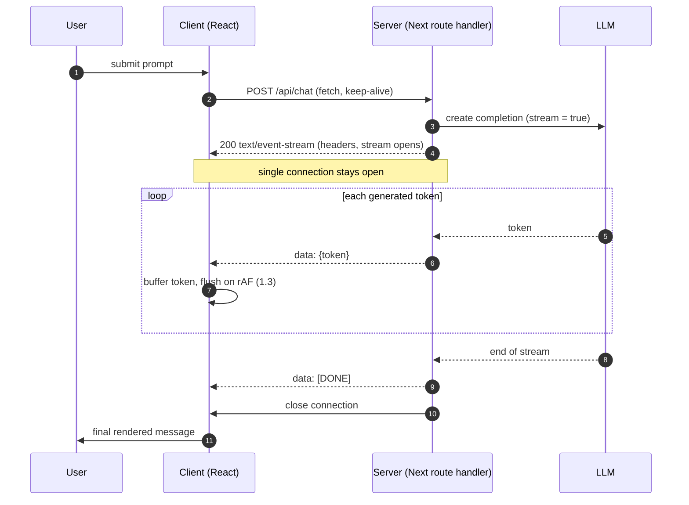
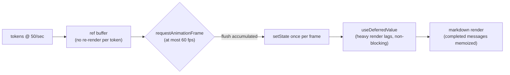
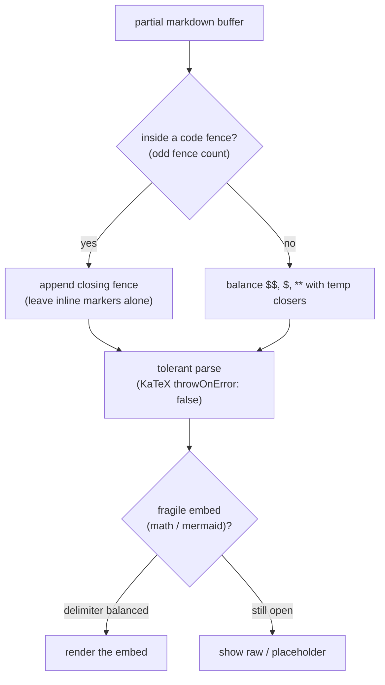

# Real-Time UI & Streaming Architectures

The previous courses built the engine room — retrieval, agents, vectors. This
course is about the surface the user actually touches, and it opens with the
single most important frontend fact about LLMs: **they are slow, and streaming is
how you make slow feel instant.** A model that takes eight seconds to produce a
paragraph is unusable as a bulk request and delightful as a stream, for the exact
same eight seconds of compute. That gap is a product decision, and getting it
right is four hard problems stacked on each other:

- **The UX of latency** — why streaming is mandatory, and TTFT vs. generation speed.
- **SSE vs. WebSockets** — the right transport, and when the simple one is wrong.
- **High-frequency React state** — appending tokens at 50/sec without melting the UI.
- **Parsing markdown in flight** — rendering output whose closing delimiter hasn't arrived.

Code leans on Next.js, React, and Node throughout, because this is where product
meets protocol.

---

## 1.1 — The UX of Latency

An LLM generates autoregressively — one token at a time — so a full answer of a
few hundred tokens at 30 to 80 tokens/sec takes several seconds. You can wait for
all of it and return one bulk response, or emit each token as it is produced. The
compute is identical; the perceived experience is not remotely.

Two distinct latency metrics govern this, and conflating them is the classic
mistake:

- **TTFT (Time To First Token)** — request sent to first token on screen. This is
  the "is it alive?" signal. It is dominated by network, queueing, and **prefill**
  (processing the input prompt, which scales with prompt length), not by model
  speed. Typically 200ms to 2s.
- **TPOT (Time Per Output Token)**, or its inverse, generation speed in tokens/sec
  — the rate at which tokens stream *after* the first. Dominated by model size and
  decode throughput.

Total wall-clock is the sum, but perceived latency is not:

$$
t_{\text{total}} = \text{TTFT} + N_{\text{out}} \cdot \text{TPOT}
$$

$$
t_{\text{perceived}} \approx \text{TTFT} \quad\text{when}\quad \frac{1}{\text{TPOT}} \ge r_{\text{read}}
$$

The second relation is the whole game. Human reading speed $r_{\text{read}}$ is
roughly 3 to 5 words/sec; models stream faster than that, so once the first token
lands the user reads continuously and never catches up to the generator. **The
perceived wait collapses from the full total down to just TTFT.**

The psychology: five seconds of blank spinner reads as *broken* — it blows past
the ~400ms Doherty threshold where attention holds, abandonment climbs, and the
user has nothing to do. Five seconds where the first words appear at 200ms and the
rest streams in reads as *fast and alive* — the same five seconds, now filled with
engaged reading. Streaming converts dead waiting into progressive disclosure, and
as a bonus gives the user an early **cancel** (they see it going wrong and stop)
and a liveness cue (the typing effect signals thinking).

| | Bulk response | Streamed response |
| --- | --- | --- |
| First feedback | After full generation (seconds) | At TTFT (~200ms) |
| Perceived wait | $t_{\text{total}}$ | $\approx \text{TTFT}$ |
| User activity while waiting | None (spinner) | Reading |
| Early cancel | No | Yes |
| Feels | Broken / slow | Instant / alive |

This is why streaming is a **requirement**, not an optimization, for any
conversational LLM surface. The cost is real engineering complexity — the rest of
this module — but there is no acceptable non-streaming chat UX.

---

## 1.2 — Server-Sent Events (SSE) vs. WebSockets

Streaming needs a transport that pushes data to the browser incrementally over a
held-open connection. Two exist, and for text generation the simpler one is almost
always correct.

**Server-Sent Events (SSE)** is a plain HTTP response with `Content-Type:
text/event-stream` that never closes — the server writes `data:` events as tokens
arrive. It is **uni-directional** (server to client only), rides ordinary HTTP/1.1
or HTTP/2, passes through the CDNs, proxies, and load balancers that already speak
HTTP, and has auto-reconnect built in. The browser's native `EventSource` is the
canonical client, though production apps usually use `fetch` + a `ReadableStream`
reader instead, because `EventSource` cannot issue a POST or set an
`Authorization` header.

Text generation is a one-directional flow: the client sends **one** request (the
prompt) and the server streams **many** tokens back. That is SSE's exact shape, so
SSE is the correct default — simpler, HTTP-native, serverless-friendly.



**WebSockets** upgrade a single TCP socket to a persistent, **bi-directional**,
full-duplex channel — both sides send at any time. That power costs simplicity: you
need a stateful WS server (not a plain HTTP handler), sticky sessions, and a
different scaling story than serverless HTTP. Reach for WebSockets only when the
client must send data *mid-stream*: **real-time agentic voice/audio** (mic audio
flowing up while TTS flows down at once), **barge-in** interruption (the user cuts
in while the model is still speaking), or live collaboration. Voice agents (e.g.
the OpenAI Realtime API) use WebSockets or WebRTC for exactly this reason.

| | SSE | WebSockets |
| --- | --- | --- |
| Direction | Uni (server → client) | Bi-directional, full-duplex |
| Protocol | Plain HTTP | TCP after HTTP upgrade |
| Browser API | `EventSource` / `fetch` reader | `WebSocket` |
| Auto-reconnect | Built in | Roll your own |
| Serverless-friendly | Yes | Awkward (stateful, sticky) |
| Infra pass-through | Any HTTP proxy/CDN | Needs WS-aware infra |
| Use for | **Text chat/completion** | **Voice/audio, interruption, collab** |

A **Next.js App Router** route handler streams SSE by returning a `ReadableStream`:

```typescript
// app/api/chat/route.ts — Next.js App Router, streaming SSE
export const runtime = "edge"; // edge streams cleanly and avoids cold-start buffering

export async function POST(req: Request) {
  const { messages } = await req.json();
  const llm = await openai.chat.completions.create({ model, messages, stream: true });

  const encoder = new TextEncoder();
  const stream = new ReadableStream({
    async start(controller) {
      for await (const chunk of llm) {
        const token = chunk.choices[0]?.delta?.content ?? "";
        if (token) controller.enqueue(encoder.encode(`data: ${JSON.stringify({ token })}\n\n`));
      }
      controller.enqueue(encoder.encode("data: [DONE]\n\n"));
      controller.close();
    },
    cancel() { /* client disconnected: abort the upstream LLM call here */ },
  });

  return new Response(stream, {
    headers: {
      "Content-Type": "text/event-stream",
      "Cache-Control": "no-cache, no-transform", // no-transform stops proxy buffering
      Connection: "keep-alive",
      "X-Accel-Buffering": "no",                 // disable nginx response buffering
    },
  });
}
```

The client reads it with `fetch` (not `EventSource`, because it needs POST + auth)
and an `AbortController` for cancellation:

```typescript
async function streamChat(
  messages: unknown,
  onToken: (t: string) => void,
  signal: AbortSignal,
) {
  const res = await fetch("/api/chat", {
    method: "POST",
    headers: { "Content-Type": "application/json", Authorization: `Bearer ${token}` },
    body: JSON.stringify({ messages }),
    signal,                                     // AbortController.abort() cancels mid-stream
  });
  const reader = res.body!.getReader();
  const decoder = new TextDecoder();
  let buf = "";
  for (;;) {
    const { value, done } = await reader.read();
    if (done) break;
    buf += decoder.decode(value, { stream: true });
    const events = buf.split("\n\n");           // SSE events are blank-line delimited
    buf = events.pop() ?? "";                   // keep the incomplete trailing event
    for (const ev of events) {
      const data = ev.replace(/^data: /, "");
      if (data === "[DONE]") return;
      onToken(JSON.parse(data).token);
    }
  }
}
```

> **Production gotchas.** Buffering proxies (nginx) and some CDNs hold the response
> until it "completes," killing streaming — send `X-Accel-Buffering: no` and
> `Cache-Control: no-transform`, and prefer the edge runtime. Serverless platforms
> cap function duration; a long generation must fit the limit or run on a streaming-
> capable runtime. The **Vercel AI SDK** (`streamText` server-side, `useChat`
> client-side) wraps all of this — use it in production, but know the mechanics
> underneath.

---

## 1.3 — High-Frequency React State Management

Tokens arrive at 30 to 80 per second. The naive handler — `setText(t => t +
token)` on every token — triggers one React render *per token*. At 50/sec that is
50 renders/sec of a continuously growing markdown tree, and because each render
re-processes the whole message, a message of $n$ tokens costs $O(n)$ per render and
$O(n^2)$ over the full stream. The UI janks, drops frames, and eventually freezes.

The fix is to **decouple the network rate from the render rate.** Accumulate
incoming tokens in a `ref` (which does *not* trigger a render) and flush to state
at most once per animation frame via `requestAnimationFrame`. Many tokens collapse
into one render per frame, capped at ~60fps and usually far less.



```tsx
"use client";
import { useRef, useState, useEffect, useCallback } from "react";

export function useStreamingText() {
  const [text, setText] = useState("");
  const buffer = useRef("");                 // tokens land here — NO render per token
  const frame = useRef<number | null>(null);

  const flush = useCallback(() => {
    frame.current = null;
    setText((prev) => prev + buffer.current); // ONE render per frame, not per token
    buffer.current = "";
  }, []);

  const push = useCallback((token: string) => {
    buffer.current += token;
    frame.current ??= requestAnimationFrame(flush); // coalesce to one flush per frame
  }, [flush]);

  const reset = useCallback(() => { buffer.current = ""; setText(""); }, []);

  // Flush-cancel on unmount so a late frame can't setState on a dead component.
  useEffect(() => () => { if (frame.current) cancelAnimationFrame(frame.current); }, []);

  return { text, push, reset };
}
```

Two more levers finish the job:

- **`useDeferredValue`** on the streamed text lets the expensive markdown render
  lag behind the raw string without blocking urgent work (the user typing or
  scrolling). React renders the heavy tree at a lower priority.
- **`React.memo` completed messages.** Only the actively-streaming message should
  re-render; freeze the rest of the transcript so the list isn't re-rendered 60×/sec.

```tsx
const Message = React.memo(function Message({ content }: { content: string }) {
  return <StreamingMarkdown text={content} />;            // §1.4
});
// A finished message's `content` prop is stable, so memo skips it entirely
// while the newest message streams. Keep the growing string in this leaf.
```

| Strategy | Renders/sec | Smoothness | Complexity | Verdict |
| --- | --- | --- | --- | --- |
| Naive `setText` per token | ~50 (token rate) | Janks, $O(n^2)$ | Trivial | Never |
| Time throttle (every ~80ms) | ~12 | Good, slightly choppy | Low | Fine |
| **ref buffer + rAF flush** | ≤60, paint-aligned | Smooth | Low | **Default** |
| + `useDeferredValue` / memo | ≤60, non-blocking | Smooth under load | Medium | Heavy trees |

The production recipe is the whole stack together: ref buffer, rAF flush,
memoized prior messages, and a deferred value feeding the heavy renderer. This is
how ChatGPT, Claude, and the Vercel AI SDK's `useChat` stay smooth at speed.

---

## 1.4 — Parsing Markdown in Flight

Rendering markdown *as it streams* means rendering markdown that is, at every
instant, incomplete and often malformed. A fenced code block has opened but its
closing fence has not arrived; a `$$` block-math opener has no closer yet; a `**`
bold run, a `[label](partial` link, or a half-typed table row is mid-flight. A
naive re-parse each frame produces two failures: **flicker** (a heading briefly
shows its literal `#`, an unterminated fence formats the entire rest of the
document as code) and **hard errors** (KaTeX throws on an incomplete `\frac{`).

The mechanics of a streaming-safe renderer come down to three moves.

**1. Auto-close unterminated syntax before parsing.** Before handing the partial
buffer to the parser, detect open constructs and append a temporary closer so the
markdown parses as intended. Count fences: an odd number of triple-backtick runs
means you are *inside* a code block, so append a closing fence. Count `$$`, `$`,
and `**`: if unbalanced, append the matching closer. Each temporary closer is
replaced by real content on the next frame as more streams in. Critically, if you
are inside a code fence, do **not** balance the inline markers — code content is
literal, so a stray backtick or dollar there is not syntax.

**2. Use a tolerant parser.** `react-markdown` already renders partial trees
without throwing, but the fragile embeds do not. KaTeX must run with
`throwOnError: false` so a mid-stream `$\frac{a}{` degrades instead of crashing the
render.

**3. Defer fragile embeds until their delimiter closes.** For expensive, error-prone
embeds — KaTeX math and Mermaid diagrams — do not attempt to render until the
delimiter is balanced. Show the raw source (or a placeholder) until the closer
arrives, then swap to the rendered form. This is why a code block visibly "pops in"
once its language line lands and a formula appears only when complete: the renderer
is deliberately waiting for a valid delimiter rather than thrashing on a broken one.



The balancing function is a heuristic, not a full CommonMark parser — production-good,
not perfect. Note the regex writes a single backtick with a `{3}` quantifier to
count triple-fences, so the source itself never contains an unterminated fence:

```typescript
// Balance unterminated markdown so a partial stream parses cleanly, not broken.
function completeMarkdown(src: string): string {
  const out = src;
  const closeFence = "`".repeat(3);

  // 1. Odd count of triple-backtick fences → we're inside a code block; close it
  //    and STOP (inline markers inside code are literal, not syntax).
  const fenceCount = (out.match(/`{3}/g) ?? []).length;
  if (fenceCount % 2 === 1) return `${out}\n${closeFence}`;

  // 2. Outside code: balance block math, then inline math, then bold.
  let patched = out;
  if (((patched.match(/\$\$/g) ?? []).length) % 2 === 1) patched += "$$";
  else {
    const inline = (patched.match(/(?<!\$)\$(?!\$)/g) ?? []).length; // lone $, not $$
    if (inline % 2 === 1) patched += "$";
  }
  if (((patched.match(/\*\*/g) ?? []).length) % 2 === 1) patched += "**";
  return patched;
}
```

```tsx
"use client";
import ReactMarkdown from "react-markdown";
import remarkGfm from "remark-gfm";
import remarkMath from "remark-math";
import rehypeKatex from "rehype-katex";
import { useDeferredValue, useMemo } from "react";

export function StreamingMarkdown({ text }: { text: string }) {
  const deferred = useDeferredValue(text);                     // heavy parse lags, non-blocking
  const safe = useMemo(() => completeMarkdown(deferred), [deferred]);
  return (
    <ReactMarkdown
      remarkPlugins={[remarkGfm, remarkMath]}
      // throwOnError:false is mandatory mid-stream — a half-typed formula must not crash.
      rehypePlugins={[[rehypeKatex, { throwOnError: false }]]}
    >
      {safe}
    </ReactMarkdown>
  );
}
```

| Unterminated construct | Naive result | Streaming-safe handling |
| --- | --- | --- |
| Open code fence | Rest of doc renders as code | Append temp closing fence |
| Open `$$` / `$` math | KaTeX error or literal `$$` | Balance delimiter; `throwOnError: false` |
| Open `**` bold | Literal asterisks flicker | Append temp `**` |
| Half `[text](url` link | Broken/literal link | Parser tolerates; resolves on close |
| Mermaid fence open | Parse thrash / error | Render as code until fence closes, then swap |

> **Honest caveat.** Perfect streaming markdown is genuinely hard, and production
> apps accept small imperfections — a code block that appears a beat late, a formula
> that pops in only when complete. Libraries such as Vercel's `streamdown` and
> `react-markdown` with a completion preprocessor exist precisely because hand-rolling
> a flawless streaming parser is not worth it. Auto-close the cheap syntax for an
> immediate feel; defer the fragile embeds for correctness.

---

## Recap

- **Streaming is mandatory, not optional.** Perceived latency collapses from
  $t_{\text{total}}$ to $\approx \text{TTFT}$ once generation outpaces reading, so
  a 200ms first token feels instant where a 5s bulk response feels broken. Optimize
  TTFT (prefill, network, queueing) separately from generation speed.
- **Default to SSE** for text: uni-directional, HTTP-native, serverless-friendly,
  auto-reconnecting — a Next.js route handler returning a `ReadableStream`, read
  client-side with `fetch` + a stream reader and an `AbortController`. Reach for
  **WebSockets** only for bi-directional needs — voice/audio, barge-in, collaboration.
- **Decouple network rate from render rate.** Buffer tokens in a `ref` and flush
  once per `requestAnimationFrame`; memoize completed messages and defer the heavy
  markdown render with `useDeferredValue`. Never `setState` per token — that path is
  $O(n^2)$ and freezes the UI.
- **Render markdown in flight** by auto-closing unterminated syntax (fences, `$$`,
  `$`, `**`) before parsing, running a tolerant parser (`throwOnError: false`), and
  deferring fragile embeds (KaTeX, Mermaid) until their delimiter balances — accepting
  that a late-appearing code block beats a flickering broken one.

## Exercises

1. **Feel the TTFT difference.** Build a route that (a) returns the full completion
   after generating, and (b) streams it token by token. Instrument TTFT and total
   time for both, then have testers rate "speed." Confirm the streamed version rates
   faster at identical total wall-clock.

2. **Kill the per-token render.** Wire a chat UI with `setText(t => t + token)` and
   profile it with the React DevTools flamegraph while streaming a 600-token reply.
   Swap in the `useStreamingText` ref+rAF hook and re-profile. Report the drop in
   render count and the frame-time improvement.

3. **Break the parser, then fix it.** Stream a reply that contains a fenced code
   block and a `$$` formula into a plain `react-markdown` render and watch it flicker
   and (for the formula) error. Add `completeMarkdown` and `throwOnError: false` and
   confirm both render cleanly as they stream.

4. **When would you need WebSockets?** Sketch the message flow for a voice agent
   where the user can interrupt the model mid-sentence. Show which messages travel
   up while others travel down simultaneously, and argue why SSE cannot serve it.

## Next: Module 2 — Designing for Uncertainty & Error States

A streaming UI that renders perfectly still has to answer for what the model *says*
— which is probabilistic, sometimes wrong, and occasionally unavailable. Module 2
is about designing the product around that uncertainty: surfacing confidence and
citations, handling refusals and rate limits and mid-stream failures gracefully,
giving users correction and regeneration paths, and building the trust affordances
that turn a fallible model into a product people rely on.
