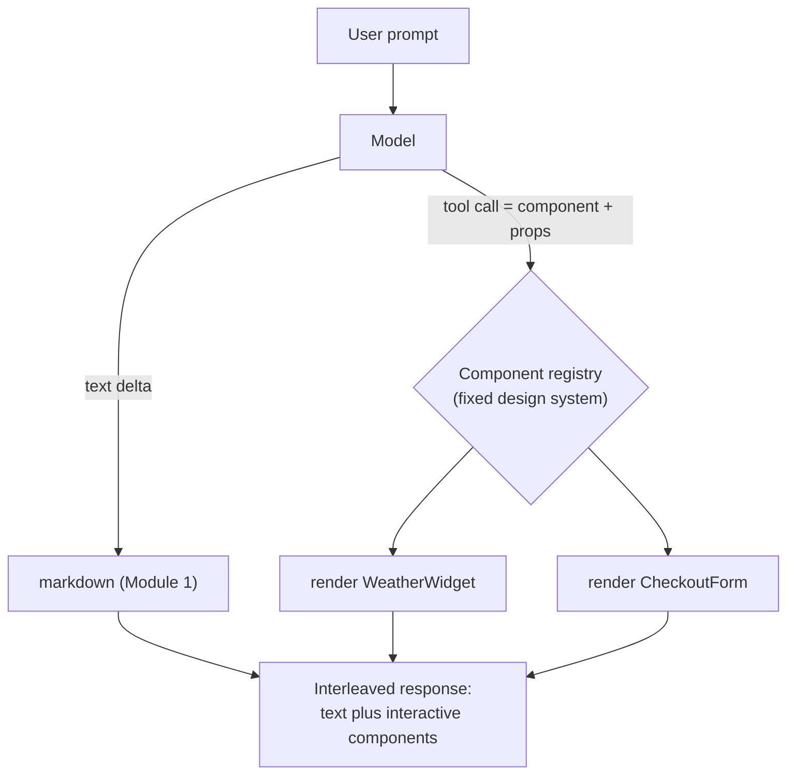
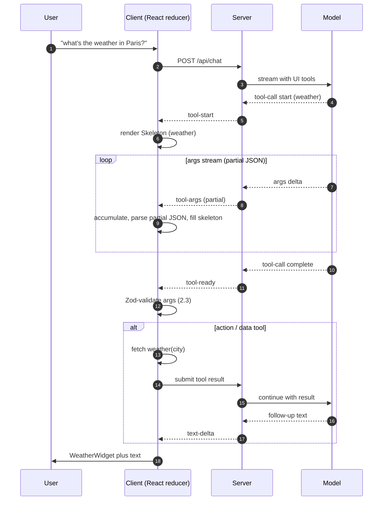
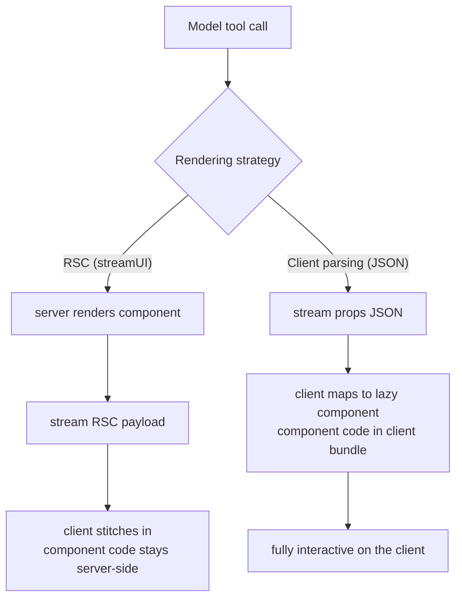

# Generative UI & Structured Client Actions

Module 1 made streamed text feel instant. This module argues that text is often
the wrong output entirely — and shows how to make a language model render real,
interactive React components instead. The mechanism is one you already know from
the Agentic course: **tool calls**. There, a tool call triggered a backend action;
here, it triggers a component. The model stops writing "it is 14 degrees and
rainy" and instead emits a structured call that the client turns into a live
`WeatherWidget`. Four parts:

- **The generative UI paradigm** — why chat is often the wrong UX, and how tool
  calls map to components.
- **Client-side tool interception** — catching a tool call mid-stream, rendering a
  skeleton, executing, and returning the result.
- **Designing for uncertainty** — Zod validation, graceful degradation, and undo,
  because the model *will* hallucinate props.
- **RSC vs. client parsing** — the two Next.js streaming patterns and their
  latency and bundle trade-offs.

---

## 2.1 — Beyond Text: The Generative UI Paradigm

Chat is a powerful default and often the wrong one. Text is a one-dimensional
channel, and many tasks are not one-dimensional. "It is 14 degrees and rainy in
Paris" is strictly worse than a weather card with an icon, an hourly strip, and a
tap-to-expand forecast. "Your order totals 48 dollars for three items" is worse
than an interactive checkout with editable quantities. Forcing structured,
interactive tasks through prose strips the affordances — you cannot click a
paragraph, you re-type to refine it, and data-dense answers become ASCII tables.

**Generative UI** inverts this: the model decides *what* to show, the app decides
*how* to render it. Instead of prose, the model emits a structured signal — a tool
call — that the client maps to a component. This is function calling (Agentic
course, Module 2) pointed at your design system: **the model's "tools" are your UI
components, and each tool's schema is that component's props.** A `weather` tool
with `{ city, tempC, condition }` becomes `WeatherWidget` with those props. The
model composes an interface from a *fixed registry* of components — it never
invents arbitrary React, which is both the safety guarantee and the constraint.



Responses interleave both: markdown paragraphs *and* components in one stream, the
model choosing per-turn. The registry ties a tool name to a Zod props schema and a
React component; the tool definitions handed to the model are *derived* from those
schemas, so there is one source of truth.

```tsx
import { z } from "zod";

// One registry entry per generative component: a props schema + the component.
export const registry = {
  weather: {
    schema: z.object({
      city: z.string(),
      tempC: z.number().min(-90).max(60),          // sanity bounds guard hallucination
      condition: z.enum(["clear", "cloudy", "rain", "snow"]),
    }),
    Component: WeatherWidget,
  },
  checkout: {
    schema: z.object({
      items: z.array(z.object({ sku: z.string(), qty: z.number().int().positive() })),
      total: z.number().nonnegative(),
    }),
    Component: CheckoutForm,
    destructive: true,                              // needs confirm / undo (2.3)
  },
} as const;

// The model's tools ARE the components: derive tool defs from the same schemas.
export const uiTools = Object.entries(registry).map(([name, { schema }]) => ({
  name,
  description: `Render the ${name} UI component`,
  parameters: schema,                              // zodToJsonSchema at the API boundary
}));
```

| | Plain text / markdown | Generative UI |
| --- | --- | --- |
| Affordances | Read-only prose | Clickable, editable components |
| Data density | ASCII tables, lists | Charts, cards, forms |
| Refinement | Re-prompt in text | Direct manipulation of the widget |
| Model freedom | Any prose | Composes a fixed component registry |
| Best for | Explanation, reasoning | Structured data, actions, forms |

Text is still right for explanations; generative UI wins for structured data and
actions. The cost is real: you build and register every component, validate its
props, and handle the model choosing wrong — the next two sections.

---

## 2.2 — Client-Side Tool Interception

The stream from Module 1 now carries two kinds of part: **text deltas** and **tool
calls**. Modern APIs stream a tool call incrementally — the name arrives first,
then the arguments JSON streams token by token as *partial* JSON. The client's job
is to intercept each part and drive UI state through it.

The lifecycle: the moment the tool *name* is known, render a loading **skeleton**
for that component — you know it is a weather card before its args finish. As the
arguments stream, accumulate and progressively parse the partial JSON (the JSON
analog of Module 1's markdown-in-flight) so the skeleton can start filling. When
the args complete, validate them (2.3) and render the real component. If the tool
represents an **action** rather than pure display, execute it — fetch data, run a
mutation — and submit the result back to the model so it can continue (the agentic
tool loop from Module 2, now rendering UI).



Model this in the client with a **reducer** over an array of message parts. Each
tool part carries a status (`partial`, `ready`, `result`, `error`) that the UI
maps to a skeleton, a live component, or a fallback.

```tsx
type Part =
  | { kind: "text"; text: string }
  | { kind: "tool"; id: string; name: string; args: unknown;
      status: "partial" | "ready" | "result" | "error"; result?: unknown };

type Action =
  | { type: "text-delta"; text: string }
  | { type: "tool-start"; id: string; name: string }
  | { type: "tool-args"; id: string; args: unknown }   // progressive partial JSON
  | { type: "tool-ready"; id: string; args: unknown }
  | { type: "tool-result"; id: string; result: unknown }
  | { type: "tool-error"; id: string };

function partsReducer(parts: Part[], a: Action): Part[] {
  const patch = (id: string, next: Partial<Part>) =>
    parts.map((p) => (p.kind === "tool" && p.id === id ? { ...p, ...next } as Part : p));
  switch (a.type) {
    case "text-delta": {
      const last = parts[parts.length - 1];
      if (last?.kind === "text")
        return [...parts.slice(0, -1), { ...last, text: last.text + a.text }];
      return [...parts, { kind: "text", text: a.text }];
    }
    case "tool-start":  return [...parts, { kind: "tool", id: a.id, name: a.name, args: {}, status: "partial" }];
    case "tool-args":   return patch(a.id, { args: a.args });                 // skeleton fills in
    case "tool-ready":  return patch(a.id, { args: a.args, status: "ready" });
    case "tool-result": return patch(a.id, { status: "result", result: a.result });
    case "tool-error":  return patch(a.id, { status: "error" });
  }
}
```

Feed the reducer from the stream reader (Module 1's `fetch` + `ReadableStream`),
parsing partial JSON so args render before they are complete:

```tsx
import { parse as parsePartialJson } from "partial-json"; // tolerant of incomplete JSON

function consume(part: StreamPart, dispatch: React.Dispatch<Action>) {
  if (part.type === "text-delta") return dispatch({ type: "text-delta", text: part.text });
  if (part.type === "tool-call-start") return dispatch({ type: "tool-start", id: part.id, name: part.name });
  if (part.type === "tool-call-delta") {                 // args JSON still streaming
    const args = parsePartialJson(part.argsTextSoFar);   // e.g. {"city":"Par -> {city:"Par"}
    return dispatch({ type: "tool-args", id: part.id, args });
  }
  if (part.type === "tool-call-end") return dispatch({ type: "tool-ready", id: part.id, args: part.args });
}
```

| Tool flavor | Model provides | Client does | Round-trip to model? |
| --- | --- | --- | --- |
| Display-only | All props (`city, tempC, condition`) | Render the component | No |
| Action / data-fetch | Args (`city`) | Execute (fetch/mutate), render result | Yes — result goes back |

---

## 2.3 — Designing for Uncertainty & Error States

The model is probabilistic, so it *will* eventually emit bad props — a hallucinated
`condition: "acid-rain"` outside the enum, `tempC: 9000`, a missing required field,
or a `city: "Atlantis"`. Even with structured outputs constraining types and enums
(Course 1), semantic invalidity slips through (Agentic Module 2: well-formed but
wrong). A generative UI that trusts the model renders broken components or performs
unwanted actions. Three defenses are mandatory.

**1. Runtime prop validation (Zod).** Never pass model args straight into a
component. Validate against the registry schema at the interception boundary with
`safeParse`; on failure, do not render the component. Range and enum bounds in the
schema (2.1) catch the plausible-but-absurd values a strict type check misses.

**2. Graceful degradation to text.** When props are invalid, or the component
throws during render, fall back to a safe text summary — never a blank screen or a
crash. Wrap every generative component in an **error boundary** whose fallback is
prose. A hallucinated component degrades into a sentence, and the conversation
continues.

```tsx
function GenerativePart({ part }: { part: ToolPart }) {
  const entry = registry[part.name as keyof typeof registry];
  if (!entry) return <TextFallback>Unsupported component: {part.name}</TextFallback>;
  if (part.status === "partial") return <Skeleton kind={part.name} />;   // still streaming

  const parsed = entry.schema.safeParse(part.args);       // NEVER trust model args
  if (!parsed.success) return <TextFallback>{summarize(part)}</TextFallback>; // degrade

  return (
    <GenerativeErrorBoundary fallback={<TextFallback>{summarize(part)}</TextFallback>}>
      <entry.Component {...parsed.data} />                 // typed, validated props
    </GenerativeErrorBoundary>
  );
}

class GenerativeErrorBoundary extends React.Component<
  { fallback: React.ReactNode; children: React.ReactNode }, { failed: boolean }
> {
  state = { failed: false };
  static getDerivedStateFromError() { return { failed: true }; }   // a render throw -> text
  render() { return this.state.failed ? this.props.fallback : this.props.children; }
}
```

**3. Undo for destructive actions.** When a tool triggers something irreversible —
placing an order, sending an email, deleting — do not execute silently on the
model's say-so. For truly irreversible actions, gate on explicit confirmation (the
HITL pattern from Agentic Module 4: render a confirm UI, execute on click). For
reversible-enough actions, apply optimistically but expose a prominent **undo**
window before committing, the way Gmail delays a send.

```tsx
// Optimistic destructive action with an undo window before the point of no return.
function useUndoableAction<T>(commit: (p: T) => void, finalize: (p: T) => Promise<void>,
                             revert: (p: T) => void, windowMs = 5000) {
  const [pending, setPending] = useState<{ payload: T; timer: number } | null>(null);
  const run = (payload: T) => {
    commit(payload);                                   // optimistic UI update now
    const timer = window.setTimeout(async () => { await finalize(payload); setPending(null); }, windowMs);
    setPending({ payload, timer });                    // ...but hold the real mutation
  };
  const undo = () => { if (!pending) return; clearTimeout(pending.timer); revert(pending.payload); setPending(null); };
  return { run, undo, pending };
}
```

| Failure mode | Symptom | Defense |
| --- | --- | --- |
| Hallucinated / out-of-range prop | Absurd or invalid values | Zod `safeParse` with bounds; degrade on failure |
| Component throws on render | White screen | Error boundary with text fallback |
| Wrong destructive action | Unwanted order / delete / send | Confirm gate (irreversible) or optimistic + undo |
| Unknown component name | Missing from registry | Text fallback for unregistered tools |

You are defending against your own AI: every generative component needs schema
validation, an error boundary, a text fallback, and — if it acts — a confirm or an
undo. That is the tax of putting a probabilistic model in charge of the interface.

---

## 2.4 — Streaming UI via RSC vs. Client Parsing

Next.js gives two dominant patterns for streaming generative UI, and they differ in
*where the component renders*.

**Pattern A — Streaming React Server Components.** The server runs the component
and streams a serialized RSC payload; the client stitches it into the tree without
holding the component's code. The Vercel AI SDK's `streamUI` (from `ai/rsc`) maps a
tool call to a server generator that yields JSX — a skeleton first, then the
data-loaded component.

```tsx
// Pattern A — RSC: the server renders and streams the component (ai/rsc).
import { streamUI } from "ai/rsc";

const result = await streamUI({
  model, prompt,
  tools: {
    weather: {
      parameters: weatherSchema,
      generate: async function* ({ city }) {
        yield <WeatherSkeleton />;                 // stream a loading RSC immediately
        const data = await getWeather(city);       // server-side fetch: DB / secrets OK here
        return <WeatherWidget {...data} />;        // final RSC streamed to the client
      },
    },
  },
});
```

**Pattern B — Streaming raw JSON, mapped on the client.** The server streams
structured JSON (tool name plus props) — not rendered UI — and the client maps it to
a component from a lazy-loaded registry (2.1). This is the `useChat` tool-invocation
approach.

```tsx
// Pattern B — client parsing: stream props JSON, map to a code-split component.
import dynamic from "next/dynamic";

const Lazy = {
  weather: dynamic(() => import("./WeatherWidget")),   // one chunk per component
  checkout: dynamic(() => import("./CheckoutForm")),
} as const;

function renderPart(part: ToolPart) {
  const parsed = registry[part.name].schema.safeParse(part.args);   // validate (2.3)
  if (!parsed.success) return <TextFallback>{summarize(part)}</TextFallback>;
  const C = Lazy[part.name as keyof typeof Lazy];
  return <C {...parsed.data} />;                        // fully interactive client component
}
```



The trade-offs are concrete. **Bundle size:** RSC keeps component code and heavy
deps off the client — a win when components are many or heavy; JSON+client ships
every possible component to the browser, mitigated by per-component `dynamic`
imports. **Latency:** JSON+client streams tiny props (low bandwidth, instant paint
for simple components) but may need a client round-trip to fetch data; RSC renders
data-bound components on the server with no client fetch, at the cost of a heavier
per-update payload. **Interactivity:** client components are interactive by default;
RSC needs nested `"use client"` islands for interactivity. **Coupling:** JSON is
portable and framework-agnostic; RSC ties you to the React/Next App Router runtime.

| | RSC streaming (`ai/rsc`) | Client JSON parsing (`useChat`) |
| --- | --- | --- |
| Renders where | Server | Client |
| Client bundle | Component code stays server-side | Ships all components (code-split) |
| Data fetching | Inline, server-side (no round-trip) | Client round-trip or separate call |
| Interactivity | Needs `"use client"` islands | Native, fully interactive |
| Payload per update | Heavier (RSC wire format) | Light (props JSON) |
| Coupling | Tied to Next App Router / RSC | Portable, framework-agnostic |
| Best for | Many/heavy, server-data-bound components | Interactive, portable, simple UIs |

Reach for **RSC** when components are numerous, heavy, and bound to server data and
you are all-in on the App Router. Reach for **client JSON parsing** when you want
portability, rich client interactivity, and bundle control via lazy loading — the
simpler, more flexible default that most production apps start with.

---

## Recap

- **Generative UI** turns tool calls into components: the model's tools are your
  design-system components, each tool's schema is that component's props, and the
  model composes a fixed registry rather than inventing UI. Interleave text and
  components in one stream; use text for explanation, components for structured data
  and actions.
- **Intercept tool calls in flight** with a client reducer over message parts. Render
  a skeleton the moment the tool name is known, accumulate and partial-parse the
  streaming args JSON to fill it, then validate and render. Action tools execute and
  submit their result back to the model — the agentic loop rendering UI.
- **Defend against the model.** Validate every tool's args with Zod `safeParse` plus
  range/enum bounds, wrap each component in an error boundary that degrades to a text
  fallback, and gate destructive actions behind confirmation or an optimistic-plus-undo
  window. Validation, boundary, fallback, and confirm/undo are non-negotiable.
- **RSC vs. client parsing** is a where-it-renders choice: RSC keeps component code
  and data fetching on the server (smaller bundle, no client round-trip, heavier
  payload, App-Router-coupled); client JSON parsing ships lightweight props and
  renders fully-interactive client components (portable, simple, bundle managed by
  code-splitting). Most apps start with client parsing and adopt RSC for heavy
  server-data-bound UIs.

## Exercises

1. **Build a two-component registry.** Define Zod schemas and React components for a
   `weather` card and a `stockChart`, derive the model's tool definitions from the
   schemas, and confirm one source of truth by changing a schema and watching the
   tool definition change.

2. **Stream a skeleton to a widget.** Wire the parts reducer and partial-JSON parser
   so a `weather` tool renders a skeleton on `tool-start`, fills the city as the args
   stream, and swaps to the live component on `tool-ready`. Verify no flicker and no
   render before validation.

3. **Make it hallucinate, then survive it.** Feed the `GenerativePart` renderer tool
   args with an out-of-range `tempC` and an invalid `condition`. Confirm it degrades
   to a text fallback rather than rendering a broken card or throwing. Then force a
   render-time throw and confirm the error boundary catches it.

4. **Undo a destructive action.** Implement a `checkout` component whose confirm
   triggers `useUndoableAction`. Show that the order appears optimistically, an undo
   button reverts it within the window, and the real mutation only fires after the
   window closes.

## Next: Module 3 — Client-Side State, Optimistic Updates & Sync

Generative components raise a harder question: where does their state live, and how
does it stay consistent? Module 3 tackles the client-state problem — optimistic
updates and rollback, reconciling streamed AI actions with server truth, caching and
invalidation for AI-driven mutations, and keeping a multi-component, multi-turn UI
coherent when both the user and the model are changing state at once.
