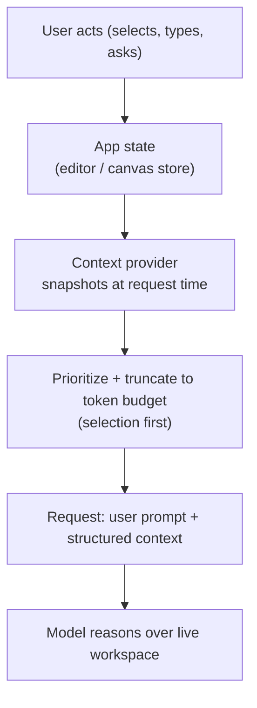
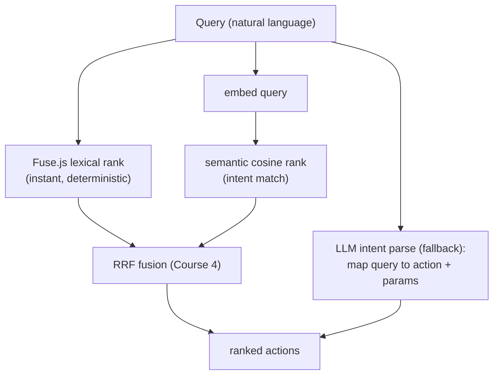
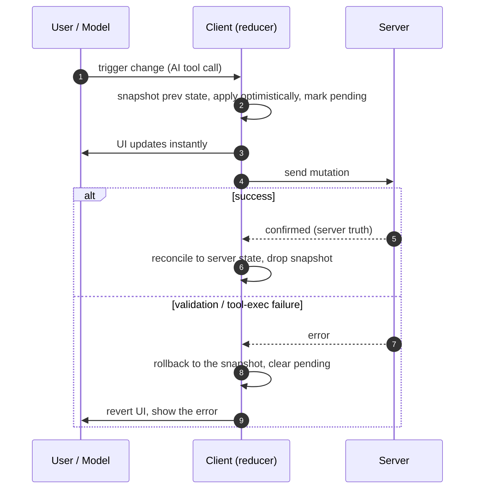

# AI-First UX Patterns & Frontend State Management

The last two modules made AI output *render* well — streamed text, generative
components. This module is about the *interaction* patterns that make an AI feel
native to an application rather than bolted on as a chat box, and the client-state
machinery underneath them. Four patterns, each with the frontend engineering that
makes it real:

- **The copilot pattern** — AI beside the workspace, with the app's state synced
  into context automatically.
- **Inline autocomplete & ghost text** — debouncing, aborting stale requests, and a
  non-interfering overlay.
- **AI command palettes** — fusing deterministic fuzzy search with semantic vector
  search.
- **Optimistic updates** — applying AI actions instantly and rolling back safely.

Everything is React, Next.js, and TypeScript.

---

## 3.1 — The Copilot Pattern (Side-by-Side Context)

A standalone chatbot forces the user to copy-paste: to ask about their code, they
select it, copy it, switch to the chat, paste it, and type the question. That
friction is why the winning pattern is the **copilot** — AI docked *beside* the
workspace (a code editor, a canvas, a document) that already knows what the user is
looking at. Cursor, Copilot Chat, and Notion AI all work this way: you select
something, ask "fix this," and the AI already knows what "this" is.

The mechanism is **implicit context injection**: on every request, the frontend
snapshots the relevant application state and includes it in the prompt, so the user
never has to describe or paste it. What you sync, in priority order:

| Context source | Relevance | Token cost | Include when |
| --- | --- | --- | --- |
| Current selection | Highest | Low | Always (it is what "this" means) |
| Visible viewport | High | Medium | Selection is empty or small |
| Active file / doc | Medium | High | Room in the budget |
| Project / file tree | Low | Very high | Retrieve a slice (RAG), never whole |



Two rules keep this correct. **Snapshot at request time** so the context reflects
the moment of asking, not a stale earlier state; and send it **structured** (file
path, language, selection range, surrounding text) so the model can reason
precisely instead of guessing from a blob. For large workspaces you cannot send
everything — budget tokens and, past a threshold, retrieve the relevant slice with
the RAG techniques from Course 2 rather than dumping the whole project.

```tsx
// Snapshot the workspace into structured context — read from your existing store.
function useWorkspaceContext() {
  const editor = useEditorStore();                 // Zustand/Redux/editor ref
  return useCallback(() => ({
    filePath: editor.activeFile,
    language: editor.language,
    selection: editor.getSelectedText(),           // highest-priority context
    visible: editor.getVisibleText(),              // viewport window, NOT the whole file
  }), [editor]);
}

// Assemble within a token budget: include by priority until the budget is spent.
function buildContext(ctx: WorkspaceContext, tokenBudget = 4000): string {
  const parts = [
    `File: ${ctx.filePath} (${ctx.language})`,
    ctx.selection && `Selected:\n${ctx.selection}`,
    ctx.visible && `Visible:\n${ctx.visible}`,
  ].filter(Boolean) as string[];
  let out = "", chars = 0;
  const charBudget = tokenBudget * 4;              // ~4 chars per token, rough
  for (const p of parts) {
    if (chars + p.length > charBudget) break;      // drop lowest-priority overflow
    out += `${p}\n\n`; chars += p.length;
  }
  return out;
}
```

> **Honest caveat.** You are shipping the user's workspace to a model — be explicit
> about it, let users scope what is shared, and never sweep in secrets (`.env`,
> credentials, files matched by `.gitignore`). Implicit context is a convenience
> that must not become silent exfiltration.

---

## 3.2 — Inline Autocomplete & Ghost Text

Ghost text is the gray inline suggestion that appears after the cursor as you type —
GitHub Copilot for code, Smart Compose for email. Accept with Tab, dismiss by
typing on. It looks simple and hides three frontend problems: firing too often,
racing responses, and rendering a suggestion that does not break the input.

**Debounce the keystrokes.** Requesting on every keystroke is spam — cost, load,
and a flood of races. Wait for a short pause (typically 150 to 500ms) before
firing.

**Abort stale requests with `AbortController`.** While a completion request is in
flight, the user keeps typing, and that response is now for *old* text. Abort the
previous request the instant the input changes, and ignore any response whose
controller has been aborted. Without this, a stale suggestion flashes in over text
it no longer matches (the cancellation pattern from Module 1, now load-bearing).

```tsx
function useGhostText(value: string, delay = 300): string {
  const [suggestion, setSuggestion] = useState("");
  const inflight = useRef<AbortController | null>(null);
  const timer = useRef<number | null>(null);

  useEffect(() => {
    setSuggestion("");                       // clear stale ghost the instant text changes
    if (timer.current) clearTimeout(timer.current);
    inflight.current?.abort();               // cancel the in-flight request — it's now stale

    if (!value.trim()) return;
    timer.current = window.setTimeout(async () => {   // debounce: fire only after a pause
      const ac = new AbortController();
      inflight.current = ac;
      try {
        const res = await fetch("/api/complete", {
          method: "POST",
          headers: { "Content-Type": "application/json" },
          body: JSON.stringify({ prefix: value }),
          signal: ac.signal,                 // makes this fetch abortable
        });
        const { completion } = await res.json();
        if (!ac.signal.aborted) setSuggestion(completion); // apply only if still current
      } catch (e) {
        if ((e as Error).name !== "AbortError") throw e;   // ignore intentional aborts
      }
    }, delay);

    return () => { if (timer.current) clearTimeout(timer.current); inflight.current?.abort(); };
  }, [value, delay]);

  return suggestion;
}
```

**Render a non-interfering overlay.** The ghost must appear inline after the caret
without being part of the editable text and without capturing any clicks or
selection. The technique is a **mirror**: an absolutely-positioned element behind a
transparent-background `textarea`, rendering the typed text (transparent, purely to
reserve the exact space) followed by the gray suggestion. `pointer-events: none` on
the mirror sends every interaction through to the real input beneath, and identical
text metrics make the ghost align perfectly after the cursor.

```tsx
function GhostTextArea({ value, onChange }: {
  value: string; onChange: (v: string) => void;
}) {
  const suggestion = useGhostText(value);
  const onKeyDown = (e: React.KeyboardEvent) => {
    if (e.key === "Tab" && suggestion) { e.preventDefault(); onChange(value + suggestion); }
  };
  return (
    <div className="ghost-wrap">
      <div className="ghost-mirror" aria-hidden>
        {value}
        <span className="ghost">{suggestion}</span>
      </div>
      <textarea
        className="ghost-input"
        value={value}
        onChange={(e) => onChange(e.target.value)}
        onKeyDown={onKeyDown}
      />
    </div>
  );
}
```

The CSS is where alignment lives — the mirror and the input must share every
text-affecting property, or the ghost drifts off the cursor:

```css
.ghost-wrap { position: relative; }

/* IDENTICAL text metrics so the ghost lands exactly where the caret is. */
.ghost-mirror,
.ghost-input {
  font: inherit;
  padding: 12px;
  line-height: 1.5;
  white-space: pre-wrap;   /* wrap like the textarea, preserve spaces */
  word-break: break-word;
  border: 0;
  margin: 0;
}

.ghost-mirror {
  position: absolute;
  inset: 0;
  pointer-events: none;    /* clicks and selection pass through to the textarea */
  color: transparent;      /* typed text is invisible here; it only reserves space */
}
.ghost-mirror .ghost { color: #71717a; }   /* the gray suggestion, the only visible part */

.ghost-input {
  position: relative;      /* sits above the mirror; its real text + caret show */
  background: transparent;  /* so the mirror's gray ghost shows through after the text */
  color: inherit;
  resize: none;
}
```

> **Honest caveat.** Pixel-perfect alignment means mirroring *every* text metric
> (font, padding, line-height, wrapping, and scroll offset for multi-line). It is
> fiddly enough that most teams reach for an editor framework (CodeMirror, Monaco,
> Lexical) that provides a decoration API. Ghost text also demands low TTFT
> (Module 1) and a small `max_tokens` — a laggy suggestion is worse than none.

---

## 3.3 — AI Command Palettes (CMD+K)

A traditional command palette is a fuzzy-searchable list of actions — type in a bar,
match command names, run the result. `Fuse.js` gives fast, typo-tolerant, fully
deterministic string matching, and it is excellent *when the user knows the command
name*. It fails on intent: "start something fresh" will not fuzzy-match "New File."

The AI upgrade is to run **two retrievers over the same action set** and fuse them —
which is exactly the hybrid dense-plus-sparse retrieval from Course 4, Module 3,
pointed at application actions instead of documents:

- **Lexical (`Fuse.js`)** — instant, deterministic string/keyword match. The sparse
  retriever.
- **Semantic (embeddings)** — embed each action's description once, embed the query,
  rank by cosine. Matches *intent*, not spelling. The dense retriever. The action
  set is small and fixed (dozens to hundreds), so precompute the embeddings and run
  brute-force cosine client-side — no vector database needed (Course 4, Module 1:
  brute force is fine at this scale).

Fuse the two ranked lists with Reciprocal Rank Fusion (Course 4), and show the
`Fuse.js` results instantly while the semantic results merge in when the query
embedding returns.



```tsx
import Fuse from "fuse.js";

type Action = { id: string; name: string; keywords: string; run: () => void };
const fuse = new Fuse<Action>(actions, { keys: ["name", "keywords"], threshold: 0.4 });

const dot = (a: number[], b: number[]) => a.reduce((s, x, i) => s + x * b[i]!, 0);

// Semantic rank over precomputed action embeddings (small fixed set, client-side).
function semanticRank(queryEmb: number[], embs: { id: string; emb: number[] }[]): string[] {
  return embs.map((a) => ({ id: a.id, score: dot(queryEmb, a.emb) }))   // unit vectors -> cosine
             .sort((a, b) => b.score - a.score).map((a) => a.id);
}

// Reciprocal Rank Fusion of lexical + semantic rankings (Course 4, Module 3).
function rrf(rankings: string[][], k = 60): string[] {
  const score = new Map<string, number>();
  for (const list of rankings)
    list.forEach((id, r) => score.set(id, (score.get(id) ?? 0) + 1 / (k + r + 1)));
  return [...score.entries()].sort((a, b) => b[1] - a[1]).map(([id]) => id);
}

function hybridPalette(query: string, queryEmb: number[] | null): string[] {
  const lexical = fuse.search(query).map((r) => r.item.id);   // instant
  if (!queryEmb) return lexical;                              // show lexical first
  return rrf([lexical, semanticRank(queryEmb, actionEmbs)]);  // merge semantic when ready
}
```

Beyond retrieval, a third tier maps a complex query to a structured **action plus
parameters** with an LLM tool call (Module 2): "email Sarah the Q3 report" resolves
to `send_email({ to: "Sarah", doc: "Q3 report" })`. Validate the mapped action with
the defensive patterns from Module 2 before running it.

| Tier | Matches by | Latency | Deterministic | Best for |
| --- | --- | --- | --- | --- |
| `Fuse.js` lexical | String / keyword | Instant | Yes | Known command names, typos |
| Semantic cosine | Intent (embeddings) | Query-embed latency | Yes (fixed embeddings) | Rephrased intent |
| LLM intent parse | Action + extracted params | Full round-trip | No | Complex, parameterized commands |

---

## 3.4 — Optimistic Updates & Client Sync

AI actions are slow: a tool call runs an LLM turn, a backend mutation, and
validation before the result comes back. If the UI waits for that round-trip, every
AI action feels sluggish. **Optimistic updates** apply the change to client state
*immediately*, then reconcile with the server — and because AI actions fail more
often than ordinary ones (hallucinated args rejected by validation, tool-execution
errors), **safe rollback is not an edge case here, it is the common path.**

The lifecycle: snapshot the current state, apply the change optimistically and mark
it pending, send the mutation. On success, reconcile to the server's authoritative
result (it may have normalized values); on failure, restore the exact snapshot and
surface the error.



Roll back by restoring a **snapshot**, never by inverting the delta — inverting is
fragile once other changes have landed. Save the exact prior state before applying,
keyed by a transaction id, and restore it verbatim on failure.

```tsx
type Entity = { id: string; value: string; status: "confirmed" | "pending" | "error" };
type State = { entities: Entity[]; snapshots: Record<string, Entity[]> };

type Action =
  | { type: "optimistic"; txId: string; apply: (e: Entity[]) => Entity[] }
  | { type: "confirm"; txId: string; server: Entity[] }
  | { type: "rollback"; txId: string };

function reducer(state: State, a: Action): State {
  switch (a.type) {
    case "optimistic":                                   // save prev, then apply
      return { entities: a.apply(state.entities),
               snapshots: { ...state.snapshots, [a.txId]: state.entities } };
    case "confirm": {                                    // reconcile to server truth
      const { [a.txId]: _done, ...rest } = state.snapshots;
      return { entities: a.server, snapshots: rest };
    }
    case "rollback": {                                   // restore the exact snapshot
      const prev = state.snapshots[a.txId] ?? state.entities;
      const { [a.txId]: _done, ...rest } = state.snapshots;
      return { entities: prev, snapshots: rest };
    }
  }
}

// Driver: apply now, await the mutation, reconcile or roll back.
async function runAiMutation(dispatch: React.Dispatch<Action>, txId: string,
                             apply: (e: Entity[]) => Entity[], mutate: () => Promise<Entity[]>) {
  dispatch({ type: "optimistic", txId, apply });         // instant UI
  try {
    const server = await mutate();                       // may reject: bad args / tool error
    dispatch({ type: "confirm", txId, server });
  } catch (err) {
    dispatch({ type: "rollback", txId });                // revert to snapshot
    toast.error(`Action failed: ${(err as Error).message}`);
  }
}
```

React and its ecosystem give this to you at higher levels too. **React 19 /
Next.js** ship `useOptimistic`, which applies an optimistic value and auto-reverts
when the underlying server state resolves without it:

```tsx
const [view, addOptimistic] = useOptimistic(
  serverState,
  (state, change: Change) => applyChange(state, change),
);
// inside a transition/server action: addOptimistic(change); await mutate();
// if the action throws or the resolved serverState lacks the change, React reverts.
```

**React Query / SWR** encode the same lifecycle as `onMutate` (snapshot + optimistic
write), `onError` (rollback from the snapshot), and `onSettled` (refetch to
reconcile) — the canonical library pattern when a cache, not a local reducer, owns
the state.

| Approach | Rollback mechanism | Reconciliation | Reach for it when |
| --- | --- | --- | --- |
| Manual reducer | Restore snapshot by `txId` | `confirm` swaps to server truth | Local, multi-entity, custom flows |
| `useOptimistic` | Auto-revert on resolve | Underlying server state | Form/server-action mutations |
| React Query `onMutate` | `onError` restores snapshot | `onSettled` refetch | A query cache owns the data |

> **Honest caveat.** The user and the model can mutate the same state at once, so a
> reducer must resolve concurrent transactions deterministically (last-write-wins,
> or merge) rather than assuming one change is in flight. The server stays
> authoritative — optimistic state is a *prediction*, and `confirm` must replace it
> with truth, not merely mark it done.

---

## Recap

- **The copilot pattern** eliminates copy-paste by snapshotting workspace state —
  selection first, then viewport, then file — into structured context at request
  time, within a token budget, retrieving a slice for large projects. Never sweep in
  secrets.
- **Ghost text** needs three things: **debounce** keystrokes so you request on a
  pause, **`AbortController`** to cancel stale in-flight requests and ignore aborted
  responses, and a **`pointer-events: none` mirror overlay** with identical text
  metrics so the gray suggestion aligns after the caret without capturing input.
- **AI command palettes** fuse deterministic `Fuse.js` lexical search with semantic
  cosine over precomputed action embeddings via RRF — the Course 4 hybrid recipe on
  actions — showing lexical instantly and merging semantic when ready, with an
  optional LLM tier that maps complex queries to validated action-plus-params calls.
- **Optimistic updates** apply AI actions instantly, snapshot the prior state keyed
  by transaction id, then reconcile to server truth on success or **restore the
  snapshot** (never invert the delta) on failure — with `useOptimistic`, React Query
  `onMutate`/`onError`/`onSettled`, or a manual reducer, and a deterministic rule for
  concurrent user-and-model edits.

## Exercises

1. **Sync a selection.** Build a two-pane editor + AI panel. On each request, inject
   the current selection and visible text as structured context and confirm the model
   resolves "explain this" with no paste. Then add a token budget and verify the
   lowest-priority context is dropped first.

2. **Race the ghost.** Wire `useGhostText` and type quickly. Log every request and
   its abort. Confirm that only the latest request's response is ever applied, and
   that removing the `AbortController` makes stale suggestions flash in.

3. **Beat fuzzy search.** Build a palette of 30 actions with `Fuse.js` plus
   precomputed embeddings. Find three queries where lexical fails but semantic
   succeeds, then confirm RRF fusion returns the right action at the top for all of
   them.

4. **Roll it back.** Implement the optimistic reducer for an AI "rename" action. Make
   the mutation reject for an invalid name and confirm the UI reverts to the exact
   snapshot with an error toast — then make it succeed with a server-normalized value
   and confirm the UI reconciles to the server's version, not the optimistic one.

## Next: Module 4 — Trust, Feedback Loops & Production Evaluation

A fast, native-feeling AI UI still has to earn trust and prove it works. The finale
covers the product-layer concerns that keep an AI feature alive in production:
capturing feedback signal (thumbs, edits, acceptance rates) and turning it into
evaluation, surfacing confidence and citations, guardrails and moderation at the UI
boundary, and the cost and latency budgets that decide what actually ships.
