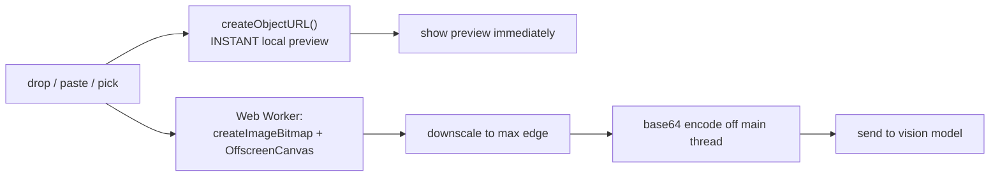
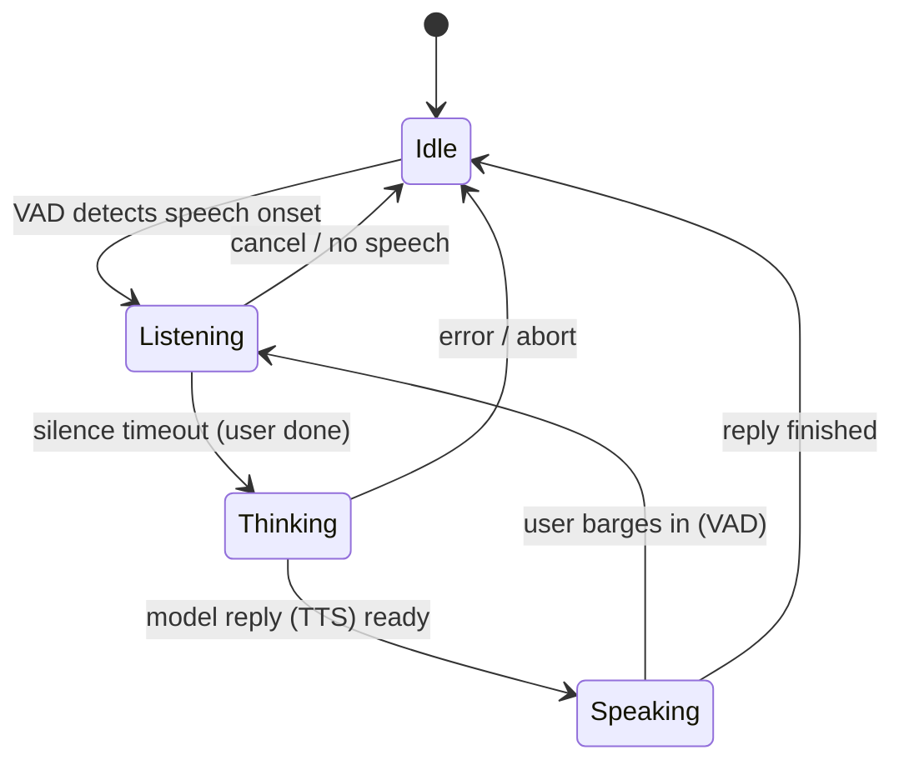
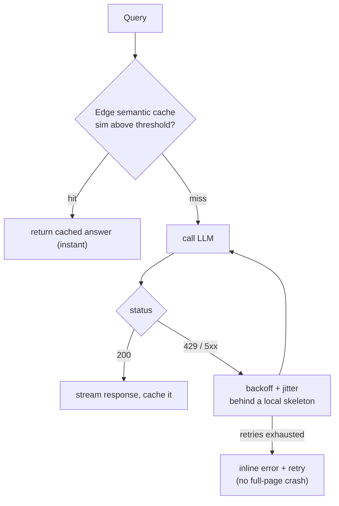

# Multimodal UI, Voice & Telemetry Feedback Loops

The course closes where product meets the messy real world: images and voice as
inputs, the feedback loop that makes the product improve, and the resiliency that
keeps it standing when the backend is slow, rate-limited, or down. Four parts, all
React, Next.js, and TypeScript:

- **Multimodal file UX** — drag-and-drop, instant local previews, off-thread encoding.
- **Real-time voice & VAD** — hands-free turn-taking and a waveform state machine.
- **Feedback & telemetry** — the data flywheel, sent reliably with `sendBeacon`.
- **Edge caching & resiliency** — semantic caching and graceful 429 handling.

---

## 4.1 — Multimodal File UX (Vision & Docs)

Vision models take images, so the UI needs to accept them from anywhere — a
drag-and-drop, a pasted screenshot, a file picker — preview them instantly, and
encode them for the API without janking. Three mechanics matter.

**Accept from everywhere.** Handle `onDragOver` (call `preventDefault` or the drop
is rejected), `onDrop` reading `e.dataTransfer.files`, and `onPaste` reading
`e.clipboardData.files` — pasting a screenshot is the single highest-value image
input. Keep a hidden `<input type="file">` as the click fallback.

**Instant local preview with `URL.createObjectURL()`.** Do not wait for upload or
encoding to show the image. The moment a file arrives, `URL.createObjectURL(file)`
returns a `blob:` URL you can drop straight into an `` `src` — an optimistic
preview (the Module 3 pattern, applied to files) that appears immediately. The
catch: object URLs pin the blob in memory until you call `URL.revokeObjectURL()`,
so revoke on remove and on unmount or you leak memory.

**Encode off the main thread.** Vision APIs usually want base64, and base64 of a
full-resolution photo is large and inflates the payload by a third. Downscale
*first* — vision models rarely need more than ~1024px on the long edge (Course 4
covered the resolution-versus-token tradeoff) — and do the decode, resize, and
encode inside a **Web Worker** with `createImageBitmap` and `OffscreenCanvas` so a
big image never blocks the UI thread.



```tsx
type Attachment = { id: string; file: File; previewUrl: string };

function useImageAttachments() {
  const [items, setItems] = useState<Attachment[]>([]);

  const add = useCallback((files: FileList | File[]) => {
    const next = Array.from(files)
      .filter((f) => f.type.startsWith("image/") && f.size < 20 * 1024 * 1024) // type + size guard
      .map((file) => ({ id: crypto.randomUUID(), file,
                        previewUrl: URL.createObjectURL(file) }));  // INSTANT preview
    setItems((prev) => [...prev, ...next]);
  }, []);

  const remove = useCallback((id: string) => {
    setItems((prev) => {
      const gone = prev.find((i) => i.id === id);
      if (gone) URL.revokeObjectURL(gone.previewUrl);   // free the blob or it leaks
      return prev.filter((i) => i.id !== id);
    });
  }, []);

  useEffect(() => () => { items.forEach((i) => URL.revokeObjectURL(i.previewUrl)); }, []); // unmount
  return { items, add, remove };
}
```

```tsx
// Resize + encode OFF the main thread (run inside a Web Worker) so a large image
// never freezes the UI. createImageBitmap and OffscreenCanvas both work in workers.
async function encodeForVision(file: File, maxEdge = 1024): Promise<string> {
  const bitmap = await createImageBitmap(file);              // decode without the DOM
  const scale = Math.min(1, maxEdge / Math.max(bitmap.width, bitmap.height));
  const canvas = new OffscreenCanvas(bitmap.width * scale, bitmap.height * scale);
  canvas.getContext("2d")!.drawImage(bitmap, 0, 0, canvas.width, canvas.height);
  const blob = await canvas.convertToBlob({ type: "image/jpeg", quality: 0.85 });
  const bytes = new Uint8Array(await blob.arrayBuffer());
  let bin = "";
  for (const b of bytes) bin += String.fromCharCode(b);      // chunk-safe for the downscaled size
  return btoa(bin);                                          // base64 for the vision API
}
```

| Concern | Wrong way | Right way |
| --- | --- | --- |
| Preview latency | Wait for upload/encode | `createObjectURL` — instant `blob:` URL |
| Memory | Keep object URLs forever | `revokeObjectURL` on remove + unmount |
| Payload size | Send full-resolution base64 | Downscale to ~1024px, JPEG quality ~0.85 |
| Main-thread freeze | Resize/encode inline | `OffscreenCanvas` in a Web Worker |

> **Honest caveat.** For many or very large images, base64 in the request bloats
> tokens and latency — upload to object storage and pass a URL (or use a Files API)
> instead. And never inline a full-res image "just in case"; the tokens are real.

---

## 4.2 — Real-Time Voice UI & VAD

Voice flips the interaction model. Push-to-talk (hold a button to speak) is a
crutch; natural conversation needs **Voice Activity Detection (VAD)** — the system
listens continuously, detects when the user *starts* speaking, and detects when
they *stop* (a sustained silence marks end-of-turn). VAD replaces the button and
enables barge-in: the user can interrupt the AI by simply speaking.

VAD runs client-side over the WebAudio graph. A simple energy threshold (RMS
amplitude above a cutoff equals speech) is easy to reason about; production uses an
ML model (Silero VAD via ONNX/WASM) for noise robustness. Either way, the output
drives a **state machine**.



Each state must be *visible*, because voice has no text to read — the animation is
the affordance telling the user what is happening. **Listening**: a live waveform
reacting to the mic amplitude. **Thinking**: a pulsing loader while STT, the LLM,
and TTS run. **Speaking**: a waveform driven by the TTS output. Read the amplitude
from a WebAudio `AnalyserNode` and draw it on a `<canvas>` in a
`requestAnimationFrame` loop (Module 1's rAF).

The stream lifecycle is where bugs hide: acquire the mic with `getUserMedia`, wire
an `AudioContext` and `AnalyserNode`, and — critically — **release the mic on
teardown** by stopping every track, or the browser's recording indicator stays on.
Real-time bidirectional audio (mic up while TTS streams down) is the WebSockets /
WebRTC case from Module 1; low-latency voice agents use WebRTC.

```tsx
type VoiceState = "idle" | "listening" | "thinking" | "speaking";

function useVoiceSession() {
  const [state, setState] = useState<VoiceState>("idle");
  const stream = useRef<MediaStream | null>(null);
  const ctx = useRef<AudioContext | null>(null);
  const raf = useRef<number | null>(null);

  const start = useCallback(async () => {
    stream.current = await navigator.mediaDevices.getUserMedia({
      audio: { echoCancellation: true, noiseSuppression: true }, // don't hear our own TTS
    });
    const audio = new AudioContext();
    ctx.current = audio;
    const analyser = audio.createAnalyser();
    analyser.fftSize = 512;
    audio.createMediaStreamSource(stream.current).connect(analyser);
    setState("listening");
    monitor(analyser, () => setState("listening"), () => setState("thinking")); // VAD + waveform
  }, []);

  const stop = useCallback(() => {
    if (raf.current) cancelAnimationFrame(raf.current);
    stream.current?.getTracks().forEach((t) => t.stop());   // release mic -> indicator off
    ctx.current?.close();
    setState("idle");
  }, []);

  useEffect(() => () => stop(), [stop]);   // never leak the mic on unmount
  return { state, start, stop };
}
```

```tsx
// Energy-based VAD + canvas waveform in one rAF loop. Real apps swap the RMS
// threshold for an ML VAD (Silero via ONNX/WASM); the state transitions are the same.
function monitor(analyser: AnalyserNode, onSpeech: () => void, onSilence: () => void) {
  const buf = new Uint8Array(analyser.fftSize);
  let silenceMs = 0, last = performance.now();
  const loop = () => {
    analyser.getByteTimeDomainData(buf);
    const rms = Math.sqrt(buf.reduce((s, v) => s + (v - 128) ** 2, 0) / buf.length);
    const now = performance.now(); silenceMs = rms > 6 ? 0 : silenceMs + (now - last); last = now;
    if (rms > 6) onSpeech();                     // speaking
    else if (silenceMs > 800) onSilence();       // ~0.8s of silence = end of turn
    drawWaveform(buf);                           // render bars on the <canvas>
    requestAnimationFrame(loop);
  };
  requestAnimationFrame(loop);
}
```

> **Honest caveat.** Voice is hard: VAD false-triggers on background noise,
> endpointing is a judgment call (too eager cuts the user off, too slow feels
> laggy), the STT-to-LLM-to-TTS pipeline must finish in well under a second, and
> echo cancellation must stop the mic from hearing the TTS. Managed stacks (LiveKit,
> the OpenAI Realtime API) exist because the raw WebRTC plumbing is a lot.

---

## 4.3 — The UX of Feedback & Telemetry

An AI product improves through a **data flywheel**: interactions become telemetry,
telemetry becomes evaluation signal (Course 1) and fine-tuning data (Course 4), and
a better model drives more use. The UI is where that signal is captured, and it
comes in two grades.

**Explicit feedback** is deliberate — thumbs up/down, a report button, an edited
correction. It is a clean label but *low volume and biased* (people rate when
delighted or furious). **Implicit feedback** is inferred from behavior, and it is
the gold mine: high-volume and honest. The user **copies** the answer (it was
useful), **accepts** a ghost-text suggestion (Module 3 — acceptance rate is
Copilot's north-star metric), **applies** a generated action (Module 2), or
**regenerates** (a negative signal). Behavior does not lie the way a survey does.

| | Explicit | Implicit |
| --- | --- | --- |
| Source | Thumbs, ratings, reports, edits | Copy, accept, apply, regenerate, dwell |
| Volume | Low (most users skip it) | High (every interaction) |
| Signal | Clean label | Inferred, needs interpretation |
| Bias | Skewed to extremes | Representative of real use |

Send it with **`navigator.sendBeacon()`**, not `fetch`. Telemetry often fires
exactly as the user navigates away or closes the tab, and a normal `fetch` in flight
is *cancelled* when the page tears down — losing the data. `sendBeacon` queues the
request in the browser, is guaranteed to send during unload, never blocks the UI,
and never delays navigation. It is POST-only, small-payload, and returns nothing —
perfect for fire-and-forget telemetry. Flush the batch on `visibilitychange` to
hidden and on `pagehide`, the reliable "about to leave" hooks.

```tsx
type TelemetryEvent = { type: string; ts: number; data?: Record<string, unknown> };

function useTelemetry() {
  const queue = useRef<TelemetryEvent[]>([]);

  const flush = useCallback(() => {
    if (queue.current.length === 0) return;
    const body = new Blob([JSON.stringify(queue.current)], { type: "application/json" });
    // Queued by the browser, survives navigation/unload, never blocks the UI thread.
    if (navigator.sendBeacon("/api/telemetry", body)) queue.current = [];
  }, []);

  const track = useCallback((type: string, data?: Record<string, unknown>) => {
    queue.current.push({ type, ts: Date.now(), data });
    if (queue.current.length >= 20) flush();     // batch small events
  }, [flush]);

  useEffect(() => {
    const onHide = () => { if (document.visibilityState === "hidden") flush(); };
    document.addEventListener("visibilitychange", onHide);
    window.addEventListener("pagehide", flush);  // the reliable unload-time flush
    return () => {
      document.removeEventListener("visibilitychange", onHide);
      window.removeEventListener("pagehide", flush);
      flush();
    };
  }, [flush]);

  return track;
}
```

```tsx
// Instrument implicit signals — the highest-volume, least-biased data you have.
function AssistantMessage({ id, content, track }: MessageProps) {
  return (
    <div onCopy={() => track("response_copied", { id })}>        {/* copy = useful */}
      <StreamingMarkdown text={content} />
      <button onClick={() => track("feedback", { id, rating: "up" })}>good</button>
      <button onClick={() => track("regenerated", { id })}>retry</button>  {/* implicit negative */}
    </div>
  );
}
```

> **Honest caveat.** Telemetry is user data — respect consent, anonymize, and honor
> privacy regulation. Do not over-collect, and interpret implicit signals carefully
> (a copy is not *always* approval). The flywheel is powerful precisely because it
> is behavioral; that is also why it demands care.

---

## 4.4 — Edge Caching & Resiliency

The last mile is protecting the UX from a slow, rate-limited, or failing backend.

**Semantic caching at the edge.** LLM calls are slow and costly, and many queries
are near-duplicates. A semantic cache returns a stored response when an incoming
query is *semantically* similar to a past one, not just byte-identical — Course 4's
vector search applied to caching. Embed the query, find the nearest cached query in
a vector store (Redis with a vector index, run at the edge for low latency), and if
the similarity clears a threshold, return the cached answer with no LLM call:

$$
\operatorname{sim}(q, q_{\text{cached}}) \ge \tau \;\Rightarrow\; \text{cache hit}
$$

Tune the threshold conservatively — too low and you return a confidently-wrong
answer for a merely-similar query. Scope the cache by user and context, give it a
TTL, and never cache personalized or time-sensitive responses.

**Resilient 429 handling.** LLM APIs rate-limit, and the UI must degrade *locally*,
never crash the page. On a `429` or `5xx`, retry with **exponential backoff plus
jitter**, honoring a `Retry-After` header when present:

$$
\text{delay} = \min\!\big(\text{base} \cdot 2^{n},\; \text{cap}\big) + \text{jitter}
$$

And contain the blast radius: a failing request degrades one component — a message
shows a skeleton while retrying, then an inline retry button if it exhausts — behind
a per-component error boundary (Module 2), while the rest of the app stays fully
usable. A localized skeleton beats a full-page spinner; an inline error beats a
white screen.



```typescript
// Exponential backoff with jitter; honor Retry-After; retry only transient failures.
async function fetchWithRetry(url: string, init: RequestInit, max = 4): Promise<Response> {
  for (let attempt = 0; ; attempt++) {
    const res = await fetch(url, init);
    if (res.status !== 429 && res.status < 500) return res;   // success or non-retryable
    if (attempt >= max) return res;                           // exhausted: caller shows error
    const retryAfter = Number(res.headers.get("Retry-After")) * 1000 || 0;
    const backoff = Math.min(1000 * 2 ** attempt, 15000) + Math.random() * 250; // cap + jitter
    await new Promise((r) => setTimeout(r, retryAfter || backoff));
  }
}
```

```typescript
// Edge semantic cache: skip the LLM when a past query is similar enough.
async function answerWithCache(query: string, threshold = 0.92): Promise<string> {
  const emb = await embed(query);                            // Course 4
  const [nearest] = await redis.vectorSearch(emb, { topK: 1 });
  if (nearest && nearest.score >= threshold) return nearest.response; // instant, no LLM
  const answer = await callLlm(query);
  await redis.store(emb, answer, { ttlSeconds: 3600 });      // populate for next time
  return answer;
}
```

```tsx
// Localized resilience: this message fails alone, the app stays usable.
function ResilientMessage({ load }: { load: () => Promise<string> }) {
  const { data, error, loading, retry } = useAsync(load);
  if (loading) return <MessageSkeleton />;      // localized skeleton, not a page spinner
  if (error) return <InlineError onRetry={retry} />; // inline, not a white screen
  return <StreamingMarkdown text={data} />;
}
```

| Failure | Naive result | Resilient handling |
| --- | --- | --- |
| Repeated / similar query | Full LLM cost + latency every time | Edge semantic cache hit (instant) |
| `429` rate limit | Error thrown, request lost | Backoff + jitter, honor `Retry-After` |
| Backend `5xx` / timeout | Full-page crash | Local skeleton then inline retry |
| One component throws | White screen | Per-component error boundary |

---

## Recap

- **Multimodal file UX** accepts images from drop, paste, and picker; shows an
  instant `createObjectURL` preview (revoked on cleanup to avoid leaks); and encodes
  base64 *off* the main thread with `OffscreenCanvas` in a Web Worker after
  downscaling to keep tokens and latency down.
- **Voice UI** replaces push-to-talk with VAD, driving an Idle to Listening to
  Thinking to Speaking state machine whose every state is visible (canvas waveform
  from an `AnalyserNode` via rAF). The stream lifecycle must release the mic on
  teardown; real-time bidirectional audio is the WebRTC/WebSockets case.
- **Feedback telemetry** feeds the flywheel: explicit signals are clean but sparse,
  implicit signals (copy, accept, apply, regenerate) are high-volume and honest.
  Send them with `navigator.sendBeacon`, which survives navigation and never blocks,
  flushing on `visibilitychange` and `pagehide`.
- **Edge caching and resiliency** protect the UX: an edge semantic cache returns
  instant answers when similarity clears a threshold, and rate limits are handled
  with exponential backoff plus jitter behind localized skeletons and per-component
  error boundaries, never a full-page crash.

## Exercises

1. **Instant, leak-free previews.** Build a drop zone that shows `createObjectURL`
   previews on drop and paste. Add and remove many large images while watching
   memory in DevTools; confirm it stays flat only when you revoke on remove and
   unmount.

2. **Keep the thread free.** Encode a 12-megapixel photo to base64 on the main
   thread and profile the long task, then move the resize and encode into a Web
   Worker with `OffscreenCanvas`. Confirm the main-thread block disappears and the
   payload shrinks after downscaling.

3. **Drive the voice machine.** Implement `useVoiceSession` with energy-based VAD and
   a canvas waveform. Verify the state transitions Idle to Listening to Thinking to
   Speaking, that barge-in returns to Listening, and that stopping releases the mic
   (indicator off).

4. **Lose nothing on unload.** Wire `useTelemetry` and fire events, then navigate away
   mid-batch. Compare `fetch` (cancelled, data lost) against `sendBeacon` (delivered)
   in the network panel, and confirm the `pagehide` flush captures the tail.

## Course complete: Building AI Products

You built the surface the systems courses were always heading toward. Module 1 made
streaming feel instant; Module 2 turned tool calls into live components; Module 3
made the AI native to the workspace with copilot context, ghost text, palettes, and
optimistic state; and Module 4 took it multimodal, gave it a voice, closed the
feedback loop, and hardened it against real-world latency and failure.

The through-line: **an AI product is a probabilistic engine wrapped in a UI that
must feel fast, degrade gracefully, and learn from use.** Streaming hides latency,
generative UI and multimodal input widen the channel, optimistic state and
resiliency absorb failure, and telemetry turns every interaction into the signal
that makes the next version better.

Where next on the roadmap: **LLM Application Engineering** goes back down a layer to
the model-serving concerns beneath this UI — structured outputs, token budgets,
caching, and the failure handling that a production AI backend demands. The frontend
you just built and the backend it calls are two halves of the same product.
