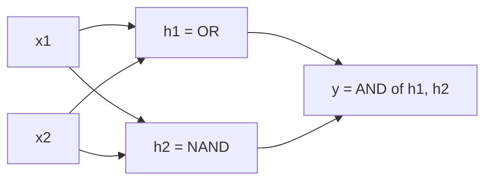
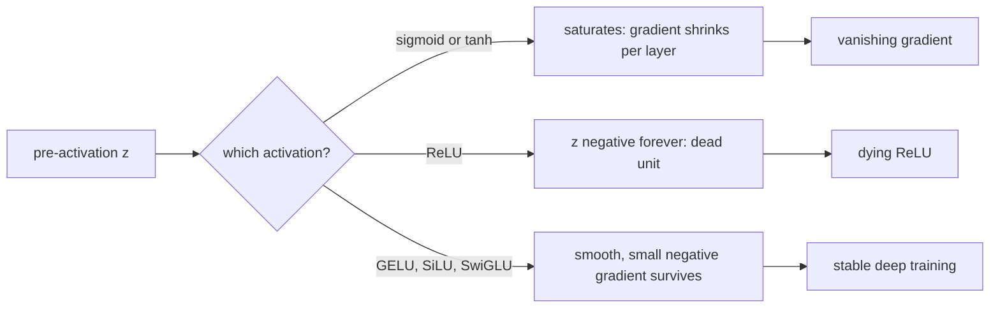
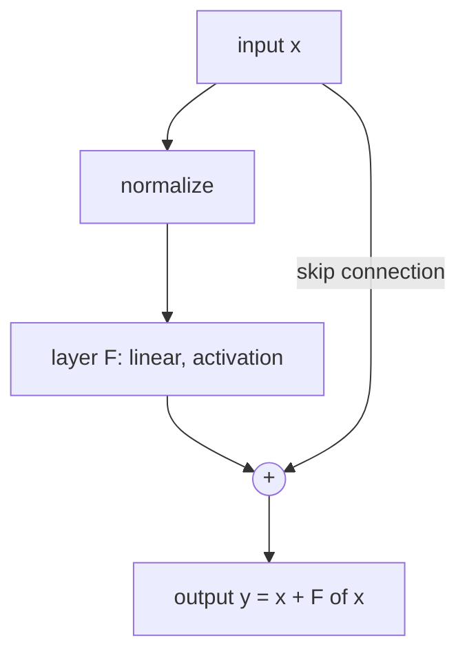

# Neurons, Layers & Activations

The ml-foundations course gave you a loss, gradient descent, and the discipline to
spot overfitting. It treated the model as a function you could fit. This course opens
the box. A deep network is a very small set of ideas repeated a very large number of
times, and if you understand the repeating unit, nothing later (backprop, attention,
scaling) is mysterious. Four parts:

- **The neuron and the perceptron** — a weighted sum and a threshold, and the problem it cannot solve.
- **Layers, activations, and depth** — matrix multiplies, the nonlinearity zoo, and why stacking works.
- **Initialization and normalization** — keeping signals alive across dozens of layers.
- **Inductive bias** — convolutions, recurrence, and what architecture assumes about data.

---

## 1.1 — The Neuron, the Perceptron & the XOR Wall

An artificial neuron computes a **weighted sum of its inputs plus a bias**, then
passes the result through a **nonlinearity**:

$$
y = \phi\!\left(\sum_{i=1}^{d} w_i x_i + b\right) = \phi(\mathbf{w}^\top \mathbf{x} + b)
$$

The weights $\mathbf{w}$ say how much each input matters, the bias $b$ shifts the
threshold, and $\phi$ decides the output. Geometrically, $\mathbf{w}^\top\mathbf{x} + b = 0$
is a **hyperplane**; the neuron asks which side of that hyperplane the input lies on.

The **perceptron** (Rosenblatt, 1958) is the earliest version: $\phi$ is a hard step
function, so the neuron outputs 0 or 1. Its learning rule is delightfully simple. For
each example with label $t \in \{0,1\}$ and prediction $\hat{y}$, nudge the weights
toward the correct answer (the update is zero when the prediction is right):

$$
\mathbf{w} \leftarrow \mathbf{w} + \eta\,(t - \hat{y})\,\mathbf{x}, \qquad b \leftarrow b + \eta\,(t - \hat{y})
$$

If the data are **linearly separable**, the perceptron convergence theorem guarantees
this finishes in a finite number of updates. If they are not, it never settles.

```python
import numpy as np

def train_perceptron(X, t, lr=0.1, epochs=50):
    """Classic perceptron. X: (n, d) inputs, t: (n,) labels in {0, 1}."""
    w, b = np.zeros(X.shape[1]), 0.0
    for _ in range(epochs):
        errors = 0
        for x, target in zip(X, t):
            pred = 1 if (w @ x + b) > 0 else 0           # hard step activation
            update = lr * (target - pred)                # zero when already correct
            w += update * x
            b += update
            errors += int(update != 0)
        if errors == 0:                                  # converged: perfectly separated
            break
    return w, b

X = np.array([[0, 0], [0, 1], [1, 0], [1, 1]], dtype=float)
print(train_perceptron(X, np.array([0, 0, 0, 1])))       # AND: converges
print(train_perceptron(X, np.array([0, 1, 1, 0])))       # XOR: oscillates forever
```

### The XOR wall

AND and OR are linearly separable: one line splits the 1s from the 0s. **XOR** is
not. The points $(0,1)$ and $(1,0)$ must be positive while $(0,0)$ and $(1,1)$ are
negative, and no single line separates those diagonals. Minsky and Papert made this
point rigorously in 1969, and it helped trigger the first "AI winter": a single neuron
can only carve space with one hyperplane.

The way out is to **compose** neurons. Two hidden neurons can each compute a different
half-space (one computes OR, one computes NAND), and an output neuron ANDs them: that
is XOR. The hidden layer *re-represents* the inputs into a space where the problem
*is* linearly separable. This is the central idea of deep learning in miniature:
**layers learn representations that make the final decision easy.**



---

## 1.2 — Layers as Matrix Multiplies, and the Activation Zoo

One neuron is a dot product. A **layer** is many neurons sharing the same input, which
is a matrix multiply. With a batch $X \in \mathbb{R}^{B \times d_{\text{in}}}$, weights
$W \in \mathbb{R}^{d_{\text{in}} \times d_{\text{out}}}$, and bias $\mathbf{b} \in \mathbb{R}^{d_{\text{out}}}$:

$$
H = \phi(X W + \mathbf{b}), \qquad H \in \mathbb{R}^{B \times d_{\text{out}}}
$$

A **multilayer perceptron (MLP)** stacks these: $f(x) = W_L\,\phi(\cdots \phi(W_2\,\phi(W_1 x)))$.
This is why GPUs matter: the whole network is a chain of dense matrix multiplies,
the exact operation GPUs are built to do. Here is the same two-layer MLP in numpy
(forward pass only; Module 2 derives the backward pass) and in PyTorch.

```python
import numpy as np
import torch
import torch.nn as nn

# ---- numpy: explicit matrices, so every shape is visible ----
rng = np.random.default_rng(0)
B, d_in, d_hidden, d_out = 32, 10, 64, 3
W1 = rng.normal(0, np.sqrt(2 / d_in), (d_in, d_hidden))      # He init (see 1.3)
b1 = np.zeros(d_hidden)
W2 = rng.normal(0, np.sqrt(2 / d_hidden), (d_hidden, d_out))
b2 = np.zeros(d_out)

def mlp_forward(X):
    h = np.maximum(0, X @ W1 + b1)       # (B, d_hidden): affine map then ReLU
    return h @ W2 + b2                   # (B, d_out): raw logits, no activation

logits = mlp_forward(rng.normal(size=(B, d_in)))

# ---- PyTorch: the same network; nn.Linear stores W transposed and adds the bias ----
class MLP(nn.Module):
    def __init__(self, d_in, d_hidden, d_out):
        super().__init__()
        self.net = nn.Sequential(
            nn.Linear(d_in, d_hidden), nn.ReLU(),
            nn.Linear(d_hidden, d_out),
        )
    def forward(self, x):
        return self.net(x)

model = MLP(d_in, d_hidden, d_out)
print(sum(p.numel() for p in model.parameters()))            # 10*64+64 + 64*3+3 = 899
```

Parameter counting is a useful reflex: a linear layer has $d_{\text{in}} d_{\text{out}} + d_{\text{out}}$
parameters, so cost grows with the *product* of adjacent widths.

### Why the nonlinearity is mandatory

Without $\phi$, stacking changes nothing: $W_2(W_1 x) = (W_2 W_1)x$, a single linear
map. Ten linear layers are exactly as expressive as one. The nonlinearity is the only
thing that lets depth add power.

### The activation functions

| Activation | Formula | Range | Where it lives |
| --- | --- | --- | --- |
| Sigmoid | $\sigma(z) = 1/(1+e^{-z})$ | (0, 1) | Output probabilities, gates |
| Tanh | $\tanh z$ | (-1, 1) | RNN cells, zero-centered hiddens |
| ReLU | $\max(0, z)$ | [0, inf) | Default for CNNs and classic MLPs |
| GELU | $z\,\Phi(z)$ | about [-0.17, inf) | BERT, GPT-2/3 |
| SiLU (Swish) | $z\,\sigma(z)$ | about [-0.28, inf) | EfficientNet, many modern nets |
| SwiGLU | $\text{SiLU}(xW)\odot(xV)$ | unbounded | LLaMA, PaLM, most current LLMs |

The derivatives are what training actually sees, because gradients flow *through* them:

$$
\sigma'(z) = \sigma(z)\,(1-\sigma(z)) \le \tfrac14, \qquad
\tanh'(z) = 1 - \tanh^2(z) \le 1, \qquad
\text{ReLU}'(z) = \mathbb{1}[z > 0]
$$

```python
import numpy as np
from math import erf, sqrt

sigmoid = lambda z: 1 / (1 + np.exp(-z))
d_sigmoid = lambda z: sigmoid(z) * (1 - sigmoid(z))           # peaks at 0.25
d_tanh = lambda z: 1 - np.tanh(z) ** 2                        # peaks at 1.0
relu = lambda z: np.maximum(0, z)
d_relu = lambda z: (z > 0).astype(float)                      # exactly 0 or 1
silu = lambda z: z * sigmoid(z)

def gelu(z):
    """Exact GELU: z * Phi(z), with Phi the standard normal CDF."""
    return z * 0.5 * (1 + np.vectorize(erf)(z / sqrt(2)))

def swiglu(x, W, V):
    """Gated MLP unit: one projection (through SiLU) gates another elementwise."""
    return silu(x @ W) * (x @ V)
```

### Vanishing gradients and dying ReLUs

**Vanishing gradients.** Backprop multiplies one local derivative per layer. The
sigmoid's derivative never exceeds $0.25$, so across $L$ layers the gradient shrinks
at least as fast as $0.25^L$: at 10 layers that is about $10^{-6}$. Early layers get
essentially zero signal and learn nothing. Worse, for large $|z|$ the sigmoid
**saturates**: its derivative approaches 0, so a confident neuron stops learning
altogether. Tanh is better (derivative up to 1, zero-centered) but also saturates.
This single effect kept deep networks untrainable for roughly a decade.

**ReLU's fix.** For $z > 0$ the derivative is exactly 1, so gradients pass through
unattenuated, and it is cheap to compute. That is why ReLU unlocked deep CNNs around
2012. Its cost is the **dying ReLU**: if a neuron's pre-activation is negative for
*every* input (say after a large update or a bad bias), its gradient is permanently
zero and it can never recover. In practice a large fraction of units can be dead in a
badly tuned network. Mitigations: lower learning rates, good initialization, and
variants such as **Leaky ReLU** ($\max(\alpha z, z)$ with small $\alpha$) that keep a
trickle of gradient on the negative side.

**GELU and SiLU** are smooth, slightly non-monotonic cousins of ReLU. They let a
small negative gradient through and have a well-defined derivative everywhere (ReLU
has a kink at 0). Empirically they train transformers better, which is why they
replaced ReLU there. **SwiGLU** goes further: instead of a pointwise nonlinearity it
uses a *gate*, where one linear projection (through SiLU) multiplicatively controls
another. Because it uses three weight matrices instead of two, models shrink the
hidden width to about $\tfrac{2}{3}\cdot 4d$ to keep the parameter count matched.



---

## 1.3 — Depth, Initialization & Normalization

### Universal approximation, and why depth wins

The **universal approximation theorem** (Cybenko 1989, Hornik 1991) says a network
with *one* hidden layer and a non-polynomial activation can approximate any continuous
function on a compact domain to arbitrary accuracy, given enough hidden units. It is
an existence result, and it hides two problems: the width required can be
exponentially large, and it says nothing about whether gradient descent will *find*
those weights or whether they generalize.

**Depth** is dramatically more efficient. Some functions need exponentially many units
in a shallow network but only polynomially many in a deep one. The intuition is
**composition and reuse**: a deep net builds features of features (edges, then
textures, then parts, then objects), and each lower-level feature is shared by many
higher-level ones. A shallow net must memorize each combination separately. Piecewise-linear
ReLU networks make this quantitative: the number of linear regions a network can carve
grows *exponentially* with depth but only polynomially with width. Real data is
compositional, so depth matches its structure.

### Initialization: keeping the signal alive

If weights start too small, activations shrink layer by layer to zero; too large, and
they explode. Both kill training before it begins. The fix is to choose the initial
variance so that signal magnitude is **preserved** through each layer.

Take a linear layer $y_j = \sum_{i=1}^{n_{\text{in}}} w_{ji} x_i$ with independent,
zero-mean weights and inputs. Then

$$
\operatorname{Var}(y_j) = n_{\text{in}}\,\operatorname{Var}(w)\,\mathbb{E}[x^2]
$$

For $\operatorname{Var}(y) = \operatorname{Var}(x)$ in the forward pass we need
$n_{\text{in}} \operatorname{Var}(w) = 1$. The same argument on the backward pass
(gradients flow through $W^\top$) demands $n_{\text{out}} \operatorname{Var}(w) = 1$.
These conflict unless $n_{\text{in}} = n_{\text{out}}$, so **Xavier/Glorot** (2010)
compromises with the harmonic mean:

$$
\operatorname{Var}(w) = \frac{2}{n_{\text{in}} + n_{\text{out}}}
$$

This assumes a roughly linear, symmetric activation (tanh, sigmoid near zero). ReLU
breaks the assumption: it zeroes half the pre-activations, so the second moment after
ReLU is half the pre-activation variance, $\mathbb{E}[\text{ReLU}(z)^2] = \tfrac12 \operatorname{Var}(z)$.
Preserving variance now requires $\tfrac12\, n_{\text{in}} \operatorname{Var}(w) = 1$,
which gives **He/Kaiming** initialization (2015):

$$
\operatorname{Var}(w) = \frac{2}{n_{\text{in}}}
$$

The factor of 2 exactly compensates ReLU's discarded half. Skipping it makes the
signal variance halve each layer, so the standard deviation decays as $2^{-L/2}$ across
$L$ layers; a 30-layer ReLU net with Xavier init collapses.

```python
import numpy as np

def forward_stats(init, depth=30, width=512, act="relu", seed=0):
    """Push random data through `depth` layers and report activation std at the end."""
    rng = np.random.default_rng(seed)
    x = rng.normal(size=(256, width))
    for _ in range(depth):
        std = {"xavier": np.sqrt(2 / (width + width)),    # Var = 2/(n_in+n_out)
               "he": np.sqrt(2 / width)}[init]            # Var = 2/n_in
        W = rng.normal(0, std, (width, width))
        z = x @ W
        x = np.maximum(0, z) if act == "relu" else np.tanh(z)
    return x.std()

print("relu + xavier:", forward_stats("xavier", act="relu"))   # tiny: signal vanished
print("relu + he    :", forward_stats("he", act="relu"))       # order 1: preserved
print("tanh + xavier:", forward_stats("xavier", act="tanh"))   # healthy
```

In PyTorch these are `nn.init.xavier_uniform_` and `nn.init.kaiming_normal_(w, nonlinearity="relu")`.

### Normalization

Initialization only fixes the *start*. As weights change, activation statistics drift
(the "internal covariate shift" story, though the real benefit is better loss-surface
conditioning and tolerance of larger learning rates). **Normalization layers** re-center
and re-scale activations during every forward pass:

$$
\hat{x} = \frac{x - \mu}{\sqrt{\sigma^2 + \epsilon}}, \qquad y = \gamma\,\hat{x} + \beta
$$

with learned scale $\gamma$ and shift $\beta$ so the network can undo the
normalization if that helps. The variants differ in *which axis* supplies $\mu$ and $\sigma$:

| Method | Statistics over | Needs batch? | Typical home |
| --- | --- | --- | --- |
| BatchNorm | the batch (per feature) | Yes; train/eval differ | CNNs |
| LayerNorm | the features (per sample) | No | Transformers, RNNs |
| RMSNorm | features, RMS only, no mean | No | LLaMA and modern LLMs |

**BatchNorm** (2015) uses batch statistics in training and running averages at
inference, which makes behavior depend on batch size and creates a train/eval mismatch;
it struggles with tiny batches and variable-length sequences. **LayerNorm** computes
statistics across a single sample's features, so it is batch-independent and works for
sequences. **RMSNorm** drops mean subtraction and the bias, keeping only the rescale by
root-mean-square, $\hat{x} = x / \sqrt{\tfrac1d\sum_i x_i^2 + \epsilon}$. It is cheaper and
works about as well, so most current LLMs use it.

```python
import torch

def layer_norm(x, gamma, beta, eps=1e-5):
    mu = x.mean(-1, keepdim=True)                        # per-token mean over features
    var = x.var(-1, unbiased=False, keepdim=True)
    return gamma * (x - mu) / torch.sqrt(var + eps) + beta

def rms_norm(x, gamma, eps=1e-6):
    rms = torch.sqrt(x.pow(2).mean(-1, keepdim=True) + eps)   # no mean subtraction
    return gamma * x / rms

x = torch.randn(4, 16, 512) * 7 + 3                      # (batch, tokens, features)
print(layer_norm(x, torch.ones(512), torch.zeros(512)).std(-1).mean())  # ~1.0
```

### Residual connections (a preview)

Even with good init and normalization, very deep plain networks got *worse* with
depth, which is an optimization failure rather than overfitting. **Residual
connections** (He et al., 2015) fix it by computing $y = x + F(x)$ instead of $y = F(x)$.
The block only has to learn a *correction*, and the identity path gives gradients an
unimpeded highway: $\partial y/\partial x = I + \partial F/\partial x$. Module 2 shows
why that "$+I$" rescues backprop; Module 3's transformer is built from exactly this
pattern, normalization plus residual around every sublayer.



---

## 1.4 — Inductive Bias: Architecture as an Assumption

A dense MLP assumes nothing about its input: every input connects to every output, so
it must *learn* structure from data. That is flexible and wasteful. Real data has
structure, and an architecture that bakes in the right assumption, an **inductive
bias**, learns faster from less data. Each classic architecture is a bet.

**Convolutional networks** bet on **locality and translation equivariance**. A cat's
ear looks the same wherever it appears, so one small filter (say $3\times3$) is slid
across the whole image with *shared weights*. Compare a $224\times224\times3$ image
fed to a dense layer of 1,000 units (about 150 million weights) against a conv layer
with 64 filters of $3\times3\times3$ (1,728 weights). Stacking conv layers grows the
**receptive field**, so deeper units see larger regions: edges, then textures, then
objects. Pooling adds some translation invariance.

**Recurrent networks** bet on **sequential structure**: process tokens one at a time
while carrying a hidden state, $h_t = \phi(W_h h_{t-1} + W_x x_t)$, with the *same*
weights at every step. This handles variable-length input, but two problems follow.
Backprop through time multiplies the same matrix $T$ times, so gradients vanish or
explode exponentially in sequence length (LSTMs and GRUs add gated, additive memory
paths to soften this), and computation is inherently sequential, so it cannot
parallelize across the sequence on a GPU.

| Architecture | Built-in assumption | Parameter sharing | Weakness |
| --- | --- | --- | --- |
| MLP | none | none | data-hungry, no structure |
| CNN | local, translation-equivariant | across space | long-range relations |
| RNN/LSTM | sequential, stationary | across time | serial, long dependencies fade |
| Transformer | pairwise relations via attention | across positions | quadratic cost, weak built-in bias |

The trend in modern deep learning is to **trade hand-built bias for data and scale**:
the transformer (Module 3) assumes very little beyond "any token may relate to any
other", and relies on massive data to learn the structure. Module 4 asks why that bet
pays off.

---

## Key takeaways

- A **neuron** is $\phi(\mathbf{w}^\top\mathbf{x}+b)$, a hyperplane test. The
  **perceptron** learns linearly separable problems and provably fails on **XOR**;
  hidden layers fix that by re-representing inputs into a separable space.
- A **layer** is a matrix multiply plus a nonlinearity, so an MLP is a chain of dense
  GEMMs. Without nonlinearity, any depth collapses to one linear map.
- **Sigmoid and tanh** saturate and their derivatives (at most 0.25 and 1) multiply
  across layers into **vanishing gradients**. **ReLU** passes gradient 1 for positive
  inputs but can **die**. **GELU, SiLU and SwiGLU** are smooth and are the transformer
  defaults.
- **Universal approximation** says one wide layer suffices in principle; **depth**
  achieves the same with exponentially fewer units by composing reusable features.
- **Xavier** ($2/(n_{in}+n_{out})$) and **He** ($2/n_{in}$) initialization come from
  preserving variance; He's factor of 2 offsets ReLU zeroing half the signal.
- **BatchNorm** normalizes across the batch, **LayerNorm** across features, **RMSNorm**
  drops the mean for speed. **Residual connections** add an identity path that keeps
  very deep networks trainable.
- **Inductive bias** (convolution's locality, recurrence's sequence order) is a bet
  about the data; modern models swap hand-built bias for scale.

## Exercises

1. **Hit the XOR wall, then climb over it.** Run `train_perceptron` on AND, OR, and
   XOR and report convergence. Then hand-set weights for a 2-2-1 network of step
   neurons (hidden = OR and NAND, output = AND) and verify its truth table. Finally
   train the same 2-2-1 net with tanh in PyTorch and plot the learned decision boundary.

2. **Measure vanishing gradients.** Build a 20-layer MLP twice, once with sigmoid and
   once with ReLU, both with He init. On one batch, call `loss.backward()` and plot the
   gradient norm of each layer's weights on a log scale. Confirm the sigmoid network's
   early layers are orders of magnitude smaller, then count dead ReLU units after
   training with a deliberately high learning rate.

3. **Verify the initialization derivation.** Extend `forward_stats` to record the
   activation standard deviation at every layer for Xavier and He init under ReLU and
   tanh. Plot the four curves, confirm which pairs stay flat, and check that the decay
   rate under ReLU+Xavier matches $2^{-1/2}$ per layer.

4. **Implement and compare norms.** Using the `layer_norm` and `rms_norm` functions,
   check them against `torch.nn.LayerNorm` and a hand-written RMSNorm module to
   $10^{-5}$. Then train a small residual MLP with and without the skip connection at
   depths 5, 20, and 50, and plot training loss to see where the plain network stops
   training.

## Next: Module 2 — Backpropagation

You now know what a network *computes*; Module 2 shows how it *learns*. We derive
backpropagation from the chain rule on a computational graph, work through the
matrix calculus for a linear layer and an activation by hand, build an automatic
differentiation engine in a few dozen lines, see exactly why the vanishing and
exploding gradients of this module arise from products of Jacobians, and use gradient
checking to prove that your implementation is correct.
