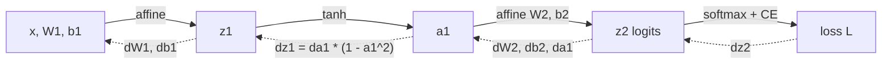
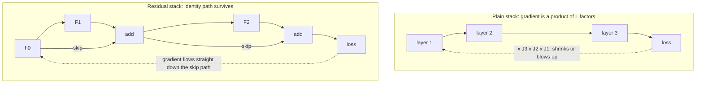
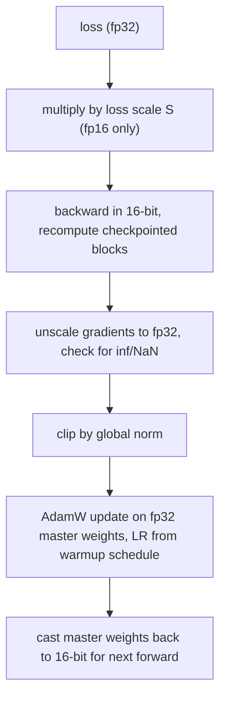

# Backpropagation

Module 1 built the forward pass: neurons, layers, activations, a function from
inputs to a loss. Training needs the other direction, the gradient of that loss with
respect to *every* parameter, and it needs it cheaply. Backpropagation is how you get
millions of partial derivatives for roughly the price of one extra forward pass. This
module derives it, builds it, then deals with what goes wrong when you do it at depth
and at scale. Four parts:

- **The chain rule and backprop by hand** — computational graphs, a 2-layer MLP, and a gradient check.
- **Reverse-mode autodiff** — a micrograd-style scalar engine in about 60 lines.
- **Vanishing and exploding gradients** — why depth hurts, clipping, and residual highways.
- **Memory and optimizers** — activation cost, checkpointing, mixed precision, AdamW, warmup.

---

## 2.1 — The Chain Rule, Computational Graphs & Backprop by Hand

Any loss is a composition of simple operations. Write $L = f_3(f_2(f_1(x)))$ and give
each intermediate a name, $a = f_1(x)$, $b = f_2(a)$, $L = f_3(b)$. The **chain rule**
says derivatives multiply along the path:

$$
\frac{\partial L}{\partial x} = \frac{\partial L}{\partial b}\,\frac{\partial b}{\partial a}\,\frac{\partial a}{\partial x}
$$

Draw those operations as a **computational graph**: nodes are values, edges are
operations. When a value feeds *several* downstream nodes, the gradients arriving from
each branch **add** (the multivariate chain rule). Backprop is nothing more than
walking this graph in reverse, handing each node the gradient of the loss with respect
to its output (the *upstream gradient*) and asking it to multiply by its own local
derivative and pass the result to its inputs.



### Derivation for a 2-layer MLP

Take a batch $X \in \mathbb{R}^{N \times D}$, hidden width $H$, $C$ classes:

$$
Z_1 = X W_1 + b_1,\quad A_1 = \tanh(Z_1),\quad Z_2 = A_1 W_2 + b_2,\quad P = \text{softmax}(Z_2),\quad L = -\frac{1}{N}\sum_{n} \log P_{n, y_n}
$$

The magic is the softmax plus cross-entropy node. Its combined local gradient
simplifies to a single subtraction, where $Y$ is the one-hot label matrix:

$$
\frac{\partial L}{\partial Z_2} = \frac{1}{N}\,(P - Y)
$$

Now walk backward, using the rule that for $Z = A W + b$ with upstream gradient $G = \partial L / \partial Z$:

$$
\frac{\partial L}{\partial W} = A^\top G, \qquad \frac{\partial L}{\partial b} = \sum_n G_{n,:}, \qquad \frac{\partial L}{\partial A} = G\, W^\top
$$

Applied twice, with the elementwise $\tanh' = 1 - \tanh^2$ in between:

$$
G_2 = \tfrac{1}{N}(P - Y),\quad \nabla_{W_2} = A_1^\top G_2,\quad \nabla_{b_2} = \textstyle\sum_n G_2,\quad G_1 = (G_2 W_2^\top) \odot (1 - A_1^{2}),\quad \nabla_{W_1} = X^\top G_1,\quad \nabla_{b_1} = \textstyle\sum_n G_1
$$

Notice that backprop **reuses the forward activations** ($A_1$ appears in both
$\nabla_{W_2}$ and the tanh derivative). That is why they must be kept in memory until
the backward pass consumes them, a fact that dominates Section 2.4.

### Code, plus the gradient check

A derivation you cannot test is a rumor. The **gradient check** compares the analytic
gradient to a numerical one from the centered finite difference
$\frac{\partial L}{\partial \theta_i} \approx \frac{L(\theta_i + \varepsilon) - L(\theta_i - \varepsilon)}{2\varepsilon}$,
whose error is $O(\varepsilon^2)$.

```python
import numpy as np

def init(D=4, H=5, C=3, seed=0):
    rng = np.random.default_rng(seed)
    return {"W1": rng.normal(0, 0.5, (D, H)), "b1": np.zeros(H),
            "W2": rng.normal(0, 0.5, (H, C)), "b2": np.zeros(C)}

def forward(p, X, y):
    z1 = X @ p["W1"] + p["b1"]
    a1 = np.tanh(z1)
    z2 = a1 @ p["W2"] + p["b2"]
    z2 = z2 - z2.max(axis=1, keepdims=True)              # stability: softmax is shift-invariant
    probs = np.exp(z2) / np.exp(z2).sum(axis=1, keepdims=True)
    loss = -np.log(probs[np.arange(len(y)), y]).mean()
    return loss, (X, a1, probs)                          # cache what backward needs

def backward(p, cache, y):
    X, a1, probs = cache
    N = len(y)
    dz2 = probs.copy()
    dz2[np.arange(N), y] -= 1.0                          # P - Y (one-hot subtract)
    dz2 /= N                                             # mean over the batch
    grads = {"W2": a1.T @ dz2, "b2": dz2.sum(axis=0)}
    da1 = dz2 @ p["W2"].T                                # push gradient through W2
    dz1 = da1 * (1.0 - a1 ** 2)                          # tanh'(z) = 1 - tanh(z)^2
    grads["W1"] = X.T @ dz1
    grads["b1"] = dz1.sum(axis=0)
    return grads

def grad_check(p, X, y, eps=1e-6):
    """Relative error between analytic and centered finite-difference gradients."""
    _, cache = forward(p, X, y)
    analytic = backward(p, cache, y)
    for name, theta in p.items():
        numeric = np.zeros_like(theta)
        for idx in np.ndindex(theta.shape):
            old = theta[idx]
            theta[idx] = old + eps; lp, _ = forward(p, X, y)
            theta[idx] = old - eps; lm, _ = forward(p, X, y)
            theta[idx] = old                             # always restore the parameter
            numeric[idx] = (lp - lm) / (2 * eps)
        a, n = analytic[name], numeric
        rel = np.linalg.norm(a - n) / (np.linalg.norm(a) + np.linalg.norm(n) + 1e-12)
        print(f"{name}: relative error {rel:.2e}")      # expect ~1e-8 or smaller

rng = np.random.default_rng(1)
X, y = rng.normal(size=(8, 4)), rng.integers(0, 3, size=8)
grad_check(init(), X, y)
```

Run in float64 and expect relative errors around $10^{-8}$; above $10^{-5}$ is a bug.
Use a tiny batch (the loop costs two forward passes per parameter) and avoid ReLU at
exactly zero, where the kink makes the finite difference legitimately disagree.

---

## 2.2 — Reverse-Mode Autodiff: A Scalar Engine from Scratch

Writing `backward` by hand for every architecture does not scale. **Automatic
differentiation** records the graph as the forward pass runs, then replays it in
reverse. There are two modes. **Forward mode** carries a derivative alongside each
value and costs one pass *per input*. **Reverse mode** costs one backward pass *per
output*. A neural network has millions of inputs (parameters) and one scalar output
(the loss), so reverse mode wins by a factor of the parameter count, and the backward
pass costs only a small constant multiple (about 2x) of the forward pass.

The recipe: each `Value` remembers its parents and a small closure that, given its own
`grad`, adds the right contribution to each parent's `grad`. A topological sort orders
nodes so every node's gradient is complete before it propagates.

```python
import math

class Value:
    """A scalar that remembers how it was computed, micrograd-style."""
    def __init__(self, data, parents=(), op=""):
        self.data = float(data)
        self.grad = 0.0                       # dL/d(self), filled in by backward()
        self._parents = parents
        self._backward = lambda: None         # closure: push self.grad to parents
        self._op = op

    def __add__(self, other):
        other = other if isinstance(other, Value) else Value(other)
        out = Value(self.data + other.data, (self, other), "+")
        def _backward():
            self.grad += out.grad             # d(a+b)/da = 1
            other.grad += out.grad            # += because a node may be reused (branches add)
        out._backward = _backward
        return out

    def __mul__(self, other):
        other = other if isinstance(other, Value) else Value(other)
        out = Value(self.data * other.data, (self, other), "*")
        def _backward():
            self.grad += other.data * out.grad    # d(ab)/da = b
            other.grad += self.data * out.grad    # d(ab)/db = a
        out._backward = _backward
        return out

    def __pow__(self, k):                     # k is a plain number
        out = Value(self.data ** k, (self,), f"**{k}")
        def _backward():
            self.grad += k * self.data ** (k - 1) * out.grad
        out._backward = _backward
        return out

    def tanh(self):
        t = math.tanh(self.data)
        out = Value(t, (self,), "tanh")
        def _backward():
            self.grad += (1.0 - t * t) * out.grad
        out._backward = _backward
        return out

    def __neg__(self): return self * -1
    def __sub__(self, o): return self + (-o if isinstance(o, Value) else Value(-o))
    def __radd__(self, o): return self + o
    def __rmul__(self, o): return self * o
    def __truediv__(self, o): return self * (o ** -1 if isinstance(o, Value) else 1.0 / o)

    def backward(self):
        order, seen = [], set()
        def visit(v):                         # post-order DFS = topological order
            if v not in seen:
                seen.add(v)
                for p in v._parents:
                    visit(p)
                order.append(v)
        visit(self)
        self.grad = 1.0                       # dL/dL = 1: the seed of the whole pass
        for v in reversed(order):             # children before parents
            v._backward()

# One neuron: loss = (tanh(w*x + b) - target)^2
w, b = Value(0.7), Value(-0.2)
x, target = Value(1.5), 0.5
loss = (( w * x + b).tanh() - target) ** 2
loss.backward()
print(loss.data, w.grad, b.grad)              # compare with a finite difference
```

Three details carry the idea: `+=` in every closure (branches add), topological order
(a node's `grad` is final before it propagates), and the seed $\partial L/\partial L = 1$.
PyTorch's `autograd` is this design with tensors and fused kernels; because gradients
*accumulate*, you must call `optimizer.zero_grad()` between steps.

---

## 2.3 — Vanishing & Exploding Gradients

Backprop multiplies one local Jacobian per layer. For a depth-$L$ chain of layers
$h_{\ell} = \phi(W_\ell h_{\ell-1})$, the gradient reaching layer 1 is a product:

$$
\frac{\partial L}{\partial h_0} = \frac{\partial L}{\partial h_L}\prod_{\ell=1}^{L} \text{diag}\!\left(\phi'(z_\ell)\right) W_\ell
$$

If the typical factor has norm below 1, the product shrinks exponentially with depth:
**vanishing gradients**, where early layers receive essentially zero signal and stop
learning. Above 1, it grows exponentially: **exploding gradients**, where one step
throws the weights into a region of NaNs. A factor of $0.9$ over 100 layers is
$2.7\times 10^{-5}$; a factor of $1.1$ is $1.4\times 10^{4}$. There is no stable middle
without design.

The classic culprit is the saturating activation: $\sigma'(z) \le 0.25$ and $	anh'$ is
near zero in the tails, so a deep sigmoid stack kills the gradient. ReLU's derivative
is exactly 1 when active, which helped unlock depth. Initialization is the other lever:
keep activation variance near 1 per layer (Xavier for tanh, He, $2/	ext{fan\_in}$, for ReLU).

### Gradient clipping

Exploding gradients, and the occasional loss spike on a bad batch, are tamed by
**clipping by global norm**. Compute the norm over *all* parameters' gradients together
and, if it exceeds a threshold $c$, rescale the whole gradient vector. Direction is
preserved; only the step length is capped:

$$
g \leftarrow g \cdot \min\!\left(1,\ \frac{c}{\lVert g \rVert_2}\right)
$$

```python
loss.backward()
gnorm = torch.nn.utils.clip_grad_norm_(model.parameters(), 1.0)  # returns pre-clip norm: LOG it
optimizer.step()                                                 # a rising norm warns of instability
```

Clipping to a norm of 1.0 is the near-universal transformer default; clip globally,
not per tensor, or you distort the direction.

### Residual paths: gradient highways

Clipping treats exploding gradients; the fix for vanishing ones is architectural. A
**residual connection** computes $h_{\ell} = h_{\ell-1} + F(h_{\ell-1})$. Its Jacobian is
$I + \partial F / \partial h$, so the backward product becomes

$$
\frac{\partial L}{\partial h_0} = \frac{\partial L}{\partial h_L}\prod_{\ell=1}^{L}\left(I + \frac{\partial F_\ell}{\partial h_{\ell-1}}\right)
$$

Expand it and one term is the pure identity: a path with **no multiplications at all**
from the loss straight to layer 0. The gradient along the skip path is never shrunk, no
matter how deep the stack. Each block can then learn a small *correction* to the
identity rather than a whole transformation. This is what let ResNets go from 20 to
over 100 layers, and it is why every transformer block wraps attention and the MLP in
residual adds (Module 3). Normalization layers (LayerNorm, RMSNorm) complement them by
keeping activation scale, and therefore the Jacobian scale, bounded.



---

## 2.4 — Memory, Mixed Precision & Optimizers

### Where the memory goes

Training memory has two kinds of cost. **Static** costs scale with parameter count
$\Psi$. In standard mixed-precision Adam training they are: fp16/bf16 weights (2
bytes), fp16/bf16 gradients (2), fp32 master weights (4), and Adam's two fp32 moments
(4 + 4), about **16 bytes per parameter**. A 7B model therefore needs roughly 112 GB
before a single activation is stored.

**Activations** are the other half, and they scale with batch size, sequence length, and
depth, because (as the derivation in 2.1 showed) the backward pass needs the forward
intermediates. For a transformer layer with sequence length $s$, batch $b$, hidden size
$h$, and $a$ heads, the 16-bit activation footprint is about $s\,b\,h\,(34 + 5as/h)$
bytes per layer; the $5as/h$ term is attention's quadratic score matrices, which
FlashAttention avoids storing. Multiply by the layer count and activations often exceed
the weights.

**Gradient checkpointing** (activation recomputation) trades compute for memory. Save
only a subset of activations, the *checkpoints*, and during backward recompute the
missing ones from the nearest checkpoint. Checkpointing every $\sqrt{L}$-th layer
drops activation memory from $O(L)$ to $O(\sqrt{L})$ at the price of one extra forward
pass, about 30 percent more compute per step. It is the standard way to fit a bigger
batch or longer context, and it is a pure memory-for-FLOPs trade, with identical
gradients.

```python
from torch.utils.checkpoint import checkpoint

# Inside the model's forward: don't store blk's internals; recompute them in backward.
for blk in self.blocks:
    x = checkpoint(blk, x, use_reentrant=False)
```

### Mixed precision: fp16 vs bf16

Running matmuls in 16 bits roughly halves memory and, on tensor cores, multiplies
throughput. The two 16-bit formats make opposite trade-offs:

| Format | Exponent / mantissa | Max value | Smallest normal | Needs loss scaling? |
| --- | --- | --- | --- | --- |
| fp32 | 8 / 23 | $3.4\times10^{38}$ | $1.2\times10^{-38}$ | No |
| fp16 | 5 / 10 | 65,504 | $6.1\times10^{-5}$ (subnormals to $6\times10^{-8}$) | **Yes** |
| bf16 | 8 / 7 | $3.4\times10^{38}$ | $1.2\times10^{-38}$ | No |

fp16 has more precision but a tiny range. Gradients are often smaller than $10^{-8}$,
which **underflow to zero** in fp16 and silently erase learning. **Loss scaling**
fixes it: multiply the loss by a large constant $S$ (say $2^{16}$) before backward, so
every gradient is scaled up by the chain rule into representable range, then divide the
gradients by $S$ in fp32 before the update. **Dynamic** loss scaling doubles $S$ after
a run of clean steps and halves it, skipping the step, whenever an inf or NaN appears.
bf16 keeps fp32's 8 exponent bits (at the cost of mantissa: about 2-3 significant
digits), so gradients do not underflow and scaling is unnecessary, which is why bf16
is the default on A100/H100-class hardware and TPUs. Whatever the format, keep fp32
**master weights** and do reductions (softmax, layernorm statistics, loss) in fp32, since a
tiny update added to a large 16-bit weight rounds away to nothing.

```python
import torch

def train_step(model, batch, opt, scaler=None, dtype=torch.bfloat16, max_norm=1.0):
    opt.zero_grad(set_to_none=True)
    with torch.autocast(device_type="cuda", dtype=dtype):      # matmuls in 16-bit, reductions in fp32
        loss = model(**batch).loss
    if scaler is not None:                                     # fp16 path: GradScaler for loss scaling
        scaler.scale(loss).backward()
        scaler.unscale_(opt)                                   # true gradients, so clipping is meaningful
        torch.nn.utils.clip_grad_norm_(model.parameters(), max_norm)
        scaler.step(opt)                                       # skips the step if inf/NaN found
        scaler.update()                                        # adapt the scale factor
    else:                                                      # bf16 path: no scaler needed
        loss.backward()
        torch.nn.utils.clip_grad_norm_(model.parameters(), max_norm)
        opt.step()
    return loss.item()

# fp16: scaler = torch.amp.GradScaler("cuda"), dtype=torch.float16
# bf16: scaler = None,                           dtype=torch.bfloat16
```

### Optimizers: Adam, AdamW & warmup

Plain SGD uses one global step size, but parameters in deep nets see wildly different
gradient scales. **Adam** keeps a running mean $m$ (momentum) and a running mean of
squares $v$ for every parameter, giving each its own effective step size:

$$
m_t = \beta_1 m_{t-1} + (1-\beta_1) g_t,\qquad v_t = \beta_2 v_{t-1} + (1-\beta_2) g_t^2,\qquad
\hat m_t = \frac{m_t}{1-\beta_1^t},\quad \hat v_t = \frac{v_t}{1-\beta_2^t}
$$

$$
\theta_t = \theta_{t-1} - \eta\,\frac{\hat m_t}{\sqrt{\hat v_t} + \epsilon}
$$

Dividing by $\sqrt{\hat v_t}$ normalizes each coordinate's step to roughly $\eta$
regardless of gradient magnitude. The bias corrections (the $1-\beta^t$ terms) undo the
zero-initialization of $m$ and $v$. Typical LLM settings are $\beta_1=0.9$,
$\beta_2 = 0.95$ to $0.999$, $\epsilon = 10^{-8}$.

**Weight decay was broken in Adam.** The old fix, adding an L2 penalty
$\tfrac{\lambda}{2}\lVert\theta\rVert^2$ to the loss, puts $\lambda\theta$ *inside* the
gradient, where Adam then divides it by $\sqrt{\hat v}$. Parameters with large
gradient history get *less* regularization, which is the opposite of what you want.
**AdamW** (Loshchilov and Hutter) *decouples* the decay: shrink the weights directly,
outside the adaptive machinery:

$$
\theta_t = \theta_{t-1} - \eta\left(\frac{\hat m_t}{\sqrt{\hat v_t}+\epsilon} + \lambda\,\theta_{t-1}\right)
$$

```python
# One AdamW update for a single parameter array p with gradient g (numpy-style)
m[:] = b1 * m + (1 - b1) * g                       # first moment
v[:] = b2 * v + (1 - b2) * g * g                   # second moment
p -= lr * (m / (1 - b1**t)) / (np.sqrt(v / (1 - b2**t)) + eps)  # adaptive step
p -= lr * wd * p                                   # DECOUPLED decay: never touches m or v
```

Apply weight decay to weight matrices only, not to biases or normalization gains; those
are few, and shrinking them hurts. Note the optimizer cost: Adam stores two extra
copies of every parameter, which is the 8 of the 16 bytes per parameter above.

**Learning-rate warmup** closes the loop with Section 2.3. At step 1 Adam's $v$ is built
from a single gradient sample, so the denominator is an unreliable estimate, and the
random-initialized network is at its most fragile. A full-size step then produces a
loss spike or divergence. Ramping $\eta$ linearly from near zero over the first few
hundred to few thousand steps lets $v$ stabilize and the weights settle before large
updates begin, then a cosine or linear decay follows (see the schedule in Fine-Tuning
Module 2). Warmup, clipping, and a sensible $\beta_2$ are the three standard defenses
against early-training instability.



---

## Key takeaways

- **Backprop is the chain rule on a graph**: reverse walk, multiply by local
  derivatives, *add* where branches merge. Softmax plus cross-entropy gives $(P-Y)/N$,
  and `dW = A^T G`, `dA = G W^T` repeat per linear layer. Always gradient-check.
- **Reverse-mode autodiff** gets every parameter's gradient in one pass at about 2x
  the forward cost, which is why it wins with many inputs and one loss.
- **Depth multiplies Jacobians**: gradients vanish or explode exponentially. Good
  activations, init, normalization and **residual paths** fix vanishing;
  **global-norm clipping** catches explosions.
- **Memory is weights plus activations**: about 16 bytes per parameter under mixed
  precision Adam. **Checkpointing** trades one extra forward for activation memory;
  **bf16** needs no loss scaling, **fp16** needs dynamic loss scaling.
- **AdamW** decouples weight decay from the adaptive step; **warmup** protects the
  first steps while Adam's second moment stabilizes.

## Exercises

1. **Break and fix the check.** Run `grad_check` on the MLP, then deliberately corrupt
   `backward` (drop the `/ N`, or use `1 - a1` instead of `1 - a1 ** 2`) and record the
   relative errors. Swap tanh for ReLU and find an input where the check fails near
   $z=0$; explain why the finite difference and the subgradient disagree.

2. **Extend the engine.** Add `relu`, `log`, and a division-safe `__rtruediv__` to
   `Value`. Build a 2-layer MLP out of `Value` objects for a 2D toy dataset, train it
   with plain SGD for 200 steps, and verify each parameter's `grad` against
   `grad_check`-style finite differences. Then call `backward()` twice without zeroing
   and explain the doubled gradients.

3. **Measure vanishing and exploding.** Build a 50-layer sigmoid MLP in PyTorch and print
   the gradient norm at every layer after one backward pass. Repeat with ReLU plus He
   init, then with residual blocks, and plot log gradient norm versus depth for all
   three. Finally scale the init by 1.5x and watch the explosion; add
   `clip_by_global_norm` and log the pre-clip norm.

4. **Price the memory.** For a 24-layer, $h=1024$ model, compute the static bytes under
   mixed-precision AdamW and the activation bytes for $s=2048$, $b=8$ using the formula in
   2.4. Then train with `use_ckpt` on and off and compare peak memory
   (`torch.cuda.max_memory_allocated`) and step time, confirming roughly 30 percent more
   compute for a large activation saving. Repeat the fp16 run with and without
   `GradScaler` and count the steps where gradients underflow to zero.

## Next: Module 3 — Attention & Transformers

You can now train any differentiable architecture and keep it stable. Module 3 applies
that to the architecture that ate the field. It derives scaled dot-product attention
from first principles, showing how queries, keys, and values let every token read from
every other; builds multi-head attention and positional encoding; assembles the full
transformer block from the residual adds, LayerNorm, and MLP you met here; and
explains why attention's quadratic memory is exactly the activation problem
FlashAttention was invented to solve.
