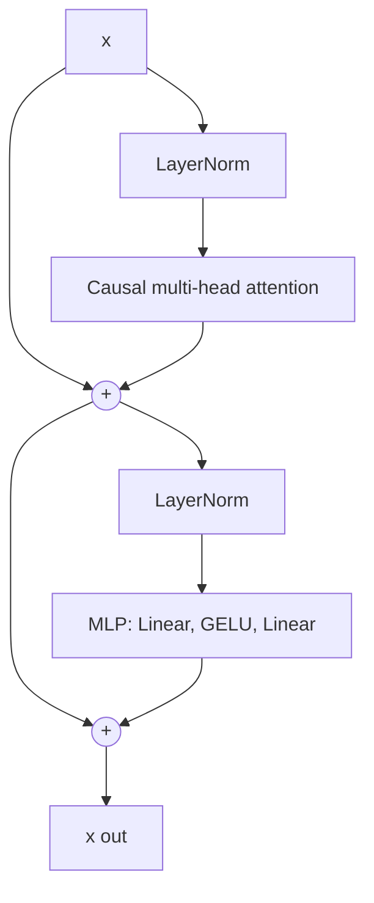
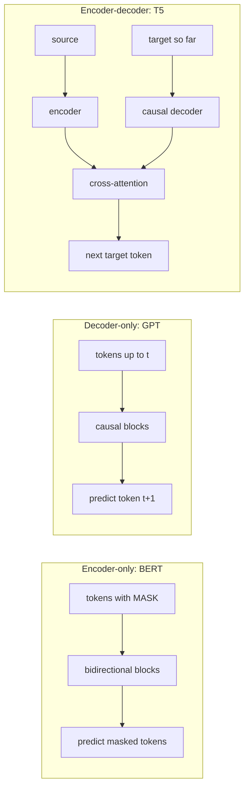

# Attention & Transformers

Module 1 gave you layers and activations. Module 2 gave you backpropagation, the
machine that trains any differentiable stack. This module introduces the one
architecture that now dominates language, vision, audio and code: the
**transformer**. We go from the problem it solved, through the math of attention,
to a working GPT you can train on your laptop. The LLM Engineering course goes deep
on the production details (RoPE, the KV cache, serving); here we build the
conceptual foundation and a first implementation. Four parts:

- **Why attention** — the failure modes of recurrent networks that forced the leap.
- **Scaled dot-product attention** — query/key/value, the formula, and the $\sqrt{d_k}$.
- **Heads, positions and masks, then the full block** — assembled into a tiny GPT.
- **Families, objectives and cost** — BERT vs. GPT vs. T5, and why attention is $O(n^2)$.

---

## 3.1 — Why Sequence Models Needed Attention

Language is a sequence of variable length where meaning depends on distant context:
in "The keys that I left on the table in the kitchen **are** missing", the verb must
agree with "keys", eight tokens back. A network for sequences must carry information
across time.

The classic answer is the **recurrent neural network**. It keeps a hidden state $h_t$
and updates it one token at a time:

$$
h_t = \tanh\!\left(W_h h_{t-1} + W_x x_t + b\right)
$$

Everything the model knows about tokens $1..t$ must be squeezed into the single
vector $h_t$. This causes three distinct problems.

**1. Vanishing (and exploding) gradients through time.** Backpropagation through
time (Module 2) unrolls the loop, so the gradient of the loss at step $T$ with
respect to an early state $h_k$ is a product of Jacobians:

$$
\frac{\partial h_T}{\partial h_k} = \prod_{t=k+1}^{T} \frac{\partial h_t}{\partial h_{t-1}} = \prod_{t=k+1}^{T} \operatorname{diag}\!\left(\tanh'(\cdot)\right) W_h
$$

Each factor has norm roughly $\|W_h\|\cdot|\tanh'|$ with $|\tanh'| \le 1$. If the
largest singular value of $W_h$ is below about 1, the product shrinks
exponentially in $T - k$; if above, it explodes. Gradient clipping tames explosion,
but vanishing has no cheap fix: the signal from a token 100 steps back is
numerically zero, so the model cannot *learn* long-range dependencies even if it
could represent them.

**2. LSTMs and GRUs help, but only partly.** The LSTM adds a **cell state** $c_t$
updated additively through gates:
$c_t = f_t \odot c_{t-1} + i_t \odot \tilde{c}_t$. When the forget gate $f_t$ is
near 1 the gradient flows through $c$ almost unchanged, a learned "gradient
highway" (the same idea residual connections later reuse). This stretches usable
memory from tens to a few hundred steps, but the state is still a fixed-size
vector, and information is still overwritten as new tokens arrive.

**3. The seq2seq context bottleneck, and no parallelism.** In machine translation
(Sutskever et al., 2014) an **encoder** RNN reads the source sentence and its final
hidden state becomes the **context vector** the **decoder** RNN conditions on. A
whole paragraph must pass through one fixed-size vector, and translation quality
visibly collapsed as sentences grew. Separately, an RNN is inherently sequential:
$h_t$ needs $h_{t-1}$, so a 1,000-token sequence takes 1,000 serial steps and
cannot use a GPU's parallel hardware across time.

**Attention** (Bahdanau et al., 2014) removed the bottleneck: instead of the last
state alone, the decoder looks back at *all* encoder states and takes a weighted
average, with weights computed from relevance to the current step. The 2017 paper
"Attention Is All You Need" then asked the radical question: if attention does the
real work, delete the recurrence entirely.

| Property | RNN / LSTM | Transformer |
| --- | --- | --- |
| Path between token $i$ and $j$ | $O(\lvert i-j \rvert)$ steps | $O(1)$, one attention hop |
| Parallel over sequence at training | No (serial in time) | Yes (all positions at once) |
| Memory of the past | One fixed-size state | The whole sequence, addressable |
| Cost per layer | $O(n\,d^2)$ | $O(n^2 d + n\,d^2)$ |

The transformer trades cheap-but-serial for costlier-but-parallel, and on modern
accelerators that trade wins decisively. Section 3.4 returns to the $n^2$ price.

---

## 3.2 — Scaled Dot-Product Attention

### The query/key/value intuition

Think of a soft dictionary lookup. A normal dictionary takes a **query**, finds the
one **key** that matches exactly, and returns its **value**. Attention makes this
differentiable: compare the query against *every* key, turn the similarities into
weights that sum to 1, and return the weighted blend of all values.

Each token's embedding $x_i$ is projected by three learned matrices into three
roles:

- **Query** $q_i = x_i W_Q$: "what am I looking for?"
- **Key** $k_j = x_j W_K$: "what do I contain, for matching purposes?"
- **Value** $v_j = x_j W_V$: "what do I hand over if I am selected?"

Splitting key from value matters: what makes a token *findable* need not be what it
*contributes*. In "the animal didn't cross the street because **it** was tired", the
query for "it" matches the key of "animal", and the value of "animal" flows into
the representation of "it".

### The formula

Stack all queries, keys and values as rows of matrices $Q, K \in \mathbb{R}^{n \times d_k}$
and $V \in \mathbb{R}^{n \times d_v}$. Then

$$
\operatorname{Attention}(Q, K, V) = \operatorname{softmax}\!\left(\frac{Q K^{\top}}{\sqrt{d_k}}\right) V
$$

Read it left to right. $QK^\top \in \mathbb{R}^{n \times n}$ holds every
query-key dot product: entry $(i, j)$ is how much token $i$ cares about token $j$.
Dividing by $\sqrt{d_k}$ rescales (explained next). The row-wise softmax turns each
row into a probability distribution $\alpha_{ij}$ over positions, and multiplying
by $V$ makes output $i$ equal to $\sum_j \alpha_{ij} v_j$, a convex combination of
values.

```python
import numpy as np

def softmax(x, axis=-1):
    x = x - x.max(axis=axis, keepdims=True)          # subtract max: numerical stability
    e = np.exp(x)
    return e / e.sum(axis=axis, keepdims=True)

def attention(Q, K, V, mask=None):
    """Scaled dot-product attention.
    Q, K: (n, d_k)   V: (n, d_v)   mask: (n, n) bool, True = allowed to attend."""
    d_k = Q.shape[-1]
    scores = Q @ K.T / np.sqrt(d_k)                  # (n, n) similarity of every pair
    if mask is not None:
        scores = np.where(mask, scores, -1e9)        # blocked positions -> ~0 after softmax
    weights = softmax(scores, axis=-1)               # each row sums to 1
    return weights @ V, weights                      # (n, d_v) blended values

rng = np.random.default_rng(0)
n, d_model, d_k = 5, 16, 8
X = rng.normal(size=(n, d_model))                    # 5 token embeddings
Wq, Wk, Wv = (rng.normal(size=(d_model, d_k)) / np.sqrt(d_model) for _ in range(3))
out, w = attention(X @ Wq, X @ Wk, X @ Wv)
print(out.shape, w.sum(axis=-1))                     # (5, 8) [1. 1. 1. 1. 1.]
```

### Why divide by $\sqrt{d_k}$?

Suppose the components of $q$ and $k$ are independent with mean 0 and variance 1.
The dot product $q \cdot k = \sum_{m=1}^{d_k} q_m k_m$ is a sum of $d_k$ independent
terms, each with mean 0 and variance 1, so

$$
\operatorname{Var}(q \cdot k) = d_k, \qquad \text{std} = \sqrt{d_k}
$$

For $d_k = 64$ the raw scores have a standard deviation of 8. Softmax over scores
that spread out is nearly one-hot: one entry takes almost all the mass. A saturated
softmax has near-zero gradient everywhere (the same disease as a saturated sigmoid
in Module 1), so learning stalls. Dividing by $\sqrt{d_k}$ restores unit variance
regardless of head size, keeping the softmax in its responsive range.

---

## 3.3 — Heads, Positions, Masks & the Full Block

### Multi-head attention

One attention pattern per layer is too restrictive: a token may need to attend to a
syntactic partner, a coreferent noun and the previous word *simultaneously*.
**Multi-head attention** runs $h$ attentions in parallel on lower-dimensional
projections, then concatenates and mixes them:

$$
\operatorname{head}_i = \operatorname{Attention}(X W_Q^{(i)},\, X W_K^{(i)},\, X W_V^{(i)}), \qquad
\operatorname{MHA}(X) = \operatorname{Concat}(\operatorname{head}_1, \dots, \operatorname{head}_h)\, W_O
$$

With $d_{\text{model}} = 512$ and $h = 8$, each head uses $d_k = d_{\text{model}}/h = 64$,
so total compute matches one full-width head while giving $h$ independent
patterns. In practice all heads are computed with one big matmul and a reshape.

### Positional information

Attention as written is **permutation-equivariant**: shuffle the input tokens and
the outputs shuffle identically, because $QK^\top$ depends only on content. "dog
bites man" and "man bites dog" would be indistinguishable. Order must be injected.

- **Sinusoidal encodings** (original paper): add a fixed vector per position,
  $PE_{(p, 2i)} = \sin(p / 10000^{2i/d})$, $PE_{(p, 2i+1)} = \cos(p / 10000^{2i/d})$.
  Different dimensions oscillate at different frequencies, like digits of a counter.
- **Learned absolute embeddings** (GPT-2, BERT): a trainable table of shape
  `(max_len, d_model)` added to the token embeddings. Simple, but cannot extrapolate
  past `max_len`.
- **Relative / rotary schemes** (RoPE, ALiBi): encode the *distance* between tokens
  inside the attention score. These dominate modern LLMs; see
  LLM Engineering Module 1 for the full RoPE derivation.

### Causal vs. bidirectional masking

A **bidirectional** (full) attention lets every token see every other, ideal when you
want to *understand* a complete input. For **generation** the model predicts token
$t+1$ from tokens $\le t$, and if position $t$ could see the future the task would be
trivial cheating. A **causal mask** sets scores for $j > i$ to $-\infty$ before the
softmax, so those weights become exactly 0:

$$
M_{ij} = \begin{cases} 0 & j \le i \\ -\infty & j > i \end{cases}, \qquad
\operatorname{softmax}\!\left(\frac{QK^\top}{\sqrt{d_k}} + M\right)
$$

The mask is lower-triangular, which also means one forward pass trains *all* $n$
next-token predictions in parallel, a major efficiency win over RNNs.

### The transformer block

Attention only mixes information *across* positions. The block pairs it with a
per-position **MLP** (feed-forward network) that transforms each token on its own,
typically expanding to $4 d_{\text{model}}$ and back with a nonlinearity (GELU). Two
stabilizers wrap each sub-layer:

- **Residual connection**: $x \leftarrow x + \operatorname{sublayer}(x)$. Gradients
  flow through the identity path unchanged, which is what lets 100-layer stacks
  train (Module 2).
- **Layer normalization**: normalize each token's feature vector to zero mean and
  unit variance, then apply learned scale and shift. It works per token, so it is
  independent of batch size and sequence length.

The placement of the norm matters:

| Variant | Update | Behaviour |
| --- | --- | --- |
| Post-norm (original) | $x \leftarrow \operatorname{LN}(x + \operatorname{sub}(x))$ | Best final quality when it trains, but needs careful LR warmup; gradients shrink with depth |
| Pre-norm (GPT-2 onward) | $x \leftarrow x + \operatorname{sub}(\operatorname{LN}(x))$ | Clean identity residual path, stable at depth and high LR; the modern default |



### A tiny GPT in PyTorch

Everything above fits in about sixty lines. This is a decoder-only model with
pre-norm blocks, learned positions and a weight-tied output head.

```python
import math
import torch
import torch.nn as nn
import torch.nn.functional as F

class CausalSelfAttention(nn.Module):
    def __init__(self, d_model, n_heads):
        super().__init__()
        assert d_model % n_heads == 0
        self.h, self.dk = n_heads, d_model // n_heads
        self.qkv = nn.Linear(d_model, 3 * d_model)      # fused W_Q, W_K, W_V
        self.out = nn.Linear(d_model, d_model)          # W_O mixes the heads

    def forward(self, x):                               # x: (B, T, d_model)
        B, T, C = x.shape
        q, k, v = self.qkv(x).split(C, dim=-1)
        # (B, T, C) -> (B, heads, T, dk): each head attends independently
        q, k, v = (t.view(B, T, self.h, self.dk).transpose(1, 2) for t in (q, k, v))
        scores = q @ k.transpose(-2, -1) / math.sqrt(self.dk)       # (B, h, T, T)
        causal = torch.tril(torch.ones(T, T, device=x.device, dtype=torch.bool))
        scores = scores.masked_fill(~causal, float("-inf"))         # hide the future
        y = F.softmax(scores, dim=-1) @ v                           # (B, h, T, dk)
        return self.out(y.transpose(1, 2).reshape(B, T, C))         # concat heads

class Block(nn.Module):
    def __init__(self, d_model, n_heads):
        super().__init__()
        self.ln1, self.ln2 = nn.LayerNorm(d_model), nn.LayerNorm(d_model)
        self.attn = CausalSelfAttention(d_model, n_heads)
        self.mlp = nn.Sequential(nn.Linear(d_model, 4 * d_model), nn.GELU(),
                                 nn.Linear(4 * d_model, d_model))

    def forward(self, x):
        x = x + self.attn(self.ln1(x))                  # pre-norm + residual
        return x + self.mlp(self.ln2(x))

class TinyGPT(nn.Module):
    def __init__(self, vocab, d_model=128, n_heads=4, n_layers=4, max_len=128):
        super().__init__()
        self.tok = nn.Embedding(vocab, d_model)
        self.pos = nn.Embedding(max_len, d_model)       # learned absolute positions
        self.blocks = nn.ModuleList(Block(d_model, n_heads) for _ in range(n_layers))
        self.ln_f = nn.LayerNorm(d_model)
        self.head = nn.Linear(d_model, vocab, bias=False)
        self.head.weight = self.tok.weight              # weight tying: share embedding

    def forward(self, idx, targets=None):               # idx: (B, T) token ids
        B, T = idx.shape
        x = self.tok(idx) + self.pos(torch.arange(T, device=idx.device))
        for blk in self.blocks:
            x = blk(x)
        logits = self.head(self.ln_f(x))                # (B, T, vocab)
        loss = None
        if targets is not None:                         # next-token cross-entropy
            loss = F.cross_entropy(logits.view(-1, logits.size(-1)), targets.view(-1))
        return logits, loss

    @torch.no_grad()
    def generate(self, idx, steps, temperature=1.0, max_len=128):
        for _ in range(steps):
            logits, _ = self(idx[:, -max_len:])         # crop to the context window
            probs = F.softmax(logits[:, -1] / temperature, dim=-1)
            idx = torch.cat([idx, torch.multinomial(probs, 1)], dim=1)
        return idx

# Train on any text: targets are the inputs shifted left by one token.
text = open("input.txt").read()
chars = sorted(set(text)); stoi = {c: i for i, c in enumerate(chars)}
data = torch.tensor([stoi[c] for c in text])
model = TinyGPT(vocab=len(chars))
opt = torch.optim.AdamW(model.parameters(), lr=3e-4)
for step in range(2000):
    ix = torch.randint(len(data) - 129, (32,))
    x = torch.stack([data[i:i + 128] for i in ix])
    y = torch.stack([data[i + 1:i + 129] for i in ix])
    _, loss = model(x, y)
    opt.zero_grad(); loss.backward(); opt.step()
```

Because of the causal mask, every position yields a training signal in one pass, and
a random model starts near loss $\ln V$. In PyTorch 2.x,
`F.scaled_dot_product_attention(q, k, v, is_causal=True)` replaces the manual lines
with a fused FlashAttention kernel.

---

## 3.4 — Model Families, Objectives & the Cost of Attention

The same block, wired three ways, gives three families.

| Family | Attention | Example | Objective | Best for |
| --- | --- | --- | --- | --- |
| Encoder-only | Bidirectional | BERT, RoBERTa | Masked language modeling | Classification, embeddings, retrieval, NER |
| Decoder-only | Causal | GPT, Llama, Claude | Next-token prediction | Open-ended generation, chat, code |
| Encoder-decoder | Bidirectional encoder, causal decoder + cross-attention | T5, BART, original Transformer | Span corruption / denoising | Translation, summarization, seq2seq |

**Encoder-only (BERT).** Every token sees the full context in both directions, so
each output vector is a rich contextual representation of its token. It cannot
generate text naturally, but it is excellent at *understanding*: sentiment, entity
tagging, sentence embeddings. Its pretraining objective is **masked language
modeling (MLM)**: hide about 15% of tokens and predict them from both sides,

$$
\mathcal{L}_{\text{MLM}} = -\sum_{i \in \text{masked}} \log p_\theta\!\left(x_i \mid x_{\setminus \text{masked}}\right)
$$

Only the masked 15% of positions yield a loss, so MLM learns less per token than
next-token prediction.

**Decoder-only (GPT).** A causal stack trained on **next-token prediction**:

$$
\mathcal{L}_{\text{LM}} = -\sum_{t=1}^{n} \log p_\theta\!\left(x_t \mid x_{<t}\right)
$$

Every position supplies a loss, the objective needs no labels (the text *is* the
label), and generation is just sampling the model's own predictions in a loop.
This simplicity, together with strong scaling behaviour (Module 4), is why decoder-only
won: one architecture and one objective cover chat, code and reasoning via prompting.

**Encoder-decoder (T5).** The encoder reads the input bidirectionally; the decoder
generates causally and, in each block, adds **cross-attention** whose queries come
from the decoder but whose keys and values come from the encoder output. T5 frames
every task as text-to-text and pretrains with **span corruption**: replace random
spans with sentinel tokens and have the decoder reconstruct them. It remains a
strong fit when input and output are distinct sequences, though many such tasks are
now handled by large decoder-only models.



### The $O(n^2)$ cost

The score matrix $QK^\top$ is $n \times n$ per head, so one attention layer costs

$$
\underbrace{O(n^2 d)}_{\text{scores and weighted sum}} \;+\; \underbrace{O(n\, d^2)}_{\text{projections and MLP}}
$$

in compute, and $O(n^2)$ per head in memory if the full matrix is materialized.
Doubling the context length quadruples the attention work. For small $n$ the
$n d^2$ term dominates; attention becomes the bottleneck when $n \gtrsim d$.

For scale: at 32 heads in fp16, one layer's score matrix is about 0.25 GiB at
$n=2{,}048$, 4 GiB at 8,192, and 1 TiB at 131,072 (it grows with $n^2$).

The fix in practice is not to change the math but to avoid *storing* the matrix:
**FlashAttention** computes exact attention in tiles that stay in fast on-chip
memory, cutting memory to $O(n)$ and, by reducing memory traffic, running faster
too. Compute is still quadratic; approximations (sliding windows, sparse and linear
attention) exist but trade quality. The serving-side consequences, including the KV
cache and long-context memory, are covered in
LLM Engineering Module 2.

---

## Key takeaways

- **RNNs** compress history into one fixed-size state, suffer vanishing gradients
  across long spans (a product of Jacobians), and are serial in time. LSTMs soften
  this with additive cell-state paths; the seq2seq context vector remained a
  bottleneck that **attention** removed by letting the decoder read all states.
- **Scaled dot-product attention** is a differentiable lookup:
  $\operatorname{softmax}(QK^\top/\sqrt{d_k})V$. Queries ask, keys advertise, values
  deliver. The $\sqrt{d_k}$ keeps score variance at 1 so the softmax does not
  saturate and kill gradients.
- **Multi-head attention** gives several independent patterns at the same compute.
  Attention is order-blind, so **positions** must be injected (sinusoidal, learned,
  or relative like RoPE), and a **causal mask** forbids looking ahead so all next-token
  losses train in one parallel pass.
- A **transformer block** is attention (mix across tokens) plus an MLP (transform
  each token), each wrapped in a **residual** and a LayerNorm. **Pre-norm** keeps a
  clean identity path and is the stable modern default. A tiny GPT is the block
  stacked, with embeddings in and a tied linear head out.
- **BERT** (bidirectional, masked LM) understands; **GPT** (causal, next-token)
  generates; **T5** (encoder-decoder with cross-attention, span corruption) maps one
  sequence to another. Attention costs $O(n^2)$ in compute and, naively, memory;
  FlashAttention fixes the memory without changing the result.

## Exercises

1. **Verify the scale.** Using the numpy code, sample random $q, k$ for
   $d_k \in \{16, 64, 256, 1024\}$ and plot the standard deviation of $q\cdot k$ with
   and without the $1/\sqrt{d_k}$. Then feed unscaled scores to `softmax` and plot
   the mean maximum attention weight versus $d_k$ to show the saturation toward
   one-hot.

2. **Prove the mask.** Call `attention` with a lower-triangular boolean mask and
   assert that `weights` is exactly lower-triangular and that each row sums to 1.
   Then change the last token of the input and confirm that earlier output rows do
   not change, which is the causal guarantee.

3. **Train the tiny GPT.** Train `TinyGPT` on a text file (for instance, Shakespeare)
   for 2,000 steps. Record the initial loss and check it is near $\ln V$, plot the
   curve, and sample with `generate` at temperatures 0.5, 1.0 and 1.5. Then swap the
   manual attention for `F.scaled_dot_product_attention(..., is_causal=True)` and
   confirm the logits match to within float tolerance.

4. **Pre-norm vs. post-norm.** Change `Block` to post-norm
   (`x = ln1(x + attn(x))`), train 12 layers with a high learning rate (3e-3) and no
   warmup, and compare loss curves and gradient norms in the first blocks against
   the pre-norm version. Report which diverges or stalls and why the residual path
   explains it.

## Next: Module 4 — Why Scale Works

You now have the architecture and a model that trains. Module 4 asks the question
that reshaped the field: why does making this same block bigger, with more
parameters, data and compute, keep getting predictably better? We cover scaling laws
and the Chinchilla compute-optimal trade-off, emergent abilities and how real they
are, the optimization and data realities of training at scale, and the limits that
remain.
