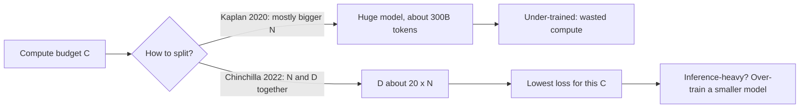
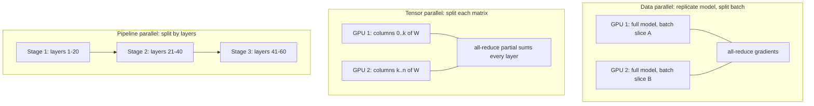

# Why Scale Works

Modules 1 through 3 gave you the parts: neurons and activations, backpropagation, and
the attention-based transformer. None of them explains why the field's dominant
strategy for the last decade has been to make the same architecture *bigger* and train
it on *more*. This final module answers that. Scaling is not folklore; it follows
smooth, measurable laws that let labs predict a trillion-token run's loss before
spending the money. Four parts:

- **Scaling laws and compute** — power laws, Chinchilla, and the 6ND rule.
- **Emergence and in-context learning** — what appears with scale, and what is a mirage.
- **Training at scale** — the memory arithmetic, parallelism, and ZeRO/FSDP.
- **Data, experts and limits** — the data wall, MoE, and what scaling cannot (yet) do.

---

## 4.1 — Scaling Laws & the Compute Budget

In 2020 Kaplan et al. trained hundreds of language models and found that test loss
$L$ falls as a **power law** in each of three resources when the other two are not
bottlenecks: parameters $N$, dataset tokens $D$, and training compute $C$:

$$
L(N) \approx \left(\frac{N_c}{N}\right)^{\alpha_N}, \qquad L(D) \approx \left(\frac{D_c}{D}\right)^{\alpha_D}, \qquad L(C) \approx \left(\frac{C_c}{C}\right)^{\alpha_C}
$$

with small exponents (roughly $\alpha_N \approx 0.076$, $\alpha_D \approx 0.095$,
$\alpha_C \approx 0.050$). On a log-log plot a power law is a straight line, and that
straightness held across more than seven orders of magnitude of compute. The exponents
are small, so each 10x of compute buys only a modest, but *predictable*, drop in loss.
That predictability is the whole point: you can fit small runs and extrapolate.

**Chinchilla (Hoffmann et al., 2022)** corrected the recipe. Kaplan had suggested
spending extra compute mostly on model size, so labs trained huge models on about 300B
tokens. Chinchilla refit the surface with a joint form that has an irreducible floor:

$$
L(N, D) = E + \frac{A}{N^{\alpha}} + \frac{B}{D^{\beta}}
$$

Here $E$ is the entropy of natural text (the loss a perfect model would still pay),
the second term is the penalty for a model that is too small, and the third is the
penalty for too little data. The published fit is approximately $E \approx 1.69$,
$A \approx 406$, $B \approx 411$, $\alpha \approx 0.34$, $\beta \approx 0.28$.
Minimizing $L$ under a fixed compute budget gives the result that reshaped the
industry: parameters and tokens should scale **in equal proportion**, landing near
**20 tokens per parameter**. A 70B model wants about 1.4T tokens; the 280B Gopher,
trained on 300B tokens, was badly *under-trained*, and the 70B Chinchilla trained on 4x
more data beat it at the same compute.



One caveat matters in practice: Chinchilla optimizes *training* compute only. A model
that will serve billions of requests should be **over-trained** (far past 20 tokens per
parameter), because a smaller model costs less on every inference. This is why
open models such as Llama 3 8B were trained on roughly 15T tokens, about 1,900 tokens
per parameter.

### The 6ND rule and a compute calculator

Training cost is dominated by matrix multiplies. A forward pass costs about $2N$ FLOPs
per token (one multiply and one add per weight), and the backward pass costs about
twice the forward (gradients with respect to both activations and weights). Together:

$$
C \approx 6\,N\,D \ \text{FLOPs}
$$

This ignores the attention score computation, which is small for moderate context
lengths, and it is accurate to within a few tens of percent. Combine it with the
$D = 20N$ rule and you get $C = 120\,N^2$, so $N_{\text{opt}} = \sqrt{C / 120}$.

```python
import math

# Chinchilla (Hoffmann et al. 2022) approximate fit: L = E + A/N^a + B/D^b
E, A, B, ALPHA, BETA = 1.69, 406.4, 410.7, 0.34, 0.28

def loss(n_params, n_tokens):
    """Predicted pre-training loss (nats/token) for N parameters, D tokens."""
    return E + A / n_params**ALPHA + B / n_tokens**BETA

def train_flops(n_params, n_tokens):
    """The 6ND rule: 2ND forward + 4ND backward."""
    return 6 * n_params * n_tokens

def compute_optimal(flops):
    """Given a budget C, use D = 20N and C = 6ND = 120 N^2  =>  N = sqrt(C/120)."""
    n = math.sqrt(flops / 120)
    return n, 20 * n

def gpu_days(flops, gpus, peak_tflops=989, mfu=0.40):
    """Wall-clock estimate. peak_tflops: BF16 dense peak of one H100 (~989).
    MFU (model FLOPs utilization) is the fraction of peak you really achieve;
    30-50 percent is typical for a well-tuned large run."""
    sustained = gpus * peak_tflops * 1e12 * mfu           # FLOPs per second
    return flops / sustained / 86400                      # seconds -> days

# Worked example: a Chinchilla-style 70B model on 1.4T tokens.
N, D = 70e9, 1.4e12
C = train_flops(N, D)
print(f"compute      : {C:.2e} FLOPs")                    # about 5.9e23
print(f"loss (fit)   : {loss(N, D):.3f}")                 # about 1.94
print(f"wall clock   : {gpu_days(C, gpus=2048):.0f} days on 2048 H100s")

# Reverse question: what is the best model for a 1e24 FLOP budget?
n_opt, d_opt = compute_optimal(1e24)
print(f"1e24 budget  : N = {n_opt/1e9:.0f}B params, D = {d_opt/1e12:.1f}T tokens")

# Compare against an over-sized, under-trained model at the SAME compute.
n_big = 4 * n_opt
d_big = 1e24 / (6 * n_big)
print(f"optimal loss : {loss(n_opt, d_opt):.3f}")
print(f"4x-bigger    : {loss(n_big, d_big):.3f}  (worse at equal compute)")
```

Run it and the worked example prints roughly $5.9 \times 10^{23}$ FLOPs and about 8
days on 2,048 H100s at 40 percent MFU. The same code shows the Chinchilla lesson
numerically: at fixed compute, the 4x-bigger model trained on a quarter of the data has
a *higher* loss than the balanced one.

---

## 4.2 — Emergence & In-Context Learning

Smooth loss curves hide something stranger. Downstream *task* performance often looks
flat near chance for small models and then rises sharply past some scale. Wei et al.
(2022) called these **emergent abilities**: multi-digit arithmetic, chain-of-thought
reasoning, and word unscrambling were near zero for models below a threshold and then
jumped. If real, this is both exciting and worrying, since it means you cannot always
predict a capability from smaller runs even though the loss is perfectly predictable.

### The measurement-artifact debate

Schaeffer et al. (2023), in "Are Emergent Abilities a Mirage?", argued that much of the
sharpness comes from **the metric, not the model**. Consider a task scored by *exact
match* on a $k$-token answer. If the per-token accuracy is $p$, then exact match is
roughly $p^{k}$. A model whose per-token accuracy improves smoothly from 0.80 to 0.95
sees exact match go from $0.80^{10} \approx 0.11$ to $0.95^{10} \approx 0.60$, which
looks like a cliff on a linear axis even though nothing discontinuous happened
underneath. Switch to a continuous metric, such as per-token log-likelihood or partial
credit, and the curve becomes smooth.

The honest summary is that the debate is not fully settled. The artifact argument
explains many reported jumps, and it teaches a durable lesson: **choose metrics that
degrade gracefully**. But some capabilities, such as using a long chain of reasoning
steps reliably, genuinely require several sub-skills to all be present, so a compounding
product of probabilities is a real property of the task rather than a trick of scoring.
Treat "emergence" as a statement about *usable* reliability crossing a threshold, not
as evidence of a phase transition in the weights.

### In-context learning

The most consequential large-model behavior is **in-context learning (ICL)**: given a
few examples in the prompt, the model performs a new task with *no weight update*.

```text
Translate to French.
sea otter => loutre de mer
cheese => fromage
peppermint =>
```

GPT-3 (175B) showed that few-shot accuracy improves with scale far more steeply than
zero-shot accuracy, as if larger models were better at "learning to learn" inside the
forward pass. Mechanistic work gives partial explanations: attention heads called
**induction heads** copy patterns of the form "A B ... A -> B", which is a primitive
form of in-context pattern completion, and their formation coincides with a visible
bump in the training loss curve. Other analyses show transformers can implement
gradient-descent-like updates over the prompt's examples. What is firmly established is
that ICL is a *consequence of next-token prediction at scale*: nothing in the training
objective mentions few-shot learning, yet predicting the next token across diverse
documents rewards inferring the latent task from context.

---

## 4.3 — Training at Scale: Memory Arithmetic & Parallelism

Modules 2 and 3 treated training as one loop on one device. At scale, the first
obstacle is not speed but **memory**. Count what mixed-precision training with Adam
must hold *per parameter*:

| Component | Precision | Bytes/param |
| --- | --- | --- |
| Weights (working copy) | BF16 | 2 |
| Gradients | BF16 | 2 |
| FP32 master weights | FP32 | 4 |
| Adam first moment $m$ | FP32 | 4 |
| Adam second moment $v$ | FP32 | 4 |
| **Total** | | **16** |

A 7B model therefore needs $7\text{B} \times 16 = 112$ GB for state alone, before
activations, and a 70B model needs 1.12 TB. No single 80 GB GPU holds even the 7B case.
The optimizer states (12 of the 16 bytes) dominate, which is where the biggest savings
hide.

```python
def training_memory_gb(n_params, n_gpus=1, zero_stage=0):
    """Per-GPU bytes for model state under ZeRO sharding (activations excluded).
    Per param: 2 (bf16 weights) + 2 (bf16 grads) + 12 (fp32 master + m + v)."""
    w, g, o = 2.0, 2.0, 12.0
    if zero_stage >= 1: o /= n_gpus          # stage 1: shard optimizer states
    if zero_stage >= 2: g /= n_gpus          # stage 2: also shard gradients
    if zero_stage >= 3: w /= n_gpus          # stage 3 (FSDP): also shard weights
    return n_params * (w + g + o) / 1e9

for stage in (0, 1, 2, 3):
    gb = training_memory_gb(70e9, n_gpus=64, zero_stage=stage)
    print(f"ZeRO-{stage}: {gb:8.1f} GB per GPU (70B model, 64 GPUs)")
# Stage 0: 1120 GB, stage 1: 297.5 GB, stage 2: 165.8 GB, stage 3: 17.5 GB
```

The fix is to split the work across devices. There are three orthogonal axes, and
production runs combine all of them (often called **3D parallelism**).

- **Data parallelism (DP).** Every GPU holds a full model replica and processes a
  different slice of the batch; gradients are averaged with an **all-reduce** before the
  step. It scales throughput almost linearly but replicates all 16 bytes per parameter
  on every device, so it alone cannot fit large models.
- **Tensor parallelism (TP).** Individual matrices are split across GPUs. In an MLP,
  split the first weight matrix by columns and the second by rows, so each GPU computes
  a partial result and one all-reduce combines them. It demands very fast links
  (NVLink) because it communicates *inside every layer*, so it is usually confined to
  one node of 8 GPUs.
- **Pipeline parallelism (PP).** Consecutive groups of layers live on different GPUs
  (stage 1 holds layers 1-20, stage 2 holds 21-40, and so on). The batch is cut into
  **micro-batches** that flow through the stages like an assembly line. Idle time at the
  start and end, the **bubble**, shrinks as the number of micro-batches $m$ grows
  relative to stages $p$: bubble fraction $\approx (p - 1)/(m + p - 1)$.



**ZeRO and FSDP** attack the redundancy in data parallelism directly. The Zero
Redundancy Optimizer observes that replicating optimizer states, gradients and weights
on every DP rank is wasteful, and **shards** them instead: stage 1 shards optimizer
states, stage 2 adds gradients, and stage 3 also shards the weights themselves,
all-gathering each layer's weights just in time for its forward and backward pass and
discarding them afterward. The calculator above shows the effect: the 70B model drops
from 1.12 TB per GPU to about 17.5 GB of state on 64 GPUs at stage 3. PyTorch's **FSDP**
(Fully Sharded Data Parallel) is the same idea as stage 3. The price is extra
communication, roughly 1.5x the traffic of plain DP, which is why it works best with
fast interconnects and why TP and PP still matter at the largest scales.

---

## 4.4 — Data, Experts & the Limits of Scaling

### Data is the bottleneck

Chinchilla made data a first-class resource, and it is the one that does not grow on
demand. The useful stock of high-quality public human text is on the order of tens of
trillions of tokens, and frontier runs already consume a large fraction of it, the
so-called **data wall**. Four forces shape what you do about it.

- **Quality beats quantity.** Filtering by a quality classifier, deduplicating, and
  weighting textbooks and code over raw web crawl yields models that match much larger
  ones trained on unfiltered data. Phi-style "textbook quality" corpora and the FineWeb
  filtering results show that a 10x smaller, cleaner set can win.
- **Repetition has a decay curve.** Muennighoff et al. (2023) found that repeating data
  for up to about 4 epochs is nearly as good as fresh data, but returns fall off
  steeply beyond roughly 16 epochs, and eventually add nothing or hurt.
- **Synthetic data** from stronger models (reasoning traces, rewritten documents, code
  with verified execution) extends the supply, especially in domains with a checker,
  such as math and code. The risk is **model collapse**: training repeatedly on a
  model's own outputs narrows the distribution and loses the tails, so synthetic data
  needs fresh human data and verification mixed in.
### Mixture of experts: parameters without FLOPs

Dense scaling couples parameters and compute: every token touches every weight, so cost
is $6ND$ with all of $N$ active. A **mixture-of-experts (MoE)** layer replaces the
feed-forward block with $E$ parallel expert FFNs and a small **router** that sends each
token to only the top $k$ of them (commonly $k = 1$ or $2$):

$$
y = \sum_{i \in \text{TopK}(g(x))} \operatorname{softmax}(g(x))_i \; \text{FFN}_i(x)
$$

Total parameters grow with $E$, but the per-token FLOPs depend only on the $k$ active
experts. Mixtral 8x7B has about 47B total parameters but activates roughly 13B per
token, giving much of the quality of a large dense model at the inference FLOPs of a
13B one. The costs are real: all experts must sit in memory (so memory scales with
*total* parameters), the router needs a **load-balancing loss** so tokens do not pile
onto a few experts, and expert parallelism adds all-to-all communication.

```python
import torch
import torch.nn as nn
import torch.nn.functional as F

class TopKMoE(nn.Module):
    """Sparse MoE FFN: route each token to its top-k experts and mix by gate weight."""
    def __init__(self, d_model, d_ff, n_experts=8, k=2):
        super().__init__()
        self.k = k
        self.router = nn.Linear(d_model, n_experts, bias=False)
        self.experts = nn.ModuleList(
            nn.Sequential(nn.Linear(d_model, d_ff), nn.GELU(), nn.Linear(d_ff, d_model))
            for _ in range(n_experts))

    def forward(self, x):                                  # x: (tokens, d_model)
        logits = self.router(x)                            # (tokens, n_experts)
        top_w, top_i = logits.topk(self.k, dim=-1)         # pick k experts per token
        top_w = F.softmax(top_w, dim=-1)                   # renormalize over the k
        out = torch.zeros_like(x)
        for slot in range(self.k):
            for e, expert in enumerate(self.experts):
                mask = top_i[:, slot] == e                 # tokens sent to expert e
                if mask.any():                             # only active experts compute
                    out[mask] += top_w[mask, slot, None] * expert(x[mask])
        return out
```

### Limits and open questions

Scaling pre-training is not the only axis anymore, and it is not free.

- **Inference-time compute.** Reasoning models spend extra tokens "thinking" before
  answering, and accuracy on hard math and code problems improves with the length or
  number of those chains, a *second scaling law* with test-time compute on the x-axis.
  Sampling many answers and verifying them (best-of-$n$, majority vote, search guided by
  a verifier) trades serving cost for quality. The open question is where to put a
  marginal dollar: a bigger model, more data, or more thinking per query.
- **Diminishing returns.** A power law with exponent 0.05 means that halving the
  reducible loss takes an astronomically larger budget, and the loss floor $E$ is
  unreachable. Lower loss also does not translate linearly into usefulness: benchmarks
  saturate and the remaining errors concentrate in rare, hard cases.
- **Energy and cost.** A $6 \times 10^{23}$ FLOP run consumes on the order of gigawatt-hours
  of electricity; frontier clusters now draw tens to hundreds of megawatts. Training is
  a one-off, but inference at billions of queries per day is a continuing load, which
  is why efficiency work (MoE, quantization, distillation) matters as much as scale.
- **What scale does not fix.** Hallucination, brittle long-horizon planning, and
  sample efficiency (a child needs far fewer words than a model) remain open, and
  whether they yield to more scale, better algorithms, or new architectures is an
  unresolved empirical question.

| Lever | Cost it adds | Typical use |
| --- | --- | --- |
| More parameters | Memory, 6ND FLOPs | Raise capability ceiling |
| More tokens | Data supply, FLOPs | Fix under-training (Chinchilla) |
| Over-training | Training FLOPs | Cheaper inference per query |
| MoE | Memory, routing complexity | More params at fixed FLOPs |
| Test-time compute | Latency, per-query cost | Hard reasoning tasks |

---

## Key takeaways

- **Scaling laws** say loss falls as a smooth power law in parameters, data and
  compute. **Chinchilla** refined this to $L = E + A/N^{\alpha} + B/D^{\beta}$ and
  showed that, for a fixed training budget, $N$ and $D$ should grow together at about 20
  tokens per parameter. For cheap inference, deliberately over-train a smaller model.
- **Compute** for a run is $C \approx 6ND$ FLOPs, which turns a model size and token
  count into GPU-days once you account for peak throughput and an MFU of 30 to 50
  percent.
- **Emergent abilities** may be partly a **measurement artifact**: all-or-nothing
  metrics turn smooth per-token gains into apparent cliffs. **In-context learning** is a
  by-product of next-token prediction at scale, supported by mechanisms like induction
  heads.
- **Memory, not speed, forces distribution.** Mixed-precision Adam costs 16 bytes per
  parameter. **Data, tensor and pipeline parallelism** split batch, matrices and layers;
  **ZeRO/FSDP** shard optimizer state, gradients and weights to remove replication.
- **Data** is the scarce input (quality, bounded repetition, careful synthetic data),
  **MoE** decouples parameters from FLOPs, and the frontier is shifting toward
  **test-time compute**, tempered by diminishing returns and energy cost.

## Exercises

1. **Fit your own law.** Train five tiny transformers (for example 0.5M to 20M
   parameters) on the same corpus for a fixed number of tokens each, record final loss,
   and fit $L = E + A N^{-\alpha}$ with `scipy.optimize.curve_fit`. Plot on log-log axes,
   extrapolate to a model 4x larger, then train it and report how far the prediction was
   off.

2. **Budget a run.** Using the calculator, choose a budget of $10^{22}$ FLOPs. Compute
   the Chinchilla-optimal $N$ and $D$, the predicted loss, and the wall-clock days on 256
   GPUs at 35 percent MFU. Then compute the same for an over-trained model of one
   quarter the size and compare training cost against inference FLOPs per token.

3. **Reproduce the mirage.** Evaluate any small model on a multi-token exact-match task
   at several checkpoints, and also record per-token accuracy and per-token
   log-likelihood. Plot all three against training steps and show which metric produces
   a sudden jump and which stays smooth, using $p^k$ to explain the gap.

4. **Shard it on paper and in code.** For a 13B model on 16 GPUs, compute per-GPU
   model-state memory at ZeRO stages 0 to 3 with `training_memory_gb`, then wrap a small
   model in `torch.distributed.fsdp.FullyShardedDataParallel` on two GPUs (or CPU
   `gloo` processes) and compare measured peak memory to your arithmetic. Finally add
   activation checkpointing and note the memory-for-compute trade.

## Course complete: Deep Learning Essentials

You started from a single neuron and ended at the frontier. Module 1 built neurons,
layers and activations; Module 2 derived backpropagation, the algorithm that makes
learning possible; Module 3 assembled attention and the transformer; and Module 4
explained why that one architecture, fed more compute and data, keeps getting better
along curves you can predict and budget.

The through-line: **deep learning is optimization of a simple differentiable function
at enormous scale, and the scale itself is governed by measurable laws.** Knowing the
mechanics (gradients, attention) and the economics (6ND, 16 bytes per parameter,
tokens per parameter) lets you reason about any model, from a classroom MLP to a
frontier system, with the same small set of ideas.

Where next on the roadmap: **LLM Engineering** takes the transformer into production,
with the KV cache, continuous batching, FlashAttention, quantization and LoRA.
**Fine-Tuning & Adaptation** covers data curation, supervised fine-tuning and
preference alignment with DPO to turn a base model into one that behaves well. And
**MLOps** covers the surrounding discipline of reproducible training pipelines,
experiment tracking, deployment and monitoring that keeps a model useful after it
ships.
