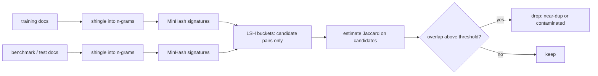
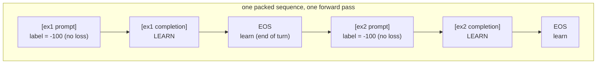

# The Data Engine: Curation & Formatting

Course 6 covered the *mechanics* of fine-tuning (LoRA, quantization). This course
is about the *practice*, and it starts where every successful fine-tune actually
starts: the data. A fine-tune is only as good as the examples you feed it, and most
failures are data failures, not training failures. This module builds the data
engine, in four parts:

- **Data quality and LIMA** — why a small curated set beats a large scraped one.
- **Chat formats** — the wire format, and why a mismatch destroys the model.
- **De-duplication and de-contamination** — stopping benchmark leakage.
- **Sequence packing and loss masking** — efficiency, and learning only completions.

---

## 1.1 — Data Quality & The LIMA Principle

The instinct is to gather as much fine-tuning data as possible. LIMA ("Less Is More
for Alignment," Zhou et al.) showed the opposite: a 65B model fine-tuned on just
**1,000** carefully curated instruction-response pairs, with no RLHF, was competitive
with models trained on orders of magnitude more data. The result rests on the
**Superficial Alignment Hypothesis**: a model's knowledge and capabilities are
learned almost entirely during pretraining, and instruction tuning does not teach new
knowledge, it teaches *format, style, and persona* for interacting with a user. You
are unlocking latent capability, not installing new capability, and a small, diverse,
high-quality set is enough to do that.

The consequences for the data engine are sharp:

- **Quality dominates quantity.** A thousand excellent examples beat a hundred
  thousand noisy scraped ones. Noise is not neutral: inconsistent formatting, factual
  errors, and low-quality responses actively teach the model bad behavior, because SFT
  is imitation and the model imitates whatever you show it.
- **Diversity of prompts, consistency of style.** The inputs should span many tasks
  and domains to cover the interaction space, while the outputs should share one
  consistent voice and structure, because that voice is exactly what the model learns
  to reproduce.
- **Curation is the work.** The effort belongs in filtering, editing, deduplicating,
  and quality-scoring (often with an LLM judge, Course 1), not in scraping more.

| | Large scraped set | Small curated set (LIMA) |
| --- | --- | --- |
| Size | 100k+ noisy examples | ~1k hand-checked examples |
| Teaches | Noise, errors, inconsistent style | Consistent helpful format/style |
| Effort | Collection | Curation and editing |
| Result | Diluted, sometimes worse | Strong alignment |

The honest boundary: LIMA is about *alignment* (style and format), not knowledge. You
cannot teach a model facts it never saw in pretraining with a thousand examples, and
genuinely new skills may need more. But even then, quality dominates, and a clean
small set beats a dirty large one every time.

---

## 1.2 — Chat Formats (ChatML, Llama-3, Alpaca)

A conversation of system, user, and assistant turns must be serialized into a single
token sequence before the model ever sees it, and that serialization uses a specific
template with **special tokens** that mark role boundaries. The model learns to
recognize those boundaries and to generate the assistant turn.

**ChatML** (OpenAI) wraps each message with `<|im_start|>` and `<|im_end|>` around a
role name:

```text
<|im_start|>system
You are a helpful assistant.<|im_end|>
<|im_start|>user
What is 2 + 2?<|im_end|>
<|im_start|>assistant
4<|im_end|>
```

**Llama-3** uses `<|begin_of_text|>`, a header pair `<|start_header_id|>` and
`<|end_header_id|>` around the role, and `<|eot_id|>` (end of turn):

```text
<|begin_of_text|><|start_header_id|>system<|end_header_id|>

You are helpful.<|eot_id|><|start_header_id|>user<|end_header_id|>

Hi<|eot_id|><|start_header_id|>assistant<|end_header_id|>

Hello!<|eot_id|>
```

**Alpaca** is an older, simpler format with *no* special role tokens, using plain-text
markers like `### Instruction:` and `### Response:` instead. It is easier to read but
less robust, because the markers are ordinary tokens the model matches only as a text
pattern.

| Format | Role markers | Special tokens | Robustness |
| --- | --- | --- | --- |
| ChatML | `<|im_start|>` role ... `<|im_end|>` | Yes (atomic) | High |
| Llama-3 | `<|start_header_id|>` role `<|end_header_id|>` ... `<|eot_id|>` | Yes (atomic) | High |
| Alpaca | `### Instruction:` / `### Response:` | No | Lower (text pattern only) |

### Why a format mismatch destroys performance

The model was fine-tuned to respond to *one exact template*. It learned that the
assistant turn begins right after a specific token sequence (`<|im_start|>assistant`
plus a newline, or `<|start_header_id|>assistant<|end_header_id|>` plus two newlines).
If inference formats the prompt even slightly differently, wrong special tokens, a
missing assistant header, an extra space, the wrong end token, the model sees an
input unlike anything in training and does not know it is its turn to answer. It
continues the user's text, ignores the system prompt, or emits garbage.

Two failure modes compound this. First, the special tokens must exist in the
tokenizer as **atomic** tokens; if you write `<|im_start|>` as plain text and the
tokenizer has no such token, it shatters into `<`, `|`, `im`, and more, which the
model never trained on. Second, the training format and the inference format must be
**identical**. This is the single most common cause of a fine-tune that "outputs
garbage," and the fix is to always serialize with the model's own chat template (the
tokenizer's `apply_chat_template`) for both training and inference.

```python
import json

IM_START, IM_END = "<|im_start|>", "<|im_end|>"   # ChatML delimiters (atomic special tokens)

def to_chatml(messages):
    """Serialize a list of {role, content} turns into a ChatML string. These tokens
    MUST be registered atomic tokens in the tokenizer, or they will shatter."""
    return "".join(f"{IM_START}{m['role']}\n{m['content']}{IM_END}\n" for m in messages)

def format_jsonl(in_path, out_path):
    """Convert a JSONL of {"messages": [...]} conversations into ChatML text records.
    Use the SAME serialization for training and inference, or performance collapses."""
    with open(in_path) as fin, open(out_path, "w") as fout:
        for line in fin:
            row = json.loads(line)
            fout.write(json.dumps({"text": to_chatml(row["messages"])}) + "\n")
```

---

## 1.3 — De-duplication & De-contamination

Web-scraped fine-tuning data has a dangerous property: published benchmarks (MMLU,
GSM8K, HumanEval) are on the web, so they leak into training corpora. If a test item
appears in training, the model memorizes its answer, and the benchmark score becomes a
measure of memorization, not capability, a **false sense of success**. Two cleaning
steps prevent it.

**De-duplication** removes duplicate and near-duplicate examples *within* the training
set, which otherwise waste compute, cause over-memorization of repeated content, and
skew the distribution. **De-contamination** removes training examples that *overlap
with evaluation sets*, so the benchmark stays an honest held-out test.

Exact duplicates are trivial to catch by hashing, but near-duplicates (reworded,
reformatted) need fuzzy matching, and doing it at corpus scale needs the right tools.

- **n-gram overlap.** Represent each document as its set of n-grams (13-grams is the
  standard contamination unit used by GPT-3 and PaLM) and flag a training document that
  shares too many n-grams with a test item.
- **Jaccard similarity** measures set overlap: for shingle sets $A$ and $B$,

$$
J(A, B) = \frac{|A \cap B|}{|A \cup B|}
$$

- **MinHash** makes this scalable. Computing pairwise Jaccard is $O(N^2)$ and hopeless
  at billions of documents, so MinHash approximates it. Hash the shingle set with $k$
  functions and keep the minimum per function as a signature. The key identity is that
  the chance two documents' minimums agree equals their Jaccard similarity:

$$
\Pr\big[\min h(A) = \min h(B)\big] = J(A, B)
$$

so comparing $k$-value signatures estimates overlap cheaply, and **LSH** buckets
similar signatures together so you only compare candidates, making near-duplicate
detection sub-quadratic.



```python
import hashlib

def shingles(text, n=13):
    """Set of n-word shingles. 13-grams is the standard contamination unit."""
    w = text.split()
    return {" ".join(w[i:i + n]) for i in range(max(0, len(w) - n + 1))}

def jaccard(a, b):
    return len(a & b) / len(a | b) if (a | b) else 0.0

def minhash(shingle_set, num_hashes=128):
    """MinHash signature: the minimum hash over the set, per hash function.
    P(sig_i(A) == sig_i(B)) == Jaccard(A, B), so signatures estimate similarity."""
    sig = []
    for h in range(num_hashes):
        sig.append(min(int(hashlib.md5(f"{h}:{s}".encode()).hexdigest(), 16) for s in shingle_set))
    return sig

def est_jaccard(sig_a, sig_b):
    return sum(1 for x, y in zip(sig_a, sig_b) if x == y) / len(sig_a)  # Jaccard estimate
```

---

## 1.4 — Sequence Packing & Loss Masking

### Packing: stop wasting the context window

Fine-tuning examples vary in length and are mostly far shorter than the context
window, so putting one example per sequence and padding to the window means most
tokens processed are padding, most of the GPU's work wasted. **Sequence packing**
concatenates many short examples into one full-length sequence, separated by an EOS
token so the model learns where one example ends, cutting padding to near zero and
maximizing tokens of real signal per forward pass.

The one caveat is cross-contamination: tokens in the second example can attend to the
first, since they share a sequence. It is usually tolerable (the model learns to reset
at EOS), but a **block-diagonal attention mask** (supported by FlashAttention's
variable-length path from Course 6) confines each packed example's attention to
itself.

### Loss masking: learn the answer, not the question

Here is the part that quietly breaks fine-tunes. An SFT example concatenates the
prompt (system plus user) and the completion (assistant), and the objective is
next-token cross-entropy over the sequence. But you only want the model to learn to
*generate the completion*, not to predict the user's prompt, which is given at
inference and which you do not want the model learning to produce. Training on the
prompt wastes capacity modeling an input distribution you do not control and teaches
the model to continue prompts instead of answering them.

The standard LM loss sums over every position:

$$
\mathcal{L} = -\sum_{t} \log p(x_t \mid x_{<t})
$$

Loss masking restricts it to the completion with a per-token mask $m_t$:

$$
\mathcal{L} = -\sum_{t} m_t \, \log p(x_t \mid x_{<t}), \qquad m_t = \begin{cases} 1 & x_t \text{ is a completion token} \\ 0 & x_t \text{ is a prompt or pad token} \end{cases}
$$

In PyTorch the mask is expressed by setting the label of every ignored position to
$-100$, the index `cross_entropy` skips, so no loss or gradient flows from the prompt.



```python
import torch

IGNORE = -100  # cross_entropy ignores targets equal to -100

def pack_with_mask(examples, eos_id, max_len):
    """Pack (prompt_ids, completion_ids) examples into one sequence with EOS
    separators, masking every prompt span so loss flows ONLY from completions.
    (The loss applies the usual next-token shift internally.)"""
    input_ids, labels = [], []
    for prompt_ids, completion_ids in examples:
        if len(input_ids) + len(prompt_ids) + len(completion_ids) + 1 > max_len:
            break
        input_ids += prompt_ids + completion_ids + [eos_id]
        labels += [IGNORE] * len(prompt_ids)   # mask the prompt: no loss here
        labels += completion_ids               # LEARN the completion tokens
        labels += [eos_id]                     # learn to emit EOS (stop the turn)
    return torch.tensor(input_ids), torch.tensor(labels)

# loss = F.cross_entropy(logits.view(-1, V), labels.view(-1))  # -100 spans contribute nothing
```

Getting this wrong is subtle because training still "works", the loss goes down, but
the model learns to model prompts and produces weaker completions. Mask the prompt,
keep the completion and its EOS, and the gradient teaches exactly the behavior you
want.

---

## Recap

- **LIMA** shows alignment is superficial: pretraining holds the knowledge, and
  instruction tuning only teaches format and style, so a thousand diverse,
  consistently-styled, hand-checked examples beat a hundred thousand noisy scraped
  ones, which actively teach bad behavior. Curation is the work.
- **Chat formats** serialize roles with special tokens (`<|im_start|>` and
  `<|im_end|>` for ChatML, the header and `<|eot_id|>` tokens for Llama-3, plain text
  for Alpaca). The tokens must be atomic in the tokenizer, and the training and
  inference templates must be identical, or the model goes out of distribution and
  outputs garbage.
- **De-duplication and de-contamination** stop benchmark leakage, which otherwise
  turns scores into memorization. n-gram overlap catches contamination, Jaccard
  measures set overlap, and MinHash plus LSH estimate it at corpus scale using the
  identity $\Pr[\min h(A) = \min h(B)] = J(A, B)$.
- **Packing** concatenates short examples with EOS separators to eliminate padding
  waste (optionally with a block-diagonal mask to isolate them), and **loss masking**
  sets prompt-token labels to $-100$ so the masked loss
  $\mathcal{L} = -\sum_t m_t \log p(x_t \mid x_{<t})$ trains the model to generate the
  completion, never the prompt.

## Exercises

1. **Curate down.** Take a large noisy instruction dataset and build a quality filter
   (length bounds, format checks, an LLM-judge score) that keeps the best few hundred
   examples. Fine-tune on the full set and the curated subset and compare; confirm the
   small clean set holds its own or wins.

2. **Break the format.** Fine-tune a tiny model with ChatML, then at inference serve it
   once with the exact template and once with a subtly wrong one (missing assistant
   header, wrong end token). Show the second produces degraded or run-on output, and
   inspect the token IDs to see the special tokens shatter when written as plain text.

3. **Catch the leak.** Plant a few benchmark test items into a training set, then run
   the `shingles` plus `minhash` pipeline against the benchmark and confirm it flags the
   planted items. Compare exact-hash dedup (misses reworded copies) to MinHash Jaccard.

4. **Mask and verify.** Build `pack_with_mask` for a few prompt/completion pairs and
   assert every prompt-position label is $-100$ while completion and EOS labels are the
   real token ids. Train with and without the mask and show the unmasked model learns
   to continue prompts instead of answering.

## Next: Module 2 — Supervised Fine-Tuning: The Training Loop

With clean, formatted, masked data in hand, Module 2 runs the actual SFT loop: the
hyperparameters that matter (learning rate, schedule, epochs, and why one to three is
usually enough), gradient accumulation and mixed precision to fit the batch, checkpoint
selection, and the catastrophic-forgetting failure mode where a model gains your task
and quietly loses its general ability.
