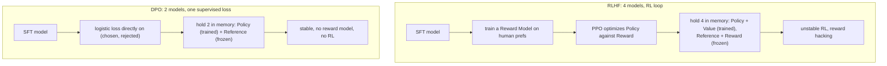

# Supervised Fine-Tuning & Direct Preference Optimization

Module 1 built clean, formatted, masked data. This module trains on it, then goes
past it. Supervised fine-tuning teaches a model to *imitate* good responses, but
imitation has a ceiling: it cannot teach the model which of two plausible answers is
better. Crossing that ceiling is **alignment**, and the field went from a
four-model reinforcement-learning nightmare to a single elegant loss. Four parts:

- **The SFT loop and catastrophic forgetting** — the mechanics, and the failure mode.
- **The alignment problem** — why imitation is not enough, and the RLHF pipeline.
- **Direct Preference Optimization** — the model as its own reward model.
- **Preference datasets** — chosen vs. rejected, and why hard negatives matter.

---

## 2.1 — The SFT Training Loop & Catastrophic Forgetting

SFT is **behavioral cloning**: the model is trained to reproduce the completions in
the demonstration data. The loop is ordinary supervised learning: sample a batch of
packed, loss-masked examples (Module 1), forward pass to logits, compute masked
cross-entropy on the completion tokens only, backpropagate, and step the optimizer.
Two mechanics make it work at scale.

**Gradient accumulation.** A large effective batch gives stable gradients, but the
activations for a large batch will not fit in GPU memory. Gradient accumulation runs
several small micro-batches, sums their gradients *without* stepping, and takes one
optimizer step after $N$ of them, so the effective batch is `micro_batch * accum_steps`
at the memory cost of a single micro-batch. Scale each micro-batch loss by $1/N$ so
the accumulated gradient is the mean over the effective batch.

**Cosine decay with warmup.** The learning rate is scheduled, not constant. A short
**warmup** ramps the LR linearly from near zero to its peak over the first few
hundred steps, because the optimizer's moment estimates are noisy at the start and a
full-speed update would diverge. After warmup, a **cosine decay** anneals the LR
smoothly from peak toward zero, large exploratory updates early, fine convergence
late:

$$
\eta_t = \eta_{\min} + \tfrac{1}{2}\,(\eta_{\max} - \eta_{\min})\left(1 + \cos\left(\pi\, \frac{t - t_{\text{warm}}}{T - t_{\text{warm}}}\right)\right)
$$

```python
import math

def cosine_lr(step, peak_lr, warmup_steps, total_steps, min_lr=0.0):
    """Linear warmup, then cosine decay. Warmup stabilizes the optimizer moments;
    cosine anneals large early updates down to near-zero for convergence."""
    if step < warmup_steps:
        return peak_lr * step / warmup_steps                  # linear ramp up
    progress = (step - warmup_steps) / (total_steps - warmup_steps)
    return min_lr + 0.5 * (peak_lr - min_lr) * (1 + math.cos(math.pi * progress))

def train_step(model, micro_batches, optimizer, accum_steps):
    """One effective step from N micro-batches: accumulate scaled gradients, step once."""
    optimizer.zero_grad()
    for i, batch in enumerate(micro_batches):
        loss = model(**batch).loss / accum_steps              # scale so grads average
        loss.backward()                                       # accumulate, do not step
        if (i + 1) % accum_steps == 0:
            optimizer.step(); optimizer.zero_grad()           # one real update per N
```

### Catastrophic forgetting

The danger of fine-tuning is that the weights encoding the model's broad pretrained
knowledge are the *same* weights your task updates. Train too hard on a narrow
dataset, and gradient descent shifts those weights toward your narrow distribution,
overwriting the general capability that lived in them: the model gains your task and
quietly loses its ability to do everything else. This is **catastrophic forgetting**,
a plasticity-stability failure where learning the new erases the old, and its output
distribution collapses toward your data.

It worsens with a high learning rate, many epochs, a small or narrow dataset, and
full fine-tuning where every weight is free to move. The mitigations follow directly:

- **Few epochs and a low LR** (one to three epochs is usually enough) so the weights
  barely move.
- **PEFT / LoRA** (Course 6): freezing the base and training only a small adapter
  *preserves* the pretrained weights, which is a major reason parameter-efficient
  fine-tuning forgets far less than full fine-tuning.
- **Data replay**: mixing in general-domain data keeps the broad distribution alive.
- **Monitoring**: evaluate a *general* held-out benchmark (not just your task) and
  perplexity on general text throughout training. If task accuracy climbs while
  general scores fall, you are forgetting, and you should stop early or regularize.

---

## 2.2 — The Alignment Problem (Beyond Imitation)

SFT maximizes the likelihood of the demonstrated responses, which teaches the model
to *mimic the format and style* of good answers. What it cannot teach is *preference*:
it has no notion that one plausible response is better than another, because it only
ever sees good examples and only learns to imitate them, flaws included. It cannot be
steered toward more helpful or more honest beyond what the data already shows, and it
cannot learn from what *not* to do. **Alignment** adds exactly that missing signal,
teaching the model that response A is preferred over response B.

The original method, **RLHF**, is a three-stage pipeline. Start from an SFT model.
Train a **reward model** on human preference data (pairs of responses a human ranked)
to predict a scalar reward. Then use **PPO** (reinforcement learning) to fine-tune the
policy to maximize that reward while a KL penalty keeps it from drifting too far from
the SFT model and reward-hacking. It works, and it is an engineering nightmare,
because it requires holding **four models** in memory at once:

| Model | Role | Trained? |
| --- | --- | --- |
| Policy | the LLM being aligned | Yes |
| Reference | frozen SFT copy, the KL anchor | No |
| Reward | scores responses by human preference | No (pre-trained) |
| Value | PPO critic, estimates expected return | Yes |

Two of them are being trained and two are frozen, all four resident, and the RL loop
on top is unstable and hyperparameter-sensitive, prone to reward hacking. That cost
and fragility is what DPO removes.

---

## 2.3 — Direct Preference Optimization (DPO)

DPO (Rafailov et al.) reaches the same preference alignment with **no separate reward
model and no reinforcement learning**. The insight is mathematical. The RLHF
objective, maximize reward subject to a KL constraint from the reference, has a
closed-form optimal policy, and you can invert it to write the reward in terms of the
policy and the reference:

$$
r(x, y) = \beta \log \frac{\pi_\theta(y \mid x)}{\pi_{\text{ref}}(y \mid x)} + \beta \log Z(x)
$$

Substituting this into the Bradley-Terry model of preference, $P(y_w \succ y_l) = \sigma(r(x, y_w) - r(x, y_l))$,
the intractable partition function $Z(x)$ cancels in the difference, and what remains
is a simple logistic loss over preference triplets that depends only on the policy and
reference log-probabilities. **The language model is its own implicit reward model.**
The DPO loss is:

$$
\mathcal{L}_{\text{DPO}} = -\mathbb{E}_{(x, y_w, y_l)}\left[\log \sigma\left(\beta \log \frac{\pi_\theta(y_w \mid x)}{\pi_{\text{ref}}(y_w \mid x)} - \beta \log \frac{\pi_\theta(y_l \mid x)}{\pi_{\text{ref}}(y_l \mid x)}\right)\right]
$$

Here $(x, y_w, y_l)$ is a prompt with a chosen (winning) and rejected (losing)
response, $\pi_\theta$ is the policy being trained, $\pi_{\text{ref}}$ is the frozen
reference, and $\sigma$ is the sigmoid. The term $\beta \log \frac{\pi_\theta(y \mid x)}{\pi_{\text{ref}}(y \mid x)}$
is the implicit reward, the log-ratio of policy to reference. The loss is a binary
classification that pushes the policy to raise the chosen response's relative
probability and lower the rejected one's.

**Beta controls the KL divergence from the reference.** It is the same KL-penalty
knob from the RLHF objective, now baked into the loss. A small $\beta$ weakly
constrains the policy, letting it move far from the reference for aggressive
preference optimization at the risk of drifting and degrading; a large $\beta$ holds
it close to the reference, conservative but safer. Typical values are 0.1 to 0.5.



```python
import torch.nn.functional as F

def dpo_loss(policy_chosen_logp, policy_rejected_logp,
             ref_chosen_logp, ref_rejected_logp, beta=0.1):
    """DPO loss. The *_logp are per-sequence summed log-probs of the chosen/rejected
    completions under the policy and the frozen reference (computed with the Module 1
    completion mask). Implicit reward = beta * (policy_logp - ref_logp)."""
    chosen_reward = beta * (policy_chosen_logp - ref_chosen_logp)
    rejected_reward = beta * (policy_rejected_logp - ref_rejected_logp)
    return -F.logsigmoid(chosen_reward - rejected_reward).mean()   # push chosen above rejected
```

DPO holds two models instead of four, trains with a stable supervised loss instead of
an RL loop, and can even precompute the reference log-probs. It matched or beat RLHF
at a fraction of the complexity, which is why it became the default. It is not
flawless, being prone to overfitting the preference set and to reducing diversity,
which the later variants (IPO, KTO, ORPO, SimPO) address, but DPO is the workhorse.

---

## 2.4 — Preference Datasets (Chosen vs. Rejected)

Alignment needs a different data shape than SFT. SFT uses (prompt, response) *pairs*
and imitates the response. Preference optimization uses (prompt, chosen, rejected)
*triplets*, a prompt with a preferred response $y_w$ and a dispreferred one $y_l$, and
learns the *ordering* rather than imitating either. The triplets come from human
rankings, from AI feedback (a judge model ranking responses, as in RLAIF and
Constitutional AI), or from generating several responses and scoring them.

```python
import json

def to_dpo_triplet(row, tokenizer):
    """A DPO example: the shared prompt plus the chosen and rejected completions.
    The prompt is chat-templated so the log-probs match the model's own format."""
    prompt = tokenizer.apply_chat_template(
        row["messages"], tokenize=False, add_generation_prompt=True)
    return {"prompt": prompt, "chosen": row["chosen"], "rejected": row["rejected"]}

def format_dpo_jsonl(in_path, out_path, tokenizer):
    with open(in_path) as fin, open(out_path, "w") as fout:
        for line in fin:
            fout.write(json.dumps(to_dpo_triplet(json.loads(line), tokenizer)) + "\n")
```

### Hard negatives and verbosity bias

The subtle trap is in *how* the chosen and rejected responses differ. If the chosen
responses are systematically longer or more formatted than the rejected ones, the
model learns a shortcut, "prefer longer text", instead of learning quality. This
**verbosity bias** is notorious: DPO and RLHF reward models both drift toward longer
responses because length correlates with "chosen" in the data, not because length is
quality, and the aligned model then pads every answer.

The fix is **hard negatives**: rejected responses that are highly plausible, matched
to the chosen in length, style, and fluency, and differ only in a *subtle* flaw, a
factual error, a reasoning slip, a slightly less helpful framing. When the pair is
controlled for superficial features and differs only on the quality dimension you
care about, the model is forced to learn the real signal rather than the shortcut.
Construct them by minimally editing a good response to introduce a flaw, by pairing
same-model responses of genuinely different quality, and by controlling for length
(length-normalized preferences, as in SimPO, attack the bias directly). Preference
data quality matters as much as SFT data quality, and hard negatives are what make it
teach substance.

| | SFT pair | DPO triplet |
| --- | --- | --- |
| Shape | (prompt, response) | (prompt, chosen, rejected) |
| Teaches | Imitate the response | Prefer chosen over rejected |
| Failure if naive | Clones flaws | Verbosity / length shortcut |
| Key data lever | Response quality | Hard negatives, length control |

---

## Recap

- **The SFT loop** is behavioral cloning with a masked cross-entropy objective,
  **gradient accumulation** to reach a large effective batch under a memory limit, and
  a **warmup then cosine** learning-rate schedule that stabilizes the optimizer early
  and anneals updates to near zero late.
- **Catastrophic forgetting** happens when narrow, hard, or long training overwrites
  the shared weights that held pretrained knowledge; fight it with few epochs, a low
  LR, PEFT that freezes the base, data replay, and monitoring a general held-out
  benchmark, not just your task.
- **Alignment** adds preference on top of imitation. RLHF does it with a reward model
  and PPO but must hold four models (policy, reference, reward, value) and run an
  unstable RL loop. **DPO** inverts the RLHF optimum to make the model its own implicit
  reward, training with one logistic loss over triplets, with $\beta$ setting the KL
  distance allowed from the reference, using two models and stable supervised training.
- **Preference data** moves from (prompt, response) pairs to (prompt, chosen, rejected)
  triplets, and its quality hinges on **hard negatives**: rejected responses matched in
  length and style but subtly flawed, without which the model learns verbosity instead
  of quality.

## Exercises

1. **Schedule and accumulate.** Implement `cosine_lr` and plot the schedule with a
   warmup, then run `train_step` at accumulation of 1, 4, and 16 and confirm the
   effective batch grows while peak memory stays flat. Verify the loss scaling makes the
   accumulated gradient the mean over the effective batch.

2. **Induce forgetting.** Full-fine-tune a small model hard on a narrow task for many
   epochs while tracking task accuracy *and* a general benchmark. Show the general score
   falls as the task score rises, then repeat with LoRA and few epochs and show the
   general score holds.

3. **Compute a DPO step.** Given toy policy and reference log-probs for chosen and
   rejected, compute `dpo_loss` by hand and in code and confirm they match. Sweep
   $\beta$ and show how the implicit-reward margin and the pull toward the reference
   change.

4. **Break the shortcut.** Build a preference set where chosen is always longer than
   rejected, DPO-train, and measure output length inflation. Then rebuild with
   length-matched hard negatives and confirm the length bias disappears while quality
   preference remains.

## Next: Module 3 — Advanced Alignment: RLHF, RLAIF & Reasoning

DPO is the default, but the frontier is wider. Module 3 goes deeper into the RL side
that DPO shortcut, PPO and its stabilizers, then AI feedback (RLAIF and Constitutional
AI) that replaces human labelers with a judge model, the preference variants (KTO,
ORPO, SimPO) and when each wins, and the reasoning fine-tuning that trains models to
think in long chains before answering.
