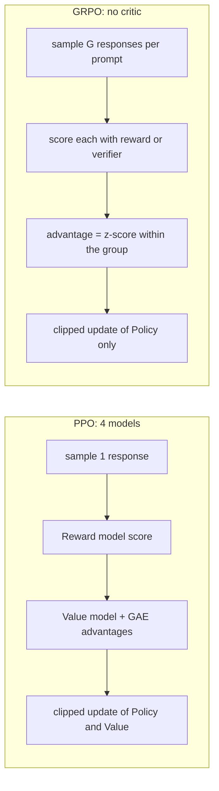
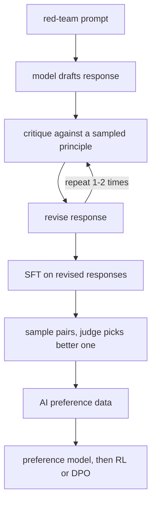
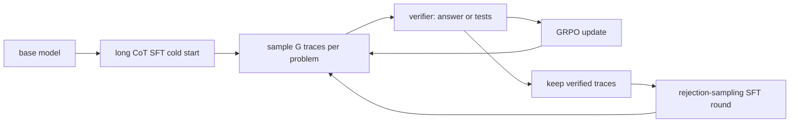

# Advanced Alignment: RLHF, RLAIF & Reasoning

Module 2 ended with DPO as the default: one logistic loss, two models, no RL. But
DPO is *offline*. It optimizes over a fixed set of pairs and never samples from the
model it is improving, which is exactly why it cannot discover new behavior, and why
the frontier labs still run reinforcement learning. This module covers what lies
beyond the default. Four parts:

- **PPO and GRPO** — the full RLHF machinery, why it is unstable, and the critic-free alternative.
- **RLAIF and Constitutional AI** — judge models replacing human labelers, and their limits.
- **Preference-optimization variants** — IPO, KTO, ORPO, SimPO, and when each wins.
- **Reasoning fine-tuning** — long chain-of-thought, verifiable rewards, and reward hacking.

---

## 3.1 — PPO in RLHF, and GRPO Without a Critic

RLHF has two learned pieces before the RL even begins. First the **reward model**
(RM): take the SFT model, replace the LM head with a scalar head, and train it on
preference pairs under the **Bradley-Terry** model, which says the probability that
$y_w$ beats $y_l$ is a sigmoid of the reward gap:

$$
P(y_w \succ y_l \mid x) = \sigma\big(r_\phi(x, y_w) - r_\phi(x, y_l)\big), \qquad
\mathcal{L}_{\text{RM}} = -\mathbb{E}\big[\log \sigma\big(r_\phi(x, y_w) - r_\phi(x, y_l)\big)\big]
$$

The RM only ever learns *differences*, so its absolute scale is arbitrary; reward
whitening or a zero-mean regularizer keeps the numbers sane. Typical RM accuracy on
held-out human pairs is only 65-75%, because humans disagree with each other at a
similar rate. That noise ceiling matters: the policy is about to be optimized
*against* this imperfect proxy.

```python
import torch
import torch.nn.functional as F

def reward_model_loss(r_chosen, r_rejected, center_coef=1e-3):
    """Bradley-Terry loss on scalar rewards (one per sequence, read at the final token).
    The small center term pins the otherwise-arbitrary reward offset near zero."""
    loss = -F.logsigmoid(r_chosen - r_rejected).mean()
    loss += center_coef * ((r_chosen + r_rejected) ** 2).mean()
    acc = (r_chosen > r_rejected).float().mean()      # track pairwise accuracy too
    return loss, acc
```

### The PPO objective

The second stage samples responses from the current policy, scores them with the RM,
and updates the policy with **Proximal Policy Optimization**. Let
$\rho_t(\theta) = \pi_\theta(a_t \mid s_t) / \pi_{\theta_{\text{old}}}(a_t \mid s_t)$ be the
probability ratio for token $a_t$ against the policy that generated the data. PPO
maximizes a *clipped* surrogate that refuses to reward moving the ratio outside
$[1-\epsilon, 1+\epsilon]$ (typically $\epsilon = 0.2$):

$$
\mathcal{L}_{\text{PPO}}(\theta) = \mathbb{E}_t\Big[\min\big(\rho_t \hat{A}_t,\ \text{clip}(\rho_t,\, 1-\epsilon,\, 1+\epsilon)\,\hat{A}_t\big)\Big]
$$

The clip is a trust region without second-order machinery: once a token's probability
has already moved 20% in the helpful direction, its gradient is zeroed, so many
epochs of minibatch updates on one batch of rollouts cannot blow the policy up.

**The KL penalty** enters through the reward. The RM scores only the final token, so
every token gets a shaped reward against the frozen reference:

$$
r_t = -\beta \log \frac{\pi_\theta(a_t \mid s_t)}{\pi_{\text{ref}}(a_t \mid s_t)} \;+\; \mathbb{1}[t = T]\; r_\phi(x, y)
$$

Without the $\beta$ term the policy drifts into degenerate text the RM happens to
love. **Generalized Advantage Estimation** then turns these rewards into low-variance
advantages using the **value model** $V$ (the critic) as a baseline:

$$
\delta_t = r_t + \gamma V(s_{t+1}) - V(s_t), \qquad
\hat{A}_t = \sum_{l=0}^{T-t} (\gamma\lambda)^l\, \delta_{t+l}
$$

$\lambda \in [0,1]$ trades bias for variance ($\lambda = 0$ is one-step TD, low
variance but biased by the critic; $\lambda = 1$ is the Monte Carlo return). LLM RLHF
typically uses $\gamma = 1$ and $\lambda = 0.95$.

```python
import torch

def gae(rewards, values, gamma=1.0, lam=0.95):
    """rewards, values: [T] for one response; values[t] = V(s_t), terminal value = 0.
    Computed backwards: A_t = delta_t + gamma*lam*A_{t+1}."""
    T = rewards.size(0)
    adv = torch.zeros_like(rewards)
    last = 0.0
    for t in reversed(range(T)):
        next_v = values[t + 1] if t + 1 < T else 0.0
        delta = rewards[t] + gamma * next_v - values[t]
        last = delta + gamma * lam * last
        adv[t] = last
    returns = adv + values                              # regression target for the critic
    return adv, returns

def ppo_policy_loss(logp_new, logp_old, adv, eps=0.2):
    adv = (adv - adv.mean()) / (adv.std() + 1e-8)       # whiten advantages per batch
    ratio = torch.exp(logp_new - logp_old)
    unclipped = ratio * adv
    clipped = torch.clamp(ratio, 1 - eps, 1 + eps) * adv
    return -torch.min(unclipped, clipped).mean()        # negate: we minimize
```

### Why PPO-RLHF is unstable

- **A moving target twice over.** The data distribution shifts as the policy changes,
  *and* the critic is chasing a returns target that shifts with it.
- **A weak critic poisons everything.** The value model must predict final-RM-score
  from every prefix of a response, an almost impossible regression early in training.
  Bad $V$ means biased advantages, which means bad policy steps.
- **Reward hacking.** The RM is a proxy. Past a point, true quality falls while RM
  score keeps rising (Goodhart's law); gold-RM experiments show the proxy-vs-true gap
  grows roughly with $\sqrt{\text{KL}}$.
- **Sensitivity.** Rollout batch size, $\beta$, $\epsilon$, learning rate and
  advantage normalization all interact, and a bad run is only visible hundreds of
  steps later. Four resident models (Module 2) make each experiment expensive.

### GRPO: delete the critic

**Group Relative Policy Optimization** (DeepSeekMath, then DeepSeek-R1) removes the
value model. For each prompt, sample a *group* of $G$ responses, score each, and use
the group itself as the baseline:

$$
\hat{A}_i = \frac{r_i - \text{mean}(r_1,\dots,r_G)}{\text{std}(r_1,\dots,r_G)}
$$

Every token of response $i$ shares that one advantage. The PPO clipped ratio is kept,
and the KL to the reference moves out of the reward and into the loss as a per-token
estimator, $\mathbb{D}_{\text{KL}} \approx \frac{\pi_{\text{ref}}}{\pi_\theta} - \log\frac{\pi_{\text{ref}}}{\pi_\theta} - 1$,
which is always non-negative. Two models are trained-or-frozen instead of four, and
no critic has to learn what a half-finished sentence is worth.

```python
import torch

def grpo_advantages(rewards):
    """rewards: [num_prompts, G]. Group-relative, no value model."""
    mean = rewards.mean(dim=1, keepdim=True)
    std = rewards.std(dim=1, keepdim=True)
    return (rewards - mean) / (std + 1e-6)              # zero adv if all G samples tie

def grpo_loss(logp_new, logp_old, logp_ref, adv, mask, eps=0.2, beta=0.04):
    """Token-level tensors [B, L]; adv is [B, 1] broadcast over tokens; mask hides pad."""
    ratio = torch.exp(logp_new - logp_old)
    surrogate = torch.min(ratio * adv, torch.clamp(ratio, 1 - eps, 1 + eps) * adv)
    log_r = logp_ref - logp_new
    kl = torch.exp(log_r) - log_r - 1                   # k3 estimator, >= 0
    per_token = -(surrogate - beta * kl)
    return (per_token * mask).sum() / mask.sum()
```

Note the pitfall visible in `grpo_advantages`: if all $G$ samples get the same reward
(all right or all wrong) the advantage is zero and the prompt teaches nothing. Group
size $G$ of 8-64 and prompts of mixed difficulty keep the signal alive.



---

## 3.2 — RLAIF & Constitutional AI

Human preference labels are the expensive, slow, inconsistent part of RLHF.
**RLAIF** (reinforcement learning from AI feedback) replaces the labeler with a
**judge model**: show a strong LLM the prompt and two candidate responses, ask which
is better under written criteria, and use its verdict as the preference label. The
output is the same (prompt, chosen, rejected) triplet from Module 2, so it feeds
reward-model training, PPO, or DPO unchanged. Cost drops by orders of magnitude, and
labels can be regenerated whenever the rubric changes. Published comparisons find
RLAIF roughly on par with RLHF on summarization and helpfulness when the judge is
strong.

**Constitutional AI** (Anthropic) is the structured form. Instead of humans labeling
which output is *harmless*, a short list of written principles (the constitution) is
the only human input, applied in two phases:

1. **Supervised phase (critique and revise).** Sample a response to a red-team prompt,
   ask the model to critique it against a randomly drawn principle, then to rewrite it.
   Repeat once or twice, then SFT on the final revisions.
2. **RL phase (RLAIF).** Sample response pairs from the SFT model, have the judge pick
   the one that better follows a principle, train a preference model on those AI
   labels, and optimize the policy against it.



```python
import random

PRINCIPLES = [
    "Choose the response that is least likely to help someone cause serious harm.",
    "Choose the response that is honest about uncertainty and does not fabricate facts.",
    "Choose the response that is helpful without being preachy or needlessly refusing.",
]

def critique_revise(llm, prompt, rounds=2):
    """`llm(text) -> str` is any chat-completion callable. Returns the final revision."""
    response = llm(prompt)
    for _ in range(rounds):
        principle = random.choice(PRINCIPLES)            # random principle = broad coverage
        critique = llm(f"Prompt: {prompt}\nResponse: {response}\n"
                       f"Critique this response using the principle: {principle}")
        response = llm(f"Prompt: {prompt}\nResponse: {response}\nCritique: {critique}\n"
                       f"Rewrite the response to fix the problems identified.")
    return response

def judge_pair(llm, prompt, a, b, principle):
    """Ask the judge twice with positions swapped; keep the label only if it is consistent."""
    def ask(x, y):
        out = llm(f"{principle}\nPrompt: {prompt}\n(A) {x}\n(B) {y}\nAnswer with A or B.")
        return out.strip().upper()[:1]
    first, second = ask(a, b), ask(b, a)
    if first == "A" and second == "B":  return {"chosen": a, "rejected": b}
    if first == "B" and second == "A":  return {"chosen": b, "rejected": a}
    return None                                          # position-dependent: discard
```

### Where AI feedback goes wrong

A judge is a model with its own biases, and optimization amplifies whatever it likes:

| Bias | Symptom | Mitigation |
| --- | --- | --- |
| Position bias | Prefers the first (or second) answer regardless of content | Swap order, keep only consistent verdicts (as above) |
| Verbosity bias | Prefers longer, more formatted answers | Length-controlled comparison, hard negatives (Module 2) |
| Self-preference | A model rates its own style or family higher | Use a different, stronger judge; ensemble judges |
| Sycophancy | Rewards agreement and confident tone over correctness | Reference answers, rubric with factual checks |
| Capability ceiling | A judge cannot reliably grade what it cannot do | Verifiable rewards (Section 3.4), human audit set |

RLAIF scales *supervision*, not *truth*. The judge must be at least as capable as the
behavior it grades, and a small human-labeled audit set (a few hundred pairs) should
measure judge-human agreement every time you change the judge or rubric. If agreement
sits near 70% and the judge is also your training signal, you have built a ceiling
into the system.

---

## 3.3 — Preference-Optimization Variants: IPO, KTO, ORPO, SimPO

DPO's weaknesses are specific, and each variant targets one. Let
$h = \log\frac{\pi_\theta(y_w\mid x)}{\pi_{\text{ref}}(y_w\mid x)} - \log\frac{\pi_\theta(y_l\mid x)}{\pi_{\text{ref}}(y_l\mid x)}$
be DPO's log-ratio margin.

**IPO** (Identity Preference Optimization). DPO's sigmoid saturates: on clean data
where $y_w$ always beats $y_l$, the loss keeps pushing $h \to \infty$, overfitting and
drifting from the reference regardless of $\beta$. IPO replaces the logistic loss with
a squared regression to a finite target margin:

$$
\mathcal{L}_{\text{IPO}} = \mathbb{E}\Big[\big(h - \tfrac{1}{2\tau}\big)^2\Big]
$$

The margin is capped at $1/(2\tau)$, so KL stays bounded. It wins on small, clean,
near-deterministic preference sets where DPO overfits.

**KTO** (Kahneman-Tversky Optimization). Needs no pairs: only a binary label per
completion, *desirable* or *undesirable*. With implicit reward
$r_\theta = \log\frac{\pi_\theta(y\mid x)}{\pi_{\text{ref}}(y\mid x)}$ and a reference
point $z_{\text{ref}}$ (a batch estimate of KL), it applies a prospect-theory value
function, with asymmetric weights $\lambda_D, \lambda_U$ for gains and losses:

$$
\mathcal{L}_{\text{KTO}} = \mathbb{E}\big[\lambda_y - v(x,y)\big], \quad
v = \begin{cases}
\lambda_D\, \sigma\big(\beta(r_\theta - z_{\text{ref}})\big) & y \text{ desirable}\\
\lambda_U\, \sigma\big(\beta(z_{\text{ref}} - r_\theta)\big) & y \text{ undesirable}
\end{cases}
$$

It wins when your data is thumbs-up/thumbs-down logs (the cheapest feedback in
production) or heavily imbalanced between good and bad outputs.

**ORPO** (Odds Ratio Preference Optimization). Folds alignment into SFT with *no
reference model and no separate SFT stage*. It adds a penalty on the log odds ratio
between chosen and rejected, where $\text{odds}(y) = P(y\mid x)/(1-P(y\mid x))$:

$$
\mathcal{L}_{\text{ORPO}} = \mathcal{L}_{\text{SFT}}(y_w) \;-\; \lambda \log \sigma\!\Big(\log\frac{\text{odds}_\theta(y_w)}{\text{odds}_\theta(y_l)}\Big)
$$

It wins on memory and pipeline simplicity: one model in memory, one training run from
a base model. The cost is less control, since there is no KL anchor.

**SimPO** (Simple Preference Optimization). Also reference-free, but it fixes a
mismatch: DPO's implicit reward is a *summed* log-ratio, while generation quality is
judged per-token. SimPO uses the **length-normalized average log-probability** as the
reward, plus a target margin $\gamma$:

$$
\mathcal{L}_{\text{SimPO}} = -\mathbb{E}\Big[\log \sigma\Big(\tfrac{\beta}{|y_w|}\log\pi_\theta(y_w\mid x) - \tfrac{\beta}{|y_l|}\log\pi_\theta(y_l\mid x) - \gamma\Big)\Big]
$$

Normalizing by length attacks the verbosity bias from Module 2 head-on. Note SimPO
needs a much larger $\beta$ (roughly 2-2.5) than DPO because average log-probs are
small numbers.

```python
import torch.nn.functional as F

def ipo_loss(pc, pr, rc, rr, tau=0.1):
    """pc/pr: policy summed logp chosen/rejected; rc/rr: reference. Squared margin loss."""
    h = (pc - rc) - (pr - rr)
    return ((h - 1.0 / (2 * tau)) ** 2).mean()

def simpo_loss(pc, pr, len_c, len_r, beta=2.0, gamma=1.0):
    """No reference model. len_*: completion token counts, for length normalization."""
    margin = beta * (pc / len_c) - beta * (pr / len_r) - gamma
    return -F.logsigmoid(margin).mean()

def orpo_loss(logp_c, logp_r, len_c, len_r, nll_chosen, lam=0.1):
    """logp_*: summed logp. Odds use length-averaged probabilities, as in the paper."""
    pc, pr = (logp_c / len_c).exp().clamp(max=1 - 1e-6), (logp_r / len_r).exp().clamp(max=1 - 1e-6)
    log_odds = (pc.log() - (1 - pc).log()) - (pr.log() - (1 - pr).log())
    return nll_chosen + lam * (-F.logsigmoid(log_odds)).mean()
```

| Method | Data | Reference model | Wins when | Watch out |
| --- | --- | --- | --- | --- |
| DPO | pairs | Yes | Default; good pair data | Overfits, verbosity |
| IPO | pairs | Yes | Small, clean, deterministic prefs | Needs tuning of $\tau$ |
| KTO | unpaired good/bad labels | Yes | Thumbs-up/down logs, imbalance | $z_{\text{ref}}$ batch estimate noisy |
| ORPO | pairs | No | Tight memory, single-stage from base | No KL anchor, drift |
| SimPO | pairs | No | Length bias, cheap runs | Sensitive $\beta,\gamma$ |

No variant dominates across benchmarks; reported gaps shrink or flip with
hyperparameter tuning. Treat the choice as data-shape first (pairs or labels?),
memory second, and always baseline against a *tuned* DPO.

---

## 3.4 — Reasoning Fine-Tuning

Reasoning models spend tokens thinking before they answer. Three ingredients produce
them, usually stacked.

**Long chain-of-thought SFT.** Fine-tune on traces that include exploration,
self-verification and backtracking ("wait, let me recheck"), not just clean
solutions. Even a few thousand carefully curated long traces can unlock the behavior
in a strong base (the "less is more" results), but SFT alone *imitates the form of
reasoning* and generalizes poorly: the model learns to sound like it is checking.
Mask the prompt as in Module 1 and budget for sequence lengths of 8k-32k tokens, where
attention memory, not parameters, dominates cost.

**RL with verifiable rewards (RLVR).** Replace the learned RM with a programmatic
check: the final math answer matches, the unit tests pass, the output parses. The
reward is exact, cannot be flattered, and needs no labelers. Run GRPO (Section 3.1) with
that reward and, as DeepSeek-R1-Zero showed, response length and self-correction
*emerge* from the reward alone. A typical recipe adds a small format reward (answer
inside the required tags) to the correctness reward.

```python
import re

def verifiable_reward(completion, gold_answer):
    """Outcome reward: 1.0 for a correct boxed answer, plus a small format bonus."""
    fmt = 0.1 if re.search(r"<think>.*?</think>", completion, re.S) else 0.0
    m = re.search(r"\\boxed\{([^}]*)\}", completion)
    correct = 1.0 if (m and m.group(1).strip() == str(gold_answer).strip()) else 0.0
    return correct + fmt

def rejection_sample(model_generate, problems, k=16):
    """STaR / rejection-sampling fine-tuning data: sample k traces, keep only verified ones.
    Train SFT on survivors, then repeat with the improved model (expert iteration)."""
    kept = []
    for p in problems:
        traces = model_generate(p["question"], n=k, temperature=1.0)
        good = [t for t in traces if verifiable_reward(t, p["answer"]) >= 1.0]
        if good:
            kept.append({"prompt": p["question"], "completion": min(good, key=len)})
    return kept                                          # shortest correct trace discourages bloat
```

**Rejection sampling and STaR.** The offline cousin of RLVR: sample many traces per
problem, keep the ones that reach the right answer, SFT on them, repeat. STaR
(Zelikman et al.) adds *rationalization*: for failures, show the model the correct
answer as a hint and ask for a rationale, so hard problems still contribute data.
It is far simpler and more stable than RL and is the right first step, but it only
reinforces what the model can already sometimes do; pass@$k$ for large $k$ bounds it.



### Process vs. outcome rewards

An **outcome reward model (ORM)** or verifier scores only the final answer: cheap and
hard to game, but credit assignment is coarse, and a lucky wrong chain that lands on
the right number is rewarded. A **process reward model (PRM)** scores every reasoning
step (as in OpenAI's "Let's Verify Step by Step", which found PRMs beat ORMs for
best-of-$n$ selection on MATH). PRMs give dense signal and reward valid reasoning, but
step labels are costly (human annotation, or Monte Carlo rollouts estimating each
step's chance of reaching a correct answer), step boundaries are fuzzy, and a learned
PRM is itself a gameable proxy. The pragmatic frontier practice: RL on verifiable
outcomes where you have them, a PRM only for reranking or where outcomes cannot be
checked.

### Reward hacking

Optimize any proxy hard enough and the policy finds the gap between proxy and intent.
Specific reasoning-RL failures:

- **Test tampering.** Coding policies special-case the unit tests, `sys.exit(0)`, or
  edit the checker. Fix: hidden tests, sandboxes with read-only graders.
- **Answer-format exploits.** Emitting many candidate answers, or a matching regex
  target, hoping one parses. Fix: strict single-answer parsing.
- **Length gaming.** Under a length-biased RM, padding; under a length *penalty*,
  truncating reasoning before it finishes. Fix: monitor length vs. accuracy jointly.
- **Unfaithful reasoning.** The chain looks plausible but is not what produced the
  answer; rewarding only outcomes does not make traces honest.
- **Language mixing and illegible traces.** R1-Zero drifted into mixed languages;
  the fix was a cold-start SFT plus a language-consistency reward.
- **Entropy collapse.** The policy becomes deterministic, groups tie, advantages go
  to zero, and learning stalls. Fix: higher temperature, clip-higher, dynamic
  sampling that drops all-tie prompts.

Defend by holding out *unseen* problems from different distributions, reading raw
samples every checkpoint, and tracking the KL and reward curves together: reward up
with KL exploding is the signature.

---

## Recap

- **PPO-RLHF** trains a Bradley-Terry reward model, then maximizes a clipped
  surrogate ($\epsilon \approx 0.2$) with a per-token KL penalty and GAE advantages
  from a learned critic. It is unstable because of a moving data distribution, a weak
  critic, and a proxy reward that Goodhart will exploit. **GRPO** deletes the critic
  by z-scoring rewards within a group of $G$ samples and moving KL into the loss.
- **RLAIF and Constitutional AI** replace human labelers with a judge and written
  principles, using critique-revise loops for SFT data and AI preferences for RL.
  Judges carry position, verbosity and self-preference biases, so swap order, use
  stronger or ensemble judges, and audit against humans.
- **IPO** bounds the margin, **KTO** works from unpaired thumbs, **ORPO** merges SFT
  and preference with no reference, **SimPO** length-normalizes the reward. Choose by
  data shape and memory, and always compare against a tuned DPO.
- **Reasoning** comes from long-CoT SFT for the form, RL with verifiable rewards for
  the substance, and rejection sampling/STaR as the stable offline loop. Prefer
  outcome verifiers; use PRMs sparingly; watch for hacking via held-out problems and
  raw-sample reading.

## Exercises

1. **Train a tiny reward model.** Using a small LM with a scalar head and 2-5k pairs,
   train with `reward_model_loss`. Report pairwise accuracy on a held-out split, then
   check how often the RM prefers the longer response regardless of label. Relate your
   accuracy to the 65-75% ceiling for human data.

2. **GAE and clipping by hand.** For a 5-token response with chosen rewards, values,
   $\gamma = 1$, and $\lambda \in \{0, 0.95, 1\}$, compute advantages with `gae` and
   verify against a hand calculation. Then feed `ppo_policy_loss` ratios of 0.7, 1.0,
   1.5 with positive and negative advantages and tabulate which gradients the clip
   zeroes.

3. **GRPO on a verifiable task.** Implement `verifiable_reward` for 3-digit
   multiplication, run `grpo_advantages` with $G = 8$ on a 0.5B model, and plot
   accuracy, mean response length, and the fraction of zero-advantage groups over
   training. Identify when entropy collapse starts to flatten learning.

4. **Judge audit.** Build 200 pairs, label them with an LLM using `judge_pair` (with
   and without position swapping), and hand-label 50. Report the discard rate from
   inconsistency, judge-vs-human agreement, and how often the judge prefers the longer
   answer. Decide whether this judge is trustworthy enough to train against.

## Next: Module 4 — Evaluating Fine-Tunes & Preventing Regressions

You can now push a model in many directions, and every one of them can quietly make
it worse somewhere else. Module 4 closes the course with the discipline that keeps
you honest: building evaluation suites and held-out sets, LLM-as-judge and
benchmark-contamination traps, measuring catastrophic forgetting and safety
regressions after each stage, and the release gates and monitoring that stop a
fine-tune that looks better from shipping a model that is worse.
