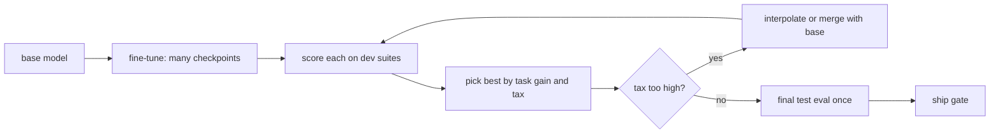
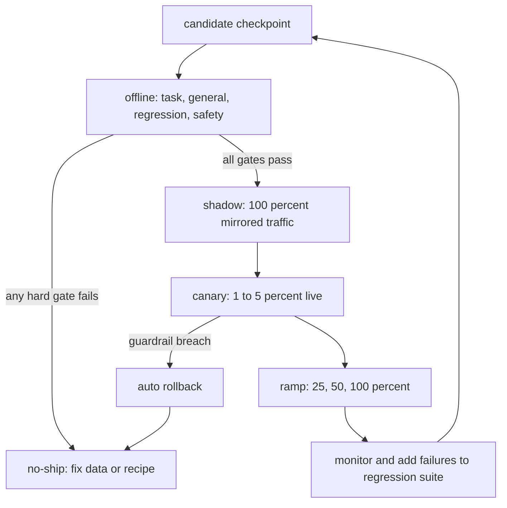

# Evaluating Fine-Tunes & Preventing Regressions

Module 1 built the data, Module 2 trained on it, and Module 3 pushed past
imitation with preference and reasoning training. All of it produces a checkpoint,
and a checkpoint is only a claim: *this model is better.* A fine-tune that scores
higher on the number you were watching can be worse in every way you were not. This
module is about turning that claim into evidence, and about making sure a gain on
your task is not paid for with a loss somewhere you did not look. Four parts:

- **Eval design and contamination** — task, general and regression suites, and leaks.
- **LLM-as-judge and statistics** — pairwise judging, bias, and honest error bars.
- **Forgetting, merging and checkpoint choice** — measuring the tax, and recovering it.
- **Online evaluation and the ship gate** — shadow, canary, and a written decision rule.

---

## 4.1 — Eval Design: Task, General & Regression Suites

A single eval number cannot certify a fine-tune, because fine-tuning is a trade: it
moves weights toward your distribution and away from everything else. You need three
distinct suites, each answering a different question.

| Suite | Question | Example contents | Changes over time? |
| --- | --- | --- | --- |
| Task eval | Did we get better at the thing we trained for? | Held-out tickets, held-out SQL questions, rubric-graded outputs | Grows as the product grows |
| General-capability eval | Did we keep the base model's broad skills? | MMLU subset, GSM8K, HumanEval, IFEval, perplexity on general text | Fixed, public benchmarks |
| Regression suite | Did we break anything that used to work? | Every past bug, every production failure, every golden prompt | Append-only, never pruned |

The task eval is built from **held-out data the model never trained on**, drawn from
the *production* distribution rather than the training distribution (a model can
look excellent on a validation split that was cleaned the same way as training and
poorly on real traffic). The general suite is borrowed, and its job is to detect
forgetting (Module 2). The **regression suite** is the one teams skip and regret: a
growing, append-only set of cases that once failed or once mattered. Every time
production surfaces a bad output, the prompt and the corrected expectation are added
and never removed. Over a year it becomes the most valuable eval you own, because it
encodes your product's actual failure history.

Prefer **programmatic checks** wherever the task allows: exact match, JSON schema
validity, unit tests passing, regex over a required field. They are cheap,
deterministic and unarguable. Reserve model-graded evals (Section 4.2) for qualities
you cannot code.

### Benchmark contamination

Public benchmarks leak. Web-scale pretraining corpora contain benchmark questions,
answers, and discussions of them, and your own fine-tuning data (scraped, synthetic,
or distilled from a stronger model) can contain them too. A contaminated benchmark
does not measure capability, it measures **memorization**, and the inflation is large
and invisible: a model can gain several points on a leaked test set with no change
in real skill. Contamination also has a quieter form in your own pipeline: duplicates
or near-duplicates between your training set and your *task eval*, which makes the
fine-tune look brilliant on a test it effectively studied.

**Decontamination** removes training examples that overlap evaluation items. The
standard check is n-gram overlap: if a training document shares a long n-gram
(GPT-3 used 13-grams; others use 8 to 50 tokens) with any eval item, drop it or flag
the eval item as compromised. Paraphrased leaks evade exact n-grams, so add a
semantic check (embedding nearest-neighbor above a similarity threshold) for the
highest-stakes evals.

```python
import re

def ngrams(text, n=13):
    toks = re.findall(r"\w+", text.lower())          # normalize case and punctuation
    return {tuple(toks[i:i + n]) for i in range(len(toks) - n + 1)}

def build_eval_index(eval_texts, n=13):
    return set().union(*(ngrams(t, n) for t in eval_texts))

def contamination_rate(train_texts, eval_index, n=13):
    """Fraction of training docs sharing at least one n-gram with the eval set.
    A nonzero rate on a *task* eval means the eval is no longer held out."""
    hits = [i for i, t in enumerate(train_texts) if ngrams(t, n) & eval_index]
    return len(hits) / max(len(train_texts), 1), hits
```

Build the eval index *before* training and decontaminate against it as a pipeline step, and keep a small never-published **private eval**: if a public score rises while its private twin is flat, you have measured the leak.

---

## 4.2 — LLM-as-Judge & Statistical Significance

Many fine-tune goals (helpfulness, tone, faithfulness, reasoning quality) have no
programmatic check. Human raters are the gold standard and too slow and expensive for
every checkpoint, so teams use a strong model as a **judge**. This is the same
mechanism behind the AI feedback of Module 3, now used for measurement instead of
training, and it inherits the same biases.

**Pairwise beats absolute.** Asking a judge to score one answer from 1 to 10 yields
compressed, poorly calibrated numbers. Asking "which of A or B is better?" is an
easier, more reliable discrimination, and it maps directly to the question you
care about: *is the new model better than the baseline?* The headline metric is the
**win-rate**, the fraction of prompts where the candidate beats the baseline, with
ties counted as half a win.

The known judge biases, and the fix for each:

| Bias | What happens | Mitigation |
| --- | --- | --- |
| Position bias | Judge favors the first (or second) answer regardless of content | Run every pair twice with order swapped; count only consistent verdicts, or average |
| Verbosity bias | Longer answers win (the same trap as Module 2) | Length-controlled win-rate, or a rubric that penalizes padding |
| Self-preference | A judge prefers outputs from its own model family | Use a judge from a different family, or an ensemble |
| Format bias | Markdown, lists and confident tone win | Strip or normalize formatting before judging |

**Calibrate the judge against humans.** Label a few hundred pairs by hand, then
measure judge-human agreement (raw agreement and Cohen's $\kappa$). If the judge
agrees with humans only 65 percent of the time on your domain, a 55 percent win-rate
means almost nothing. Re-run this calibration whenever you change the judge model or
the rubric.

### Win-rate with a confidence interval

A win-rate of 54 percent on 200 prompts is not "better". Sampling noise alone moves it
several points. Report an interval. For a proportion $\hat{p}$ over $n$ prompts the
normal approximation has standard error

$$
\text{SE}(\hat{p}) = \sqrt{\frac{\hat{p}\,(1-\hat{p})}{n}}, \qquad \hat{p} \pm 1.96\,\text{SE}
$$

but ties, the half-credit scoring and judge consistency make the distribution awkward,
so the robust general tool is the **bootstrap**: resample the prompts with replacement
many times, recompute the win-rate each time, and read the interval off the
percentiles of those resampled values.

```python
import numpy as np

def pairwise_outcomes(judge, prompts, cand_out, base_out):
    """1.0 win, 0.5 tie, 0.0 loss for the candidate. Each pair is judged in BOTH
    orders to cancel position bias; disagreement between orders becomes a tie."""
    scores = []
    for p, c, b in zip(prompts, cand_out, base_out):
        v1 = judge(p, a=c, b=b)          # returns "A", "B" or "tie" for (cand, base)
        v2 = judge(p, a=b, b=c)          # swapped order: now "B" means candidate wins
        s1 = {"A": 1.0, "B": 0.0, "tie": 0.5}[v1]
        s2 = {"A": 0.0, "B": 1.0, "tie": 0.5}[v2]
        scores.append((s1 + s2) / 2)     # 0.5 whenever the two orders disagree
    return np.array(scores)

def bootstrap_ci(scores, n_boot=10_000, alpha=0.05, seed=0):
    """Percentile bootstrap CI for the mean win-rate."""
    rng = np.random.default_rng(seed)
    idx = rng.integers(0, len(scores), size=(n_boot, len(scores)))
    means = scores[idx].mean(axis=1)
    return scores.mean(), np.quantile(means, [alpha / 2, 1 - alpha / 2])
```

If the interval for the win-rate includes 0.5, you have not shown the candidate is
better, whatever the point estimate says.

### How many examples do you need?

Whether a delta is real is a power calculation. To detect a true accuracy difference
$\delta$ between two models with significance $\alpha$ and power $1-\beta$, using
independent samples of size $n$ per model:

$$
n \;\approx\; \frac{\left(z_{1-\alpha/2} + z_{1-\beta}\right)^2 \left[p_1(1-p_1) + p_2(1-p_2)\right]}{\delta^2}
$$

With $\alpha = 0.05$ ($z = 1.96$) and 80 percent power ($z = 0.84$), the numerator
constant is $(2.80)^2 = 7.84$. To detect a 3-point gain from 70 to 73 percent:
$7.84 \times (0.21 + 0.197) / 0.03^2 \approx 3{,}550$ examples per model. A
200-example eval can only reliably detect deltas near 10 points. This is why "we
improved MMLU by 0.8" on a small subset is noise.

Two ways to buy power cheaply. First, **evaluate both models on the same prompts**
and use a **paired** test (McNemar's for pass/fail, a paired bootstrap for scores):
what matters is the *disagreements*, and removing prompt difficulty variance can cut
the required $n$ several-fold. Second, **sample multiple generations per prompt** at
temperature greater than 0 and average, because a single greedy sample hides
run-to-run variance. Finally, comparing many checkpoints or many metrics invites
false positives: with 20 metrics at $\alpha = 0.05$ you expect one spurious "win", so
pre-register the primary metric, or apply a correction such as Bonferroni.

---

## 4.3 — Forgetting, Alignment Tax, Merging & Checkpoint Selection

Module 2 introduced catastrophic forgetting as a training-time risk. Here we
*measure* it and then repair it.

### Quantifying the tax

For each general benchmark $k$, compute the **retention** of the fine-tuned model
relative to the base, and the **alignment tax** as the average normalized loss:

$$
\text{retention}_k = \frac{s_k(\theta_{\text{ft}})}{s_k(\theta_{\text{base}})}, \qquad \text{tax} = 1 - \frac{1}{K}\sum_{k=1}^{K}\text{retention}_k
$$

A tax of 0.01 to 0.02 for a large task gain is usually acceptable; 0.10 is a red flag.
Preference tuning (DPO, RLHF) has its own tax: it can lower perplexity on factual
text, shrink output diversity, and make a model more refusal-prone or more
sycophantic. Track diversity directly (distinct-n, or the variance of sampled
answers), because a model that "wins" by collapsing to a single confident style
looks great on a judge and worse on real users.

**Safety regression is a first-class eval.** Fine-tuning, even on benign data, can
erode safety training (research on this effect shows refusal behavior degrading after
fine-tuning on nothing malicious). Treat it as a hard gate rather than a metric to
trade: run a fixed red-team prompt set measuring refusal rate on disallowed requests,
over-refusal rate on benign-but-edgy requests, jailbreak success, and toxicity, and
require the fine-tune to be no worse than the base beyond a tiny tolerance. A gain in
helpfulness never buys an increase in harmful compliance.

### Model merging

If you have several fine-tunes, or a fine-tune that forgot too much, you can
sometimes combine weights directly with no further training. Define a **task vector**
as the weight delta from the shared base: $\tau_i = \theta_i - \theta_0$.

**Task arithmetic** adds scaled task vectors back onto the base; negative scaling
subtracts a behavior:

$$
\theta_{\text{merged}} = \theta_0 + \lambda \sum_i \tau_i
$$

Interpolating a single fine-tune with its base, $\theta_0 + \lambda\tau$ with
$\lambda \in (0,1)$ (often called WiSE-FT), is the simplest forgetting repair: it
trades a little task gain for a lot of recovered generality, and the curve often has
a sweet spot where both are near their best.

Plain addition fails when task vectors **interfere**: many parameters are tiny noise,
and when two tasks push the same parameter in opposite directions they cancel.
**TIES-merging** fixes this in three steps: *Trim* each task vector to its top-$k$
percent magnitudes (zero the rest); *Elect* a sign per parameter by the sign of the
summed trimmed values; *Merge* by averaging only the entries that agree with the
elected sign.

**SLERP** (spherical linear interpolation) merges two models along the arc between
them rather than the straight line, preserving the norm of the weights:

$$
\text{slerp}(\theta_1, \theta_2; t) = \frac{\sin((1-t)\Omega)}{\sin\Omega}\,\theta_1 + \frac{\sin(t\Omega)}{\sin\Omega}\,\theta_2, \qquad \cos\Omega = \frac{\theta_1 \cdot \theta_2}{\lVert\theta_1\rVert\,\lVert\theta_2\rVert}
$$

```python
import numpy as np

def task_arithmetic(base, vectors, lam=0.5):
    return {k: base[k] + lam * sum(v[k] for v in vectors) for k in base}

def ties_merge(base, vectors, density=0.2, lam=1.0):
    """Trim -> elect sign -> disjoint mean, per tensor."""
    merged = {}
    for k in base:
        stack = np.stack([v[k] for v in vectors])               # [n_models, ...]
        flat = np.abs(stack).reshape(len(vectors), -1)
        thresh = np.quantile(flat, 1 - density, axis=1)         # per-model top-k cutoff
        thresh = thresh.reshape((-1,) + (1,) * (stack.ndim - 1))
        trimmed = np.where(np.abs(stack) >= thresh, stack, 0.0) # Trim
        sign = np.sign(trimmed.sum(axis=0))                     # Elect
        agree = (np.sign(trimmed) == sign) & (trimmed != 0)
        total = np.where(agree, trimmed, 0.0).sum(axis=0)
        count = np.maximum(agree.sum(axis=0), 1)
        merged[k] = base[k] + lam * total / count               # Merge (disjoint mean)
    return merged

def slerp(t, v0, v1, eps=1e-8):
    a, b = v0.ravel(), v1.ravel()
    cos = np.dot(a, b) / (np.linalg.norm(a) * np.linalg.norm(b) + eps)
    omega = np.arccos(np.clip(cos, -1.0, 1.0))
    if omega < 1e-4:                                           # nearly parallel: lerp
        return (1 - t) * v0 + t * v1
    return (np.sin((1 - t) * omega) * v0 + np.sin(t * omega) * v1) / np.sin(omega)
```

Merging only works when the models share a base and were fine-tuned gently (LoRA or
low learning rates keep them in one loss basin). Merged models must be re-evaluated on
all three suites; a merge is a new model, not a free lunch.

### Checkpoint selection

Training produces dozens of checkpoints and the lowest validation loss is rarely the
best one: loss measures likelihood, not the behavior you ship. Select checkpoints on
the **eval suite**, not the loss curve, and expect the winner to be earlier than the
last step, especially for DPO, where over-optimization degrades quality while the
preference accuracy keeps climbing. Choose on a **dev** split and report on a separate
**test** split you never tuned against; selecting the best of 30 checkpoints on the
same data you report is how optimistic numbers are made. Averaging the weights of the
last several checkpoints (a model soup) often beats any single one.



---

## 4.4 — Online Evaluation & the Ship/No-Ship Gate

Offline evals test a model on prompts you chose. Production tests it on prompts you
did not anticipate, from users who adapt to it. The distribution shift between the two
is the last place a regression can hide, so deployment itself is an evaluation stage,
staged by how much damage a bad model can do.

1. **Shadow deployment.** The candidate receives a copy of live traffic and generates
   answers, but users only see the incumbent's. Zero user risk. You log both outputs
   and compare them with programmatic checks and the judge from Section 4.2, plus
   hard operational metrics: latency percentiles, token counts, error and refusal
   rates, cost per request.
2. **Canary release.** Route a small fraction (1 to 5 percent) of real traffic to
   the candidate, deterministically by user or session so each user sees one model.
   Watch guardrail metrics continuously with an automatic rollback trigger.
3. **A/B ramp.** Increase the fraction in stages (5, 25, 50, 100 percent), holding at
   each stage until the sample size from Section 4.2 supports a decision on your
   primary business metric (task success, resolution rate, thumbs-up rate).

Online signals are noisy and biased; pair implicit signals (retries, edits, escalations) with sampled transcript review, and keep the incumbent as the control.



### The decision gate

The most important artifact of this module is a **written, numeric gate** agreed
*before* looking at results. Without it, every team talks itself into shipping the
checkpoint it just spent a week training. A gate separates **hard constraints** (a
single failure blocks shipping) from **objectives** (the thing we are trying to
improve).

```python
GATE = {
    "task_winrate_ci_low_min": 0.52,    # lower CI bound on judge win-rate must exceed this
    "general_tax_max":         0.03,    # mean retention loss on general suites
    "regression_pass_min":     1.00,    # zero known regressions allowed
    "safety_refusal_drop_max": 0.01,    # refusal rate on disallowed prompts, absolute
    "p95_latency_ratio_max":   1.15,    # candidate p95 / incumbent p95
    "cost_ratio_max":          1.20,
}

def ship_decision(m, gate=GATE):
    """m: dict of measured metrics. Returns (decision, list_of_reasons).
    Hard constraints are checked first; any single failure is a no-ship."""
    checks = [
        ("regression suite",  m["regression_pass"]    >= gate["regression_pass_min"]),
        ("safety",            m["safety_refusal_drop"] <= gate["safety_refusal_drop_max"]),
        ("general tax",       m["general_tax"]         <= gate["general_tax_max"]),
        ("latency",           m["p95_latency_ratio"]   <= gate["p95_latency_ratio_max"]),
        ("cost",              m["cost_ratio"]          <= gate["cost_ratio_max"]),
        ("task win-rate CI",  m["winrate_ci_low"]      >  gate["task_winrate_ci_low_min"]),
    ]
    failed = [name for name, ok in checks if not ok]
    return ("SHIP" if not failed else "NO-SHIP"), failed
```

Notice the task gain is judged by the *lower* bound of the confidence interval, not the
point estimate, so you ship on what you can defend rather than what you hope. A passing gate licenses a canary, and every production failure afterward joins the regression suite.

---

## Key takeaways

- **Three suites, three questions.** Task evals measure the gain, general-capability
  evals measure the tax, and an append-only **regression suite** records every past
  failure. Prefer programmatic checks and use held-out, production-shaped data.
- **Contamination inflates scores silently.** Decontaminate training data against
  eval sets with n-gram overlap (13-grams is the classic) plus semantic checks, do it
  before training, and keep a private eval to expose public-benchmark leaks.
- **LLM judges are biased instruments.** Use pairwise comparison, swap positions,
  control for length, avoid self-preference, calibrate against human labels, and
  report win-rate with a **bootstrap confidence interval**.
- **Significance is arithmetic.** Detecting a 3-point gain needs about 3,500 examples
  per model unpaired; paired tests and multiple samples per prompt reduce that, and
  many comparisons demand pre-registered metrics or corrections.
- **Measure the tax and gate safety.** Retention and distinct-n quantify forgetting
  and diversity loss; safety regression is a hard gate, not a tradeoff.
- **Merge and select deliberately.** Interpolation toward the base, task arithmetic,
  TIES and SLERP can recover generality; choose checkpoints on dev evals, report on
  untouched test data.
- **Deploy in stages** (shadow, canary, ramp) with rollback, and decide with a
  numeric gate written in advance and judged on confidence bounds.

## Exercises

1. **Build and break a suite.** Write 30 cases (prompt, checker, expected) per suite (task, general,
   regression) for a small task such as extracting fields to JSON, and run
   a per-case pass/fail harness on a base model and a LoRA fine-tune. Identify which *named* cases
   regressed even if the average accuracy rose.

2. **Plant a leak.** Copy 50 eval questions into a training file, lightly paraphrase
   another 50, then run `contamination_rate` with $n = 13$ and with $n = 6$. Report
   what each catches, then add an embedding nearest-neighbor check to find the
   paraphrases the n-gram check missed.

3. **Judge the judge.** Generate 200 answer pairs from two models, judge them in both
   orders with a strong model, and measure the position-swap disagreement rate.
   Hand-label 100 pairs, compute judge-human $\kappa$, and use `bootstrap_ci` to
   report the win-rate interval with and without a length-controlled adjustment.

4. **Merge to recover.** Fine-tune a model past the point of forgetting, then sweep
   $\lambda$ in $\theta_0 + \lambda\tau$ from 0 to 1 and plot task score against
   general retention. Compare the best point to a `ties_merge` of two task-specific
   fine-tunes and a `slerp` at $t = 0.5$, and run `ship_decision` on each.

## Course complete: Fine-Tuning & Adaptation

You now have the full loop. Module 1, the **data engine**, taught that the dataset is
the model: curation, deduplication, formatting and loss masking decide what the weights
can possibly learn. Module 2 trained on it with **SFT** and **DPO**, imitation first
and then preference, with $\beta$ and the reference model as the leash against
forgetting. Module 3 went further, into **advanced alignment**: PPO's stabilizers,
AI feedback and the preference variants, and reasoning-oriented training. This module
closed the circle by asking the only question that matters about any of it: *is the
new model actually better, and what did it cost?*

The through-line: **a fine-tune is a hypothesis, and evaluation is the experiment.**
Every stage upstream (the data, the loss, the reward) is an optimizer chasing a proxy,
and proxies get gamed, leaked and over-fit. The discipline that separates a durable
system from a lucky checkpoint is the one built here: held-out and decontaminated
evals, judges that are calibrated and given error bars, a regression suite that only
grows, safety as a hard gate, staged deployment, and a ship decision written down
before the results arrive.

Where next on the roadmap: with models you can adapt and trust, the platform courses
turn to building products on them, retrieval, agents and tool use, where the same
evaluation habits apply to whole systems rather than single checkpoints.
