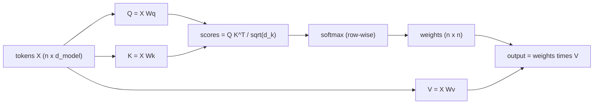
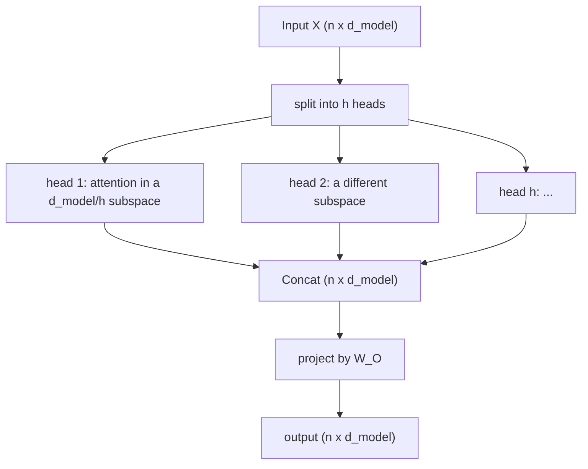
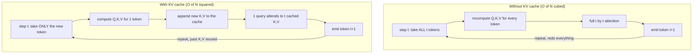

# The Transformer Architecture & Attention Mechanics

Every LLM you have used in this program is a stack of transformer blocks, and the
beating heart of each block is one operation: **attention**. This course engineers
LLMs from the inside, and it opens where it must, with the mechanism itself. By
the end of this module you will be able to derive attention from first principles,
explain why every design choice is there, and understand the single optimization
(the KV cache) that makes generation tractable at all. Four parts:

- **Self-attention and the QKV math** — queries, keys, values, and the scaled
  dot-product formula.
- **Multi-head attention and positional encoding** — why one head is not enough,
  and how RoPE encodes order.
- **Causal masking** — the lower-triangular mask that enforces autoregression.
- **The KV cache** — the inference optimization that eliminates quadratic
  recomputation.

This is dense and mathematical by design. Take it slowly.

---

## 1.1 — Self-Attention & The QKV Math

A sequence of $n$ tokens enters as embeddings stacked into a matrix $X \in \mathbb{R}^{n \times d_{model}}$
(one row per token). Attention's job is to let every token gather information from
every other token, weighted by relevance. It does this through three learned
projections.

**Queries, Keys, Values.** From the input, learn three weight matrices and project:

$$
Q = X W_Q, \qquad K = X W_K, \qquad V = X W_V
$$

with $W_Q, W_K \in \mathbb{R}^{d_{model} \times d_k}$ and $W_V \in \mathbb{R}^{d_{model} \times d_v}$, giving $Q, K \in \mathbb{R}^{n \times d_k}$ and $V \in \mathbb{R}^{n \times d_v}$.
The intuition is a soft dictionary lookup: a token's **query** is what it is
looking for, every token's **key** advertises what it offers, and its **value** is
the information it actually carries. Token $i$ finds relevant tokens by matching its
query against all keys, then reads out a blend of their values.

**Scaled dot-product attention.** The whole operation is one formula:

$$
\text{Attention}(Q, K, V) = \text{softmax}\!\left(\frac{Q K^{\top}}{\sqrt{d_k}}\right) V
$$

Read it left to right. $Q K^{\top} \in \mathbb{R}^{n \times n}$ is the score matrix:
entry $(i, j)$ is the dot product of query $i$ with key $j$, a raw relevance score.
Divide by $\sqrt{d_k}$ (the reason is the crux of this section). Apply softmax along
each row so every token's scores become a probability distribution over the $n$
keys that sums to $1$. Finally multiply by $V$: each output row is a convex
combination of value vectors, weighted by attention. The output is $\mathbb{R}^{n \times d_v}$,
one context-mixed vector per token.



### Why divide by the square root of the dimension

This is not a cosmetic constant; without it, training stalls. Model each component
of $q$ and $k$ as independent, mean $0$, variance $1$. The dot product is a sum of
$d_k$ terms:

$$
q \cdot k = \sum_{i=1}^{d_k} q_i k_i
$$

Each term $q_i k_i$ has mean $\mathbb{E}[q_i]\,\mathbb{E}[k_i] = 0$ and variance $\mathbb{E}[q_i^2]\,\mathbb{E}[k_i^2] = 1$.
Summing $d_k$ independent terms adds their variances, so

$$
\text{Var}(q \cdot k) = d_k, \qquad \text{std}(q \cdot k) = \sqrt{d_k}
$$

The raw scores grow in magnitude like $\sqrt{d_k}$. For a realistic head dimension
of $d_k = 64$ or $128$, the logits fed to softmax swing by $\pm 8$ to $\pm 11$ or more.
Softmax on large-magnitude logits **saturates**: one entry rounds to $1$, the rest
to $0$, collapsing the attention into a hard argmax. And a saturated softmax has
near-zero gradient. Its Jacobian entries are $p_i(1 - p_i)$ on the diagonal and
$-p_i p_j$ off it. When the distribution $p$ is nearly one-hot, every one of those
terms is near zero, so no gradient flows back through attention and learning halts.

Dividing by $\sqrt{d_k}$ rescales the variance back to $1$:

$$
\text{Var}\!\left(\frac{q \cdot k}{\sqrt{d_k}}\right) = \frac{d_k}{d_k} = 1
$$

so the logits stay in a well-conditioned range regardless of head size, softmax
keeps a soft distribution, and gradients survive. That is the whole reason for the
$\sqrt{d_k}$: it decouples the softmax temperature from the head dimension.

```python
import numpy as np

def softmax(x, axis=-1):
    x = x - x.max(axis=axis, keepdims=True)        # subtract max for numerical stability
    e = np.exp(x)
    return e / e.sum(axis=axis, keepdims=True)

def attention(Q, K, V, mask=None):
    """Q,K: (n, d_k); V: (n, d_v). Returns (n, d_v)."""
    d_k = Q.shape[-1]
    scores = Q @ K.T / np.sqrt(d_k)                # (n, n): query i . key j, scaled
    if mask is not None:
        scores = scores + mask                     # additive mask: -inf where forbidden (1.3)
    weights = softmax(scores, axis=-1)             # row-wise distribution over keys
    return weights @ V                             # weighted sum of value vectors

# Q, K, V come from learned projections of the embeddings X (n, d_model):
#   Q = X @ Wq ; K = X @ Wk ; V = X @ Wv
```

```typescript
type Mat = number[][];

// scores(i,j) = (row_i of A) . (row_j of B)  ==  A @ B^T
const scoreMatrix = (A: Mat, B: Mat): Mat =>
  A.map((a) => B.map((b) => a.reduce((s, x, i) => s + x * b[i]!, 0)));

function softmaxRow(row: number[]): number[] {
  const m = Math.max(...row);
  const e = row.map((x) => Math.exp(x - m));
  const sum = e.reduce((s, x) => s + x, 0);
  return e.map((x) => x / sum);
}

function attention(Q: Mat, K: Mat, V: Mat, mask?: Mat): Mat {
  const dk = Q[0]!.length;
  const scaled = scoreMatrix(Q, K).map((row, i) =>
    row.map((s, j) => s / Math.sqrt(dk) + (mask ? mask[i]![j]! : 0)),
  );
  const weights = scaled.map(softmaxRow);
  const dv = V[0]!.length;
  // weights (n x n) @ V (n x d_v)
  return weights.map((w) =>
    Array.from({ length: dv }, (_, c) => w.reduce((s, wj, j) => s + wj * V[j]![c]!, 0)),
  );
}
```

---

## 1.2 — Multi-Head Attention & Positional Encoding

### One head is not enough

A single attention operation produces one distribution per token, forcing every
relationship a token cares about into a single weighting. But language has many
kinds of dependency at once: a verb attends to its subject, a pronoun to its
antecedent, a token to its immediate neighbours, a word to the topic. One softmax
cannot express all of these simultaneously, and one projection can only look in one
learned subspace.

**Multi-head attention** runs $h$ attention operations in parallel, each with its
own projections into a smaller subspace of size $d_k = d_{model} / h$. Each head
learns a different relationship, then their outputs are concatenated and mixed by a
final projection $W_O$:

$$
\text{head}_i = \text{Attention}(X W_Q^{(i)}, X W_K^{(i)}, X W_V^{(i)})
$$

$$
\text{MultiHead}(X) = \text{Concat}(\text{head}_1, \dots, \text{head}_h)\, W_O
$$

Because each head is $d_{model} / h$ wide, the total compute is roughly that of one
full-width head, but you get $h$ independent attention patterns for free. This is
almost all of the transformer's expressive power.



### The permutation problem, and RoPE

Attention has a deep blind spot: it is **permutation-equivariant**. The score
$q_i \cdot k_j$ depends only on the *content* of tokens $i$ and $j$, never on where
they sit in the sequence. Shuffle the input rows and the outputs shuffle to match,
but no relationship changes. To attention, "the cat sat" and "sat the cat" are the
same bag of tokens. Order must be injected explicitly.

The original transformer **added** a fixed sinusoidal (or learned) position vector
to each embedding, encoding *absolute* position. Modern LLMs (LLaMA, most current
models) instead use **Rotary Positional Embeddings (RoPE)**, which encode *relative*
position by rotating the query and key vectors rather than adding to them.

RoPE splits each $d_k$-dimensional query or key into $d_k / 2$ coordinate pairs and
rotates the pair at index $i$ by an angle proportional to the token's position $m$,
using a per-pair frequency:

$$
\theta_i = b^{-2i / d_k}, \qquad b = 10000
$$

$$
R(m\theta_i) = \begin{pmatrix} \cos m\theta_i & -\sin m\theta_i \\ \sin m\theta_i & \cos m\theta_i \end{pmatrix}
$$

The elegant part is what happens in the dot product. A query at position $m$ and a
key at position $n$ are each rotated by their own position, and because rotation
matrices compose as $R(\alpha)^{\top} R(\beta) = R(\beta - \alpha)$, their inner product depends
only on the *difference* of positions:

$$
(R(m\theta)\,q)^{\top} (R(n\theta)\,k) = q^{\top} R((n - m)\theta)\, k
$$

So the attention score between two tokens is a function of their **relative**
distance $n - m$ and their content, exactly the property language wants. RoPE is
applied to $Q$ and $K$ only (never $V$), before the dot product, adds no parameters,
and extrapolates to longer contexts far better than absolute encodings, which is why
it is the default in nearly every current LLM.

| Scheme | Encodes | How | Extrapolates to longer context |
| --- | --- | --- | --- |
| Sinusoidal absolute | Absolute position | Add a fixed vector to the embedding | Poorly |
| Learned absolute | Absolute position | Add a trained per-position vector | No (undefined past trained length) |
| **RoPE (rotary)** | **Relative position** | **Rotate Q and K by position angle** | **Well (with NTK / YaRN scaling)** |

```python
def apply_rope(x, positions, base=10000.0):
    """Rotate coordinate pairs of x (n, d) by position-dependent angles. Apply to
    Q and K before the dot product; the resulting score depends on (n - m)."""
    n, d = x.shape
    idx = np.arange(0, d, 2)
    theta = base ** (-idx / d)                     # (d/2,): one frequency per pair
    ang = positions[:, None] * theta[None, :]      # (n, d/2): rotation angle per token, per pair
    cos, sin = np.cos(ang), np.sin(ang)
    x_even, x_odd = x[:, 0::2], x[:, 1::2]
    out = np.empty_like(x)
    out[:, 0::2] = x_even * cos - x_odd * sin       # standard 2D rotation of each pair
    out[:, 1::2] = x_even * sin + x_odd * cos
    return out
```

```typescript
// Rotate coordinate pairs of each row by an angle proportional to its position.
function applyRope(x: number[][], positions: number[], base = 10000): number[][] {
  const d = x[0]!.length;
  const theta = Array.from({ length: d / 2 }, (_, i) => base ** ((-2 * i) / d));
  return x.map((row, t) => {
    const out = new Array(d);
    for (let i = 0; i < d / 2; i++) {
      const ang = positions[t]! * theta[i]!;
      const c = Math.cos(ang), s = Math.sin(ang);
      const e = row[2 * i]!, o = row[2 * i + 1]!;
      out[2 * i] = e * c - o * s;                  // rotate the (2i, 2i+1) pair
      out[2 * i + 1] = e * s + o * c;
    }
    return out;
  });
}
```

---

## 1.3 — Causal Masking & Autoregressive Generation

An autoregressive LM predicts the next token from the tokens before it. During
training we want to predict *every* position at once, in parallel, feeding the whole
sequence through one forward pass (teacher forcing). But plain self-attention lets
token $i$ attend to *every* token, including the future ones it is supposed to
predict. Position $i$ peeking at position $i + 1$ is looking at the answer, which
would let the model cheat and learn nothing useful.

The fix is a **causal mask**: an additive matrix $M$ applied to the scores before
softmax, allowing a query at position $i$ to attend only to keys at positions
$j \le i$ and forbidding all future keys:

$$
\text{Attention} = \text{softmax}\!\left(\frac{Q K^{\top}}{\sqrt{d_k}} + M\right) V, \qquad M_{ij} = \begin{cases} 0 & \text{if } j \le i \\ -\infty & \text{if } j > i \end{cases}
$$

The mask is lower-triangular: zeros on and below the diagonal, negative infinity
above it. Because $e^{-\infty} = 0$, every forbidden (future) position receives
exactly zero weight after softmax, so its value never enters the output. In practice
a large negative constant such as $-10^{9}$ stands in for $-\infty$ to keep the
arithmetic finite.

Here is the mask for a length-4 sequence. Each row is a query; each column a key:

| query \\ key | $t_1$ | $t_2$ | $t_3$ | $t_4$ |
| --- | --- | --- | --- | --- |
| $t_1$ | $0$ | $-\infty$ | $-\infty$ | $-\infty$ |
| $t_2$ | $0$ | $0$ | $-\infty$ | $-\infty$ |
| $t_3$ | $0$ | $0$ | $0$ | $-\infty$ |
| $t_4$ | $0$ | $0$ | $0$ | $0$ |

This is what makes parallel training possible: a single masked forward pass computes
the correct, causally-restricted prediction for all $n$ positions simultaneously,
each position seeing only its own past. At inference the model generates one token
at a time and is causal by construction, but the same mask still governs the
parallel **prefill** of the prompt (Module 2).

```python
def causal_mask(n):
    """0 where key j <= query i (allowed); -inf where j > i (future)."""
    j = np.arange(n)[None, :]
    i = np.arange(n)[:, None]
    return np.where(j <= i, 0.0, -np.inf)

# scores = Q @ K.T / sqrt(d_k) + causal_mask(n); then softmax zeroes the future.
```

```typescript
const causalMask = (n: number): number[][] =>
  Array.from({ length: n }, (_, i) =>
    Array.from({ length: n }, (_, j) => (j <= i ? 0 : -Infinity)),
  );
// Add to the scaled scores before softmax; -Infinity -> exp -> 0 weight for future keys.
```

---

## 1.4 — The KV Cache

Everything so far describes one forward pass. Generation is a *loop* of forward
passes, and done naively it is catastrophically wasteful. The KV cache is the single
optimization that makes LLM inference practical.

### The redundancy

To generate token $t + 1$, an autoregressive model needs the attention output at the
last position, which requires the last token's query attending to the keys and values
of all $t$ tokens so far. The naive approach re-runs the whole model over the entire
growing sequence at every step. But notice: the key and value vectors of the earlier
tokens are computed from those tokens alone, which do not change as generation
proceeds. Recomputing them every step is pure redundant work.

Quantify it. Without caching, step $t$ re-encodes $t$ tokens, and the attention alone
is $t \times t$ score computation, costing $O(t^2)$. Summing over $N$ generated tokens:

$$
\sum_{t=1}^{N} O(t^2) = O(N^3)
$$

Generation is cubic in the output length. Doubling the response quadruples-and-then-some
the compute, most of it re-deriving keys and values that were already correct.

### The cache

The **KV cache** stores the key and value vectors of every token already processed,
per layer and per head. The generation loop then becomes:

1. Compute $Q$, $K$, $V$ for the **single new token** only.
2. Append its $K$ and $V$ to the cache.
3. The new token's query attends to **all cached keys and values**, producing the
   next-token distribution.

The past keys and values are read from the cache, never recomputed. Each step is now
one query against $t$ cached keys, costing $O(t)$, so total generation is

$$
\sum_{t=1}^{N} O(t) = O(N^2)
$$

The cache removes a full factor of $N$ from the work. The unavoidable $O(N^2)$ that
remains is the intrinsic cost of every token attending to all previous tokens; the
cache eliminates only the *redundant* re-derivation, which was everything else.



```python
def decode_step(q_new, k_new, v_new, cache_k, cache_v):
    """One layer, one new token. q/k/v_new: (d,). The cache holds every past K,V."""
    cache_k.append(k_new)                          # O(1) append; never recomputed
    cache_v.append(v_new)
    K = np.stack(cache_k)                          # (t, d): all keys so far, reused
    V = np.stack(cache_v)                          # (t, d): all values so far, reused
    scores = q_new @ K.T / np.sqrt(len(q_new))     # (t,): new query vs cached keys
    return softmax(scores) @ V                     # (d,): attention output for the new token

# Loop: prefill the prompt once (fills the cache), then call decode_step per new token.
```

```typescript
function decodeStep(
  qNew: number[], kNew: number[], vNew: number[], cacheK: number[][], cacheV: number[][],
): number[] {
  cacheK.push(kNew);                               // append the new key  (past keys reused)
  cacheV.push(vNew);                               // append the new value
  const dk = qNew.length;
  const scores = cacheK.map((k) => k.reduce((s, x, i) => s + x * qNew[i]!, 0) / Math.sqrt(dk));
  const w = softmaxRow(scores);                    // new query vs all cached keys
  const dv = cacheV[0]!.length;
  return Array.from({ length: dv }, (_, c) => w.reduce((s, wj, t) => s + wj * cacheV[t]![c]!, 0));
}
```

### The cost of the cache: memory

The cache is a compute-for-memory trade, and the memory is enormous. It holds a key
and a value for every layer, every KV head, every token in the context, for every
sequence in the batch:

$$
\text{KV bytes} = 2 \cdot L \cdot n_{kv} \cdot d_{head} \cdot s \cdot b \cdot p
$$

where $L$ is layers, $n_{kv}$ KV heads, $d_{head}$ the head dimension, $s$ the sequence
length, $b$ the batch size, $p$ the bytes per element, and the leading $2$ counts keys
and values. For a large model at long context this runs to many gigabytes and becomes
the dominant consumer of GPU memory during inference, capping how long a context and
how large a batch a device can serve. That pressure is the origin of a whole family of
engineering techniques you will meet next: **Grouped-Query Attention** (share KV heads
across query heads, shrinking $n_{kv}$), **PagedAttention** (page the cache like virtual
memory to stop fragmentation), and **KV-cache quantization** (store $K$ and $V$ at lower
precision). The cache is where transformer theory becomes serving economics.

---

## Recap

- **Self-attention** projects tokens into queries, keys, and values, scores every
  query against every key, and returns a softmax-weighted blend of values:
  $\text{softmax}(Q K^{\top} / \sqrt{d_k}) V$. The $\sqrt{d_k}$ scaling exists because the
  dot product has variance $d_k$; without it, large logits saturate softmax into a
  near one-hot with vanishing gradient, and training stalls. Dividing by $\sqrt{d_k}$
  restores unit variance and healthy gradients.
- **Multi-head attention** runs $h$ smaller attention operations in parallel so the
  model can express many relationships at once, then concatenates and projects them.
  Attention is permutation-blind, so order is injected separately; **RoPE** rotates $Q$
  and $K$ by a position-dependent angle so that scores depend on relative distance
  $n - m$, which generalizes to longer contexts and is the modern default.
- **Causal masking** adds a lower-triangular matrix of $-\infty$ above the diagonal so
  a token attends only to positions $j \le i$; after softmax the future gets zero
  weight. This enforces autoregression while allowing all positions to train in one
  parallel masked pass.
- **The KV cache** stores past keys and values so each generation step processes only
  the new token, turning naive $O(N^3)$ generation into $O(N^2)$ by removing the
  redundant re-derivation of the prefix. Its price is memory that scales as
  $2 L\, n_{kv}\, d_{head}\, s\, b\, p$, the dominant inference-memory cost and the driver of
  GQA, PagedAttention, and cache quantization.

## Exercises

1. **Watch softmax saturate.** Sample random $q, k$ vectors at $d_k \in \{4, 64, 512\}$,
   compute the raw and the scaled dot products across many pairs, and confirm the raw
   scores' standard deviation tracks $\sqrt{d_k}$ while the scaled ones stay near $1$.
   Then plot the softmax of a score row before and after scaling and observe the
   collapse to one-hot at large $d_k$.

2. **Prove RoPE is relative.** Implement `apply_rope`, rotate a fixed query at several
   positions and a fixed key at several positions, and verify numerically that the
   dot product depends only on the position difference $n - m$, not on $m$ and $n$
   separately.

3. **Mask, then check.** Build the causal mask, add it to a score matrix, softmax it,
   and confirm every entry above the diagonal is exactly zero and every row still sums
   to one. Remove the mask and show a token can then "see" its own future.

4. **Measure the cache.** Implement the cached and uncached generation loops over a toy
   attention layer. Count the multiply-adds each performs to generate $N$ tokens for
   $N \in \{16, 64, 256\}$ and confirm the uncached cost grows like $N^3$ while the
   cached cost grows like $N^2$. Then compute the KV-cache byte size for a 32-layer,
   32-KV-head, 128-head-dim model at 8k context in fp16.

## Next: Module 2 — Inference Optimization & the Serving Stack

The KV cache made a single stream tractable; serving thousands of them profitably is
the next problem. Module 2 covers the inference engineering that sits on top of this
architecture: continuous batching to keep the GPU saturated across many concurrent
requests, quantization to shrink weights and the KV cache, speculative decoding to
break the one-token-per-step barrier, and the throughput-versus-latency trade-offs
that define how an LLM is actually served.
