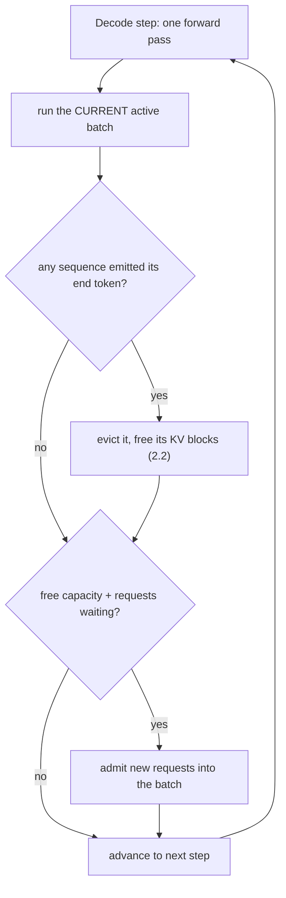
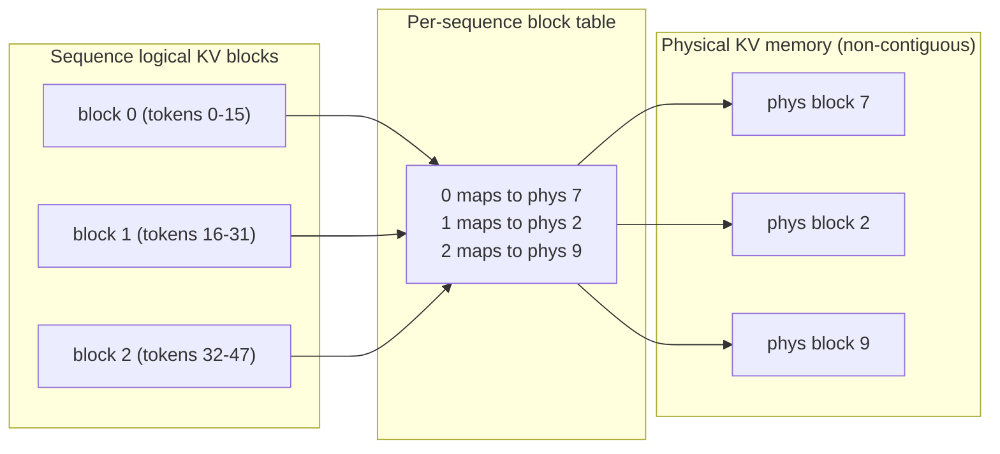
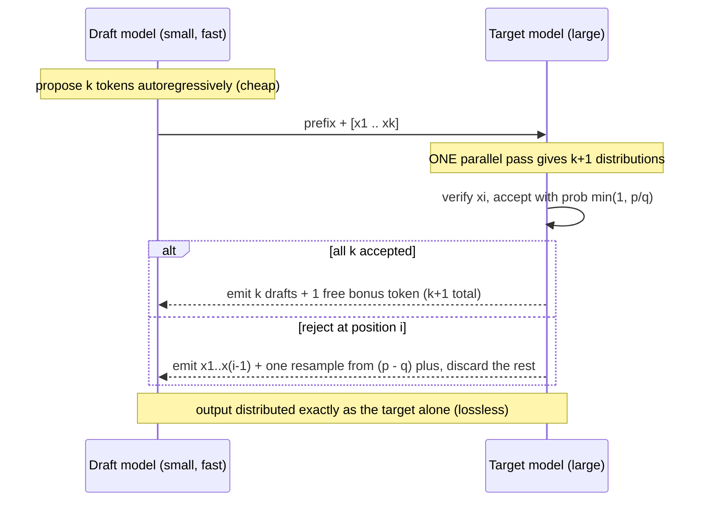

# Inference Optimization & the Serving Stack

Module 1 explained the transformer and the KV cache that makes a single generation
stream tractable. Serving *thousands* of streams on one GPU, fast and cheap, is a
different problem — and it is dominated by hardware realities, not math. LLM decode
is **memory-bound**: at each step the GPU loads gigabytes of weights and the KV
cache to produce one token, and its arithmetic units sit mostly idle waiting on
memory. The serving stack is a set of techniques for beating that wall. Four of
them, all in production systems like vLLM:

- **Continuous batching** — schedule at the token level so the GPU never waits for
  the slowest sequence.
- **PagedAttention** — page the KV cache to eliminate fragmentation and OOM.
- **FlashAttention** — fuse attention in on-chip SRAM to avoid HBM round-trips.
- **Speculative decoding** — draft cheap, verify in parallel, break the one-token
  wall.

---

## 2.1 — Continuous Batching

GPUs deliver throughput through parallelism, so you batch many requests together.
But autoregressive generation is sequential and requests have wildly different
output lengths and arrival times, which is exactly what naive batching handles
badly.

**Static batching** collects a batch, runs it through generation until *every*
sequence finishes, then returns and starts the next batch. Because sequences finish
at different steps, the short ones leave their GPU slots **idle** while the batch
waits for the longest one, and a new request cannot join until the whole batch
completes. The batch runs at the pace of its slowest member, and utilization decays
as sequences drop out.

Watch three requests (R1 = 2 tokens, R2 = 8, R3 = 5) with R4 arriving at step 2:

| step | slot 1 | slot 2 | slot 3 | R4 (waiting) |
| --- | --- | --- | --- | --- |
| 1-2 | R1 | R2 | R3 | queued |
| 3-5 | **idle** (R1 done) | R2 | R3 | queued |
| 6-8 | **idle** | R2 | **idle** (R3 done) | queued |
| 9+ | R4 starts only now | | | admitted |

Slot 1 is wasted for six steps, and R4 waits the full batch out. On real traffic
this leaves the GPU less than half utilized.

**Continuous batching** (iteration-level scheduling, from Orca and central to vLLM)
fixes it with one idea: the batch composition can change at *every decode step*,
not every request. The scheduler runs one forward pass over the currently active
sequences; the instant a sequence emits its end token it is **evicted** and its
slot freed, and waiting requests are **admitted** into the batch as capacity opens —
mid-flight, without waiting for anything else to finish.

| step | slot 1 | slot 2 | slot 3 |
| --- | --- | --- | --- |
| 1-2 | R1 | R2 | R3 |
| 3+ | **R4** (R1 evicted, admitted same step) | R2 | R3 |

No idle slots, no head-of-line blocking, and the GPU stays saturated. This alone is
often a several-fold throughput win.



One wrinkle the scheduler must manage: a request first needs a **prefill** pass
(process the whole prompt, fill its KV cache — compute-bound, many tokens at once)
before it joins the per-token **decode** loop (memory-bound, one token). Dropping a
large prefill into a decode batch stalls every other sequence that step, spiking
their latency. Production schedulers use **chunked prefill** (split a long prompt
across several steps) so admitting a new request does not freeze the ones already
generating. Continuous batching maximizes *throughput*; chunked prefill protects
per-request *latency*.

---

## 2.2 — PagedAttention & Memory Management

The KV cache from Module 1 dominates inference memory, and *how you allocate it*
decides how many sequences a GPU can serve.

**Naive pre-allocation** reserves a single contiguous KV region per sequence, sized
to the maximum possible context (say 4096 tokens). Two failures follow. **Internal
fragmentation:** most requests generate far fewer tokens than the max, so most of
each reservation is reserved-but-unused — often 60 to 80 percent of KV memory
wasted. **External fragmentation:** contiguous reservations chop free memory into
holes, so a new request needing a contiguous block can fail to fit even when the
*total* free memory is ample. The result is premature OOM and small batches, which
is low throughput.

**PagedAttention** (vLLM's core contribution) borrows paging straight from operating
systems. The KV cache is cut into fixed-size **blocks** (e.g. 16 tokens of K and V
per block). A sequence's cache is a *list* of blocks that may sit anywhere in
physical memory, and a per-sequence **block table** maps each logical block index to
a physical block address, exactly as an OS page table maps virtual pages to physical
frames. Blocks are allocated **on demand** as the sequence grows — a new physical
block only when the current one fills — and returned to a shared free pool when the
sequence finishes.



The wins are structural. Internal fragmentation drops to at most one partially-filled
block per sequence — a waste of fewer than `block_size` tokens instead of thousands.
External fragmentation vanishes because every free block is the same size and
non-contiguity is fine. Memory now scales with *actual* tokens generated, not the
max, so far more sequences fit and batch sizes grow. And because blocks are
indirected through a table, sequences can **share** physical blocks copy-on-write —
a shared system prompt, parallel samples, or beam-search branches reference the same
K and V until they diverge, then fork only the block that changes.

```python
BLOCK_SIZE = 16  # tokens of K and V per physical block

class PagedKVManager:
    """Models vLLM-style paged KV allocation: a free pool of fixed-size physical
    blocks, a per-sequence block table, on-demand growth, no max-length reservation."""

    def __init__(self, num_blocks: int):
        self.free = list(range(num_blocks))   # pool of physical block ids
        self.block_table: dict[str, list[int]] = {}
        self.length: dict[str, int] = {}

    def add_sequence(self, seq_id: str) -> None:
        self.block_table[seq_id] = []
        self.length[seq_id] = 0

    def append_token(self, seq_id: str) -> None:
        """Called once per generated token. A new physical block is grabbed only
        when the current one fills — grow on demand, non-contiguous is fine."""
        if self.length[seq_id] % BLOCK_SIZE == 0:      # current block full (or none yet)
            if not self.free:
                raise MemoryError("KV OOM: every physical block is in use")
            self.block_table[seq_id].append(self.free.pop())  # any free block will do
        self.length[seq_id] += 1

    def slot_of(self, seq_id: str, token_pos: int) -> tuple[int, int]:
        """Map a logical token position to (physical_block, offset) via the table —
        the indirection the PagedAttention kernel follows to gather K and V."""
        block = self.block_table[seq_id][token_pos // BLOCK_SIZE]
        return block, token_pos % BLOCK_SIZE

    def free_sequence(self, seq_id: str) -> None:
        self.free.extend(self.block_table.pop(seq_id))  # return blocks to the pool
        del self.length[seq_id]
```

The cost is that the attention kernel can no longer assume contiguous K and V; it
must gather them block by block through the table. That custom **PagedAttention
kernel** is what makes the scheme practical, and it composes with the continuous
batching scheduler above (which frees blocks the moment a sequence is evicted).

---

## 2.3 — FlashAttention (v2 / v3)

Attention on a modern GPU is limited by **memory bandwidth**, not arithmetic. To see
why, you have to look at the memory hierarchy.

| Memory | Role | Capacity (A100) | Bandwidth | Speed |
| --- | --- | --- | --- | --- |
| **HBM** | Main GPU DRAM (weights, KV cache, activations) | 40 to 80 GB | ~2 TB/s | slower |
| **SRAM** | On-chip per-SM shared memory / registers | ~20 MB total | ~19 TB/s | ~10x faster |

SRAM is roughly an order of magnitude faster than HBM but thousands of times
smaller. Standard attention ignores this. It computes the full score matrix
$S = QK^{\top}$ of shape $N \times N$, writes it to HBM, reads it back to softmax into
$P$, writes $P$ to HBM, reads it back to compute $O = PV$. For a long sequence that
$N \times N$ matrix is enormous, and the repeated HBM round-trips of it dominate the
runtime — the GPU is bandwidth-starved while its compute units idle. The IO, not the
FLOPs, is the wall.

**FlashAttention** (Tri Dao) is an IO-aware, fused kernel that **never materializes
the $N \times N$ matrix in HBM at all**. Two ideas make it work:

- **Tiling.** Split $Q$, $K$, $V$ into blocks small enough to fit in SRAM. Load a $Q$
  block and a $K, V$ block into SRAM, compute their partial scores and partial output
  entirely on-chip, then stream to the next block. Only $Q$, $K$, $V$ (in) and $O$
  (out) ever touch HBM, turning attention's memory traffic from $O(N^2)$ down to
  $O(N)$.
- **Online (streaming) softmax.** Softmax normally needs a whole row at once to find
  its max and normalizer. FlashAttention computes it incrementally across $K, V$
  tiles by carrying a running max $m$ and running sum $\ell$, and rescaling the
  accumulated output as each tile arrives. For a new tile with local max $m_j$:

$$
m^{\text{new}} = \max(m,\, m_j), \qquad \ell \leftarrow \ell\, e^{m - m^{\text{new}}} + \ell_j\, e^{m_j - m^{\text{new}}}
$$

$$
O \leftarrow O\, e^{m - m^{\text{new}}} + P_j V_j, \qquad O_{\text{final}} = O / \ell
$$

This yields the *exact* softmax result without ever holding a full row — the whole
matmul-mask-softmax-matmul chain becomes one fused kernel.

```python
import numpy as np

def flash_attention(Q, K, V, block=64):
    """Tiled attention with online softmax. Streams K,V in SRAM-sized blocks and
    keeps a running max/sum, so the full N x N scores never exist. Exact result;
    the real kernel's win is that each tile stays in SRAM, off HBM."""
    n, d = Q.shape
    O = np.zeros((n, d))
    m = np.full(n, -np.inf)            # running row max
    l = np.zeros(n)                    # running row normalizer
    for j in range(0, n, block):       # stream K,V tiles (each fits in SRAM)
        Kb, Vb = K[j:j + block], V[j:j + block]
        S = Q @ Kb.T / np.sqrt(d)      # (n, block): partial scores for this tile only
        m_new = np.maximum(m, S.max(axis=1))
        alpha = np.exp(m - m_new)      # rescale factor for everything accumulated so far
        p = np.exp(S - m_new[:, None])
        l = l * alpha + p.sum(axis=1)  # update running normalizer
        O = O * alpha[:, None] + p @ Vb  # rescale prior output, add this tile
        m = m_new
    return O / l[:, None]
```

The versions track GPU generations. **v2** re-partitions the work to cut non-matmul
FLOPs and parallelize across the sequence dimension, roughly doubling v1. **v3**
exploits Hopper (H100) features — asynchronous copies via TMA, warp specialization,
and FP8 — overlapping the matmul and softmax for another large step. In all of them
the principle is identical: keep attention on-chip and off the HBM bus.

---

## 2.4 — Speculative Decoding

The last wall is autoregression itself. The large model emits one token per forward
pass, and each decode pass is memory-bound — it loads every weight to produce a
single token, leaving compute to spare. **Speculative decoding** spends that spare
compute to emit several tokens per expensive pass.

Use a small, cheap **draft** model to guess ahead, and the large **target** model to
verify the guesses in parallel:

1. The draft model autoregressively proposes $k$ candidate tokens $x_1, \dots, x_k$.
   Cheap, because the draft is small.
2. The target model runs **one** forward pass over the prompt plus all $k$ drafts,
   producing its next-token distribution at each of the $k + 1$ positions at once —
   one compute-bound pass instead of $k$ sequential memory-bound ones.
3. Verify each draft with modified rejection sampling. Accept $x_i$ with probability

$$
\min\!\left(1,\; \frac{p(x_i)}{q(x_i)}\right)
$$

where $p$ is the target's probability and $q$ the draft's. On the first rejection,
discard the rest and resample that position from the residual distribution

$$
p'(x) = \frac{\max(0,\, p(x) - q(x))}{\sum_{x'} \max(0,\, p(x') - q(x'))}
$$

This scheme is **provably lossless**: the emitted tokens are distributed *exactly* as
if you had sampled from the target model alone. Speculative decoding buys speed with
zero change to the output distribution — the whole reason it is safe to deploy.



```python
import numpy as np

def speculative_step(target, draft, prefix, k, rng=np.random.default_rng()):
    """One speculative iteration. Emits 1 to k+1 tokens, distributed EXACTLY as the
    target model would. `verify` runs a single parallel target pass over the drafts."""
    seq, drafted, q_dists = list(prefix), [], []
    for _ in range(k):                                # 1. draft proposes k tokens (cheap)
        qd = draft.next_token_probs(seq)
        tok = rng.choice(len(qd), p=qd)
        drafted.append(tok); q_dists.append(qd); seq.append(tok)

    p_dists = target.verify(prefix, drafted)          # 2. ONE target pass -> k+1 dists

    emitted = []
    for i, tok in enumerate(drafted):                 # 3. rejection-sample each draft
        if rng.random() < min(1.0, p_dists[i][tok] / q_dists[i][tok]):
            emitted.append(tok)                       # accept
        else:
            resid = np.maximum(0.0, p_dists[i] - q_dists[i])  # reject: resample residual
            emitted.append(rng.choice(len(resid), p=resid / resid.sum()))
            return emitted                            # ...and discard the remaining drafts
    emitted.append(rng.choice(len(p_dists[k]), p=p_dists[k]))  # 4. all accepted: free bonus
    return emitted
```

How much you gain depends on the **acceptance rate** $\alpha$ (how often the draft
agrees with the target) and the draft's cost. If each draft is accepted independently
with probability $\alpha$, the expected number of tokens emitted per target pass is

$$
\mathbb{E}[\text{tokens}] = \frac{1 - \alpha^{k+1}}{1 - \alpha}
$$

A well-matched draft (high $\alpha$) yields two to three tokens per expensive pass for
a matching speedup; a poor draft that is rarely accepted wastes its own compute and
can even slow things down. The engineering is in cheap, well-aligned drafters —
small sibling models, or self-speculation heads (Medusa, EAGLE) that predict several
tokens from the target's own hidden states, avoiding a separate model entirely.

| | Draft model | Target model |
| --- | --- | --- |
| Size / cost | Small, fast | Large, expensive |
| Role | Propose $k$ tokens autoregressively | Verify all $k$ in one parallel pass |
| Passes per iteration | $k$ (cheap) | 1 (compute-bound, efficient) |
| Governs | Acceptance rate $\alpha$ | Final output distribution (lossless) |

---

## Recap

- **Continuous batching** schedules at the token level: it evicts finished sequences
  and admits waiting requests at every decode step, so the GPU never idles at the
  pace of the slowest sequence the way static batching does. Chunked prefill keeps a
  newly-admitted prompt from stalling the sequences already decoding.
- **PagedAttention** pages the KV cache into fixed-size blocks with a per-sequence
  block table, OS-style. On-demand, non-contiguous allocation removes the internal and
  external fragmentation that made contiguous pre-reservation waste most of KV memory
  and OOM early, and the indirection enables copy-on-write sharing of common prefixes.
- **FlashAttention** is IO-aware: by tiling $Q, K, V$ into SRAM and computing an online
  softmax with a running max and normalizer, it never writes the $N \times N$ matrix to
  HBM, cutting attention's memory traffic from $O(N^2)$ to $O(N)$ and beating the
  bandwidth wall; v2 and v3 push the same idea onto newer GPU features.
- **Speculative decoding** breaks the one-token-per-pass limit: a cheap draft proposes
  $k$ tokens, the target verifies them in a single parallel pass, and modified rejection
  sampling (accept at $\min(1, p/q)$, else resample the residual) makes the output
  provably identical to the target's own sampling — free speed, no quality loss.

## Exercises

1. **Quantify the idle GPU.** Simulate static vs. continuous batching over a stream of
   requests with a realistic (say, long-tailed) output-length distribution. Track slot
   occupancy per step and report GPU utilization and mean queueing latency for each.
   Confirm continuous batching's utilization stays high while static's decays.

2. **Page the cache.** Extend `PagedKVManager` with copy-on-write: two sequences share
   the blocks of a common prompt prefix until one appends a diverging token, at which
   point only the last shared block is forked. Verify total physical blocks used is far
   below the sum of the two sequences' lengths.

3. **Prove Flash is exact.** Run `flash_attention` and a standard full-matrix attention
   on the same inputs and confirm the outputs match to floating-point tolerance for
   several block sizes. Then count the bytes each writes to a simulated "HBM" and show
   the standard version's traffic grows like $N^2$ while Flash's grows like $N$.

4. **Speculate losslessly.** Implement `speculative_step` with two toy categorical
   models. Over many iterations, collect the emitted-token histogram and confirm it
   matches sampling the target model directly. Then sweep the draft's acceptance rate
   and plot emitted-tokens-per-iteration against the $\tfrac{1 - \alpha^{k+1}}{1 - \alpha}$ prediction.

## Next: Module 3 — Tokenization, Sampling & Decoding Strategies

We have made the forward pass and the serving loop fast; Module 3 turns to what goes
in and comes out. Byte-pair encoding and the tokenizer that turns text into the
integer sequence the model actually sees (and the failure modes that causes), then the
sampling layer on the logits — temperature, top-k, top-p, repetition penalties, and
structured/constrained decoding — that shapes every token the optimized stack emits.
