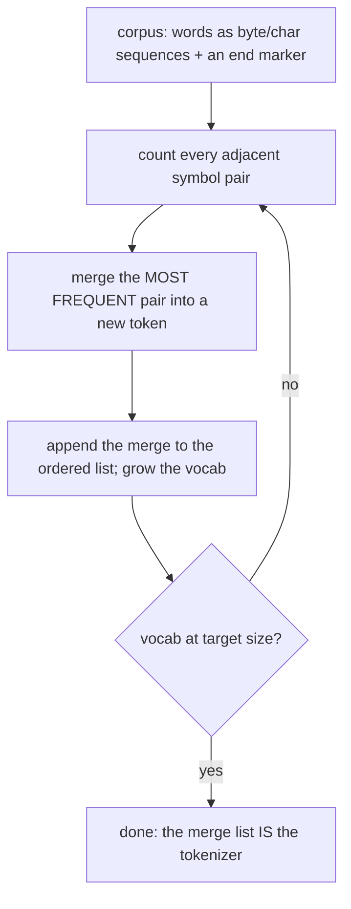
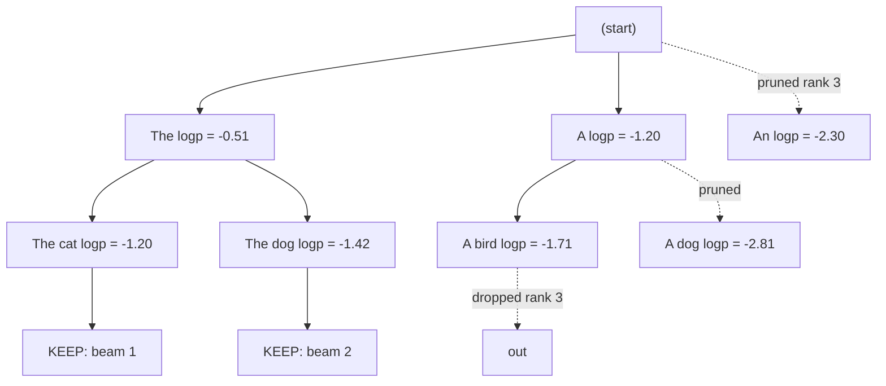
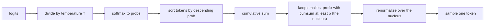

# Tokenization, Sampling & Decoding Strategies

The last two modules made the forward pass and the serving loop fast. This module
covers the layers on either side of them: the **tokenizer** that turns text into the
integer sequence the model actually sees, and the **decoding** layer that turns the
model's per-step probabilities into an output sequence. Both are pure algorithms,
and both are where a technically-perfect model produces visibly wrong text. Four
parts:

- **Tokenization and BPE** — how text becomes tokens, and why the boundaries hurt.
- **Greedy vs. beam search** — deterministic decoding of a sequence.
- **Temperature, top-k, top-p** — injecting controlled randomness.
- **Repetition and length penalties** — stopping generative collapse.

---

## 3.1 — Tokenization & Byte-Pair Encoding

A model never sees characters. It sees a sequence of integer **token IDs** drawn
from a fixed vocabulary of tens of thousands of entries, and a tokenizer is the
reversible map between text and those IDs. Tokens sit between two bad extremes:
word-level vocabularies explode in size and choke on any unseen word, while
character-level vocabularies make sequences painfully long. Subword tokenization is
the compromise, and the dominant algorithm is byte-pair encoding.

**Byte-Pair Encoding (BPE).** Originally a compression scheme, BPE learns a
vocabulary by merging. Start with a base alphabet (characters, or raw bytes), count
every adjacent symbol pair in the corpus, merge the single most frequent pair into a
new symbol, add it to the vocabulary, and repeat until the vocabulary reaches its
target size. The output is an ordered list of **merges**; encoding a new string
applies those merges greedily in learned order. Frequent substrings like `the` or
`ing` collapse into one token; rare strings stay fragmented.



```python
from collections import Counter

def train_bpe(corpus, num_merges):
    """Learn an ordered list of merges. Each word starts as space-separated symbols
    plus an end marker; the most frequent adjacent pair is merged each round.
    (Illustrative: production uses boundary-aware regex, not str.replace.)"""
    vocab = Counter()
    for line in corpus:
        for word in line.split():
            vocab[" ".join(word) + " </w>"] += 1          # 'low' -> 'l o w </w>'

    merges = []
    for _ in range(num_merges):
        pairs = Counter()
        for word, freq in vocab.items():
            syms = word.split()
            for a, b in zip(syms, syms[1:]):
                pairs[(a, b)] += freq                     # count adjacent pairs, freq-weighted
        if not pairs:
            break
        (a, b), _ = pairs.most_common(1)[0]               # the most frequent pair
        vocab = {w.replace(f"{a} {b}", a + b): f for w, f in vocab.items()}  # merge it
        merges.append((a, b))                             # ordered = merge priority
    return merges
```

**Byte-level BPE and SentencePiece.** GPT-family tokenizers run BPE over raw *bytes*
(256 base symbols), so any string whatsoever is representable and there is no
out-of-vocabulary token, ever. **SentencePiece** (used by LLaMA, T5) treats the input
as a raw stream, encodes a leading space as a visible meta-symbol (rendered `▁`) so
detokenization is exact and language-agnostic, and applies **byte fallback** so an
unknown character decomposes into its UTF-8 bytes rather than an unknown token. The
practical effect: true OOV is gone, but it is replaced by "effective OOV" where rare
strings encode into many tiny tokens the model handles poorly.

**Token fertility** is the average number of tokens per word. English on a GPT
tokenizer runs around 1.3, but non-Latin and low-resource languages often run 2 to 4
times higher because the vocabulary is English-biased, so the same content costs far
more tokens, money, and context budget in those languages. Fertility is a direct
cost and fairness lever.

### Why token boundaries break things

The tokenizer is the source of a whole class of model failures, because the model
reasons over opaque token IDs, not the characters inside them.

- **Spelling and character tasks.** "strawberry" is two or three tokens, not nine
  letters, so counting the letter r or reversing the string is genuinely hard: the
  characters are hidden inside token IDs the model cannot see through.
- **Arithmetic.** Multi-digit numbers tokenize inconsistently. "1234" might be one
  token, or split into "123" and "4", or "12" and "34", depending on corpus
  frequency. Digit grouping is arbitrary and unaligned, which is why per-digit
  arithmetic is fragile; some newer tokenizers split every digit specifically to fix
  this.
- **Trailing spaces.** Most tokenizers fold a leading space into the token, so
  `" the"` and `"the"` are *different* IDs. A prompt that ends in a trailing space
  tells the model to expect a token with no leading space, but the natural
  continuations all *have* leading spaces, so completion quality degrades. Never end
  a prompt with whitespace.
- **Glitch tokens.** A token can be frequent in the *tokenizer's* training corpus but
  absent from the *model's* training data, leaving its embedding essentially
  untrained. The infamous `SolidGoldMagikarp` (a Reddit username that became a token)
  is one: feeding it produces evasion, gibberish, or an inability to even repeat the
  word, because the model has never learned what that ID means. Glitch tokens are a
  mismatch between the tokenizer corpus and the model corpus.

---

## 3.2 — Decoding Strategies: Greedy vs. Beam Search

At each step the model gives a probability distribution over the vocabulary for the
next token. A **decoding strategy** turns that stream of per-step distributions into
a full output sequence.

**Greedy decoding** takes the single most probable token at every step (`argmax`).
It is deterministic and fast, but locally optimal is not globally optimal: a
slightly-less-likely token now can lead to a far more likely *sequence* later, and
greedy can never recover from a bad early commitment. It also tends toward bland,
repetitive text.

**Beam search** keeps the top $b$ partial sequences (the beam width) instead of one.
At each step it expands every beam by every possible next token, scores each
candidate sequence by its cumulative log-probability, and keeps the best $b$ overall.
Greedy is simply beam search with $b = 1$.



At beam width 2, step one keeps {The, A}; step two expands them into four candidates
and keeps the two best by cumulative log-probability, {The cat, The dog}, pruning the
rest. Because probabilities multiply, the score is a *sum of log-probabilities*:

$$
\log P(y) = \sum_{t=1}^{|y|} \log P(y_t \mid y_{<t})
$$

Beam search explores more of the space than greedy and reliably finds
higher-probability sequences, which is why it dominates machine translation and
summarization where a single "correct" output exists. But it is a poor fit for
open-ended generation: optimizing hard for likelihood produces generic, repetitive,
degenerate text, so chat and creative generation use sampling instead. Beam search
also costs $b$ times the compute and $b$ KV caches, and it carries a length bias we
fix in 3.4.

| Strategy | Picks | Deterministic | Best for |
| --- | --- | --- | --- |
| Greedy | `argmax` each step | Yes | Short, factual, fast |
| Beam search | Top $b$ sequences by log-prob | Yes | Translation, summarization |
| Sampling (3.3) | A draw from the distribution | No | Chat, creative, open-ended |

---

## 3.3 — Stochastic Sampling: Temperature, Top-K, Top-P

Deterministic decoding is repetitive; sampling draws the next token from the
distribution to get diversity, and three knobs shape that distribution.

**Temperature** rescales the logits $z_i$ before the softmax by a factor $T$:

$$
q_i = \frac{\exp(z_i / T)}{\sum_j \exp(z_j / T)}
$$

At $T = 1$ the distribution is unchanged. At $T < 1$ it sharpens (differences between
logits are amplified), making the model more confident and closer to greedy, with
$T \to 0$ approaching `argmax`. At $T > 1$ it flattens toward uniform, making output
more random and creative but more error-prone. Temperature is the primary creativity
dial.

**Top-K** truncates to the $k$ highest-probability tokens, renormalizes, and samples
from just those. It is a *hard rank cutoff*: always exactly $k$ candidates, whatever
the shape of the distribution. That rigidity is its weakness. When the model is
confident and one token dominates, a fixed $k$ drags in low-probability junk; when
the model is uncertain and the distribution is flat, the same $k$ cuts off good
options.

**Top-P (nucleus) sampling** truncates by *cumulative probability mass* instead of
rank: keep the smallest set of tokens whose probabilities sum to at least $p$, the
**nucleus**, then renormalize and sample. Formally the nucleus is the smallest set
$V^{(p)}$ with

$$
\sum_{x \in V^{(p)}} P(x) \ge p
$$

The cutoff is *dynamic*: a confident distribution yields a tiny nucleus (the top
token already covers $p$), an uncertain one yields a large nucleus. Because it adapts
to the model's own confidence, top-p is the default for open-ended generation, often
combined with temperature and a top-k safety cap.



```python
import numpy as np

def sample_top_p(logits, temperature=1.0, p=0.9, rng=np.random.default_rng()):
    """Temperature + nucleus (top-p) sampling. Keeps the smallest set of tokens
    whose cumulative probability reaches p, renormalizes, and samples one."""
    z = logits / max(temperature, 1e-6)             # temperature scales the logits
    z = z - z.max()                                 # stable softmax
    probs = np.exp(z); probs /= probs.sum()

    order = np.argsort(probs)[::-1]                 # tokens by descending probability
    cumulative = np.cumsum(probs[order])
    cutoff = int(np.searchsorted(cumulative, p)) + 1  # smallest prefix reaching mass p
    nucleus = order[:cutoff]

    renorm = probs[nucleus] / probs[nucleus].sum()  # renormalize over the nucleus only
    return int(rng.choice(nucleus, p=renorm))       # sample a token from the nucleus
```

---

## 3.4 — Penalty Mechanisms: Repetition & Length

### Stopping repetition

Low-temperature and deterministic decoding collapse into loops: the model repeats a
phrase forever because each repeated token stays the most probable. Penalties edit
the logits based on what has already been generated to break the cycle.

- **Presence penalty** subtracts a fixed amount from the logit of any token that has
  appeared *at all* in the generated context. It is binary and pushes the model
  toward introducing new tokens and topics.
- **Frequency penalty** subtracts an amount *proportional to how many times* the token
  has appeared. The more a token repeats, the harder it is pushed down.

Writing $c_i$ for the number of times token $i$ has already been generated, the
OpenAI-style adjusted logit is:

$$
z_i' = z_i - \alpha_p \cdot \mathbf{1}[c_i > 0] - \alpha_f \cdot c_i
$$

where $\alpha_p$ is the presence penalty and $\alpha_f$ the frequency penalty, both
applied before the softmax. (A multiplicative variant, the CTRL "repetition penalty,"
divides the logits of seen tokens by a factor instead of subtracting.)

```python
import numpy as np

def apply_penalties(logits, counts, presence=0.0, frequency=0.0):
    """OpenAI-style additive penalties, applied to logits before softmax.
    counts[i] = times token i already appeared in the generated context.
    Presence penalizes any prior appearance; frequency scales with the count."""
    appeared = (counts > 0).astype(logits.dtype)
    return logits - presence * appeared - frequency * counts

# Generation loop: after emitting a token, increment counts[token], then re-penalize
# next step's logits so repeats are progressively suppressed.
```

### Normalizing for length

Beam search has a structural bias toward *short* sequences. Because every token adds
a negative log-probability, a longer sequence always has a lower total score, so the
raw objective rewards stopping early. Left unchecked, beam search answers "Yes." when
a full paragraph was better.

**Length normalization** divides the score by the length raised to a power:

$$
\text{score}(y) = \frac{1}{|y|^{\alpha}} \sum_{t=1}^{|y|} \log P(y_t \mid y_{<t})
$$

with $\alpha$ typically around 0.6 to 0.7. At $\alpha = 0$ this is the raw sum (full
short-sequence bias); at $\alpha = 1$ it is the mean log-probability per token (which
over-corrects toward long sequences); intermediate values let long and short
hypotheses compete fairly. This is a beam-search concern specifically; pure sampling
does not score whole sequences, so repetition penalties, not length normalization,
are the relevant control there.

| Mechanism | Acts on | Effect |
| --- | --- | --- |
| Presence penalty | Logit of any previously-seen token | Encourages new topics (binary) |
| Frequency penalty | Logit, scaled by appearance count | Suppresses heavy repetition |
| Repetition penalty (CTRL) | Divides logits of seen tokens | Multiplicative variant of the above |
| Length normalization | Beam sequence score | Removes the short-sequence bias |

---

## Recap

- **Tokenization** maps text to integer IDs, and BPE learns the vocabulary by
  repeatedly merging the most frequent adjacent symbol pair. Byte-level BPE and
  SentencePiece with byte fallback remove true OOV, but token boundaries hide
  characters from the model, which is why spelling, arithmetic, trailing-space
  handling, and glitch tokens like `SolidGoldMagikarp` all fail at the tokenizer, not
  the weights.
- **Greedy decoding** takes the `argmax` each step and is fast but locally myopic;
  **beam search** keeps the top $b$ sequences by cumulative log-probability, finding
  higher-likelihood outputs for translation and summarization, but producing bland,
  degenerate text for open-ended generation and carrying a short-sequence bias.
- **Sampling** draws from the distribution: **temperature** sharpens ($T < 1$) or
  flattens ($T > 1$) the logits before softmax, **top-k** keeps a fixed number of
  candidates, and **top-p / nucleus** keeps the smallest set whose mass reaches $p$, a
  dynamic cutoff that adapts to the model's confidence and is the open-ended default.
- **Penalties** edit the logits from context to prevent collapse: **presence** and
  **frequency** penalties push down previously-generated tokens (binary and
  count-scaled), while **length normalization** divides a beam's score by $|y|^{\alpha}$
  so it stops over-rewarding short sequences.

## Exercises

1. **Train a tokenizer.** Run `train_bpe` on a small corpus for a few hundred merges,
   then encode held-out words by applying the merges in order. Measure token fertility
   (tokens per word) on English versus another language's text and explain the gap.

2. **See greedy fail.** Construct a toy two-step distribution where the greedy first
   token leads to a low-probability continuation while the second-best first token
   leads to a high-probability sequence. Show beam search with $b = 2$ finds the better
   sequence and greedy does not.

3. **Watch the nucleus breathe.** Feed `sample_top_p` a sharply-peaked logit vector and
   a nearly-flat one at the same $p$, and report the nucleus size in each. Then sweep
   temperature and show how it changes the nucleus for a fixed $p$.

4. **Break a loop.** Generate from a toy model that falls into a repetition loop, then
   apply `apply_penalties` with a few settings of presence and frequency. Plot the
   repeated token's probability over steps and find the smallest penalties that break
   the loop without degrading coherence.

## Next: Module 4 — Quantization, Fine-Tuning & Model Compression

We have optimized the architecture, the serving loop, and the decoding layer; the
last module shrinks the model itself. Post-training quantization and QLoRA-style
low-bit training (INT8, INT4, and the numerics that make them work), parameter-efficient
fine-tuning with LoRA adapters, and distillation and pruning, the techniques that let a
model that needed a cluster to train run on a single accessible GPU.
