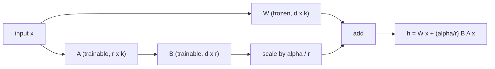
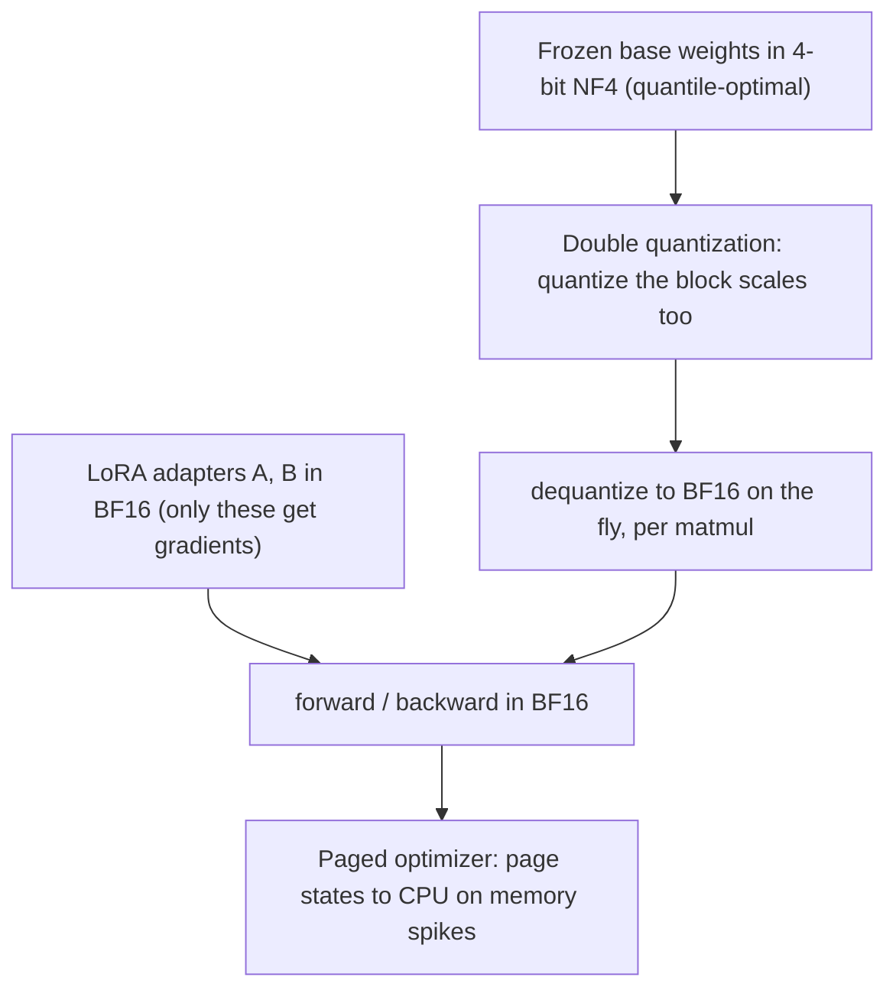
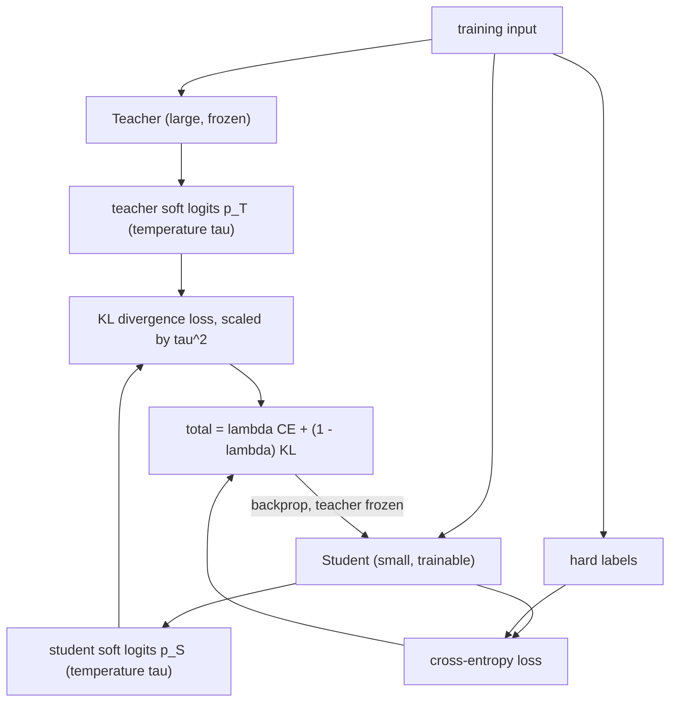

# Quantization, PEFT & Model Compression

We have made the forward pass fast (Module 1), the serving loop efficient (Module
2), and the decoding controllable (Module 3). This final module shrinks the model
itself so it fits and adapts on hardware you can actually afford. Every technique
here is a trade against the two scarce resources: **memory** and **precision**. Four
of them:

- **Post-training quantization** — fewer bits per weight, and the outlier problem.
- **LoRA** — fine-tune a low-rank update instead of the whole model.
- **QLoRA** — a 4-bit frozen base that puts huge models on one GPU.
- **Distillation and pruning** — a smaller model, and why sparsity rarely helps.

---

## 4.1 — Post-Training Quantization (PTQ)

A weight is stored in some numeric precision, and since decode is memory-bound
(Module 2), fewer bytes per weight means a smaller model *and* faster inference.
Quantization is the map from floats to low-bit integers.

| Format | Bits | Bytes/weight | Character | Role |
| --- | --- | --- | --- | --- |
| FP32 | 32 | 4 | Full range and precision | Legacy training |
| FP16 / BF16 | 16 | 2 | Half memory (BF16 keeps FP32 range) | Standard inference/training |
| INT8 | 8 | 1 | 4x smaller than FP32 | Quantized serving |
| INT4 | 4 | 0.5 | 8x smaller; needs careful methods | Large models on limited GPUs |

**Affine quantization** maps a float range onto an integer range $[0, 2^b - 1]$ with
two constants: a **scale** $S$ (real units per integer step) and a **zero-point** $Z$
(the integer that represents real zero):

$$
S = \frac{w_{\max} - w_{\min}}{2^b - 1}, \qquad Z = \text{round}\!\left(-\frac{w_{\min}}{S}\right)
$$

Quantizing and dequantizing are then

$$
w_q = \text{round}\!\left(\frac{w}{S}\right) + Z, \qquad \hat{w} = S\,(w_q - Z)
$$

and the round-off error is bounded by half a step, $|w - \hat{w}| \le S / 2$. Fewer
bits or a wider range means a larger $S$ and more error. (Symmetric quantization sets
$Z = 0$ and centers the range on zero, which suits roughly zero-mean weights.)

```python
import numpy as np

def quantize_affine(w, bits=8):
    """Asymmetric affine quantization to `bits` integers. Returns the codes plus the
    (scale, zero_point) needed to dequantize."""
    qmin, qmax = 0, (1 << bits) - 1
    w_min, w_max = float(w.min()), float(w.max())
    scale = (w_max - w_min) / (qmax - qmin)             # real units per integer step
    zero_point = round(qmin - w_min / scale)            # integer that maps to real 0
    q = np.clip(np.round(w / scale) + zero_point, qmin, qmax).astype(np.int32)
    return q, scale, zero_point

def dequantize_affine(q, scale, zero_point):
    return scale * (q.astype(np.float32) - zero_point)  # back to float, with round-off

def quantize_grouped(w, bits=4, group_size=128):
    """Per-group quantization: an outlier only inflates the scale of ITS group, not
    the whole tensor. One (scale, zero_point) per group -- the AWQ/GGUF idea."""
    groups = w.reshape(-1, group_size)
    return [quantize_affine(g, bits) for g in groups]
```

### The outlier problem

Naive per-tensor quantization collapses in large LLMs because of **outliers**: a few
weight and (especially) activation dimensions carry magnitudes far larger than the
rest. A single scale over the whole tensor must stretch to cover those outliers,
which blows up $S$, and a huge step size crushes the *many* normal small values into
a handful of levels. The bulk of the model loses almost all its precision, and
accuracy falls off a cliff at INT8 or INT4.

The fix is to stop sharing one scale across everything. **Group-wise quantization**
gives each group of consecutive weights (typically 32, 64, or 128) its own scale and
zero-point, so an outlier only distorts the quantization of its own small group while
every other group keeps fine resolution. This is the basis of **GGUF** (the
llama.cpp K-quant blocks) and **AWQ** (activation-aware weight quantization), which
goes further by measuring which weight channels multiply the largest activations and
protecting those salient channels with per-channel scaling before quantizing. A
related approach, LLM.int8(), keeps only the outlier dimensions in FP16 and does the
rest in INT8. In every case the principle is the same: isolate the outliers so they
cannot poison the precision of the majority.

---

## 4.2 — Low-Rank Adaptation (LoRA)

Full fine-tuning updates every parameter, and the memory cost is brutal. For a 7B
model in FP16 the weights alone are 14 GB, but training also needs gradients (another
14 GB) and Adam optimizer states, which keep two FP32 moments per parameter, about 56
GB more. That is roughly 84 GB before activations, needing several high-end GPUs, and
it produces a full 14 GB copy of the model per task. At 70B it is hopeless.

**LoRA** rests on one observation: the *update* a model learns during fine-tuning has
low intrinsic rank. So rather than learn a full update $\Delta W \in \mathbb{R}^{d \times k}$,
freeze the base weights $W$ and learn the update as a product of two thin matrices:

$$
\Delta W = B A, \qquad B \in \mathbb{R}^{d \times r}, \quad A \in \mathbb{R}^{r \times k}, \quad r \ll \min(d, k)
$$

The adapter has $r(d + k)$ parameters instead of $d \times k$. For $d = k = 4096$ and
$r = 8$ that is 65{,}536 parameters against 16.8 million, a 256-fold reduction. Only
$A$ and $B$ carry gradients and optimizer state; the frozen $W$ carries none, which is
where nearly all the memory saving comes from. The layer computes

$$
h = W x + \frac{\alpha}{r}\, B A x
$$



Two hyperparameters govern it. The **rank** $r$ is the bottleneck width: small $r$ (4
to 64) means fewer parameters and less adapter capacity, larger $r$ means more of
both. The **alpha** $\alpha$ scales the update by $\alpha / r$; because that factor
divides out the rank, you can change $r$ without retuning the learning rate, and
$\alpha$ effectively sets how strongly the adapter influences the base (common choices
are $\alpha = r$ or $\alpha = 2r$). $A$ is initialized random and $B$ to zero, so
$\Delta W = 0$ at the start and fine-tuning begins from the exact pretrained model. At
inference you can merge $B A$ back into $W$ for zero overhead, or keep many small
swappable adapters over one shared base.

```python
import torch
import torch.nn as nn

class LoRALinear(nn.Module):
    """A frozen base Linear (W) plus a trainable low-rank update B @ A, scaled by
    alpha/r. Only A and B receive gradients."""
    def __init__(self, in_features, out_features, r=8, alpha=16, bias=True):
        super().__init__()
        self.base = nn.Linear(in_features, out_features, bias=bias)
        self.base.weight.requires_grad = False          # freeze W
        if self.base.bias is not None:
            self.base.bias.requires_grad = False
        self.A = nn.Parameter(torch.randn(r, in_features) * 0.01)  # (r, in)
        self.B = nn.Parameter(torch.zeros(out_features, r))        # (out, r): dW = 0 at init
        self.scaling = alpha / r                          # decouples LR from rank

    def forward(self, x):
        base_out = self.base(x)                           # frozen W x (+ b)
        lora_out = (x @ self.A.T) @ self.B.T              # (B A) x, the low-rank path
        return base_out + self.scaling * lora_out         # W x + (alpha/r) B A x
```

---

## 4.3 — QLoRA (Quantized LoRA)

LoRA removes the gradient and optimizer memory, but the frozen base weights still sit
in FP16, so a 70B model is still 140 GB and will not fit on a consumer GPU. **QLoRA**
closes that gap by storing the frozen base in 4-bit and fine-tuning LoRA adapters on
top, matching 16-bit fine-tuning quality while cutting memory enough to train a 65B
model on a single 48 GB GPU. Three pieces make it work.

- **4-bit NormalFloat (NF4).** Neural-network weights are approximately zero-mean
  Gaussian, so uniform INT4 wastes levels where there are no weights. NF4 places its 16
  levels at the *quantiles* of a standard normal, so each level holds equal probability
  mass. This information-theoretically matches the weight distribution and gives lower
  error than uniform INT4 at the same bit width.
- **Double Quantization.** Group-wise quantization stores one scale per block, and
  those scales themselves cost memory (roughly half a bit per weight). Double
  quantization quantizes the scales too, saving about another 0.37 bits per weight for
  free.
- **Paged Optimizers.** Training has memory spikes (a long sequence in a batch), and
  QLoRA uses unified memory to *page* optimizer state between GPU and CPU when the GPU
  runs short, exactly the virtual-memory idea PagedAttention used for the KV cache in
  Module 2, here preventing OOM crashes instead of fragmentation.

At runtime the base weights live in NF4 and are dequantized to BF16 on the fly for
each matmul, so compute stays accurate while storage stays tiny; gradients flow only
into the BF16 LoRA adapters.



| | Full fine-tune (7B) | LoRA (7B) | QLoRA (7B) |
| --- | --- | --- | --- |
| Base weights | 14 GB FP16 | 14 GB FP16 (frozen) | ~4 GB NF4 (frozen) |
| Gradients + optimizer | ~70 GB | tiny (adapters only) | tiny (adapters only) |
| Fits on | Multi-GPU | One large GPU | One consumer GPU |
| Quality | Baseline | Near-baseline | Matches 16-bit |

---

## 4.4 — Distillation & Pruning

Quantization and LoRA keep the architecture and change the numbers. The last two
techniques change the architecture itself.

**Knowledge Distillation** trains a small **student** to imitate a large **teacher**.
The key idea is that the teacher's full output *distribution* carries more signal than
a hard label: the relative probabilities it assigns to the wrong answers encode
similarity structure ("this 7 is a little like a 1") that a one-hot label throws away.
The student minimizes the KL divergence to the teacher's distribution, both softened by
a temperature $\tau$ that exposes that fine structure:

$$
\text{KL}(P \,\|\, Q) = \sum_i P_i \log \frac{P_i}{Q_i}, \qquad \mathcal{L}_{KD} = \tau^2 \cdot \text{KL}(p_T^{\tau} \,\|\, p_S^{\tau})
$$

usually combined with ordinary cross-entropy on the hard labels,
$\mathcal{L} = \lambda\, \mathcal{L}_{CE} + (1 - \lambda)\, \mathcal{L}_{KD}$. The $\tau^2$ factor rescales the
gradients, which shrink when the distributions are softened. DistilBERT, produced this
way, keeps about 97 percent of BERT's performance at 40 percent smaller and 60 percent
faster.



```python
import torch.nn.functional as F

def distillation_loss(student_logits, teacher_logits, labels, tau=2.0, lam=0.5):
    """Soft KL to the teacher (temperature tau) + hard cross-entropy on labels."""
    p_teacher = F.softmax(teacher_logits / tau, dim=-1)
    log_p_student = F.log_softmax(student_logits / tau, dim=-1)
    kd = F.kl_div(log_p_student, p_teacher, reduction="batchmean") * (tau * tau)
    ce = F.cross_entropy(student_logits, labels)
    return lam * ce + (1.0 - lam) * kd
```

**Pruning** removes weights outright, and the structure of what you remove decides
whether it helps.

- **Unstructured pruning** zeros out individual low-magnitude weights, scattered
  arbitrarily across the matrix. You can zero 50 to 90 percent of weights with modest
  accuracy loss after fine-tuning. But here is the hard truth: a GPU multiplies *dense*
  matrices, and scattered zeros do not change the shape of the matrix, so the dense
  matmul still runs over every entry. Unstructured sparsity shrinks the model *on disk*
  (if stored sparse) but delivers **no GPU speedup** without specialized sparse kernels
  or hardware.
- **Structured pruning** removes whole units, entire neurons, channels, attention
  heads, or layers, yielding a smaller *dense* model with smaller matmuls that runs
  faster on any GPU. The accuracy cost per parameter is higher, since removing a whole
  head discards more than scattered weights, but the speedup is real.
- **2:4 semi-structured sparsity** is the middle ground: NVIDIA Ampere and later
  accelerate a pattern of two zeros in every four weights in hardware, roughly doubling
  throughput while staying fine-grained.

| Technique | Removes | Size reduction | GPU speedup | Accuracy cost |
| --- | --- | --- | --- | --- |
| Distillation | Trains a smaller model | Large (smaller net) | Yes (fewer params) | Moderate |
| Unstructured pruning | Individual weights | Only if stored sparse | **No** (dense matmul) without special HW | Low |
| Structured pruning | Whole neurons/heads/layers | Yes (smaller dense) | Yes | Higher |
| 2:4 sparsity | 2 of every 4 weights | ~2x | ~2x (Ampere+ HW) | Low |

---

## Recap

- **Post-training quantization** maps floats to low-bit integers with a scale and
  zero-point, $w_q = \text{round}(w / S) + Z$, trading precision for memory and speed.
  A single per-tensor scale is destroyed by outlier dimensions, so group-wise schemes
  (GGUF, AWQ) give each small group its own scale to isolate outliers and preserve the
  precision of the majority.
- **LoRA** freezes the base weights and learns a low-rank update $\Delta W = B A$ with
  $r \ll \min(d, k)$, cutting trainable parameters and optimizer memory by orders of
  magnitude; rank $r$ sets capacity and $\alpha / r$ scales the update while decoupling
  it from the learning rate. Adapters are tiny and swappable over one base.
- **QLoRA** stores the frozen base in 4-bit NF4 (levels at the quantiles of a normal),
  double-quantizes the scales, and pages optimizer state to CPU on spikes, fitting a
  65B fine-tune on one 48 GB GPU at 16-bit quality.
- **Distillation** trains a small student to match a teacher's softened distribution via
  $\tau^2\, \text{KL}(p_T \,\|\, p_S)$, capturing most capability in a smaller net.
  **Pruning** removes weights, but only *structured* pruning (whole neurons, heads,
  layers) or hardware-backed 2:4 sparsity actually speeds up a GPU; unstructured
  sparsity leaves the dense matmul unchanged.

## Exercises

1. **Quantize and measure error.** Quantize a Gaussian weight tensor with
   `quantize_affine` at 8, 4, and 3 bits, dequantize, and report the mean and max error
   against the $S / 2$ bound. Then inject a single large outlier and show per-tensor
   error explodes while `quantize_grouped` contains it.

2. **Count LoRA's savings.** For a 7B model, count the trainable parameters and estimate
   the optimizer memory for full fine-tuning versus LoRA at $r \in \{4, 16, 64\}$ on the
   attention projections. Confirm the base weights are identical and only the adapter
   grows with $r$.

3. **Distill a classifier.** Train a small student against a larger teacher's softened
   logits with `distillation_loss`, sweeping $\tau$ and $\lambda$. Compare student
   accuracy to training on hard labels alone and explain what the soft targets added.

4. **Prune and time it.** Magnitude-prune 80 percent of a linear layer's weights
   (unstructured) and time a dense matmul before and after on a GPU; confirm no speedup.
   Then remove 20 percent of the output neurons (structured) and confirm the smaller
   dense layer is genuinely faster.

## Course complete: LLM Engineering

You built the engine and everything around it. Module 1 derived the transformer and
the KV cache; Module 2 turned it into a serving stack with continuous batching,
PagedAttention, FlashAttention, and speculative decoding; Module 3 handled the
tokenizer and the decoding and sampling layer; and Module 4 compressed the model with
quantization, LoRA, QLoRA, distillation, and pruning.

The through-line: **an LLM is a memory-bound matrix machine, and almost every
optimization is a trade against memory** — caching it, paging it, keeping it on-chip,
quantizing it, or factoring the update that adapts it. That systems-level view is what
separates someone who calls an LLM API from someone who can make one fast, cheap, and
runnable.

Where next on the roadmap: **Fine-Tuning & Adaptation** takes the mechanics you just
learned (LoRA, QLoRA) into the practice of actually adapting a model well, the datasets,
the preference-tuning methods like RLHF and DPO, and the evaluation that tells you
whether a fine-tune helped or quietly regressed.
