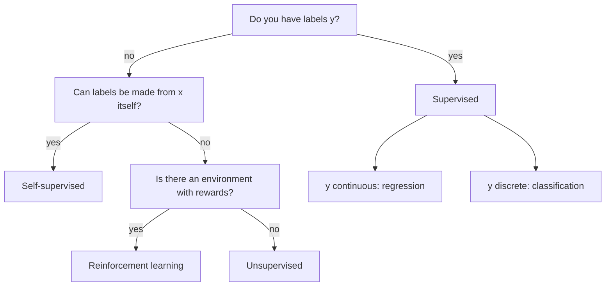
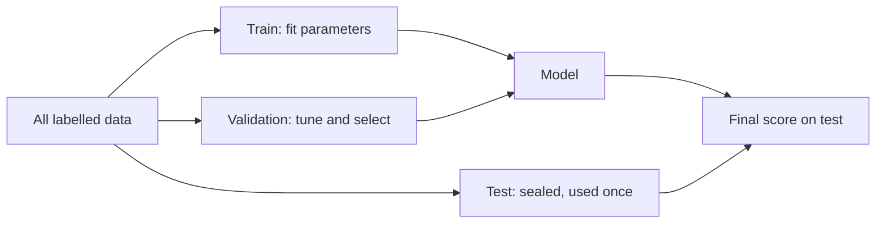

# What Learning From Data Means

Ordinary programming is rules plus data in, answers out. Machine learning flips
it: **data plus answers in, rules out**. The rules are a function you did not write
by hand, found by searching for one that fits examples. That one sentence hides
every hard question in the field: what family of functions do we search, what does
"fits" mean, how do we feed in messy real-world objects, and how do we know the
function works on data it has never seen? This module answers those, with numpy
code you can run. Four parts:

- **Framing the problem** — the learning paradigms, and classification versus regression.
- **Hypotheses, loss and risk** — what a model is, what "good" means, and ERM.
- **Features and representation** — encoding, scaling, embeddings, and the curse of dimensionality.
- **Two models from scratch, and honest data splits** — linear and logistic regression, then train/validation/test and the i.i.d. assumption.

---

## 1.1 — Framing the Problem

Before any algorithm, decide what kind of problem you have. The kind is determined
by *what signal the data contains*, not by what tool you like.

| Paradigm | Data you have | What you learn | Example |
| --- | --- | --- | --- |
| Supervised | inputs $x$ **and** labels $y$ | a map $x \to y$ | email text to spam / not spam |
| Unsupervised | inputs $x$ only | structure in $x$ | cluster customers by behaviour |
| Self-supervised | inputs only, labels **made from the inputs** | representations | hide a word, predict it (how LLMs pretrain) |
| Reinforcement | an environment giving rewards for actions | a policy | a game-playing agent, robot control |

**Supervised learning** is the workhorse and the focus of this course. Each training
example is a pair $(x_i, y_i)$, and the goal is a function $f$ with $f(x) \approx y$
on *new* inputs. **Unsupervised learning** has no answer key: clustering (k-means),
dimensionality reduction (PCA) and density estimation all look for structure
without being told what is right. **Self-supervised learning** is unsupervised data
with supervised machinery: a program manufactures the labels from the data itself
(mask a token, predict the next one, rotate an image and predict the angle). Because
labels are free, it scales to the whole internet, which is why it powers modern
language models. **Reinforcement learning** differs in kind: there is no fixed
dataset, the agent's own actions change what data it sees, and feedback is a sparse,
delayed scalar reward rather than a correct answer.

Within supervised learning, the type of $y$ picks the problem:

- **Regression**: $y$ is a continuous number (a house price, tomorrow's temperature).
  Predictions are judged by *how far off* they are.
- **Classification**: $y$ is one of $K$ discrete classes. Binary ($K=2$), multiclass
  ($K>2$, exactly one label), and multilabel (several labels may be on at once) are
  different set-ups with different output layers and losses. Predictions are judged by
  *whether they are right*, and good classifiers output probabilities, not just labels.

A common trap is framing: "predict the delivery time" is regression, but "will it
arrive late?" is classification of the *same* data, and the two lead to different
models, losses and metrics. Choose the framing that matches the decision downstream.



---

## 1.2 — Hypotheses, Loss, and Empirical Risk Minimization

Supervised learning has exactly three ingredients, and every algorithm in this
course is a choice of them.

**1. The hypothesis space $\mathcal{H}$.** The set of functions you are willing to
consider. "Straight lines" is a hypothesis space; so is "all neural networks with this
architecture". A particular function is picked out by its **parameters** $\theta$,
so a model is $f_\theta$ and learning is a search over $\theta$. Choosing
$\mathcal{H}$ encodes your **inductive bias**: a small space (lines) is easy to search
and hard to overfit but may be unable to express the truth (**underfitting**, high
*bias*); a huge space can express anything, including the noise (**overfitting**, high
*variance*). Module 3 is about exactly this tension.

**2. The loss function $\ell(\hat{y}, y)$.** A number saying how bad one prediction is.
It is the *only* way you tell the machine what you want, so it must match the goal.

| Task | Loss | Formula | Behaviour |
| --- | --- | --- | --- |
| Regression | squared error (L2) | $(\hat{y}-y)^2$ | punishes big misses hard; sensitive to outliers |
| Regression | absolute error (L1) | $\lvert\hat{y}-y\rvert$ | robust to outliers; predicts the median |
| Binary classification | cross-entropy | $-[y\log p + (1-y)\log(1-p)]$ | punishes confident wrong answers without bound |
| Classification | 0-1 loss | $\mathbb{1}[\hat{y}\ne y]$ | the true goal, but not differentiable, so never trained on |

The 0-1 row matters: accuracy is what we *care about* but it is flat almost everywhere,
so it gives a search no direction to move. We train on a smooth **surrogate** (cross-entropy)
and *report* accuracy. Training loss and reported metric are different things.

**3. The objective.** We would love to minimize the **true risk**, the expected loss
over the real data-generating distribution $P$:

$$
R(\theta) = \mathbb{E}_{(x,y)\sim P}\big[\ell(f_\theta(x), y)\big]
$$

but $P$ is unknown; all we have is $n$ samples. So we minimize the **empirical risk**,
the average loss on the training set, and the principle is called **empirical risk
minimization (ERM)**:

$$
\hat{R}(\theta) = \frac{1}{n}\sum_{i=1}^{n} \ell\big(f_\theta(x_i), y_i\big), \qquad \hat{\theta} = \arg\min_{\theta}\ \hat{R}(\theta)
$$

ERM is a *bet*: that low loss on the sample implies low loss on the population. The
law of large numbers says $\hat{R}(\theta) \to R(\theta)$ for a *fixed* $\theta$ as
$n$ grows, but $\hat\theta$ was chosen *because* it did well on this sample, so
$\hat{R}(\hat\theta)$ is optimistically biased. The gap $R(\hat\theta) - \hat{R}(\hat\theta)$
is the **generalization gap**, and the rest of the course is largely about measuring
and shrinking it.

Even the *true* function cannot get below the noise variance
(for example 0.3 noise gives 0.09). That irreducible error is the **Bayes error** for this loss; a model
that scores far below it on training data is not brilliant, it is memorizing noise.

---

## 1.3 — Features, Representation & the Curse of Dimensionality

A model consumes numbers. Real data is text, categories, timestamps and images, so a
**feature** is a numeric measurement of one aspect of an example, and the vector
$x \in \mathbb{R}^d$ of all of them is its **representation**. Representation is
often worth more than the choice of algorithm: the same linear model is hopeless
on raw pixel intensities of a face and strong on the right features.

**Numeric features need scaling.** Suppose one feature is age (0-100) and another is
income (0-1,000,000). Anything distance-based (k-NN, k-means) is dominated by income,
and gradient-based training (Module 2) crawls on badly scaled axes. **Standardization**
rescales each feature to zero mean and unit variance, $z = (x - \mu)/\sigma$;
**min-max** maps to $[0,1]$. The classic pitfall is *leakage*: compute $\mu$ and
$\sigma$ **on the training set only** and reuse them on validation and test data;
fitting the scaler on all data quietly leaks test statistics into training.

**Categorical features need encoding.** Mapping red=1, green=2, blue=3 invents an
ordering and a distance (blue is "three times red") that does not exist.
**One-hot encoding** gives each category its own 0/1 column, so categories are
equidistant and the model can weight each independently. It breaks down at high
cardinality: a ZIP-code or user-ID column becomes tens of thousands of mostly-zero
columns. The modern answer is an **embedding**: a learned lookup table that maps each
category to a short dense vector (say 16 numbers), trained jointly with the model so
that *similar categories land near each other*. An embedding lookup is mathematically
a one-hot vector times a weight matrix, just computed by indexing instead of a huge
multiply. The same idea turns words and tokens into the vectors LLMs run on.

```python
import numpy as np

# --- Standardization: fit on TRAIN only, apply everywhere ---
X_train = np.array([[25., 40_000.], [32., 85_000.], [47., 120_000.], [51., 60_000.]])
X_test = np.array([[29., 70_000.]])
mu, sigma = X_train.mean(axis=0), X_train.std(axis=0)
Z_train = (X_train - mu) / sigma
Z_test = (X_test - mu) / sigma          # uses TRAIN statistics, never test's own

# --- One-hot encoding ---
categories = ["red", "green", "blue"]
index = {c: k for k, c in enumerate(categories)}
def one_hot(label):
    v = np.zeros(len(categories)); v[index[label]] = 1.0
    return v
print(one_hot("blue"))                   # [0. 0. 1.]

# --- Embedding = one-hot @ W, done as a row lookup ---
d_embed = 2
W = np.random.default_rng(1).normal(0, 0.1, size=(len(categories), d_embed))
assert np.allclose(one_hot("green") @ W, W[index["green"]])  # identical, but O(d) not O(V*d)
# In a real model W is a trainable parameter: gradients move "red" and "green"
# closer if the task treats them alike.
```

### The curse of dimensionality

More features feel like more information, but geometry turns against you as $d$
grows. Three facts, all counterintuitive:

- **Data becomes sparse.** To cover the unit interval with 10 evenly spaced points
  you need 10 samples; to give a $d$-dimensional cube the same resolution you need
  $10^d$. With $d=20$ no dataset on Earth is dense enough, so "look at nearby
  training points" has no nearby points.
- **Volume lives in the corners.** The fraction of a unit cube occupied by its
  inscribed ball is $\frac{\pi^{d/2}}{2^d\,\Gamma(d/2+1)}$: 78.5% at $d=2$, 52% at $d=3$,
  and about 0.25% at $d=10$. Almost all the volume is far from the centre.
- **Distances concentrate.** For random points, the gap between the nearest and the
  farthest neighbour shrinks relative to the distance itself:
  $\frac{\text{dist}_{\max} - \text{dist}_{\min}}{\text{dist}_{\min}} \to 0$ as $d \to \infty$.
  When every point is about equally far from every other, "nearest" stops meaning anything.

```python
import numpy as np

rng = np.random.default_rng(0)
for d in [2, 10, 100, 1000]:
    pts = rng.uniform(size=(500, d))
    q = rng.uniform(size=d)
    dist = np.linalg.norm(pts - q, axis=1)
    contrast = (dist.max() - dist.min()) / dist.min()
    print(f"d={d:5d}  relative contrast = {contrast:.3f}")
# Contrast collapses toward 0 as d grows: nearest and farthest look the same.
```

The escape hatch is that real data lies near a low-dimensional **manifold** inside
the full space (faces occupy a thin sliver of pixel space), and good representations
such as embeddings are coordinates on it. Prefer informative features over many weak
ones, and distrust raw distances in hundreds of dimensions.

---

## 1.4 — Two Models From Scratch, and Honest Data Splits

Now put the three ingredients together on the two simplest useful models.

### Linear regression and the normal equation

Hypothesis space: $\hat{y} = x^\top w$, with a constant-1 column appended to $x$ so
the bias is just another weight. Loss: squared error. Stacking $n$ examples into a
matrix $X \in \mathbb{R}^{n\times d}$ and targets $y \in \mathbb{R}^n$, the empirical risk
is $\frac{1}{n}\lVert Xw - y\rVert^2$. It is a convex quadratic bowl, so its single
minimum is where the gradient vanishes:

$$
\nabla_w \tfrac{1}{n}\lVert Xw - y\rVert^2 = \tfrac{2}{n}X^\top(Xw - y) = 0
\;\;\Longrightarrow\;\; X^\top X\, w = X^\top y
\;\;\Longrightarrow\;\; w^\star = (X^\top X)^{-1}X^\top y
$$

This is the **normal equation**: a closed-form, one-shot solution, no iteration.
Geometrically $Xw^\star$ is the *orthogonal projection* of $y$ onto the column space
of $X$, so the residual is perpendicular to every feature. Practical caveats: forming
$X^\top X$ squares the condition number, so use `np.linalg.lstsq` (SVD-based) or `solve`
rather than an explicit inverse; if features are collinear $X^\top X$ is singular; and the
$O(nd^2 + d^3)$ cost is fine for thousands of features but not millions, which is where
iterative methods (Module 2) take over.

```python
import numpy as np

rng = np.random.default_rng(42)
n, d = 200, 3
X_raw = rng.normal(size=(n, d))
true_w = np.array([2.0, -1.0, 0.5]); true_b = 4.0
y = X_raw @ true_w + true_b + rng.normal(0, 0.5, size=n)

X = np.hstack([X_raw, np.ones((n, 1))])        # append bias column

# Normal equation, solved stably (never np.linalg.inv in real code)
w_hat = np.linalg.solve(X.T @ X, X.T @ y)
w_lstsq, *_ = np.linalg.lstsq(X, y, rcond=None)  # SVD route, handles rank deficiency
assert np.allclose(w_hat, w_lstsq)

print("recovered:", np.round(w_hat, 2))         # close to [2, -1, 0.5, 4]
resid = y - X @ w_hat
print("mean residual x feature:", np.round((X.T @ resid) / n, 8))  # ~0: residual is orthogonal
print("R^2:", 1 - resid.var() / y.var())
```

### Logistic regression and cross-entropy

For a binary label, a raw linear score $z = x^\top w$ is unbounded, so squash it into
a probability with the **sigmoid** $\sigma(z) = 1/(1+e^{-z})$ and read it as
$p = P(y=1\mid x)$. The decision boundary $x^\top w = 0$ is still a straight line
(a hyperplane), so logistic regression is a *linear classifier*; only the output is
non-linear. Squared error on probabilities gives a non-convex, slow-learning surface,
so we use the principled loss: the **negative log-likelihood** of a Bernoulli label,
the binary cross-entropy:

$$
\ell(p, y) = -\big[\,y\log p + (1-y)\log(1-p)\,\big], \qquad
\hat{R}(w) = \frac{1}{n}\sum_i \ell\big(\sigma(x_i^\top w),\, y_i\big)
$$

It is convex in $w$, and its gradient is pleasingly simple. Because
$\sigma'(z) = \sigma(z)(1-\sigma(z))$, the sigmoid's derivative cancels and

$$
\nabla_w \hat{R} = \frac{1}{n}X^\top(p - y)
$$

the same "features times error" form as linear regression. Unlike the normal equation
there is **no closed-form solution** here, so we iterate: nudge $w$ against the
gradient. (Why this works, and how to do it well, is all of Module 2; here is the
bare loop.) Cross-entropy also explains why confident mistakes hurt: predicting
$p=0.01$ for a true positive costs $-\log 0.01 \approx 4.6$ nats, while $p=0.4$ costs only 0.92.

```python
import numpy as np

def sigmoid(z):
    # Clip to avoid overflow in exp for large |z|.
    return 1.0 / (1.0 + np.exp(-np.clip(z, -30, 30)))

def cross_entropy(p, y, eps=1e-12):
    p = np.clip(p, eps, 1 - eps)                 # never take log(0)
    return -np.mean(y * np.log(p) + (1 - y) * np.log(1 - p))

rng = np.random.default_rng(7)
n = 400
X0 = rng.normal([-1.0, -1.0], 1.0, size=(n // 2, 2))   # class 0 blob
X1 = rng.normal([+1.0, +1.0], 1.0, size=(n // 2, 2))   # class 1 blob
X = np.vstack([X0, X1]); y = np.r_[np.zeros(n // 2), np.ones(n // 2)]
X = np.hstack([X, np.ones((n, 1))])                    # bias column

w = np.zeros(3)
lr = 0.5
for step in range(500):
    p = sigmoid(X @ w)
    grad = X.T @ (p - y) / n                           # gradient of mean cross-entropy
    w -= lr * grad                                     # preview of Module 2
    if step % 100 == 0:
        print(f"step {step:3d}  loss {cross_entropy(p, y):.4f}")

acc = np.mean((sigmoid(X @ w) > 0.5) == y)
print("weights:", np.round(w, 2), " train accuracy:", acc)
```

### Splitting data honestly, and the i.i.d. assumption

A model that scored well on the data it was fitted to has told you almost nothing:
a lookup table that memorizes the training set has zero training loss and is useless.
The only evidence of learning is performance on **held-out data the model never touched**.
So we split:

| Split | Typical share | Used for | Rule |
| --- | --- | --- | --- |
| Train | 60-80% | fitting parameters $\theta$ | the model may see this freely |
| Validation | 10-20% | choosing hyperparameters, model type, stopping point | look often, but each look leaks a little |
| Test | 10-20% | one final, unbiased estimate | touch **once**, at the very end |

The validation set exists because tuning against the test set turns it into a second
training set: pick the best of 50 configurations by test score and the winner's score is
inflated by selection. Hence the test set is a sealed envelope. Split **randomly with a fixed seed**
(for reproducibility), **stratify** by class when classes are imbalanced so each split
keeps the same label ratios, and do all preprocessing fits (scalers, encoders,
imputers) inside the training split only.

All of this rests on the **i.i.d. assumption**: training and future examples are drawn
**independently** from the **identical** distribution $P$. It is what licenses ERM
(sample risk approximates true risk) and what makes a random held-out split a faithful
preview of deployment. It fails in common, expensive ways:

- **Time series.** Tomorrow depends on today and the world drifts, so a random split lets
  the model "see the future". Split by time: train on the past, test on the later period.
- **Grouped data.** Many rows per patient, user or document are not independent; if
  one patient lands in both train and test, the model recognizes the *person*, not the
  disease. Split by group.
- **Distribution shift.** Deployment differs from training (new camera, new season,
  new user base). No split of the old data can reveal this; monitor in production.
- **Duplicates and leakage.** Near-duplicate rows or a feature computed from the label
  contaminate the test set and make results look wonderful and mean nothing.



---

## Key takeaways

1. **Learning = search for a function.** Pick a hypothesis space $\mathcal{H}$, a loss
   $\ell$, and minimize empirical risk. Every model in this course is a choice of those three.
2. **The paradigm follows the signal.** Labels: supervised. Labels derived from the
   data: self-supervised. No labels: unsupervised. Reward from acting: RL. Continuous
   target: regression; discrete: classification.
3. **Train on a smooth surrogate, report the real metric.** Cross-entropy trains,
   accuracy reports; 0-1 loss gives no gradient.
4. **ERM is optimistic.** Training loss underestimates true risk because $\hat\theta$
   was chosen to fit that sample; the generalization gap is the thing to watch.
5. **Representation matters as much as the algorithm.** Scale numerics (fit stats on
   train only), one-hot or embed categories, and respect the curse of dimensionality:
   in high $d$, data is sparse and distances concentrate.
6. **Linear regression has an exact answer** ($X^\top X w = X^\top y$, solve it with
   `lstsq`); **logistic regression** needs iteration but has the clean gradient $X^\top(p-y)/n$.
7. **Held-out data is the only evidence.** Train/validation/test, test touched once,
   and splits that respect time and groups, because the i.i.d. assumption is what
   makes any of it valid.

## Exercises

1. **See the surrogate gap.** Train the logistic regression above, but record both
   cross-entropy and accuracy every 10 steps. Plot both. Find a point where loss is still
   falling while accuracy has already plateaued, and explain why the loss keeps improving.
2. **Break the normal equation.** Add a fourth feature that is exactly $2\times$ feature
   one. Compute `np.linalg.cond(X.T @ X)`, try `np.linalg.solve`, then `np.linalg.lstsq`.
   Report what happens and which weights `lstsq` returns (minimum-norm) and why.
3. **Leak on purpose.** Generate pure-noise features and random labels (50 samples, 200
   features). Standardize on *all* data, then select the 10 features most correlated with
   the labels using all data, then fit and evaluate on a split. Observe the inflated
   accuracy, then redo it with selection inside the training split and compare.
4. **Measure the curse.** For $d \in \{2, 5, 20, 100, 500\}$ draw 1000 random points and
   compute the nearest-to-farthest distance ratio from a random query. Then repeat with
   points that lie on a 2-D plane embedded in $d$ dimensions (random orthonormal basis)
   and explain why the contrast no longer collapses.

## Next: Module 2 — Training & Gradient Descent

Logistic regression had no closed-form answer, so we iterated with a bare
`w -= lr * grad` and hand-waved. Module 2 makes it rigorous: the gradient as the
direction of steepest ascent, why the learning rate can make training crawl or
explode, stochastic and mini-batch descent, momentum and Adam, backpropagation as
the chain rule applied to a computation graph, and how to read a loss curve to
diagnose a training run that is going wrong.
