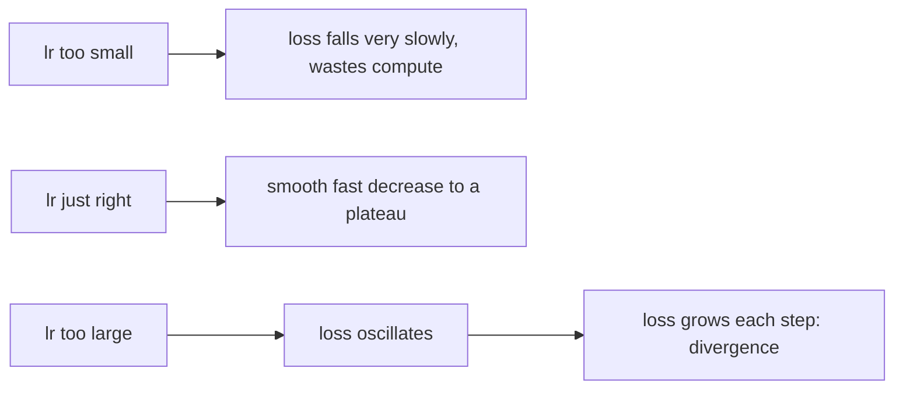
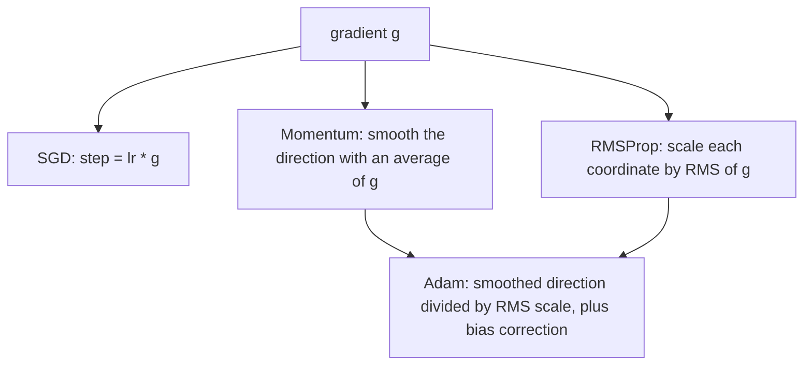
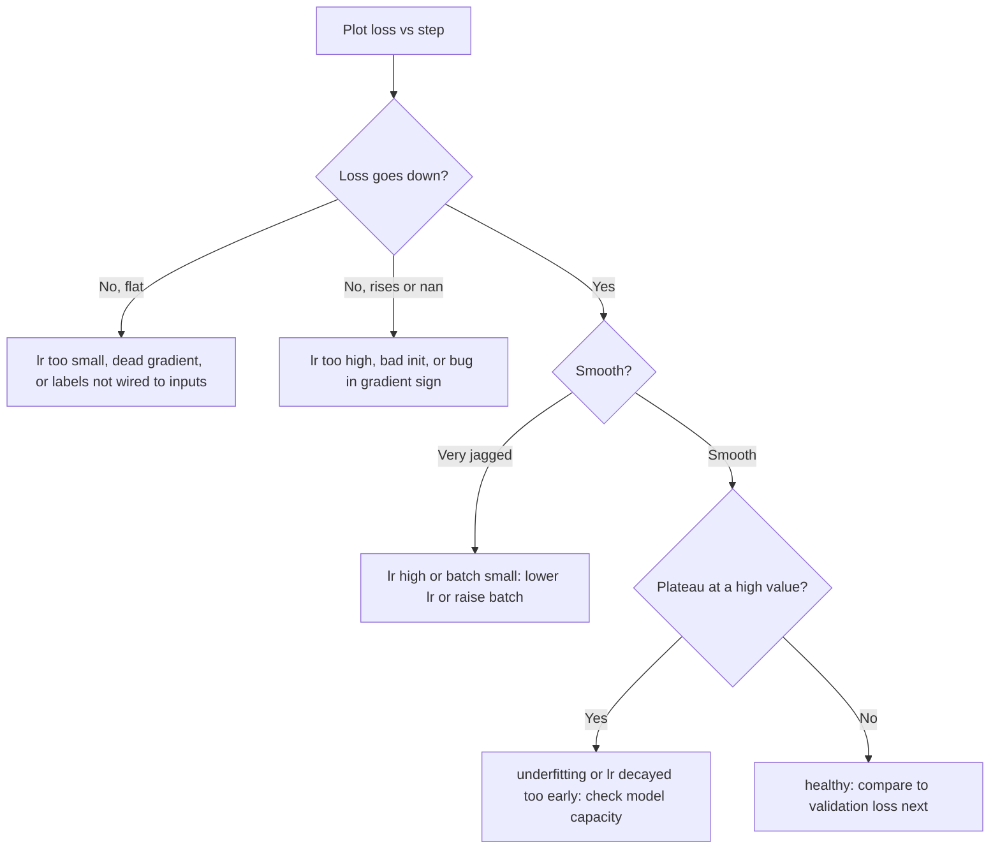

# Training & Gradient Descent

Module 1 defined *what* we want: a loss function that scores a model, and a model
family (linear, logistic) whose parameters we can tune. This module is *how* the
parameters get tuned. The answer for nearly all of modern machine learning, from a
linear regression to a billion-parameter network, is the same one-line idea: nudge
every parameter a little in the direction that lowers the loss, and repeat. Four parts:

- **Gradient descent, derived and coded** — the update rule, the exact gradients, and
  what the learning rate does.
- **Stochastic gradients and adaptive optimizers** — mini-batches, noise, momentum,
  RMSProp and Adam.
- **Loss landscapes and conditioning** — saddles, local minima, feature scaling, and
  learning-rate schedules.
- **Debugging training** — loss curves, gradient checks, and chasing down NaNs.

---

## 2.1 — Gradient Descent, Derived and Coded

We have a loss $L(\theta)$ over parameters $\theta$ and want its minimum. We cannot
solve for it in general, but we can always compute the **gradient** $\nabla L(\theta)$,
the vector of partial derivatives, which points in the direction of steepest *increase*.
A first-order Taylor expansion says that for a small step $\Delta$:

$$
L(\theta + \Delta) \approx L(\theta) + \nabla L(\theta)^\top \Delta
$$

The right side drops fastest when $\Delta$ points opposite the gradient. So we step
against it, scaled by a **learning rate** $\eta$:

$$
\theta_{t+1} = \theta_t - \eta\, \nabla L(\theta_t)
$$

That is gradient descent in full. Everything else in this module is a refinement of
how to compute $\nabla L$ cheaply, how to pick $\eta$, and how to survive a landscape
that is not a clean bowl.

### The gradient of MSE

For linear regression with predictions $\hat{y} = Xw + b$ over $n$ examples, the loss
is $L = \frac{1}{n}\sum_i (\hat{y}_i - y_i)^2$. Using the chain rule on each term,
$\partial (\hat{y}_i - y_i)^2 / \partial w = 2(\hat{y}_i - y_i)\,x_i$, so

$$
\nabla_w L = \frac{2}{n} X^\top (\hat{y} - y), \qquad \frac{\partial L}{\partial b} = \frac{2}{n}\sum_i (\hat{y}_i - y_i)
$$

Read it as: each example pushes the weights along its own feature vector $x_i$, with
strength equal to its **error** $\hat{y}_i - y_i$. Big error, big push.

### The gradient of cross-entropy

For logistic regression, $p_i = \sigma(x_i^\top w + b)$ and the loss is the average
binary cross-entropy $L = -\frac{1}{n}\sum_i [\,y_i \log p_i + (1-y_i)\log(1-p_i)\,]$.
The sigmoid's derivative $\sigma' = \sigma(1-\sigma)$ cancels against the log terms and
leaves something strikingly clean:

$$
\nabla_w L = \frac{1}{n} X^\top (p - y), \qquad \frac{\partial L}{\partial b} = \frac{1}{n}\sum_i (p_i - y_i)
$$

It is the *same shape* as the MSE gradient: features times (prediction minus target).
That is not a coincidence, it is why cross-entropy is paired with the sigmoid (and
softmax): the gradient stays proportional to the error and does not vanish when the
model is confidently wrong, which squared error on a sigmoid would.

```python
import numpy as np

def sigmoid(z):
    return 1.0 / (1.0 + np.exp(-z))

def mse_loss_grad(w, b, X, y):
    """Linear regression: loss and gradients. Shapes: X (n,d), y (n,), w (d,)."""
    n = len(y)
    err = X @ w + b - y                      # prediction minus target, (n,)
    loss = np.mean(err ** 2)
    return loss, (2 / n) * (X.T @ err), (2 / n) * err.sum()

def bce_loss_grad(w, b, X, y, eps=1e-12):
    """Logistic regression: binary cross-entropy and gradients."""
    n = len(y)
    p = sigmoid(X @ w + b)
    loss = -np.mean(y * np.log(p + eps) + (1 - y) * np.log(1 - p + eps))
    err = p - y                              # same 'prediction minus target' form
    return loss, (1 / n) * (X.T @ err), err.mean()

def gradient_descent(loss_grad, X, y, lr=0.1, steps=500):
    w, b = np.zeros(X.shape[1]), 0.0
    history = []
    for _ in range(steps):
        loss, gw, gb = loss_grad(w, b, X, y)
        w -= lr * gw                         # step against the gradient
        b -= lr * gb
        history.append(loss)
    return w, b, history

# Recover a known line: y = 3*x1 - 2*x2 + 1 + noise
rng = np.random.default_rng(0)
X = rng.normal(size=(200, 2))
y = X @ np.array([3.0, -2.0]) + 1.0 + 0.1 * rng.normal(size=200)
w, b, hist = gradient_descent(mse_loss_grad, X, y, lr=0.1, steps=300)
print(w, b, hist[-1])                        # close to [3, -2], 1, ~0.01
```

### The learning rate: three regimes

The learning rate is the most important hyperparameter you will ever tune. Too small
and training crawls; too large and it overshoots; in between is a sweet spot.



There is an exact threshold for a quadratic bowl. Near a minimum any smooth loss looks
like $L(\theta) \approx \tfrac{1}{2}\theta^\top H \theta$, where $H$ is the **Hessian**
(matrix of second derivatives). Gradient descent then gives $\theta_{t+1} = (I - \eta H)\theta_t$.
Along an eigen-direction with curvature $\lambda$, the error is multiplied by
$(1 - \eta\lambda)$ each step. That shrinks only if $|1 - \eta\lambda| < 1$, i.e.

$$
\eta < \frac{2}{\lambda_{\max}}
$$

Beyond $2/\lambda_{\max}$ the steepest direction flips sign *and grows*: the loss
explodes geometrically. The best stable rate is $\eta \approx 1/\lambda_{\max}$, and the
slowest direction then converges at rate $(1 - \lambda_{\min}/\lambda_{\max})$ per step,
a fact that will matter greatly in section 2.3.

| Symptom | Likely cause | First fix |
| --- | --- | --- |
| Loss decreases but glacially | $\eta$ too small | Raise $\eta$ by 3x-10x |
| Loss zig-zags, noisy plateau | $\eta$ near the edge | Lower $\eta$ or decay it |
| Loss increases, then `inf`/`nan` | $\eta > 2/\lambda_{\max}$ | Lower $\eta$ by 10x, scale features |
| Loss flat from step 0 | $\eta$ tiny, or dead gradient | Check gradient is nonzero |

---

## 2.2 — Stochastic Gradients and Adaptive Optimizers

The gradient above averages over all $n$ examples. That is **batch** gradient descent:
exact, but one step costs a full pass over the data. With a million examples, you pay a
million forward passes to move once. We can do far better, because the full gradient
is just an average, and an average can be estimated from a sample.

| Variant | Examples per step | Gradient | Character |
| --- | --- | --- | --- |
| Batch GD | all $n$ | exact | smooth, slow, memory-hungry |
| Stochastic GD (SGD) | 1 | very noisy, unbiased | cheap steps, jittery |
| Mini-batch | $B$ (32 to 1024 typical) | mildly noisy, unbiased | the default everywhere |

A mini-batch gradient $g_B$ is an **unbiased estimate** of the true gradient,
$\mathbb{E}[g_B] = \nabla L$, with variance that shrinks as $\sigma^2 / B$. Doubling the
batch does not double the signal, it only cuts the noise standard deviation by
$\sqrt{2}$, which is why huge batches show diminishing returns. Mini-batches also map
neatly onto vectorized hardware, which is why $B$ is usually a power of two.

The noise is not purely a cost. It helps the optimizer jiggle out of sharp, narrow
minima and saddle points, and it acts as a mild regularizer (a theme for Module 3).
But it also means the loss never settles exactly: at a constant $\eta$ the iterate
bounces around the minimum in a ball whose size grows with $\eta$ and shrinks with $B$.

```python
def minibatch_sgd(loss_grad, X, y, lr=0.05, batch_size=32, epochs=20, seed=0):
    """One epoch = one full pass. Shuffle each epoch so batches differ every time."""
    rng = np.random.default_rng(seed)
    n = len(y)
    w, b = np.zeros(X.shape[1]), 0.0
    for _ in range(epochs):
        order = rng.permutation(n)                       # reshuffle each epoch
        for start in range(0, n, batch_size):
            idx = order[start:start + batch_size]
            _, gw, gb = loss_grad(w, b, X[idx], y[idx])  # gradient on the batch only
            w -= lr * gw
            b -= lr * gb
    return w, b
```

### Momentum

Plain SGD in a long narrow valley zig-zags across the steep walls while creeping along
the floor. **Momentum** keeps a running velocity $v$, an exponential moving average of
past gradients, so consistent directions accumulate and oscillating ones cancel:

$$
v_{t+1} = \mu\, v_t + g_t, \qquad \theta_{t+1} = \theta_t - \eta\, v_{t+1}
$$

with $\mu \approx 0.9$. Picture a heavy ball rolling downhill: it builds speed along the
valley and averages out the side-to-side wobble. With $\mu = 0.9$ the effective step
along a steady gradient is up to $1/(1-\mu) = 10\times$ larger.

### RMSProp: a learning rate per parameter

Different parameters can have wildly different gradient scales (a rare feature gets
tiny, infrequent gradients; a common one gets large ones). One global $\eta$ cannot
suit both. **RMSProp** divides each coordinate's step by a running RMS of its recent
gradients:

$$
s_{t+1} = \rho\, s_t + (1-\rho)\, g_t^2, \qquad \theta_{t+1} = \theta_t - \frac{\eta}{\sqrt{s_{t+1}} + \epsilon}\, g_t
$$

with $\rho \approx 0.9$ to $0.99$ and $\epsilon \approx 10^{-8}$ to avoid division by zero.
Coordinates with consistently large gradients take smaller steps; flat, quiet ones take
larger steps. Every coordinate moves at roughly the same pace, about $\eta$ per step.

### Adam: momentum plus RMSProp

**Adam** (Kingma and Ba) combines both ideas: a first-moment average for direction and
a second-moment average for scale.

$$
\begin{aligned}
m_t &= \beta_1 m_{t-1} + (1-\beta_1)\, g_t \\
v_t &= \beta_2 v_{t-1} + (1-\beta_2)\, g_t^2 \\
\hat{m}_t &= \frac{m_t}{1-\beta_1^t}, \qquad \hat{v}_t = \frac{v_t}{1-\beta_2^t} \\
\theta_t &= \theta_{t-1} - \eta\, \frac{\hat{m}_t}{\sqrt{\hat{v}_t} + \epsilon}
\end{aligned}
$$

The defaults $\beta_1 = 0.9$, $\beta_2 = 0.999$, $\epsilon = 10^{-8}$ work remarkably
broadly. The **bias correction** divides by $1 - \beta^t$ because $m$ and $v$ start at
zero: without it the first steps would be badly underestimated (at $t=1$, $m_1 = 0.1\,g_1$
is ten times too small). The correction fades to 1 as $t$ grows.

```python
class Adam:
    """Minimal Adam for a flat parameter vector."""
    def __init__(self, size, lr=1e-3, b1=0.9, b2=0.999, eps=1e-8):
        self.lr, self.b1, self.b2, self.eps = lr, b1, b2, eps
        self.m = np.zeros(size)              # first moment: mean of gradients
        self.v = np.zeros(size)              # second moment: mean of squared gradients
        self.t = 0

    def step(self, params, grad):
        self.t += 1
        self.m = self.b1 * self.m + (1 - self.b1) * grad
        self.v = self.b2 * self.v + (1 - self.b2) * grad ** 2
        m_hat = self.m / (1 - self.b1 ** self.t)     # undo the zero-init bias
        v_hat = self.v / (1 - self.b2 ** self.t)
        return params - self.lr * m_hat / (np.sqrt(v_hat) + self.eps)
```



A practical rule: Adam with $\eta \approx 10^{-3}$ is the safe first choice and rarely
needs heavy tuning; well-tuned SGD with momentum often generalizes slightly better on
vision tasks but demands more care. Adam's per-parameter scaling also makes it far less
sensitive to feature scale, though, as the next section shows, you should still fix the
scale at the source.

---

## 2.3 — Loss Landscapes, Conditioning & Schedules

Picture the loss as terrain over parameter space, and training as a hiker descending it
in fog, feeling only the local slope. What the terrain looks like decides everything.

**Convex losses** have a single basin: any local minimum is the global minimum, and
gradient descent with a small enough $\eta$ is guaranteed to find it. The MSE of linear
regression and the cross-entropy of logistic regression are both convex in the
parameters, which is why Module 1's models train so reliably. **Non-convex losses**,
which is every neural network, have many valleys, ridges and plateaus, and no such
guarantee.

At any point where $\nabla L = 0$ (a **critical point**) the Hessian's eigenvalues tell
the type:

| Hessian eigenvalues | Critical point | Descent behaviour |
| --- | --- | --- |
| all positive | local minimum | converges |
| all negative | local maximum | escapes immediately |
| mixed signs | **saddle point** | gradient vanishes, then slides off along a negative direction |

The fear of "getting stuck in a bad local minimum" turns out to be mostly overblown in
high dimensions. For a point to be a minimum, *every one* of thousands of directions must
curve upward, which is overwhelmingly unlikely by chance; far more critical points are
**saddles**. The real hazard is the slow crawl across the flat plateau near a saddle,
where gradients are tiny. SGD's noise and momentum both help push through. Empirically,
the local minima that large networks do reach tend to have losses close to the global one.

### Conditioning and feature scaling

Return to the quadratic bowl. Convergence is limited by the ratio of its steepest to
flattest curvature, the **condition number**

$$
\kappa = \frac{\lambda_{\max}}{\lambda_{\min}}
$$

Because $\eta$ must stay below $2/\lambda_{\max}$ to avoid divergence, the flat direction
creeps at rate about $1 - 1/\kappa$ per step, needing on the order of $\kappa$ steps. If
$\kappa = 1000$, you need thousands of steps; if $\kappa = 1$ (a perfectly round bowl)
you need one.

Where does a large $\kappa$ come from? For linear models the Hessian is proportional to
$X^\top X$, so it is dominated by **feature scale**. Suppose one feature is house area in
square feet (about 1000s) and another is bedroom count (about 1 to 5). The curvature along
the area weight is roughly $10^6$ times larger than along the bedrooms weight: a long,
razor-thin valley that forces a tiny $\eta$ and a glacial crawl. The fix is cheap and
should be reflex: **standardize each feature** to zero mean and unit variance, using
statistics computed on the *training set only*.

$$
x' = \frac{x - \mu_{\text{train}}}{\sigma_{\text{train}}}
$$

```python
def standardize(X_train, X_other=None):
    mu, sigma = X_train.mean(axis=0), X_train.std(axis=0) + 1e-8
    out = (X_train - mu) / sigma
    return out if X_other is None else (out, (X_other - mu) / sigma)  # reuse TRAIN stats

def condition_number(X):
    H = X.T @ X / len(X)                       # Hessian of MSE is 2*H, same kappa
    eig = np.linalg.eigvalsh(H)
    return eig.max() / eig.min()

rng = np.random.default_rng(1)
area = rng.normal(1500, 400, 500)              # large-scale feature
beds = rng.integers(1, 5, 500).astype(float)   # small-scale feature
X_raw = np.column_stack([area, beds])
print(condition_number(X_raw))                 # huge, millions
print(condition_number(standardize(X_raw)))    # close to 1
```

Standardizing the training data and then applying the *same* $\mu, \sigma$ to validation
and test data is not optional pedantry: recomputing statistics on test data is a quiet
form of leakage, and a model trained on scaled inputs will misbehave on raw ones.

### Learning-rate schedules

A fixed $\eta$ forces a compromise: large enough to make progress early, yet small enough
to settle late. A **schedule** changes $\eta$ over time, so you get both.

| Schedule | Rule | Use |
| --- | --- | --- |
| Step decay | multiply by $\gamma$ (e.g. 0.1) every $k$ epochs | classic vision training |
| Exponential | $\eta_t = \eta_0\, \gamma^t$ | smooth version of step |
| Cosine | $\eta_t = \tfrac{1}{2}\eta_0\,(1+\cos(\pi t/T))$ | modern default, no cliff |
| Warmup | ramp linearly from ~0 to $\eta_0$ over the first steps | stabilizes Adam and big batches |
| 1/t | $\eta_t = \eta_0 / (1 + k t)$ | classic SGD convergence theory |

Warmup matters because early on Adam's second-moment estimate $\hat{v}$ is built from
very few samples and can be wildly wrong, so a full-size step can blow up. A short ramp
lets the statistics settle first.

```python
import math

def lr_schedule(step, total, base_lr=0.1, warmup=50, min_lr=0.0):
    if step < warmup:
        return base_lr * (step + 1) / warmup                    # linear warmup
    progress = (step - warmup) / max(1, total - warmup)
    return min_lr + 0.5 * (base_lr - min_lr) * (1 + math.cos(math.pi * progress))
```

---

## 2.4 — Debugging Training

Training bugs are insidious because a broken model still produces numbers. It runs,
the loss prints, and it is simply wrong. Build the habit of looking before trusting.

### Read the loss curve

Always plot training loss (and, from Module 3 on, validation loss) against step. The
shape is a diagnosis.



Two sanity checks save days. First, **overfit a tiny batch**: take 10 examples and train
only on them. A correct model and loop must drive that loss to nearly zero. If it
cannot, there is a bug (wrong shapes, labels misaligned, gradient wrong), not a
hyperparameter problem. Second, **check the initial loss**: for a $K$-class classifier
with near-uniform predictions it should be about $\ln K$ ($\ln 2 \approx 0.693$ for
binary). A starting loss of 12 means something is miscalibrated before training began.

### Gradient checking with finite differences

If you derived a gradient by hand, as we did above, verify it numerically. The
definition of the derivative gives a free test: perturb one parameter and measure the
change. The **centered difference** has error $O(\epsilon^2)$:

$$
\frac{\partial L}{\partial \theta_j} \approx \frac{L(\theta + \epsilon e_j) - L(\theta - \epsilon e_j)}{2\epsilon}
$$

Compare to the analytic gradient with a **relative error**, not an absolute one, since
gradient magnitudes vary:

$$
\text{rel\_err} = \frac{\lVert g_{\text{analytic}} - g_{\text{numeric}} \rVert}{\lVert g_{\text{analytic}} \rVert + \lVert g_{\text{numeric}} \rVert}
$$

```python
def gradient_check(loss_grad, w, b, X, y, eps=1e-5):
    """Compare the analytic gradient on w to centered finite differences."""
    _, gw, _ = loss_grad(w, b, X, y)
    numeric = np.zeros_like(w)
    for j in range(len(w)):
        w_hi, w_lo = w.copy(), w.copy()
        w_hi[j] += eps
        w_lo[j] -= eps
        numeric[j] = (loss_grad(w_hi, b, X, y)[0] - loss_grad(w_lo, b, X, y)[0]) / (2 * eps)
    rel = np.linalg.norm(gw - numeric) / (np.linalg.norm(gw) + np.linalg.norm(numeric) + 1e-12)
    return rel

rng = np.random.default_rng(2)
X = rng.normal(size=(50, 4)); y = (rng.random(50) > 0.5).astype(float)
w = rng.normal(size=4) * 0.1
print(gradient_check(bce_loss_grad, w, 0.0, X, y))   # expect < 1e-6
```

Rough reading of the result: below $10^{-7}$ is excellent, around $10^{-5}$ is
suspicious, above $10^{-3}$ is a bug. Use float64, a small random subset of parameters
for big models, and remember that finite differences cost two forward passes *per
parameter*, so this is a one-off test, never part of the training loop.

### Chasing NaNs

A `nan` loss is infectious: once one appears, every parameter it touches becomes `nan`
and never recovers. The usual suspects, roughly in order:

1. **Learning rate too high** — divergence reaches `inf`, then `inf - inf = nan`.
2. **`log(0)`** — cross-entropy with a probability of exactly 0 or 1. Clip with `eps`,
   or better, compute from logits with the log-sum-exp trick.
3. **`exp` overflow** — `np.exp(z)` overflows for $z > 709$ in float64 (about 88 in
   float32). Use a numerically stable sigmoid and subtract the max in softmax.
4. **Division by zero** — standardizing a constant feature gives $\sigma = 0$; add $\epsilon$.
5. **Bad data** — a missing value that slipped through as `nan` in $X$ or $y$.
6. **Exploding gradients** — fix with **gradient clipping**: rescale $g$ so
   $\lVert g \rVert \le c$ before the step.

```python
def stable_sigmoid(z):
    z = np.asarray(z, dtype=float)
    out = np.empty_like(z)
    pos = z >= 0
    out[pos] = 1.0 / (1.0 + np.exp(-z[pos]))        # safe: exp of a non-positive number
    ez = np.exp(z[~pos])
    out[~pos] = ez / (1.0 + ez)                     # safe: exp of a negative number
    return out

def clip_grad(g, max_norm=1.0):
    norm = np.linalg.norm(g)
    return g * (max_norm / norm) if norm > max_norm else g

# Cheap tripwire: fail loudly at the first bad step, not after an hour of training.
def assert_finite(name, arr):
    if not np.all(np.isfinite(arr)):
        raise FloatingPointError(f"{name} contains nan/inf")
```

---

## Key takeaways

- **Gradient descent** steps against the gradient, $\theta \leftarrow \theta - \eta \nabla L$,
  justified by a first-order Taylor expansion. MSE and cross-entropy share the form
  $\tfrac{c}{n} X^\top(\text{prediction} - \text{target})$, with $c = 2$ and $c = 1$.
- The **learning rate** has a sweet spot: too small crawls, and above $2/\lambda_{\max}$
  the loss diverges geometrically. The best stable value is near $1/\lambda_{\max}$.
- **Mini-batch SGD** trades exactness for speed with an unbiased, noisy gradient whose
  variance falls as $1/B$. **Momentum** smooths direction, **RMSProp** rescales per
  coordinate, and **Adam** combines both with bias correction; $\eta = 10^{-3}$ is the
  standard starting point.
- Convex losses have one basin; neural-network losses do not, but in high dimensions
  **saddle points and plateaus** are a bigger obstacle than bad local minima.
- **Conditioning** ($\kappa = \lambda_{\max}/\lambda_{\min}$) sets convergence speed, and
  unscaled features are its main cause. **Standardize with training statistics.**
  **Schedules** (warmup, cosine) give big steps early and precise ones late.
- **Debug deliberately**: overfit ten examples, check the initial loss against $\ln K$,
  verify hand-derived gradients with centered finite differences, and add finite-value
  assertions to catch NaNs at their source.

## Exercises

1. **Watch it diverge.** Fit the MSE model from section 2.1 on unscaled data and compute
   $\lambda_{\max}$ of $\tfrac{2}{n}X^\top X$. Run gradient descent with
   $\eta = 0.9 \cdot 2/\lambda_{\max}$, then $1.1 \cdot 2/\lambda_{\max}$, and plot both
   loss curves to confirm the threshold predicts exactly where divergence begins.

2. **Race the optimizers.** On a logistic-regression problem with two features of very
   different scale, implement SGD, SGD with momentum ($\mu = 0.9$), RMSProp, and `Adam`.
   Plot loss against step for each, then repeat after `standardize`, and report how much
   scaling helped each optimizer and which was least sensitive to it.

3. **Batch size and noise.** Train with batch sizes 1, 8, 64 and the full dataset at the
   same $\eta$. Measure the standard deviation of the loss over the last 50 steps and
   verify it falls roughly as $1/\sqrt{B}$, then add a cosine schedule and watch the
   noise floor collapse.

4. **Break and detect.** Introduce three bugs on purpose (flip the sign of the bias
   gradient, drop the $1/n$ factor, use `np.log(p)` without clipping). Catch the first two
   with `gradient_check` and the overfit-ten-examples test, and the third with
   `assert_finite`. Note which tool caught which.

## Next: Module 3 — Overfitting & Generalisation

You can now train a model until its training loss is tiny, but a low training loss is
not the goal; performance on data it has never seen is. Module 3 explains why driving
the loss down can make a model *worse* in the real world: the bias-variance trade-off,
underfitting vs. overfitting, train/validation curves that diverge, and the remedies
(regularization such as L2 and early stopping, more data, and simpler models) that turn
a model that memorizes into one that generalizes.
