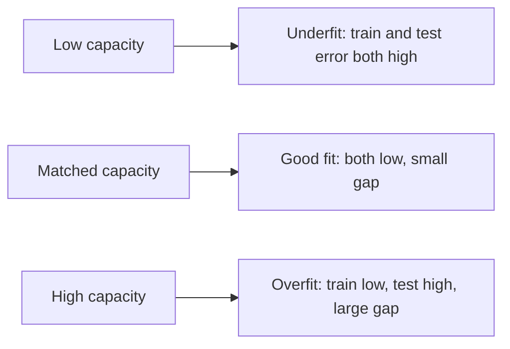
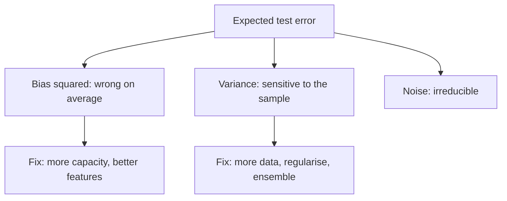
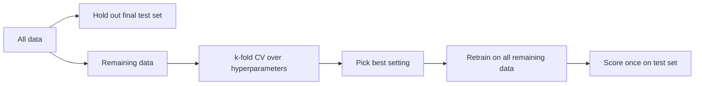
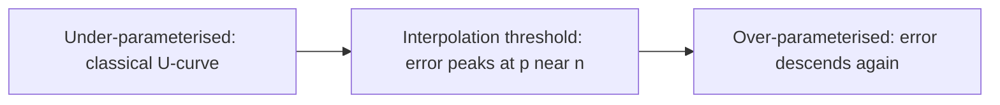

# Overfitting & Generalisation

Module 2 taught you to drive training loss down. This module is about the uncomfortable
fact that **low training loss is not the goal**. The goal is low error on data the
model has never seen, called *generalisation*, and a model with enough freedom can
drive training loss to zero by memorising noise. Four parts:

- **Underfitting, overfitting and capacity** — the polynomial-fit demo that shows both.
- **The bias-variance decomposition** — derived, so the tradeoff is not folklore.
- **Regularisation and cross-validation** — the tools that control capacity, and the
  honest way to choose their settings.
- **Learning curves and double descent** — diagnosing a model, and where the classic
  story breaks.

---

## 3.1 — Underfitting, Overfitting & Capacity

Fix a dataset $\{(x_i, y_i)\}_{i=1}^n$ drawn from some unknown process. A model family
has a **capacity**: roughly, how rich a set of functions it can represent. A line has
low capacity, a degree-15 polynomial has high capacity, a deep network has enormous
capacity. Training picks the best function *inside* that family for the training data.

- **Underfitting** (high bias): capacity too low to capture the true pattern. Error is
  high on training *and* test data. A line fit to a sine wave.
- **Overfitting** (high variance): capacity high enough to bend around the noise in
  this particular sample. Training error is tiny, test error is large. The fitted
  function changes wildly if you resample the training set.
- **Good fit**: capacity matched to the signal. Both errors are low and close.

The central object is the **generalisation gap**: test error minus training error. It
is nearly always non-negative, because the model was optimised on the training set and
never saw the test set.



### The polynomial demo

The cleanest experiment: generate noisy samples of a smooth function, fit polynomials
of increasing degree, and measure error on training data and on a fresh test set.

```python
import numpy as np

rng = np.random.default_rng(0)

def true_f(x):
    return np.sin(2 * np.pi * x)                        # the hidden signal

def make_data(n, noise=0.3):
    x = rng.uniform(0, 1, n)
    y = true_f(x) + rng.normal(0, noise, n)             # signal + irreducible noise
    return x, y

x_tr, y_tr = make_data(15)                              # tiny train set on purpose
x_te, y_te = make_data(1000)                            # big test set approximates truth

def design(x, degree):
    """Vandermonde features [1, x, x^2, ..., x^degree]."""
    return np.vander(x, degree + 1, increasing=True)

def mse(y, yhat):
    return np.mean((y - yhat) ** 2)

for d in [1, 3, 9, 14]:
    # lstsq returns the minimum-norm least-squares solution, stable even when ill-posed
    w, *_ = np.linalg.lstsq(design(x_tr, d), y_tr, rcond=None)
    tr = mse(y_tr, design(x_tr, d) @ w)
    te = mse(y_te, design(x_te, d) @ w)
    print(f"degree {d:2d}  train {tr:.3f}  test {te:.3f}")
```

Typical output: degree 1 has train and test MSE both near 0.2 to 0.5 (underfit);
degree 3 has both near 0.1 (the noise floor is $0.3^2 = 0.09$); degree 14 with 15
points has train MSE essentially $0$ because the polynomial interpolates every point,
and test MSE far larger, often in the hundreds or worse. The model has $15$ parameters
for $15$ points: just enough freedom to hit each noisy label exactly, and between the
points it oscillates wildly.

Note the **noise floor**. Even the true function cannot beat $\sigma^2 = 0.09$ on noisy
test labels. Test error below that is impossible, and training error below it is
*evidence of overfitting*, not skill.

| Symptom | Train error | Test error | Gap | Diagnosis |
| --- | --- | --- | --- | --- |
| Both high | high | high | small | Underfitting: add capacity or features |
| Train low, test high | low | high | large | Overfitting: regularise, add data, cut capacity |
| Both low | low | low | small | Good fit |
| Train high, test low | high | low | negative | Suspect leakage or a lucky split |

---

## 3.2 — The Bias-Variance Decomposition

Why does the test curve go down and then up as capacity grows? The decomposition makes
it exact. Assume the data are generated as

$$
y = f(x) + \varepsilon, \qquad \mathbb{E}[\varepsilon] = 0, \quad \mathrm{Var}(\varepsilon) = \sigma^2,
$$

with noise $\varepsilon$ independent of everything else. Our learned predictor
$\hat f(x; D)$ depends on the training set $D$, which is itself random. Fix a test point
$x$ and let $\bar f(x) = \mathbb{E}_D[\hat f(x; D)]$ be the *average* prediction over
all possible training sets. We want the expected squared error at $x$ over both $D$
and the test noise.

**Step 1: split off the noise.** Write $y - \hat f = (f - \hat f) + \varepsilon$ and
expand. The cross term vanishes because $\varepsilon$ is independent with mean zero:

$$
\mathbb{E}\big[(y - \hat f)^2\big] = \mathbb{E}\big[(f - \hat f)^2\big] + \underbrace{\mathbb{E}[\varepsilon^2]}_{\sigma^2} + 2\,\mathbb{E}[(f-\hat f)\,\varepsilon] = \mathbb{E}\big[(f - \hat f)^2\big] + \sigma^2 .
$$

**Step 2: add and subtract the mean prediction.** Write
$f - \hat f = (f - \bar f) + (\bar f - \hat f)$. The first bracket is a constant with
respect to $D$; the second has mean zero over $D$, so the cross term again vanishes:

$$
\mathbb{E}_D\big[(f - \hat f)^2\big] = \underbrace{(f - \bar f)^2}_{\text{bias}^2} + \underbrace{\mathbb{E}_D\big[(\hat f - \bar f)^2\big]}_{\text{variance}} .
$$

Putting the two steps together:

$$
\boxed{\;\mathbb{E}\big[(y - \hat f(x))^2\big] = \underbrace{\big(f(x) - \bar f(x)\big)^2}_{\text{Bias}^2} + \underbrace{\mathbb{E}_D\big[(\hat f(x) - \bar f(x))^2\big]}_{\text{Variance}} + \underbrace{\sigma^2}_{\text{Irreducible noise}}\;}
$$

Read each term as a question:

- **Bias$^2$**: if I could average over infinitely many training sets, how far is the
  *average* model from the truth? It measures systematic wrongness: a line cannot be a
  sine, no matter how much data you feed it.
- **Variance**: how much does the prediction move when the training set changes? It
  measures sensitivity to the particular sample. High-capacity models have high variance.
- **Noise $\sigma^2$**: error in the labels themselves. No model removes it.

Raising capacity usually lowers bias and raises variance. The sum is U-shaped, and the
minimum is the **sweet spot**. You can estimate all three terms by simulation, because
in a toy problem you can draw many training sets.

```python
def bias_variance(degree, n_train=20, n_sets=300, noise=0.3):
    """Monte Carlo estimate of bias^2, variance and noise on a fixed test grid."""
    x_grid = np.linspace(0, 1, 100)
    preds = np.empty((n_sets, x_grid.size))
    for s in range(n_sets):                              # many independent training sets D
        x = rng.uniform(0, 1, n_train)
        y = true_f(x) + rng.normal(0, noise, n_train)
        w, *_ = np.linalg.lstsq(design(x, degree), y, rcond=None)
        preds[s] = design(x_grid, degree) @ w
    f_bar = preds.mean(axis=0)                           # average prediction  f-bar(x)
    bias2 = np.mean((true_f(x_grid) - f_bar) ** 2)       # (f - f-bar)^2, averaged over x
    var = np.mean(preds.var(axis=0))                     # E_D[(f-hat - f-bar)^2]
    return bias2, var, noise ** 2

for d in [1, 3, 5, 9]:
    b, v, n = bias_variance(d)
    print(f"degree {d}: bias^2 {b:.3f}  variance {v:.3f}  noise {n:.3f}  total {b+v+n:.3f}")
```

Expect bias$^2$ to fall from roughly $0.2$ to $0.4$ at degree 1 to nearly $0$ by degree
5, while variance climbs from about $0.02$ at degree 1 to far larger values at degree 9.
The total bottoms out around degree 3 to 5. Squared loss gives this clean three-way
split; for other losses (0-1 loss, cross-entropy) the decomposition is messier, but the
intuition carries over.



A practical corollary: **ensembling reduces variance**. Averaging $M$ independent
predictors with variance $v$ each gives variance $v/M$ while leaving bias unchanged.
Bagged trees are only partly independent, so the gain is smaller in practice, but it is
why random forests tame deep, high-variance trees.

---

## 3.3 — Regularisation & Cross-Validation

Regularisation is any change that trades a little extra training error for lower
variance. Cross-validation is how you honestly choose how much.

### L2 regularisation (ridge)

Add a penalty on the squared weight norm to the loss:

$$
J(\mathbf{w}) = \frac{1}{n}\lVert X\mathbf{w} - \mathbf{y}\rVert_2^2 + \lambda \lVert \mathbf{w} \rVert_2^2 .
$$

For linear regression there is a closed form, $\hat{\mathbf{w}} = (X^\top X + n\lambda I)^{-1} X^\top \mathbf{y}$.
The added $\lambda I$ makes the matrix invertible and *shrinks* weights toward zero, so
the function cannot afford large oscillating coefficients. In gradient descent it
appears as **weight decay**: each step multiplies the weights by $(1 - 2\eta\lambda)$
before applying the data gradient. The penalty should not apply to the intercept,
and features must be standardised first or the penalty punishes them unequally.

### L1 regularisation (lasso) and sparsity

Replace the squared norm with the absolute sum, $\lambda \lVert \mathbf{w} \rVert_1$.
The geometry explains the difference: the L1 ball has *corners* on the coordinate axes,
and the loss contours tend to touch it at a corner, where some weights are exactly
zero. L2 shrinks all weights smoothly but rarely to exactly zero; L1 performs **feature
selection**. The L1 update has a closed form called *soft thresholding*:

$$
\mathrm{soft}(z, t) = \mathrm{sign}(z)\,\max(|z| - t,\, 0).
$$

```python
def standardize(X):
    mu, sd = X.mean(0), X.std(0) + 1e-12
    return (X - mu) / sd, mu, sd

def ridge_fit(X, y, lam):
    """Closed-form ridge on standardised X; intercept handled by centring y."""
    n, d = X.shape
    return np.linalg.solve(X.T @ X + n * lam * np.eye(d), X.T @ (y - y.mean()))

def soft(z, t):
    return np.sign(z) * np.maximum(np.abs(z) - t, 0.0)

def lasso_fit(X, y, lam, iters=200):
    """Coordinate descent for (1/2n)||y - Xw||^2 + lam*||w||_1 on standardised X."""
    n, d = X.shape
    yc, w = y - y.mean(), np.zeros(d)
    for _ in range(iters):
        for j in range(d):
            r = yc - X @ w + X[:, j] * w[j]              # residual excluding feature j
            w[j] = soft(X[:, j] @ r / n, lam)            # column variance is 1 after standardising
    return w

# 100 samples, 20 features, only 3 truly matter
Xr = rng.normal(size=(100, 20))
w_true = np.zeros(20); w_true[[0, 1, 2]] = [3.0, -2.0, 1.5]
yr = Xr @ w_true + rng.normal(0, 1.0, 100)
Xs, _, _ = standardize(Xr)
print("ridge nonzeros:", np.sum(np.abs(ridge_fit(Xs, yr, 0.1)) > 1e-6))   # all 20
print("lasso nonzeros:", np.sum(np.abs(lasso_fit(Xs, yr, 0.3)) > 1e-6))   # about 3
```

| Method | Penalty | Effect on weights | Use when |
| --- | --- | --- | --- |
| Ridge (L2) | $\lambda\lVert w\rVert_2^2$ | shrinks all, none exactly zero | many small correlated effects |
| Lasso (L1) | $\lambda\lVert w\rVert_1$ | shrinks and zeroes many | few features matter, want selection |
| Elastic net | both | grouped sparsity | correlated features, still want sparsity |

Lasso has a pitfall: among a group of highly correlated features it arbitrarily keeps
one, so the selected set is unstable across resamples.

### Early stopping, dropout, and augmentation

**Early stopping.** Track validation loss during training and stop when it stops
improving, restoring the best weights. Training loss keeps falling, but validation loss
follows a U: the model first learns signal, then starts memorising noise. For linear
models, stopping gradient descent early behaves much like ridge, because weights have
not yet grown along the low-variance directions. Use *patience* (for example, stop
after 10 epochs without improvement) because validation loss is noisy.

**Dropout (preview).** During training, randomly zero each hidden unit with probability
$p$ and rescale the survivors by $1/(1-p)$; at test time use every unit. Units cannot
rely on any single co-adapted partner, which acts like training and averaging a huge
ensemble of thinned networks. You will meet it properly in the deep learning course.

**Data augmentation.** Create extra training examples by label-preserving transforms:
flip, crop and colour-jitter images, add noise or time-shift audio. It injects the
invariances you know the task has, and it is regularisation by *more data* rather than
by penalty. A transform must preserve the label: flipping a "6" vertically changes
the digit. The most effective regulariser of all is simply more real data.

### Cross-validation

A single train/validation split is noisy: a lucky split flatters one model. **k-fold
cross-validation** splits the data into $k$ folds, trains on $k-1$, validates on the
held-out fold, rotates $k$ times, and averages:

$$
\mathrm{CV}_k = \frac{1}{k}\sum_{j=1}^{k} \mathrm{Err}\big(\hat f^{(-j)};\ D_j\big).
$$

Common choices are $k=5$ or $10$; $k=n$ is leave-one-out (low bias, high cost, high
variance). Three variants matter in practice:

- **Stratified k-fold**: each fold preserves the class proportions. Essential for
  imbalanced classification, where a plain split can leave a fold with almost no
  positives.
- **Group k-fold**: keep all rows from one patient, user or session in the same fold,
  otherwise near-duplicates leak across the split.
- **Time-series split**: for temporal data, always train on the past and validate on the
  future. Shuffled folds let the model peek at the future and give wildly optimistic
  scores.

```python
def kfold_indices(n, k, shuffle=True, seed=0):
    idx = np.arange(n)
    if shuffle:
        np.random.default_rng(seed).shuffle(idx)
    return np.array_split(idx, k)                        # k nearly equal folds

def stratified_kfold(y, k, seed=0):
    """Deal each class's shuffled indices round-robin into k folds."""
    r = np.random.default_rng(seed)
    folds = [[] for _ in range(k)]
    for c in np.unique(y):
        members = r.permutation(np.where(y == c)[0])
        for i, m in enumerate(members):
            folds[i % k].append(m)
    return [np.array(f) for f in folds]

def time_series_splits(n, k):
    """Expanding window: train on [0, t), validate on the next block. Never look ahead."""
    block = n // (k + 1)
    for i in range(1, k + 1):
        yield np.arange(0, i * block), np.arange(i * block, (i + 1) * block)

def cv_score(X, y, fit, predict, folds):
    errs = []
    for j, val in enumerate(folds):
        tr = np.concatenate([f for i, f in enumerate(folds) if i != j])
        model = fit(X[tr], y[tr])
        errs.append(np.mean((y[val] - predict(model, X[val])) ** 2))
    return np.mean(errs), np.std(errs)                   # report spread, not just the mean
```

### Hyperparameter search

$\lambda$, polynomial degree, learning rate and tree depth are **hyperparameters**:
settings you choose, not weights the optimiser learns. Select them by cross-validated
score. **Grid search** tries every combination on a fixed lattice; cost explodes
exponentially with the number of hyperparameters. **Random search** samples
configurations from distributions and, following Bergstra and Bengio (2012), usually
wins at equal budget because often only a few hyperparameters matter, and random draws
test more distinct values of each. Search scale-like parameters on a log scale
($\lambda \in [10^{-6}, 10^{2}]$), not linearly.

```python
def random_search(X, y, n_trials=30):
    """Random search over ridge lambda with 5-fold CV. X must be standardised."""
    best = (np.inf, None)
    folds = kfold_indices(len(y), 5)
    yc = y - y.mean()
    for _ in range(n_trials):
        lam = 10 ** rng.uniform(-5, 1)                   # log-uniform sample
        fit = lambda Xt, yt, lam=lam: ridge_fit(Xt, yt, lam)
        pred = lambda w, Xv: Xv @ w
        score, _ = cv_score(X, yc, fit, pred, folds)
        if score < best[0]:
            best = (score, lam)
    return best                                          # (cv mse, chosen lambda)

print(random_search(Xs, yr))
```

A subtle trap: once you pick the best configuration by CV score, that score is
*optimistically biased*, because you selected the minimum of many noisy estimates. You
need a final **test set** touched exactly once, which is the subject of Module 4.



---

## 3.4 — Learning Curves & Double Descent

### Learning curves

A **learning curve** plots training and validation error as a function of training set
size $n$ (or of training epochs). It is the cheapest diagnostic for deciding what to do
next. Train on growing subsets, evaluate each on a fixed validation set:

```python
def learning_curve(degree, sizes, lam=1e-6):
    x_val, y_val = make_data(2000)
    rows = []
    for m in sizes:
        x, y = make_data(m)
        A = design(x, degree)
        # tiny ridge term keeps the normal equations solvable when m is small
        w = np.linalg.solve(A.T @ A + lam * np.eye(degree + 1), A.T @ y)
        rows.append((m, mse(y, A @ w), mse(y_val, design(x_val, degree) @ w)))
    return rows

for m, tr, va in learning_curve(degree=9, sizes=[12, 25, 50, 100, 400, 1600]):
    print(f"n={m:5d}  train {tr:.3f}  val {va:.3f}  gap {va - tr:.3f}")
```

Read the shape:

| Curve shape | What you see | Diagnosis | Remedy |
| --- | --- | --- | --- |
| High-bias | Both curves plateau at a high error, close together | Model too simple | More capacity, better features; more data will not help |
| High-variance | Large persistent gap, validation still falling | Model too flexible for the data | More data, regularise, simpler model |
| Healthy | Both converge to a low error near the noise floor | Fine | Ship it |

The crucial insight is the **plateau test**: if validation error has flattened and the
gap is small, more data is wasted money; if the gap is large and the validation curve
still slopes down, collecting data is likely the best investment you can make. The
same plot against *epochs* shows the early-stopping point directly.

### Double descent

The classic U-curve says that once a model is flexible enough to interpolate the
training data, it must be overfit. Modern practice contradicts this: huge neural
networks with far more parameters than examples, trained to zero training error,
generalise well. Belkin et al. (2019) reconciled the two with **double descent**.
Sweeping model size $p$ against a fixed training set of size $n$:

1. **Classical regime** ($p < n$): the U-curve. Test error falls, then rises.
2. **Interpolation threshold** ($p \approx n$): the model has barely enough capacity to
   fit every point, and must contort to do it. Test error **peaks**.
3. **Overparameterised regime** ($p \gg n$): infinitely many functions interpolate the
   data. Gradient descent and minimum-norm solutions pick a *smooth* one, so test
   error **falls again**, often below the classical optimum.



You can reproduce the peak with minimum-norm least squares on random features:

```python
def double_descent(n=40, noise=0.5, trials=20):
    results = {}
    for p in [5, 10, 20, 35, 40, 45, 60, 100, 200]:
        errs = []
        for _ in range(trials):
            x_tr = rng.uniform(-1, 1, n)
            y_tr = true_f(x_tr) + rng.normal(0, noise, n)
            x_te = rng.uniform(-1, 1, 500)
            W = rng.normal(0, 3, p); b = rng.uniform(0, 2 * np.pi, p)
            phi = lambda x: np.cos(np.outer(x, W) + b)       # random Fourier features
            w = np.linalg.pinv(phi(x_tr)) @ y_tr             # minimum-norm solution
            errs.append(mse(true_f(x_te), phi(x_te) @ w))
        results[p] = np.mean(errs)
    return results                                           # expect a spike near p = n = 40

for p, e in double_descent().items():
    print(f"p={p:4d}  test error vs truth {e:.3f}")
```

Why does the peak appear? At $p \approx n$ the design matrix is nearly singular, its
smallest singular values are tiny, and inverting them amplifies label noise into huge
weights. Past the threshold, extra directions give the solver room to spread the fit
across many small weights, which is an *implicit regulariser*: among all interpolators,
the pseudo-inverse (and gradient descent from zero initialisation) picks the
minimum-norm one.

The same effect appears as **epoch-wise double descent** and **sample-wise double
descent** (more data can transiently hurt near the threshold). Practical lessons:

- Do not conclude "bigger models always overfit". Parameter count alone does not
  determine generalisation; the *inductive bias* of the optimiser and architecture does.
- Regularisation (even a small weight decay) damps the peak.
- The peak is real but usually avoided in practice, because you rarely train exactly
  at the threshold, and noisier labels make the peak taller.

---

## Key takeaways

- **Generalisation is the goal.** Low training error alone is meaningless; judge a model
  on data it never saw, and compare against the noise floor $\sigma^2$.
- **Capacity controls the tradeoff.** Expected squared error equals
  $\text{Bias}^2 + \text{Variance} + \sigma^2$; more capacity trades bias for variance.
- **Regularise deliberately.** Ridge shrinks, lasso zeroes, early stopping and dropout
  limit effective capacity, and augmentation and more data attack variance directly.
- **Use cross-validation to choose settings.** Stratify for imbalance, group by entity,
  split by time for temporal data, and search hyperparameters on a log scale, preferably
  randomly.
- **Learning curves tell you what to do next**: more data, more capacity, or neither.
- **Double descent** shows that past the interpolation threshold, bigger can be better;
  the classic U is only the first half of the story.

## Exercises

1. **Reproduce the U.** Run the polynomial experiment for degrees 1 to 14 with 15, 50
   and 200 training points. Plot train and test MSE against degree. Where does the
   minimum move as $n$ grows, and why?

2. **Verify the decomposition.** Using `bias_variance`, check that
   $\text{bias}^2 + \text{variance} + \sigma^2$ matches the directly measured average
   test MSE across many training sets. Then bag 10 degree-9 fits and show variance
   drops substantially while bias barely moves.

3. **Ridge versus lasso paths.** On the 20-feature synthetic problem, sweep
   $\lambda$ over $10^{-4}$ to $10^{1}$ on a log grid for both methods. Plot each
   weight against $\lambda$ and the CV error. Which method recovers the 3 true
   features, and at what $\lambda$ does CV error bottom out?

4. **Break cross-validation on purpose.** Generate a random-walk time series and
   predict the next value from lagged values. Score with shuffled 5-fold CV and with
   `time_series_splits`. Compare the two scores and explain the gap in terms of leakage.

## Next: Module 4 — Evaluating Models Honestly

You can now build models that generalise, and tune them with cross-validation. But every
tuning decision leaks a little information about the validation data into the model, and
a single accuracy number hides most of what matters. Module 4 covers train, validation
and test discipline, data leakage in its many disguises, the right metrics for the job
(precision, recall, ROC and PR curves, calibration), confidence intervals on your
scores, and baselines, so that when you report a number, it is one you can defend.
