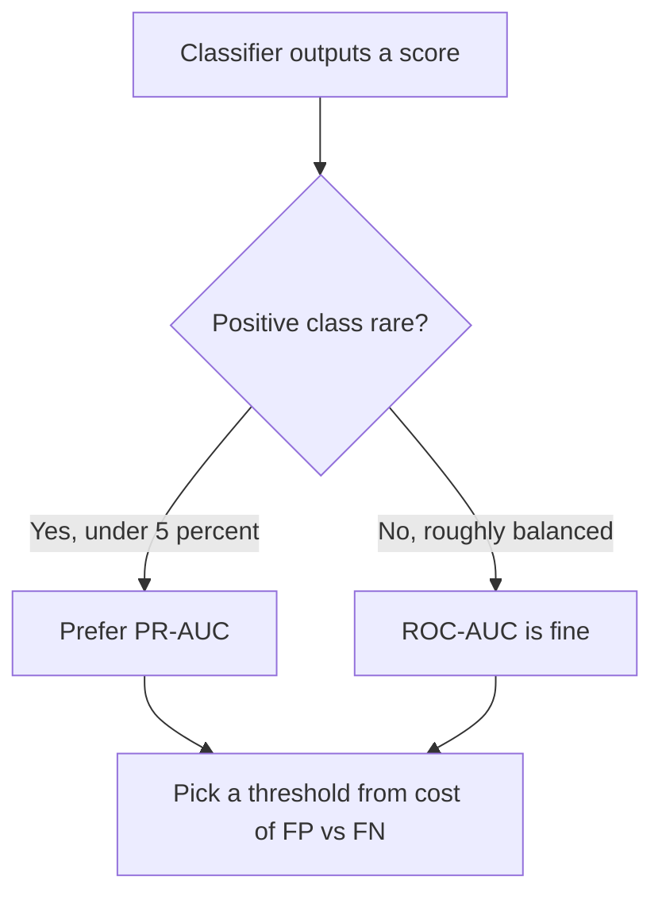
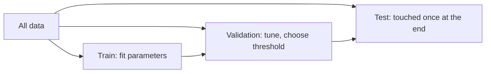
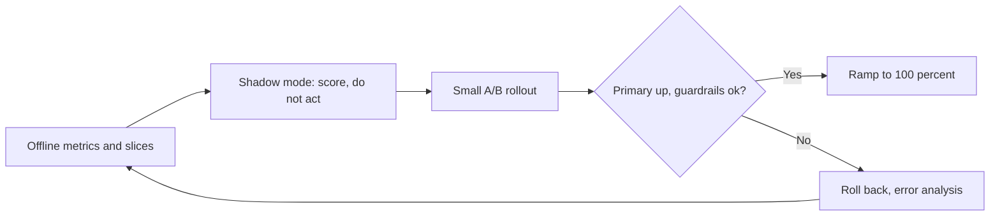

# Evaluating Models Honestly

Modules 1 to 3 taught you to fit a model and to stop it memorizing. This module is
about the question underneath all of them: **how do you know it works?** Most failed
ML projects do not fail because the model was bad; they fail because the evaluation
was flattering, and the number that shipped was never the number the world delivered.
Honest evaluation is a set of habits more than a set of formulas. Four parts:

- **Metrics that tell the truth** — why accuracy misleads, and what to use instead.
- **Thresholds and calibration** — turning scores into decisions, and trusting probabilities.
- **Leakage and split design** — the quiet ways a test set stops being a test.
- **Uncertainty, slices, and the real world** — intervals, baselines, error analysis, A/B tests.

---

## 4.1 — Metrics That Tell the Truth

### The accuracy trap

Accuracy is the fraction of predictions that are correct. It is intuitive and, on
imbalanced data, nearly useless. If 1 transaction in 1,000 is fraud, a model that
always answers "not fraud" scores **99.9 percent accuracy** and catches zero fraud.
Whenever one class dominates, ask what a trivial constant predictor would score; that
is the floor your accuracy must be compared to, not 50 percent.

Everything starts from the **confusion matrix** for a binary problem:

| | Predicted positive | Predicted negative |
| --- | --- | --- |
| **Actual positive** | TP (true positive) | FN (false negative) |
| **Actual negative** | FP (false positive) | TN (true negative) |

From it come the metrics that separate the two ways of being wrong:

$$
\text{precision} = \frac{TP}{TP + FP}
\qquad
\text{recall} = \frac{TP}{TP + FN}
\qquad
F_1 = \frac{2\,P\,R}{P + R}
$$

**Precision** asks: of everything I flagged, how much was real? **Recall** (also
sensitivity, true positive rate) asks: of everything real, how much did I catch? They
trade off, and which matters depends on the cost of each error. A spam filter wants
high precision (never bin a real email); a cancer screen wants high recall (never miss
a case). $F_1$ is the *harmonic* mean, which punishes imbalance between the two: with
$P = 1.0$ and $R = 0.01$ the arithmetic mean is 0.505 but $F_1 \approx 0.02$. The general
form $F_\beta$ weights recall $\beta$ times as much as precision.

```python
import numpy as np

def confusion(y_true, y_pred):
    """Counts for a binary problem; inputs are 0/1 arrays."""
    y_true, y_pred = np.asarray(y_true), np.asarray(y_pred)
    tp = int(((y_true == 1) & (y_pred == 1)).sum())
    fp = int(((y_true == 0) & (y_pred == 1)).sum())
    fn = int(((y_true == 1) & (y_pred == 0)).sum())
    tn = int(((y_true == 0) & (y_pred == 0)).sum())
    return tp, fp, fn, tn

def prf(y_true, y_pred):
    tp, fp, fn, tn = confusion(y_true, y_pred)
    precision = tp / (tp + fp) if tp + fp else 0.0     # guard divide-by-zero
    recall    = tp / (tp + fn) if tp + fn else 0.0
    f1 = 2 * precision * recall / (precision + recall) if precision + recall else 0.0
    return precision, recall, f1, (tp + tn) / len(y_true)

rng = np.random.default_rng(0)
y = (rng.random(100_000) < 0.001).astype(int)           # 0.1% positives
print(prf(y, np.zeros_like(y)))   # accuracy ~0.999, recall 0.0: the trap, in one line
```

For more than two classes, **macro** averaging computes the metric per class and
averages them (every class counts equally, so rare classes matter); **micro**
averaging pools all counts first (frequent classes dominate). Report which one you used.

### ROC-AUC versus PR-AUC

Most classifiers output a *score*, and the metric changes as you slide the decision
threshold. The **ROC curve** plots true positive rate against false positive rate
($FPR = FP / (FP + TN)$) across all thresholds; **ROC-AUC** is the area under it, and
equals the probability that a random positive is scored above a random negative. It is
threshold-free and 0.5 means chance. Its weakness: FPR divides by the huge negative
count, so with 1,000,000 negatives, 1,000 false positives is still an FPR of 0.001 and
the curve looks excellent even when most of your alerts are wrong.

The **precision-recall curve** has no true negatives anywhere in it, so it stays
sensitive to the rare class. **PR-AUC** (average precision) is the better headline for
heavily imbalanced problems, and its chance baseline is the *positive rate*, not 0.5.



```python
def roc_auc(y_true, scores):
    """AUC as P(score of random positive > score of random negative), via ranks."""
    y_true, scores = np.asarray(y_true), np.asarray(scores)
    order = np.argsort(scores)
    ranks = np.empty(len(scores)); ranks[order] = np.arange(1, len(scores) + 1)
    n_pos = y_true.sum(); n_neg = len(y_true) - n_pos
    # Mann-Whitney U statistic (ties are ignored here for brevity)
    return (ranks[y_true == 1].sum() - n_pos * (n_pos + 1) / 2) / (n_pos * n_neg)

def average_precision(y_true, scores):
    """Mean of precision at each rank where a true positive appears."""
    order = np.argsort(-np.asarray(scores))
    hits = np.asarray(y_true)[order]
    precision_at_k = np.cumsum(hits) / np.arange(1, len(hits) + 1)
    return float((precision_at_k * hits).sum() / hits.sum())
```

### Regression and ranking metrics

For a numeric target the standard errors are:

$$
\text{MAE} = \frac{1}{n}\sum_i |y_i - \hat y_i|
\qquad
\text{RMSE} = \sqrt{\frac{1}{n}\sum_i (y_i - \hat y_i)^2}
\qquad
R^2 = 1 - \frac{\sum_i (y_i - \hat y_i)^2}{\sum_i (y_i - \bar y)^2}
$$

MAE is in the target's units and robust to outliers; RMSE squares errors so a few
large misses dominate it, which is what you want if big misses are disproportionately
costly. $R^2$ is "fraction of variance explained relative to predicting the mean", so
$R^2 = 0$ means you matched the constant baseline and negative values mean you did
*worse* than it. When the target spans orders of magnitude (prices, counts), consider
errors in log space or a percentage metric, but beware MAPE blowing up near zero.

**Ranking metrics** apply when the output is an ordered list (search, recommendations)
and only the top matters. **Precision@k** is the fraction of the top $k$ that are
relevant. **NDCG@k** also rewards putting the *most* relevant items first by discounting
gain with rank:

$$
\text{DCG@}k = \sum_{i=1}^{k} \frac{2^{rel_i} - 1}{\log_2(i + 1)}
\qquad
\text{NDCG@}k = \frac{\text{DCG@}k}{\text{IDCG@}k}
$$

where IDCG is the DCG of the ideal ordering, so NDCG lies in $[0, 1]$.

---

## 4.2 — Thresholds and Calibration

### A threshold is a business decision

A model outputs $\hat p$; a decision needs a rule such as "flag if $\hat p \ge t$". The
default $t = 0.5$ is an accident, not an optimum. If a missed fraud costs 200 and a
false alarm costs 5, the cost-minimizing threshold on *calibrated* probabilities is
$t^* = \frac{c_{FP}}{c_{FP} + c_{FN}} = \frac{5}{205} \approx 0.024$. Choose $t$ on a
**validation** set from the costs or from a constraint ("at least 90 percent recall"),
then freeze it before touching the test set.

```python
def best_threshold(y_true, p, c_fp=5.0, c_fn=200.0):
    """Scan thresholds on validation data, return the one with the lowest total cost."""
    y_true, p = np.asarray(y_true), np.asarray(p)
    ts = np.unique(p)
    costs = [c_fp * ((p >= t) & (y_true == 0)).sum() +
             c_fn * ((p <  t) & (y_true == 1)).sum() for t in ts]
    return ts[int(np.argmin(costs))]
```

### Calibration: do the probabilities mean anything?

A model is **calibrated** if, among all cases where it says 0.8, about 80 percent are
positive. Ranking quality (AUC) and calibration are independent: a model can rank
perfectly yet output useless probabilities. Calibration matters whenever you act on the
number itself (expected cost, risk scores, combining models, showing users a percentage).
Boosted trees and heavily-trained neural nets tend to be over-confident; naive Bayes is
often extreme; logistic regression is usually reasonably calibrated.

A **reliability diagram** bins predictions by confidence and plots mean predicted
probability against observed positive frequency; a calibrated model hugs the diagonal.
The **Brier score** is the mean squared error of the probabilities, a proper scoring
rule that rewards both discrimination and calibration (lower is better; predicting the
base rate $\bar y$ scores $\bar y (1 - \bar y)$):

$$
\text{Brier} = \frac{1}{n}\sum_i (\hat p_i - y_i)^2
$$

```python
def reliability(y_true, p, bins=10):
    """Return per-bin (mean predicted, observed rate, count) plus ECE and Brier."""
    y_true, p = np.asarray(y_true), np.asarray(p)
    edges = np.linspace(0, 1, bins + 1)
    idx = np.clip(np.digitize(p, edges) - 1, 0, bins - 1)
    rows, ece = [], 0.0
    for b in range(bins):
        m = idx == b
        if m.sum() == 0:
            continue
        conf, acc = p[m].mean(), y_true[m].mean()
        rows.append((conf, acc, int(m.sum())))
        ece += m.mean() * abs(conf - acc)         # expected calibration error
    return rows, ece, float(np.mean((p - y_true) ** 2))
```

If a model is miscalibrated, fix it *after* training on held-out data: **Platt scaling**
fits a logistic regression on the scores, $\sigma(a s + b)$; **isotonic regression** fits
a monotone step function and needs more data. Calibrate on a split the model never
trained on, and evaluate calibration on a third, or you will fool yourself.

---

## 4.3 — Data Leakage and Split Design

**Leakage** is any path by which information unavailable at prediction time reaches
training. It is the most common reason a model scores 0.98 offline and 0.60 in
production, and it is dangerous because the result looks *better*, so nobody hunts for
the bug. Three families:

| Kind | Example | Symptom |
| --- | --- | --- |
| Target leakage | A feature computed after the outcome, e.g. "days overdue" predicting default | Suspiciously high score; one feature dominates |
| Temporal leakage | Random split of time-ordered data, so the model trains on the future | Great offline, decays fast in production |
| Preprocessing / split leakage | Scaling, imputing, or selecting features on all data before splitting; duplicates or the same user across train and test | Small, quiet optimism that is hard to see |

**Target leakage** is a feature problem: ask of every column, "would I know this value
at the moment I must predict?" **Temporal leakage** is a split problem: for anything
that evolves, split by *time* (train on the past, validate on the next window, test on
the latest), never randomly. **Preprocessing leakage** is a pipeline problem: the mean
and standard deviation you standardize with are *parameters learned from data*, so they
must be learned on the training fold only.

```python
# WRONG: statistics from ALL rows leak test-set information into training
X_scaled = (X - X.mean(0)) / X.std(0)
X_tr, X_te = X_scaled[:800], X_scaled[800:]

# RIGHT: fit on train only, then apply the frozen statistics to test
mu, sd = X[:800].mean(0), X[:800].std(0)
X_tr, X_te = (X[:800] - mu) / sd, (X[800:] - mu) / sd
```

The same rule covers imputation, feature selection, PCA, target encoding and even
hyperparameter search: every fitted step belongs *inside* the cross-validation loop.
Selecting the "top 20 genes" on the full dataset and then cross-validating a classifier
on them is a famous way to get impressive accuracy on pure noise.

### Designing the splits



Rules that keep the test set honest:

1. **Three roles, three sets.** Train fits parameters, validation makes choices
   (hyperparameters, threshold, model family), test is used *once*. Every time you look
   at test and adjust, it quietly becomes a validation set.
2. **Split by the unit that generalizes.** If the model will see new patients, split by
   patient, not by row, or the same person's records land on both sides (use
   group-aware K-fold). Deduplicate near-identical rows before splitting.
3. **Mimic deployment.** Time-ordered data uses forward-chaining splits; stratify by
   label when positives are rare so each fold has enough of them.
4. **Use cross-validation for small data**, but remember it estimates the *procedure*,
   and nested CV is needed if you also tune hyperparameters inside it.

```python
def forward_chaining_splits(n, n_folds=4, min_train=0.4):
    """Yield (train_idx, val_idx) where validation always lies after training."""
    start = int(n * min_train)
    step = (n - start) // n_folds
    for k in range(n_folds):
        end = start + k * step
        yield np.arange(0, end), np.arange(end, end + step)
```

---

## 4.4 — Uncertainty, Slices, and the Real World

### Is the difference real?

Your model scores 0.842 and the baseline 0.835 on 500 test examples. Is that a win? A
test metric is a *sample statistic*; with a different test sample it would move. The
**bootstrap** estimates that spread without a formula: resample the test set with
replacement many times, recompute the metric each time, and read the interval off the
percentiles. For comparing two models, resample the *same* indices for both and bootstrap
the **paired difference**, which cancels the shared difficulty of the examples.

```python
def bootstrap_diff(y, pred_a, pred_b, metric, n_boot=2000, seed=0):
    """95% CI for metric(A) - metric(B), resampling the same rows for both models."""
    rng = np.random.default_rng(seed)
    y, pred_a, pred_b = map(np.asarray, (y, pred_a, pred_b))
    n, diffs = len(y), []
    for _ in range(n_boot):
        i = rng.integers(0, n, n)                        # with replacement
        diffs.append(metric(y[i], pred_a[i]) - metric(y[i], pred_b[i]))
    lo, hi = np.percentile(diffs, [2.5, 97.5])
    return float(np.mean(diffs)), (float(lo), float(hi))

accuracy = lambda y, p: float((y == p).mean())
# If the interval contains 0, you have not shown that A beats B.
```

A rough sanity rule for accuracy near 0.8: the standard error is
$\sqrt{p(1-p)/n} \approx 0.018$ at $n = 500$, so a 95 percent interval is about
$\pm 3.5$ points, and a 0.7-point gain is noise. Also beware **multiple comparisons**:
try 40 variants on one test set and the best will look good by luck alone, another
reason to keep a final untouched test.

### Baselines give numbers meaning

A metric without a baseline is a number without a unit. Always report, in order: a
**constant** predictor (majority class or the mean), a **simple heuristic** (yesterday's
value, last purchase, a keyword rule), a **simple model** (logistic or linear regression),
and only then your complex model. If the gradient-boosted model beats the heuristic by 0.3
points, the honest conclusion may be "ship the heuristic". Also compare against
**human-level** performance where it exists, since it bounds what is achievable.

### Error analysis and slices

An aggregate metric averages away exactly the failures you need to see. After computing
the headline number, **read the mistakes**: sample 50 to 100 errors, tag each with a
cause (label noise, missing feature, ambiguous input, genuine model failure), and count.
The biggest bucket is your next piece of work, usually worth more than a new architecture.

Then evaluate by **slices**: the same metric computed per subgroup (device, country,
new vs returning user, text length, image brightness, rare class). A 0.90 overall recall
can hide 0.60 on a segment that matters. **Fairness slices** are the same idea applied
to protected or sensitive groups: compare recall, false positive rate and calibration
across groups. These criteria can conflict (calibration within groups and equal error
rates generally cannot both hold when base rates differ), so fairness is a stated
product decision, not a number you minimize by accident. Always report slice sizes; a
slice of 12 examples needs a wide interval.

```python
def slice_report(y, pred, groups, min_n=30):
    """Recall and support per group; flag slices too small to trust."""
    y, pred, groups = map(np.asarray, (y, pred, groups))
    out = {}
    for g in np.unique(groups):
        m = (groups == g) & (y == 1)                     # positives within this slice
        n = int(m.sum())
        out[g] = {"n_pos": n,
                  "recall": float(pred[m].mean()) if n else None,
                  "reliable": n >= min_n}
    return out
```

### Offline versus online

Everything above is **offline** evaluation: a fixed historical dataset. It is fast and
repeatable but answers "how well does the model match past labels?", not "does the
product get better?". The two diverge because of feedback loops (the model changes what
data you collect), label delay, distribution shift, and because the real objective
(revenue, retention, safety) is rarely the metric you optimized.

An **A/B test** closes the gap: randomly assign users to control (old system) and
treatment (new model), run long enough to cover weekly cycles, and compare a
pre-registered **primary metric**, with **guardrail metrics** (latency, complaints,
revenue) that must not regress. Decide sample size *in advance* from the smallest effect
you care about, and do not stop the moment the p-value dips under 0.05, because
repeated peeking inflates false positives.



---

## Key takeaways

- **Accuracy lies under imbalance.** Compare against the constant predictor; report
  precision, recall, $F_1$, and prefer PR-AUC when positives are rare.
- **Match the metric to the cost of errors.** MAE vs RMSE, macro vs micro, NDCG@k when
  only the top of a list matters.
- **A threshold is a decision, calibration is a property.** Choose $t$ from costs on
  validation data; check reliability diagrams and the Brier score before trusting a
  probability.
- **Leakage inflates scores silently.** Ask "would I know this at prediction time?",
  split by time or group as deployment demands, and fit every preprocessing step on the
  training fold only.
- **The test set is single-use.** Tune on validation; touch test once.
- **Quantify uncertainty.** Bootstrap paired differences; if the interval includes zero,
  you have not shown an improvement. Always report baselines.
- **Look at errors and slices**, including fairness slices, not just the average.
- **Offline metrics predict; A/B tests decide.**

---

## Exercises

1. **Break accuracy.** Generate a dataset with 0.5 percent positives and fit a logistic
   regression with plain numpy from Module 2. Report accuracy, precision, recall, $F_1$,
   ROC-AUC and PR-AUC against the always-negative baseline, and explain why ROC-AUC
   looks healthier than PR-AUC.

2. **Plant a leak.** Build a synthetic task where the label is random noise. Add a
   feature that is a noisy copy of the label and watch the test score soar; then do
   standardization and top-$k$ feature selection on the full data before a CV split and
   show the optimistic bias. Repair both and confirm the score returns to chance.

3. **Calibrate a model.** Train an over-confident model (many epochs, no
   regularization), draw its reliability diagram, compute ECE and Brier, then apply Platt
   scaling fit on a separate calibration split. Report all three before and after, and
   confirm AUC is unchanged.

4. **Is it significant?** Train two models whose accuracies differ by about 1 point on
   a 500-example test set. Use `bootstrap_diff` to get the 95 percent interval, repeat
   with 5,000 examples, and write down how the conclusion changes. Then add
   `slice_report` and find a subgroup where the "better" model is actually worse.

---

## Course complete: ML Foundations

You now hold the whole loop. Module 1 defined what learning from data means:
features, labels, a hypothesis space and a loss. Module 2 showed how a model is
fitted by gradient descent. Module 3 explained why fitting the training data is not
the goal, and how regularization and validation protect generalization. This module
closed it by teaching you to measure the result without fooling yourself.

The through-line: **a model is only as trustworthy as the experiment that measured
it.** Pick metrics that reflect real costs, keep the test set sealed, hunt leakage,
attach error bars, and let the product's own experiment have the last word.

Where next on the roadmap: **Deep Learning Essentials** swaps the linear model for
layered neural networks, with backpropagation, convolutions and sequence models, and
every evaluation habit here carries over unchanged. **MLOps** then takes a validated
model into production: versioned data and pipelines, monitoring for drift and decaying
calibration, and the retraining and rollout machinery that keeps a model honest after
launch.
