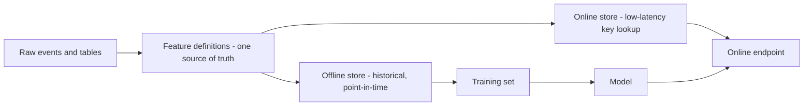
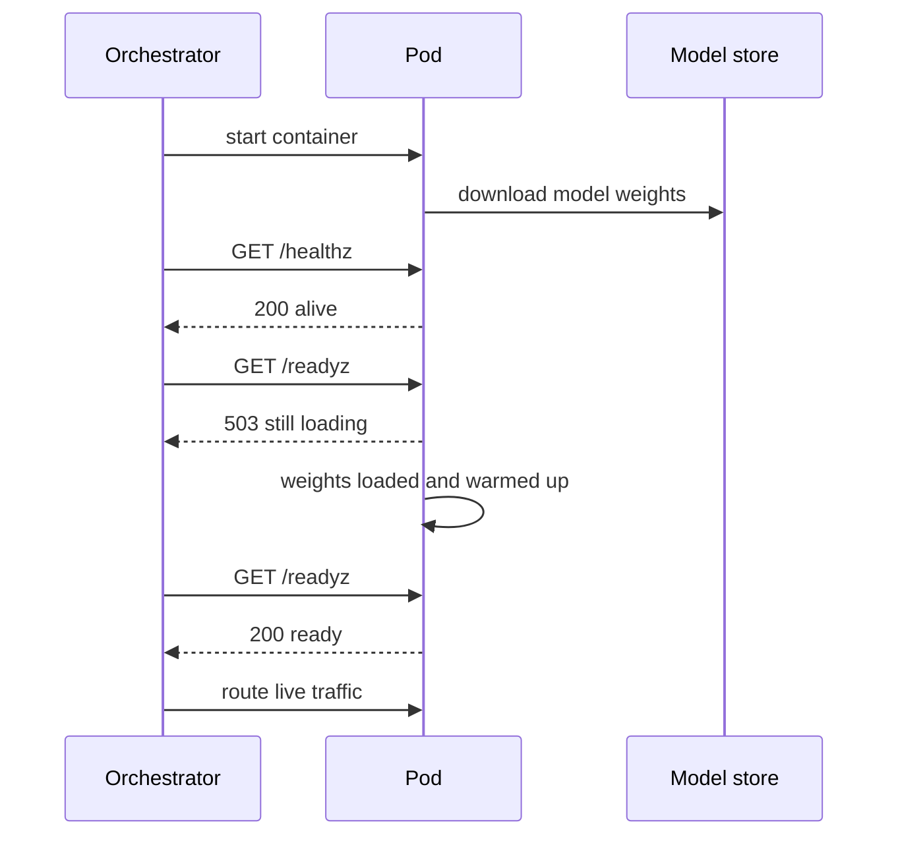

# From Notebook to Endpoint

A notebook proves a model *can* work. An endpoint proves it *keeps* working, for
other people's inputs, at 3 a.m., after the person who trained it has left. Almost
none of the work between the two is machine learning; it is software engineering with
two ML-specific hazards: state you did not know you depended on, and data that looks
the same but is not. Four parts:

- **Why notebooks break and the package refactor** — pure functions, config, seeds.
- **Training/serving skew** — the silent failure, and the feature-consistency fix.
- **Packaging and serving** — FastAPI, probes, batching, timeouts, and the Docker image.
- **Deployment patterns, CI/CD and latency budgets** — where it runs, how it ships,
  and how fast it must answer.

---

## 1.1 — Why Notebooks Break, and the Refactor into a Package

Notebooks are superb for exploration and poor as a production artifact, for concrete
reasons rather than taste:

- **Hidden state.** A cell's result depends on every cell executed *before it, in
  execution order*, not top-to-bottom order. Delete a cell and its variable still
  lives in the kernel. "Restart and run all" is the only honest test, and most
  notebooks fail it.
- **No tests, no review.** JSON diffs of outputs and cell counters make code review
  nearly useless, and cell code is not importable, so it cannot be unit tested.
- **Implicit environment.** `pip install` typed into a cell, a file read from a
  laptop path, a library version nobody recorded.
- **Unseeded randomness.** Shuffles, splits, initializations and dropout differ per
  run, so "AUC 0.91" is a sample, not a fact.

The fix is to move logic out of cells into a **package**, and keep the notebook as a
thin client that imports it. The governing rule is *pure functions at the core,
side effects at the edges*: a function takes data and parameters and returns a value,
touching no globals, files or clocks. Pure functions are trivially testable and
cacheable; I/O lives in a small outer layer.

```text
churn/
  pyproject.toml          # pinned deps, entry points
  conf/train.yaml         # all hyperparameters and paths, no magic numbers
  src/churn/
    config.py             # typed config (validated once, at the edge)
    features.py           # pure: raw dataframe -> feature matrix
    train.py              # orchestration: load -> fit -> evaluate -> save
    service.py            # FastAPI app (section 1.3)
  tests/
    test_features.py
    test_model_gate.py
  notebooks/explore.ipynb # imports churn.*, contains no logic worth keeping
```

```python
# src/churn/config.py -- configuration is data, validated once at the boundary
from pydantic import BaseModel, Field
import yaml

class TrainConfig(BaseModel):
    data_path: str
    seed: int = 1234
    test_fraction: float = Field(0.2, gt=0, lt=1)
    n_estimators: int = Field(300, ge=1)
    max_depth: int = Field(6, ge=1)

def load_config(path: str) -> TrainConfig:
    with open(path) as f:
        return TrainConfig(**yaml.safe_load(f))   # fails fast on a bad value
```

```python
# src/churn/features.py -- a PURE transform: same input -> same output, no I/O
import numpy as np
import pandas as pd

FEATURES = ["tenure_months", "monthly_spend", "support_tickets_90d", "plan_is_annual"]

def build_features(raw: pd.DataFrame) -> pd.DataFrame:
    out = pd.DataFrame(index=raw.index)
    out["tenure_months"] = raw["tenure_months"].clip(lower=0)
    out["monthly_spend"] = np.log1p(raw["monthly_spend"].clip(lower=0))  # tame the tail
    out["support_tickets_90d"] = raw["support_tickets_90d"].fillna(0)
    out["plan_is_annual"] = (raw["plan"] == "annual").astype(int)
    return out[FEATURES]                          # fixed column ORDER is part of the contract
```

```python
# src/churn/train.py -- the orchestration layer: seeds, splits, I/O live here
import json, random, subprocess
import joblib, numpy as np, pandas as pd
from sklearn.ensemble import GradientBoostingClassifier
from sklearn.metrics import roc_auc_score
from sklearn.model_selection import train_test_split
from churn.config import load_config
from churn.features import build_features

def set_seeds(seed: int) -> None:
    random.seed(seed); np.random.seed(seed)       # add torch.manual_seed etc. if used

def main(config_path: str = "conf/train.yaml") -> None:
    cfg = load_config(config_path)
    set_seeds(cfg.seed)
    raw = pd.read_parquet(cfg.data_path)
    X, y = build_features(raw), raw["churned"]
    X_tr, X_te, y_tr, y_te = train_test_split(
        X, y, test_size=cfg.test_fraction, random_state=cfg.seed, stratify=y)
    model = GradientBoostingClassifier(
        n_estimators=cfg.n_estimators, max_depth=cfg.max_depth, random_state=cfg.seed)
    model.fit(X_tr, y_tr)
    auc = roc_auc_score(y_te, model.predict_proba(X_te)[:, 1])
    joblib.dump(model, "artifacts/model.joblib")
    meta = {"auc": auc, "config": cfg.model_dump(),            # config travels WITH the model
            "git_sha": subprocess.check_output(["git", "rev-parse", "HEAD"]).decode().strip()}
    json.dump(meta, open("artifacts/meta.json", "w"), indent=2)
```

**Reproducibility** is a stack, and a seed is only its top layer: pin the *code*
(git SHA), the *config* (stored beside the model), the *data* (a snapshot id or
content hash; Module 2), the *environment* (a lockfile and a container image), and the
*randomness* (seeds). Even then, GPU kernels and parallel reductions can be
non-deterministic, so the practical goal is "reruns land within a tolerance", checked
by a test, not bitwise identity.

---

## 1.2 — Training/Serving Skew and the Feature-Consistency Problem

The most expensive production ML bug is not a crash; it is a model that returns
confident, plausible, *wrong* numbers. **Training/serving skew** is any systematic
difference between the features a model saw in training and those it receives in
serving. Offline metrics stay green because the offline pipeline is self-consistent;
the endpoint quietly degrades.

| Source of skew | Example |
| --- | --- |
| Duplicated logic | Pandas `fillna(0)` in training, a hand-ported `if x is None: 0.5` in the service |
| Different libraries / versions | Training scaler fit on one version; the service rounds differently |
| Time travel (label leakage) | Training joins a feature computed *after* the prediction moment |
| Stale or missing online features | Batch-computed nightly aggregate vs. a live value, or a null the training set never had |
| Different category handling | Unseen category index shifted a one-hot column |

The cure is a single rule: **one definition of each feature, executed by both paths.**
The package in 1.1 does this at the code level; `build_features` is imported by the
trainer *and* the service, so they cannot drift. Fitted state (a scaler's mean,
a vocabulary) must travel with the model, ideally inside one serialized pipeline:

```python
from sklearn.pipeline import Pipeline
from sklearn.preprocessing import StandardScaler
from sklearn.ensemble import GradientBoostingClassifier

# The scaler's fitted mean/std are saved WITH the classifier, so serving cannot
# re-fit or forget them. One artifact, one set of numbers.
pipe = Pipeline([("scale", StandardScaler()),
                 ("clf", GradientBoostingClassifier(random_state=1234))])
pipe.fit(X_tr, y_tr)
joblib.dump(pipe, "artifacts/model.joblib")
```

At larger scale the same idea becomes a **feature store**: a system that owns feature
definitions and serves them through two interfaces from one source of truth.



Its two key services are the **offline store** (large history; supports
*point-in-time correct* joins, so a training row at time $t$ only sees feature values
known at $t$, which prevents leakage) and the **online store** (a key-value lookup
such as Redis or DynamoDB, served in single-digit milliseconds, kept fresh by
materialization jobs). Feast, Tecton and the feature stores in cloud platforms
implement this. A feature store is not mandatory; a small team with a shared
`build_features` and a nightly batch job has solved most of the problem. Adopt one
when many models reuse features, or when you need fresh online aggregates.

The cheap, universal safeguard is a **skew test**: log the exact feature vectors the
service computes, replay the same raw rows through the training path, and assert the
two agree to tolerance.

---

## 1.3 — Packaging and Serving a Model Behind a Stable API

An endpoint is a contract: *this* JSON in, *that* JSON out, with errors you chose. The
model behind it can change weekly; the contract should not. FastAPI with pydantic
gives you validation, typed docs and async handling in little code.

```python
# src/churn/service.py
import asyncio, os
from contextlib import asynccontextmanager
import joblib, pandas as pd
from fastapi import FastAPI, HTTPException
from pydantic import BaseModel, Field
from churn.features import build_features

MODEL_PATH = os.environ.get("MODEL_PATH", "artifacts/model.joblib")  # injected, never hard-coded
state: dict = {"model": None}

class Customer(BaseModel):
    tenure_months: float = Field(..., ge=0, le=600)
    monthly_spend: float = Field(..., ge=0)
    support_tickets_90d: int | None = Field(None, ge=0)
    plan: str = Field(..., pattern="^(monthly|annual)$")

class Score(BaseModel):
    churn_probability: float
    model_version: str

@asynccontextmanager
async def lifespan(app: FastAPI):
    state["model"] = joblib.load(MODEL_PATH)       # load ONCE at startup, not per request
    state["version"] = os.environ.get("MODEL_VERSION", "dev")
    yield
    state["model"] = None

app = FastAPI(lifespan=lifespan)

@app.get("/healthz")                               # liveness: is the process alive?
def healthz():
    return {"status": "ok"}

@app.get("/readyz")                                # readiness: can it serve RIGHT NOW?
def readyz():
    if state["model"] is None:
        raise HTTPException(status_code=503, detail="model not loaded")
    return {"status": "ready", "model_version": state["version"]}

@app.post("/v1/score", response_model=Score)
async def score(c: Customer):
    df = build_features(pd.DataFrame([c.model_dump()]))
    # CPU-bound inference runs in a worker thread so the event loop keeps answering probes
    try:
        p = await asyncio.wait_for(
            asyncio.to_thread(lambda: float(state["model"].predict_proba(df)[0, 1])),
            timeout=0.25)                          # fail fast rather than queue forever
    except asyncio.TimeoutError:
        raise HTTPException(status_code=504, detail="inference timeout")
    return Score(churn_probability=p, model_version=state["version"])
```

Several decisions here are load-bearing:

- **Validation at the edge.** Pydantic rejects `tenure_months = -3` or an unknown
  `plan` with a 422 before the model sees it, turning garbage-in into a clear client
  error instead of a plausible wrong score. Bounds you choose here also document
  what the model was trained on.
- **Load at startup.** Deserializing a model can take seconds to minutes (large LLM
  weights, far longer). Doing it per request makes every call slow; doing it in
  `lifespan` pays once.
- **Liveness vs. readiness.** Liveness answers "restart me if false": it must not
  depend on the model or a downstream. Readiness answers "send me traffic?": false
  while loading or when a dependency is gone. Conflating them causes restart loops
  while a slow model loads, or traffic to pods that cannot answer.
- **Timeouts everywhere.** Without a deadline, a slow request holds a worker and a
  queue builds. Bounded latency plus a clear 504 lets callers retry elsewhere.
- **A versioned path and a `model_version` field**, so clients and monitors know what
  answered (Module 3 depends on this).

**Batching.** Matrix operations amortize overhead: scoring 32 rows costs far less
than 32 times one row, especially on a GPU. *Micro-batching* collects requests for a
few milliseconds, runs one batched call and fans the results back:

```python
import asyncio
from dataclasses import dataclass, field
from typing import Callable

@dataclass
class MicroBatcher:
    predict_batch: Callable            # list[row] -> list[float]
    max_batch: int = 32
    max_wait_ms: float = 8.0
    queue: asyncio.Queue = field(default_factory=asyncio.Queue)

    async def submit(self, row):
        fut = asyncio.get_running_loop().create_future()
        await self.queue.put((row, fut))
        return await fut

    async def run(self):               # started once as a background task
        loop = asyncio.get_running_loop()
        while True:
            row, fut = await self.queue.get()               # block for the first item
            rows, futs = [row], [fut]
            deadline = loop.time() + self.max_wait_ms / 1000
            while len(rows) < self.max_batch:
                timeout = deadline - loop.time()
                if timeout <= 0:
                    break
                try:
                    r, f = await asyncio.wait_for(self.queue.get(), timeout)
                    rows.append(r); futs.append(f)
                except asyncio.TimeoutError:
                    break
            results = await asyncio.to_thread(self.predict_batch, rows)
            for f, res in zip(futs, results):
                f.set_result(res)
```

The trade is explicit: `max_wait_ms` is latency you *add* to buy throughput. Tune it
against your latency budget (1.4). For LLMs, use an engine with continuous batching
(LLM Engineering, Module 2) rather than hand-rolling this.

### The container

The image is the unit you promote across environments. Build it so it is small,
reproducible and unprivileged.

```dockerfile
# ---- builder: has compilers and build caches; none of it ships ----
FROM python:3.11-slim AS builder
ENV PIP_NO_CACHE_DIR=1
WORKDIR /build
COPY requirements.lock .
# fully pinned (== versions, with hashes if possible)
RUN python -m venv /opt/venv && /opt/venv/bin/pip install -r requirements.lock
COPY pyproject.toml .
COPY src ./src
RUN /opt/venv/bin/pip install --no-deps .

# ---- runtime: only the venv and the artifact ----
FROM python:3.11-slim AS runtime
# never run as root
RUN useradd --create-home --uid 10001 appuser
COPY --from=builder /opt/venv /opt/venv
COPY --chown=appuser artifacts/model.joblib /models/model.joblib
ENV PATH="/opt/venv/bin:$PATH" MODEL_PATH=/models/model.joblib PYTHONUNBUFFERED=1
USER appuser
EXPOSE 8000
HEALTHCHECK CMD python -c "import urllib.request as u; u.urlopen('http://localhost:8000/healthz')"
CMD ["uvicorn", "churn.service:app", "--host", "0.0.0.0", "--port", "8000"]
```

Why each choice: **multi-stage** keeps compilers and caches out of the final image
(smaller, fewer CVEs, faster pulls); **pinned dependencies** make the build
repeatable (an unpinned `scikit-learn` that jumps a minor version can change model
behavior or fail to unpickle); **non-root** limits blast radius if the service is
compromised; **tag by immutable id** (git SHA or digest), never rely on `latest`.
Large model weights usually should *not* be baked into the image: pull them from an
artifact store at startup, which keeps images small and lets a model update ship
without a rebuild.



Include a **warm-up** inference in startup: the first call often triggers lazy
initialization (JIT compilation, CUDA context, allocator growth) and would otherwise
be the slowest request a real user ever sees.

---

## 1.4 — Deployment Patterns, CI/CD and Latency Budgets

### Choosing the serving mode

Start from the question *how fresh must the answer be, and who is waiting?*

| Pattern | Trigger | Latency | Best for | Cost shape |
| --- | --- | --- | --- | --- |
| **Batch** | Schedule (nightly) | Minutes to hours | Churn lists, precomputed recommendations, reporting | Cheap; spot/preemptible compute |
| **Online** | Request/response | Tens to hundreds of ms | Fraud checks, search ranking, chat | Always-on capacity, provisioned for peak |
| **Streaming** | Event arrives on a log | Sub-second, continuous | Anomaly detection, real-time features | Stateful consumers (Kafka/Flink) |

Prefer the *least* real-time mode that meets the need: a nightly batch that writes
scores to a table is dramatically simpler and cheaper to run than an online service,
and often indistinguishable to the user. Precomputing for known entities and serving
the lookup is a very common hybrid.

**Where to run.** Small CPU models (trees, linear, small embeddings) suit
containers on CPU or **serverless** functions: scale to zero and pay per invocation,
but accept **cold starts** (loading the model on the first request after idle), which
can reach seconds. Large neural and LLM workloads need **GPU pods**: they are costly,
slow to start (minutes to pull images and weights), and must be kept busy to be
worthwhile, which is why batching and autoscaling matter so much there.

**Autoscaling signal.** CPU utilization is a poor trigger for model servers: a GPU
service can be saturated while CPU looks idle. Scale on signals that track *waiting*:
**queue depth** or in-flight requests per replica, request latency (p95), or GPU
utilization. With target concurrency $c$ per replica and observed in-flight load $L$,
replicas needed are roughly:

$$
N = \left\lceil \frac{L}{c \cdot u} \right\rceil, \qquad u \approx 0.6\text{-}0.7 \text{ (headroom)}
$$

Because new replicas take time to become ready (1.3), scale up *eagerly* and scale
down slowly, keep a minimum replica count for latency-critical paths, and never let
the autoscaler outrun the readiness probe.

### CI/CD for ML

ML pipelines need three kinds of tests, not one, because three things can break:

| Layer | What it catches | Examples |
| --- | --- | --- |
| **Code** | Logic bugs | Unit tests for `build_features` edge cases (nulls, negatives); API tests via `TestClient` |
| **Data** | Bad inputs | Schema, null rate, value ranges, row count, label balance (Great Expectations, pandera) |
| **Model** | Regressions | Metric above a floor on a frozen eval set; no slice (region, plan) drops more than $\delta$; prediction invariants; skew test from 1.2 |

```python
# tests/test_model_gate.py -- a model-quality gate that runs in CI
import json, joblib, pandas as pd
from sklearn.metrics import roc_auc_score
from churn.features import build_features

def test_model_beats_floor():
    meta = json.load(open("artifacts/meta.json"))
    assert meta["auc"] >= 0.85, f"AUC {meta['auc']:.3f} below release floor"

def test_no_slice_collapses():
    model = joblib.load("artifacts/model.joblib")
    ev = pd.read_parquet("tests/data/frozen_eval.parquet")      # versioned, never regenerated
    for plan, g in ev.groupby("plan"):
        auc = roc_auc_score(g["churned"], model.predict_proba(build_features(g))[:, 1])
        assert auc >= 0.78, f"slice plan={plan} AUC {auc:.3f}"   # average can hide a broken slice
```

The pipeline ties these into a promotion path, and the last gate before traffic is a
**smoke test** against the *built container*, because "tests pass" and "the image
starts and answers" are different claims:

```yaml
# .github/workflows/ci.yaml
name: ci
on: { push: { branches: [main] }, pull_request: {} }
jobs:
  build-test-push:
    runs-on: ubuntu-latest
    permissions: { contents: read, packages: write }
    env:
      IMAGE: ghcr.io/${{ github.repository }}/churn:${{ github.sha }}
    steps:
      - uses: actions/checkout@v4
      - uses: actions/setup-python@v5
        with: { python-version: "3.11" }
      - run: pip install -r requirements.lock && pip install -e . pytest
      - run: pytest tests/ -q                       # code + data + model gates
      - name: Build image
        run: docker build -t "$IMAGE" .
      - name: Smoke test the container
        run: |
          docker run -d --name svc -p 8000:8000 "$IMAGE"
          for i in $(seq 1 30); do curl -sf localhost:8000/readyz && break || sleep 1; done
          curl -sf -X POST localhost:8000/v1/score -H 'content-type: application/json' \
            -d '{"tenure_months":14,"monthly_spend":42.5,"support_tickets_90d":1,"plan":"annual"}' \
            | python -c "import sys,json; p=json.load(sys.stdin)['churn_probability']; assert 0<=p<=1"
      - name: Push (main only)
        if: github.ref == 'refs/heads/main'
        run: |
          echo "${{ secrets.GITHUB_TOKEN }}" | docker login ghcr.io -u "${{ github.actor }}" --password-stdin
          docker push "$IMAGE"
```


Promote the *same image digest* from staging to production; rebuilding per
environment destroys the guarantee that what you tested is what you run. Canary
rollouts and rollback on a bad signal are the subject of Module 4.

### Latency budgets and percentile thinking

An average hides the experience that matters. If 99% of requests take 40 ms and 1%
take 2 s, the mean is about 60 ms and looks healthy, yet one user in a hundred waits
two seconds, and a page that makes 20 backend calls hits that tail on
$1 - 0.99^{20} \approx 18\%$ of page loads. **Tail amplification** is why you
reason in percentiles: p50 is the typical case, p95/p99 the experience of your
unluckiest users and the number SLOs are written against.

Work backwards from the user-facing target into a **budget** per stage:

| Stage | p50 | p99 budget |
| --- | --- | --- |
| Network and gateway | 5 ms | 20 ms |
| Validation + feature fetch (online store) | 8 ms | 30 ms |
| Micro-batch wait | 4 ms | 8 ms |
| Model inference | 15 ms | 60 ms |
| Serialization + response | 2 ms | 10 ms |
| **Total** | **34 ms** | **128 ms (target: 150 ms)** |

Percentiles do not add exactly (the p99 of a sum is not the sum of p99s), so the
table is a planning tool you then verify by load test, measuring end to end. Keep
the knobs honest: batching raises throughput but spends latency; a bigger model
raises quality but spends the budget; timeouts (1.3) cap the tail; and queueing
makes latency blow up *nonlinearly* as utilization approaches 100%, which is why
the headroom factor $u$ above exists. Measure with a load tool (`locust`, `k6`),
report histograms rather than means, and include cold starts separately.

---

## Key takeaways

- Notebooks fail on hidden state, no tests and unpinned randomness. Refactor to a
  package of **pure functions** with validated **config**, seeds and a lockfile; the
  notebook becomes a client of the package.
- **Training/serving skew** is the silent killer. Use a *single* feature definition
  executed by both paths, ship fitted state inside one artifact, use a feature store
  (offline point-in-time + online lookup) when reuse and freshness demand it, and
  test for skew by replay.
- Serve behind a **stable, validated contract**: load the model at startup, separate
  liveness from readiness, bound every call with a timeout, expose the model version,
  and micro-batch when throughput matters (accepting the added wait).
- Build **multi-stage, pinned, non-root** images, tag by SHA, warm up on start, and
  keep large weights out of the image.
- Pick the **least real-time** mode that works (batch, online, streaming); autoscale
  on **queue depth / latency**, not CPU; account for slow GPU startup.
- CI/CD needs **code, data and model tests** plus a **container smoke test**, then
  promotes one immutable image digest through environments.
- Think in **p50/p99 and budgets**: averages hide tails, tails amplify across calls,
  and queueing is nonlinear near saturation.

## Exercises

1. **Refactor and prove it.** Take a notebook that trains any sklearn model. Move
   feature logic into a pure `build_features`, add a pydantic config, seed everything,
   and write a test that trains twice and asserts the metric differs by less than a
   chosen tolerance. Then run "restart and run all" on the original notebook and
   list every hidden-state bug you find.

2. **Manufacture and catch skew.** Deliberately re-implement one feature differently
   in the service (e.g. fill nulls with the median instead of 0). Write the replay
   skew test from 1.2 and show it fails. Quantify how much the model's score
   distribution shifts, then fix it by importing the shared function.

3. **Probe the probes.** Run the service with a 20-second artificial model-load
   delay. Verify `/healthz` returns 200 immediately while `/readyz` returns 503, and
   that an orchestrator (docker compose with a healthcheck, or Kubernetes) sends no
   traffic until ready. Then break it by making liveness depend on the model and
   observe the restart loop.

4. **Budget and load-test.** Wire the micro-batcher into the service and load-test
   with `locust` or `k6` at several request rates for `max_wait_ms` of 0, 8 and 30.
   Plot throughput and p50/p99 for each, find the knee where p99 explodes, and
   write a one-paragraph latency budget defending the setting you would deploy.

## Next: Module 2 — Versioning Models, Data & Prompts

We can now ship one model reliably; Module 2 asks how to ship *many* without losing
track. Model registries and lineage, versioning datasets so a model can be traced to
the exact data that trained it, experiment tracking, and treating prompts and
LLM configurations as versioned, reviewable, testable artifacts, so that any answer
the endpoint ever gave can be reproduced and any release rolled back to a known state.
