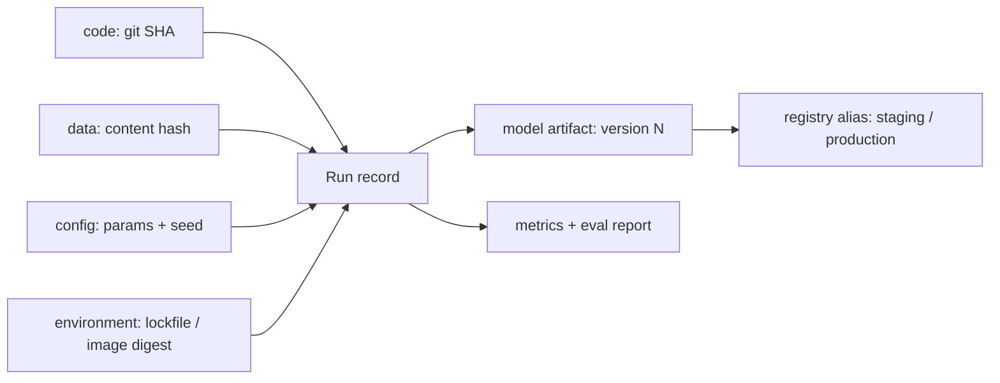
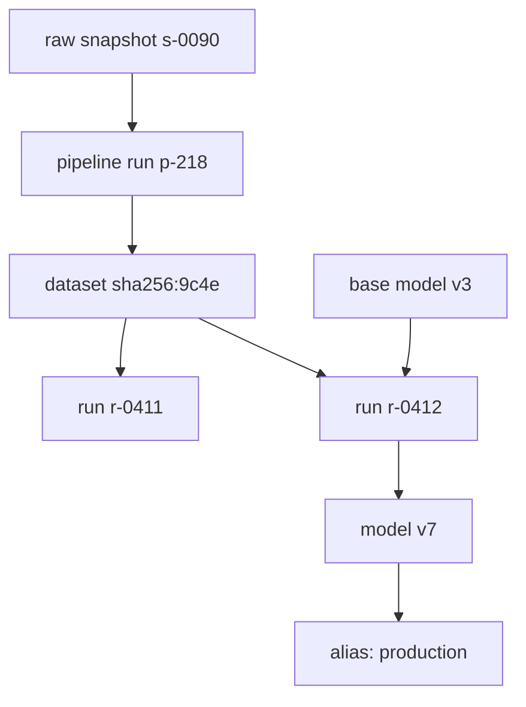

# Versioning Models, Data & Prompts

Module 1 got a model from a notebook to an endpoint. The moment that endpoint serves
real traffic, a new question arrives: *which* model is it, what was it trained on, and
can we get back to the one that worked yesterday? Software has a solved answer for
code: git. ML does not fit inside it, because the behavior of a deployed system is a
function of far more than source files. Four parts:

- **Why git is not enough** — a run is code x data x config x model.
- **Data versioning and experiment tracking** — content addressing, manifests, run records, lineage.
- **The model registry** — versions, aliases, model cards, promotion gates, reproducibility.
- **Prompts, configs and a mini-registry** — LLM-era artifacts, plus a worked implementation.

---

## 2.1 — Why ML Needs More Than Git

In ordinary software, `commit + build environment` determines the artifact. In ML the
artifact (a trained model) is the output of a **run**, and a run depends on four
independent axes:

$$
\text{model}_{v} = \text{train}\big(\underbrace{\text{code}}_{\text{git}},\ \underbrace{\text{data}}_{\text{TBs, mutable}},\ \underbrace{\text{config}}_{\text{hyperparams, seeds}},\ \underbrace{\text{environment}}_{\text{libs, hardware}}\big)
$$

Change *any* axis and you get a different model, usually with no diff in git to tell
you why. A teammate re-exports the training table, a library bumps a default, someone
edits a learning rate in a notebook cell: the code commit is identical and the
accuracy dropped two points. Git fails here for concrete reasons:

- **Size.** Git stores whole snapshots in a repository everyone clones; datasets and
  checkpoints are gigabytes to terabytes. They do not belong in it.
- **Mutability.** A path like `s3://bucket/train.parquet` is a *name*, not a version.
  The bytes behind it can be overwritten silently, so "the same data" is unverifiable.
- **Non-determinism.** Seeds, GPU kernels, data-loader order and floating-point
  reduction order mean even identical inputs may give different weights.
- **Many-to-many lineage.** One dataset feeds many models; one model descends from a
  base model plus a fine-tuning set. Git history is a line, lineage is a graph.

The unifying principle for the whole module is: **every artifact gets an immutable
identity derived from its content, and every run records the identities of all its
inputs.** Names (`production`, `latest`) are *pointers* that move; identities (hashes,
version numbers) never do. With that, "reproduce last Tuesday's model" becomes a lookup.



LLM applications add two more axes that behave exactly like the first four: the
**prompt** (a program written in English that changes behavior as much as weights do)
and the **model identifier** (a hosted `provider/model-2026-xx` snapshot, or your own
fine-tuned checkpoint). Section 2.4 treats them the same way.

---

## 2.2 — Data Versioning & Experiment Tracking

### Content-addressed storage

The core trick is **content addressing**: name a blob by the hash of its bytes. Two
identical files share one address, any change produces a new address, and a hash
mismatch proves corruption or tampering. This is the same idea git uses internally for
objects, extended to large files stored in object storage.

$$
\text{address}(b) = \text{SHA-256}(b), \qquad \text{address}(b) = \text{address}(b') \iff b = b' \text{ (up to collision, } \approx 2^{-128}\text{)}
$$

**DVC** (Data Version Control) is the canonical git-companion for this. You run
`dvc add data/train.parquet`; DVC hashes the file, moves the bytes into a content-
addressed cache, uploads to a remote (S3, GCS, Azure), and writes a tiny pointer file
that *is* committed to git:

```yaml
# data/train.parquet.dvc  (committed to git; the 2 GB file itself is not)
outs:
  - md5: 3f2a9c1d7b64e0a85d1c9f4e2b7a6d30   # content hash = the dataset's identity
    size: 2147483648
    path: train.parquet
```

```shell
dvc add data/train.parquet            # hash, cache, write the .dvc pointer
git add data/train.parquet.dvc data/.gitignore
git commit -m "data: train set v3 (dedup + label fixes)"
dvc remote add -d store s3://acme-ml-data/dvc
dvc push                              # upload content-addressed blobs
# later, on any machine:
git checkout a1b2c3d && dvc checkout  # code AND data revert together
```

Now a git commit pins code *and* the exact data hash, so `git checkout` plus
`dvc checkout` time-travels both. For multi-file datasets, DVC hashes a directory by
hashing a manifest of its members' hashes (a Merkle-style tree), so adding one file
changes only the root hash and the new blob.

### Dataset manifests

For datasets that are not a single file (image folders, sharded parquet, a SQL query
result), record a **manifest**: an ordered list of `(path, sha256, rows)` plus the
manifest's own hash. The manifest is the dataset's version; it is small enough to log
on every run, and verifying it detects a swapped or truncated shard.


### Branching data: the lakeFS idea

Copying a 10 TB lake to experiment is absurd. **lakeFS**-style systems give an object
store git semantics: *branches*, *commits*, and *merges* over metadata pointers, with
**zero-copy** branching because commits reference the same immutable objects and only
diverge in what they point to. A data scientist branches `main` to `exp/dedup-v2`,
rewrites partitions there, trains against that branch, and either merges or discards
it; production keeps reading `main`, untouched. Delta Lake and Iceberg provide a
related primitive, **time travel** (`VERSION AS OF 42`), for tables. The common
thread: data reads must name an immutable snapshot, never "whatever is there now".

### Experiment tracking

Hashing the inputs is half the job; you also need a durable record of each attempt.
Tools like **MLflow** and **Weights & Biases** (and Neptune, Aim, Comet) all model a
**run** the same way:

| Field | Contents | Example |
| --- | --- | --- |
| Params | scalar inputs, logged once | `lr=3e-4`, `max_depth=8`, `seed=17` |
| Metrics | numbers, logged over time (step-indexed) | `val_auc=0.912`, `loss` curve |
| Artifacts | files produced or consumed | model weights, confusion matrix PNG, eval report |
| Tags / source | provenance | git SHA, dirty-tree flag, user, host, image digest |
| Inputs / lineage | which dataset & parent run | `dataset_id=sha256:9c4e...`, `parent_run=r-0412` |


**Lineage** is what turns a pile of runs into an audit trail: model `v7` came from run
`r-0412`, which read dataset `sha256:9c4e...`, which was produced by pipeline run
`p-218` from raw snapshot `s-0090`. When a data bug is discovered upstream, lineage
answers "which deployed models are contaminated?" with a graph query instead of
archaeology. Two habits matter more than any tool: log the **dirty-tree flag**
(uncommitted changes make the git SHA a lie), and log the **seed and environment**,
because a run without them cannot be repeated.



---

## 2.3 — The Model Registry

Experiment tracking records *attempts*; the **model registry** is the curated, governed
list of the models that might actually ship. It is the contract between the people who
train models and the systems (and humans) that deploy them. Its three ideas:

**Immutable versions.** Registering a model creates `name@version` (1, 2, 3, ...)
bound to a specific run and artifact URI. A version never changes; if you retrain, that
is version 4. This is what makes rollback safe: version 6 is still byte-identical.

**Mutable aliases (or stages).** Deployment code should never hard-code version
numbers; it asks for `models:/churn@production`. An **alias** is a movable pointer to a
version. Promoting is moving the pointer; rolling back is moving it back. MLflow
historically used fixed *stages* (`Staging`, `Production`, `Archived`) and now
recommends free-form **aliases** (`champion`, `challenger`, `production`) plus tags,
because real organizations need more than three lifecycle states and per-region
pointers (`production-eu`).

**Metadata.** Each version carries a **model card**: intended use and out-of-scope use,
training data identity, evaluation results per slice (not just overall), known
limitations, fairness checks, owner, and the exact run for lineage. A model without a
card is an unreviewable binary.

### Promotion gates

Moving an alias is the consequential act, so it is guarded by **gates**: automated
checks that must pass, plus an approval for high-risk models.

| Gate | Check | Blocks promotion when |
| --- | --- | --- |
| Reproducibility | re-train from recorded inputs, compare metrics | metric differs beyond tolerance |
| Quality | candidate vs. current production on a frozen eval set | candidate worse by more than a margin |
| Slice / fairness | metrics per segment, not just aggregate | any protected slice regresses |
| Contract | input/output schema and latency on a smoke test | schema mismatch, p95 too slow |
| Provenance | card complete, data hash present, license cleared | any required field missing |
| Approval | named human sign-off | missing for high-risk tier |

A promotion rule worth writing down as math, because "better" must be defined before
you look at results. Promote the candidate $c$ over the champion $p$ only if its
improvement is both material and statistically credible:

$$
\Delta = \text{metric}(c) - \text{metric}(p) \ \ge\ \delta_{\min}
\quad\text{and}\quad
\text{CI}_{95\%}(\Delta)\ \text{lower bound} > 0
$$

where the confidence interval comes from bootstrapping the shared eval set. This stops
the classic failure of shipping a "+0.1%" improvement that is pure noise.

### Reproducibility checks

"Reproducible" has levels, and a registry should state which one a model meets:

1. **Re-runnable**: code, data hash, config, environment are all recorded.
2. **Reproducible within tolerance**: re-training yields metrics within a noise band
   (typical for GPU training, where bit-exact equality is not expected).
3. **Bit-exact**: deterministic kernels and fixed seeds give identical weights (cheap
   for classical models, expensive and often unrealistic for large neural nets).

A pragmatic gate is level 2: re-train in CI from the recorded inputs a few times,
estimate the seed-to-seed standard deviation $\sigma$, and fail if the registered
metric lies more than about $3\sigma$ from the re-run mean. That also gives you the
noise floor that $\delta_{\min}$ in the rule above must exceed.

---

## 2.4 — Prompts, Configs & a Worked Mini-Registry

### Prompts are artifacts

For an LLM application, the prompt template, the few-shot examples, the tool schemas,
the sampling parameters and the model identifier together *are* the model, in the
sense of 2.1: changing a sentence changes outputs as surely as changing weights. Yet
prompts are routinely pasted into code as string literals and edited in production
dashboards with no history. Treat them as first-class versioned artifacts:

- **Prompt registry.** Store templates outside application code (git-backed files or a
  registry service such as MLflow's prompt registry, LangSmith or Langfuse prompt
  management). Each save creates an immutable version with a content hash; the app
  fetches `support-triage@production` at runtime or build time.
- **Templates with declared variables.** `"Summarize {{ticket}} in {{tone}}"` plus a
  declared variable schema, so a missing variable fails at load, not in a customer's
  face.
- **Semantic versioning, adapted.** Apply SemVer to the *contract*: a **patch** is a
  wording fix that should not change behavior (still re-evaluated); a **minor** adds an
  optional variable or example; a **major** changes the output format or variable
  schema and so breaks downstream parsers. Parsers depend on the major number.
- **Prompt/model pairing.** A prompt is tuned against one model snapshot. Record the
  pair `(prompt_version, model_id, sampling_params)` as a single deployable unit;
  upgrading the model without re-evaluating the prompt is an unversioned change. Pin
  dated model snapshots, not floating aliases like `latest`.
- **Eval-gated promotion.** The gate from 2.3 applies unchanged: run the candidate
  prompt over a frozen golden set (plus regression cases from past incidents) scored by
  exact-match, rubrics or an LLM judge, and only then move the alias.

### Config and feature flags

Thresholds, retrieval top-k, routing rules, retry budgets and kill switches are the
fifth axis. Keep them in versioned config (a git-managed YAML, reviewed like code), and
use **feature flags** to decouple *deploying* a new model/prompt from *releasing* it:
a flag routes 1% of traffic to the candidate, then 10%, then 100%, and flipping it off
is the fastest rollback you have, with no redeploy. Flags need owners and expiry dates
or they become permanent dead branches.


A **rollback target** is a complete, known-good, *previously
shipped* release tuple recorded *before* you promote. Rolling back only the prompt
while the model moved on is not a rollback to a known state. Module 4 builds the
automation around this; the versioning discipline is what makes it possible.

### Putting it together: a Python mini-registry

The following is a deliberately small, dependency-free registry that implements the
module's principles: content-addressed immutable versions, movable aliases, gated
promotion with a recorded audit trail, and one-step rollback. It works for model
artifacts and prompts alike, since both are "bytes plus metadata".

```python
from __future__ import annotations
import hashlib, json, time
from dataclasses import dataclass, field

@dataclass(frozen=True)
class Version:
    name: str
    number: int                  # immutable, monotonically increasing per name
    content_hash: str            # sha256 of the artifact bytes
    uri: str                     # where the bytes live (blob store path)
    metadata: dict               # run_id, dataset_id, git_sha, model card fields
    metrics: dict                # frozen eval results at registration time

@dataclass
class Registry:
    versions: dict[str, list[Version]] = field(default_factory=dict)
    aliases: dict[tuple[str, str], int] = field(default_factory=dict)   # (name, alias)->number
    history: dict[tuple[str, str], list[int]] = field(default_factory=dict)
    audit: list[dict] = field(default_factory=list)

    def register(self, name: str, payload: bytes, uri: str, metadata: dict, metrics: dict) -> Version:
        digest = hashlib.sha256(payload).hexdigest()
        existing = self.versions.setdefault(name, [])
        for v in existing:                                   # idempotent: same bytes, same version
            if v.content_hash == digest:
                return v
        required = {"run_id", "dataset_id", "git_sha"}       # provenance gate at registration
        if missing := required - metadata.keys():
            raise ValueError(f"missing provenance fields: {sorted(missing)}")
        v = Version(name, len(existing) + 1, digest, uri, dict(metadata), dict(metrics))
        existing.append(v)
        return v

    def resolve(self, name: str, alias: str) -> Version:
        return self.versions[name][self.aliases[(name, alias)] - 1]

    def promote(self, name: str, number: int, alias: str, *, gates: list, actor: str) -> None:
        cand = self.versions[name][number - 1]
        current = self.aliases.get((name, alias))
        champion = self.versions[name][current - 1] if current else None
        failures = [msg for gate in gates if (msg := gate(cand, champion))]   # gate -> None or reason
        self.audit.append({"ts": time.time(), "actor": actor, "name": name, "alias": alias,
                           "candidate": number, "champion": current,
                           "result": "blocked" if failures else "promoted", "failures": failures})
        if failures:
            raise PermissionError("; ".join(failures))
        self.history.setdefault((name, alias), []).append(current or 0)   # remember rollback target
        self.aliases[(name, alias)] = number

    def rollback(self, name: str, alias: str, *, actor: str) -> int:
        stack = self.history.get((name, alias), [])
        if not stack or stack[-1] == 0:
            raise LookupError("no previous version to roll back to")
        previous = stack.pop()
        self.audit.append({"ts": time.time(), "actor": actor, "name": name, "alias": alias,
                           "candidate": previous, "champion": self.aliases[(name, alias)],
                           "result": "rolled_back", "failures": []})
        self.aliases[(name, alias)] = previous
        return previous

# --- gates: each returns None on pass, or a human-readable failure reason ---
def min_improvement(metric: str, delta_min: float):
    def gate(cand: Version, champ: Version | None):
        if champ is None:
            return None                                       # first promotion: nothing to beat
        gain = cand.metrics[metric] - champ.metrics[metric]
        return None if gain >= delta_min else f"{metric} gain {gain:+.4f} < required {delta_min}"
    return gate

def has_model_card(cand: Version, champ: Version | None):
    need = {"intended_use", "limitations", "eval_slices"}
    gap = need - cand.metadata.keys()
    return f"model card incomplete: {sorted(gap)}" if gap else None

# --- usage ---
reg = Registry()
meta = {"run_id": "r-0412", "dataset_id": "sha256:9c4e", "git_sha": "a1b2c3d",
        "intended_use": "churn scoring", "limitations": "new users", "eval_slices": ["region"]}
v1 = reg.register("churn", b"weights-v1", "s3://models/churn/1", meta, {"val_auc": 0.901})
v2 = reg.register("churn", b"weights-v2", "s3://models/churn/2", meta, {"val_auc": 0.913})
gates = [has_model_card, min_improvement("val_auc", 0.005)]
reg.promote("churn", 1, "production", gates=gates, actor="ci")
reg.promote("churn", 2, "production", gates=gates, actor="ci")     # +0.012 >= 0.005, passes
print(reg.resolve("churn", "production").number)                   # 2
print(reg.rollback("churn", "production", actor="oncall"))         # 1, one pointer move
```

Walk through what this enforces. `register` is **idempotent by content**: uploading
identical bytes twice cannot mint a phantom new version, and it refuses artifacts with
no lineage. `promote` never mutates a version; it only moves a pointer, after every
gate has produced a verdict, and it writes the audit record *before* acting so even
blocked attempts are traceable. `rollback` is a pointer move to the recorded previous
target, which is why it is fast and safe: nothing is rebuilt. A production registry
adds persistence, concurrency control (compare-and-swap on the alias), signed
artifacts and access control, but the shape is identical to MLflow's, and a prompt
registry is this same class with `payload` set to the template text.

---

## Key takeaways

- A model is the product of **code x data x config x environment** (plus prompt and
  model id for LLM apps). Git versions only the first; the rest need explicit,
  immutable identities or the run is unrepeatable.
- **Content addressing** (SHA-256 of bytes) gives data tamper-evident, deduplicated
  versions. DVC commits a small hash pointer to git; manifests version multi-file
  datasets; lakeFS/Delta/Iceberg add zero-copy branches and time travel.
- **Experiment tracking** stores params, step-indexed metrics, artifacts and tags per
  run, including the git SHA with a dirty flag, dataset hash, seed and environment.
  **Lineage** turns runs into a graph you can query when upstream data is found bad.
- The **registry** separates immutable **versions** from movable **aliases**. Deploy
  code resolves `name@production`; promotion and rollback are pointer moves.
- **Promotion gates** (reproducibility, quality with a confidence interval, slices,
  contract, provenance, approval) define "better" before results are seen. A model
  **card** makes the artifact reviewable.
- **Prompts are programs.** Version them with content hashes and SemVer on the output
  contract, pair them with a pinned model snapshot, and promote only through an eval
  gate. **Feature flags** separate deploy from release; record a complete **rollback
  target** tuple before every promotion.

## Exercises

1. **Hash a dataset.** Build a manifest for a folder of at least 20 files with
   `build_manifest`. Change one byte in one file, rebuild, and show only that file's hash
   and the `dataset_id` change. Then add a verify function that re-hashes on load and
   raises on mismatch, and use it to catch a deliberately truncated shard.

2. **Track and reproduce.** Train a scikit-learn model with MLflow logging params, the
   dataset manifest, git SHA, dirty flag and seed. In a fresh environment, re-run purely
   from the logged record five times, measure the metric's standard deviation, and check
   the original lies within $3\sigma$. Report which axis you found hardest to pin.

3. **Extend the mini-registry.** Add a bootstrap-CI gate implementing
   $\text{CI}_{95\%}(\Delta)$ lower bound $> 0$ over per-example eval scores, a
   `compare_and_swap` guard so two concurrent promotions cannot both succeed, and JSON
   persistence. Write tests that cover a blocked promotion, an idempotent re-register,
   and a rollback after two promotions.

4. **Version a prompt.** Store a support-triage prompt as `1.0.0` with declared
   variables and a 30-case golden set. Make a "harmless" rewording as `1.0.1`, evaluate
   both, and record the score change. Then change the output from prose to JSON as
   `2.0.0`, show which downstream parser breaks, and write the release YAML with a
   pinned model snapshot and a rollback target.

## Next: Module 3 — Monitoring What Matters

Versioning tells you exactly what is running; it cannot tell you whether it is still
working. Module 3 turns to production monitoring: the golden signals for ML services
(latency, errors, saturation, cost), data and prediction quality metrics, delayed ground
truth and proxy metrics, LLM-specific signals such as token usage, refusal and
hallucination rates, and how to build dashboards and alerts that catch real regressions
without drowning the on-call in noise.
