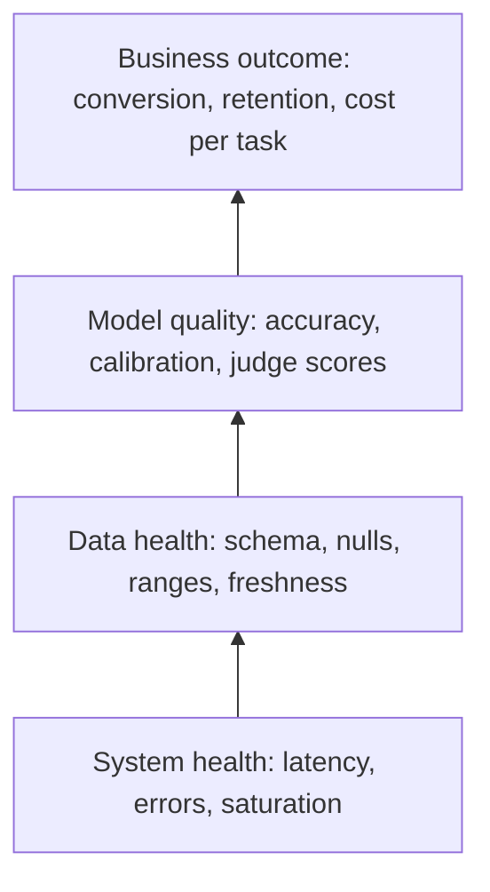
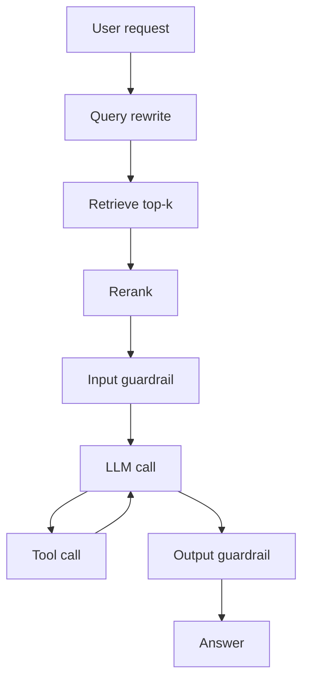

# Monitoring What Matters

Module 2 made every artifact reproducible: model, data, and prompt are versioned.
Now the thing is live, and the hardest property of ML systems shows up: they fail
*silently*. A crashed service returns a 500 and everyone knows. A model fed
shifted data returns a confident 200 with a worse answer, and nothing in your
infrastructure dashboard turns red. Monitoring for ML is the discipline of making
silent failure loud, without drowning the on-call engineer in noise. Four parts:

- **The pyramid and the SRE core** — golden signals, SLOs, error budgets, and percentiles.
- **The three pillars** — structured logs, Prometheus metrics, and traces, in a worked FastAPI service.
- **ML and LLM signals** — distributions, delayed labels, proxy metrics, tokens, cost, judges.
- **Alerts and dashboards** — paging on symptoms, runbooks, and avoiding alert fatigue.

---

## 3.1 — The Monitoring Pyramid & the SRE Core

Monitor in layers. Each layer catches failures the one below it cannot see, and
each is more valuable and harder to measure than the one beneath.



| Layer | Example question | Signal latency | Typical tool |
| --- | --- | --- | --- |
| System | Is the endpoint up and fast? | seconds | Prometheus, Grafana |
| Data | Are inputs shaped like training data? | minutes | validation checks, feature stats |
| Model | Are predictions still correct? | hours to weeks (labels lag) | offline eval on logged data, judges |
| Business | Did the product goal move? | days to months | product analytics, A/B tests |

A healthy dashboard for layer one with a collapsing layer four is the classic ML
incident. Build bottom-up so you can localize, but *alert* as high up the pyramid
as the signal allows.

### The four golden signals, RED, and USE

Google's SRE book names four signals for any user-facing service: **latency**
(of successes and of errors separately, since fast errors flatter the average),
**traffic** (requests per second), **errors** (explicit 5xx, implicit wrong
content, and policy violations like "latency over 1 s counts as an error"), and
**saturation** (how full the most constrained resource is). Two mnemonics
specialize this:

- **RED** (Rate, Errors, Duration) for *request-driven services*: every endpoint
  gets these three. This is your model-serving API.
- **USE** (Utilization, Saturation, Errors) for *resources*: GPU, CPU, memory,
  connection pools, queues. For a GPU server watch GPU utilization, KV-cache
  occupancy or batch-queue depth (saturation), and OOM or CUDA errors.

### SLIs, SLOs, and error budgets

A **Service Level Indicator** is a measured ratio of good events to valid events.
A **Service Level Objective** is the target for that ratio over a window.
Example: SLI = fraction of `/predict` requests that return 2xx in under 300 ms;
SLO = 99.5% over 30 days. The remainder is the **error budget**:

$$
\text{budget} = 1 - \text{SLO}, \qquad \text{30 days at } 99.9\% \Rightarrow 0.001 \times 43{,}200\ \text{min} = 43.2\ \text{min of badness}
$$

The budget turns reliability from an argument into arithmetic: while budget
remains, ship features; when it is spent, freeze risky launches and fix
reliability. The actionable quantity is the **burn rate**, how fast you consume
budget relative to a steady spend that would end exactly at the window's end:

$$
\text{burn rate} = \frac{\text{observed error rate}}{1 - \text{SLO}}
$$

A burn rate of 1 exhausts the budget exactly at day 30; a burn rate of 14.4
sustained for one hour consumes $14.4 \times 1\text{ h} / 720\text{ h} = 2\%$ of
a 30-day budget. The standard multi-window recipe pages when *both* a long and a
short window burn fast (for example, 1 h and 5 min at 14.4x), which catches real
incidents quickly while the short window makes the alert reset promptly after a fix.

### Why averages lie: percentiles and histogram math

Suppose 99% of requests take 50 ms and 1% take 5,000 ms (a cold cache, a retry,
a long generation). The mean is

$$
\bar{x} = 0.99 \times 50 + 0.01 \times 5000 = 99.5\ \text{ms}
$$

which looks fine, while one user in a hundred waits 100x longer than typical.
Worse, tails *compound under fan-out*: if a page issues $n$ independent calls
each with a 1% chance of being slow, the chance at least one is slow is

$$
P(\text{slow page}) = 1 - 0.99^{n}, \qquad n = 100 \Rightarrow 63\%
$$

so a "rare" p99 becomes the common experience. Track **p50, p95, p99** (and p99.9
for high-traffic paths). You also cannot average percentiles across instances;
the p99 of the fleet is not the mean of each pod's p99. That is why Prometheus
exports **cumulative histogram buckets** that *can* be summed across instances,
and estimates a quantile at query time by linear interpolation inside the bucket
containing the target rank. If the target rank $q \cdot N$ falls in bucket
$(l, u]$ with $c_{\text{below}}$ observations below it and $c_{\text{in}}$ inside:

$$
\hat{x}_q \approx l + (u - l)\cdot \frac{qN - c_{\text{below}}}{c_{\text{in}}}
$$

The error is bounded by bucket width, so choose bucket boundaries around your SLO
threshold (a 300 ms SLO needs a bucket edge at exactly 0.3 s). Quantile estimates
from a coarse bucket at the tail are only as good as that bucket's resolution.

```python
from bisect import bisect_left

def histogram_quantile(q, bounds, cumulative_counts):
    """Estimate the q-quantile from cumulative bucket counts, the way Prometheus does.
    bounds: ascending upper edges, e.g. [0.05, 0.1, 0.3, 1.0, 5.0]
    cumulative_counts: count of observations <= each edge (same length as bounds)."""
    total = cumulative_counts[-1]
    rank = q * total                                   # the observation we want
    i = bisect_left(cumulative_counts, rank)           # first bucket whose cumulative >= rank
    lower = bounds[i - 1] if i > 0 else 0.0
    below = cumulative_counts[i - 1] if i > 0 else 0
    in_bucket = cumulative_counts[i] - below
    # Linear interpolation assumes observations are uniform inside the bucket
    return lower + (bounds[i] - lower) * (rank - below) / in_bucket

# 1000 requests: 940 under 50ms, 50 in (50,100], 8 in (0.1,0.3], 2 in (0.3,1.0]
print(histogram_quantile(0.99, [0.05, 0.1, 0.3, 1.0], [940, 990, 998, 1000]))  # ~0.2 s
```

---

## 3.2 — The Three Pillars: Logs, Metrics, Traces

Observability is the ability to answer *new* questions about a running system
without shipping new code. Three complementary signal types do it, and each
answers a different question.

| Pillar | Answers | Cost | Cardinality tolerance |
| --- | --- | --- | --- |
| Metrics | "Is something wrong, and how much?" | cheap, aggregated | low (labels must be bounded) |
| Logs | "What exactly happened to this request?" | expensive per event | high |
| Traces | "Where did the time go across components?" | medium, usually sampled | high |

**Structured logging.** Emit one JSON object per event, never a prose sentence you
must regex later. Every line carries a `request_id` (and `trace_id`) so the three
pillars join, plus the model and prompt version from Module 2, which turns
"quality dropped Tuesday" into "quality dropped when `prompt_v14` rolled out."
Never log raw PII or full prompts by default; log hashes, lengths, and a sampled,
redacted payload.

**Metrics.** Prometheus has three workhorse types. A **counter** only increases
(requests, errors, tokens); you graph its `rate()`. A **gauge** goes up and down
(in-flight requests, queue depth, GPU memory). A **histogram** buckets observations
(latency, tokens per request) so quantiles can be computed fleet-wide. The cardinal
sin is **label cardinality**: every unique label combination is a separate time
series, so never label by `user_id`, `request_id`, or raw prompt. Labels like
`model_version`, `endpoint`, and `status` are bounded and safe.

**Distributed tracing.** A trace is a tree of **spans**, each with a start, a duration, and attributes, linked by a propagated trace context (the W3C `traceparent` header). For ML pipelines, spans turn "predict is slow" into a waterfall showing the feature fetch took 180 ms of 220.

### A small instrumented FastAPI service

```python
import json, logging, time, uuid
from contextlib import contextmanager
from fastapi import FastAPI, Request
from prometheus_client import Counter, Gauge, Histogram, generate_latest, CONTENT_TYPE_LATEST
from starlette.responses import Response
from opentelemetry import trace

tracer = trace.get_tracer("predict-service")        # no-op unless an SDK/exporter is configured
MODEL_VERSION = "churn-2.3.1"                       # comes from the registry (Module 2)

# ---- Metrics: bounded labels only. Bucket edge at 0.3 aligns with the 300 ms SLO. ----
REQS = Counter("predict_requests_total", "Requests", ["endpoint", "status", "model_version"])
LATENCY = Histogram("predict_latency_seconds", "End-to-end latency", ["endpoint"],
                    buckets=(0.025, 0.05, 0.1, 0.2, 0.3, 0.5, 1.0, 2.5))
INFLIGHT = Gauge("predict_inflight_requests", "Requests currently being served")
SCORE = Histogram("prediction_score", "Distribution of model output",
                  buckets=[i / 10 for i in range(1, 11)])          # ML signal, not just system
NULLS = Counter("input_null_total", "Null feature values seen", ["feature"])

# ---- Structured logging: one JSON object per line ----
logger = logging.getLogger("predict")
logging.basicConfig(level=logging.INFO, format="%(message)s")
def log_event(**fields):
    logger.info(json.dumps({"ts": time.time(), "model_version": MODEL_VERSION, **fields}))

app = FastAPI()

@contextmanager
def timed_span(name):
    """A trace span plus nothing else; metrics for sub-steps could hook in here too."""
    with tracer.start_as_current_span(name) as span:
        yield span

@app.middleware("http")
async def observe(request: Request, call_next):
    request_id = request.headers.get("x-request-id", str(uuid.uuid4()))
    INFLIGHT.inc()
    start = time.perf_counter()
    status = "500"                                   # default so a raised exception is counted
    try:
        response = await call_next(request)
        status = str(response.status_code)
        response.headers["x-request-id"] = request_id
        return response
    finally:
        elapsed = time.perf_counter() - start
        INFLIGHT.dec()
        endpoint = request.scope.get("route").path if request.scope.get("route") else "unknown"
        LATENCY.labels(endpoint).observe(elapsed)
        REQS.labels(endpoint, status, MODEL_VERSION).inc()
        log_event(event="request", request_id=request_id, endpoint=endpoint,
                  status=int(status), latency_ms=round(elapsed * 1000, 1))

@app.post("/predict")
async def predict(payload: dict):
    with timed_span("preprocess"):
        for name, value in payload.items():
            if value is None:
                NULLS.labels(name).inc()             # data-health signal at the edge
        features = [v if v is not None else 0.0 for v in payload.values()]
    with timed_span("model_infer") as span:
        score = min(1.0, max(0.0, sum(features) / (len(features) or 1)))   # stand-in model
        span.set_attribute("model.version", MODEL_VERSION)
    SCORE.observe(score)                              # feeds prediction-distribution dashboards
    return {"score": score, "model_version": MODEL_VERSION}

@app.get("/metrics")
def metrics():
    return Response(generate_latest(), media_type=CONTENT_TYPE_LATEST)
```

The alert rules in 3.4 consume these series; an SLI is just a PromQL ratio such as `sum(rate(predict_requests_total{status=~"5.."}[5m])) / sum(rate(predict_requests_total[5m]))`.

---

## 3.3 — ML-Specific Signals & LLM Telemetry

Infrastructure signals say the model *ran*. ML signals say whether it was *right*.

### Classical models

**Input data health.** Check at the serving edge what training-time validation
checked: schema and dtypes, **null rate per feature**, value ranges, categorical
cardinality (a new, unseen category), and freshness of upstream tables. A feature
whose null rate jumps from 0.2% to 30% is almost always an upstream pipeline bug
and is the cheapest high-precision ML alert you can write.

**Prediction distributions.** Without labels you can still watch what the model
*outputs*. Track the histogram of scores, the predicted class mix, and the mean
score. A fraud model whose positive rate halves overnight has either found
something or broken; either way a human should look. Comparing this live
distribution to a reference is exactly the drift detection of Module 4.

**Delayed ground truth.** The true label often arrives late: a loan default after
months, churn after a billing cycle, a click within seconds. Design for it: log
every prediction with a `prediction_id` and features, then **join labels when they
land** and compute accuracy, precision/recall, calibration, or AUC on that
matured cohort. Always report quality *by prediction date*, not label date, and
state the label lag, so "last week's AUC" is not silently measuring two-month-old
predictions.

**Proxy metrics.** While waiting, use fast correlates of quality: user override or
rejection rate, fallback-to-rules rate, downstream conversion, retry or
re-query rate, and calibration against early partial labels. Proxies are
noisy and can mislead, so validate each against the true metric once labels
mature, and never let a proxy replace it.

### LLM applications

LLM systems add costs and failure modes that classical monitoring lacks. Every
request has variable length, variable price, and non-deterministic output, and no
label at all. Instrument these:

| Signal | Why it matters | Notes |
| --- | --- | --- |
| Input / output tokens | drives cost and latency | histogram, split by model and route |
| Cost per request | budget and anomaly detection | tokens x price, labeled by feature, not by user |
| Time to first token (TTFT) | perceived responsiveness for streaming | dominated by prefill and queueing |
| Inter-token latency | streaming smoothness | decode speed per user |
| Total latency | SLO for non-streaming | grows with output length |
| Finish reason | `length` truncations, `stop`, errors | rising `length` means cut-off answers |
| Guardrail trigger rate | safety and policy health | by rule; both spikes and drops matter |
| Tool-call error rate | agent reliability | per tool, retries included |
| Cache hit rate | prompt-cache or semantic-cache savings | direct cost lever |

Latency decomposes as $\text{total} \approx \text{TTFT} + (n_{\text{out}} - 1)\cdot t_{\text{inter-token}}$,
so alert on TTFT and inter-token latency separately; a long answer is not an outage.
Cost per request is $c = n_{\text{in}} p_{\text{in}} + n_{\text{out}} p_{\text{out}}$
(minus cache discounts), and an agent loop that retries can multiply it silently,
so track **cost per completed task**, not just per call.

**Tracing RAG and agents.** An LLM request is a pipeline, so trace it as one:
a root span for the user request, child spans for query rewrite, embedding,
retrieval (with top-k, scores, and doc IDs as attributes), reranking, each LLM
call (model, prompt version, token counts), each tool call, and guardrails. When
an answer is wrong, the trace shows whether retrieval missed, the prompt
mangled context, or the model ignored it.



**Online quality: judges and feedback.** There is no label, but there is signal.
Run an **LLM-as-judge** on a *sampled* slice of production traffic (say 1-5%,
stratified by route) scoring faithfulness to retrieved context, relevance, and
policy compliance against a rubric. Sampling bounds cost; judging asynchronously
keeps it off the request path. Treat judges as instruments needing calibration:
periodically compare to human labels, watch for position and verbosity bias, and
pin the judge model and rubric version, because changing the judge shifts your
metric without any change in production. Combine this with **explicit feedback**
(thumbs up or down, with the trace ID attached) and **implicit feedback** (user
rephrases the question, copies the answer, abandons the session, escalates to a human).

Watch **guardrail trigger rates** as a first-class metric. A refusal or
blocked-output rate that suddenly doubles may mean an attack campaign or an
over-eager new rule; a rate that drops to zero may mean the guardrail is silently
broken. Both directions are signals.

---

## 3.4 — Alert Design & Dashboards

Monitoring that nobody acts on is just expensive storage; alerting that wakes people
for nothing is worse, because they learn to ignore it. The rules are few.

**Alert on symptoms, investigate causes.** Page on what the *user* experiences
(SLO burn, error ratio, p99 latency, judged-quality collapse), not on every internal
cause (CPU at 85%, one pod restarted). Causes belong on dashboards and in
non-paging tickets. A symptom alert fires for failure modes you never predicted;
a cause alert only for ones you did.

**Every page must be urgent, actionable, and real.** If a page can wait until
morning, it should be a ticket. If the responder can do nothing, delete it. If it
fires and self-heals, fix the threshold. Track pages per on-call shift; more than
a couple of actionable pages per shift is a system problem, and a high fraction of
non-actionable pages is **alert fatigue**, the point at which the real incident
gets muted along with the noise.

```yaml
# Prometheus alerting rules: symptom-based, multi-window, with a runbook link
groups:
  - name: predict-alerts
    rules:
      - alert: PredictErrorBudgetFastBurn
        # SLO 99.5% => budget 0.005. 14.4x burn = error ratio over 0.072
        expr: |
          sli:predict_error_ratio:rate1h > (14.4 * 0.005)
          and sli:predict_error_ratio:rate5m > (14.4 * 0.005)
        for: 2m
        labels: {severity: page}
        annotations:
          summary: "predict is burning its 30-day error budget 14x too fast"
          runbook: "https://wiki.example.com/runbooks/predict-error-burn"
      - alert: FeatureNullRateHigh
        expr: sum by (feature) (rate(input_null_total[30m])) / sum(rate(predict_requests_total[30m])) > 0.05
        for: 30m
        labels: {severity: ticket}
        annotations:
          summary: "feature {{ $labels.feature }} null rate over 5% (likely upstream bug)"
          runbook: "https://wiki.example.com/runbooks/feature-nulls"
```

**Runbooks.** Every alert links to a runbook that answers: what does this alert
mean for users, how do I confirm it, the first three things to check (recent
deploys, upstream data, dependency status), how to mitigate (roll back to the
previous model or prompt version, which Module 4 automates), and who to escalate to.
If writing the runbook is hard, the alert is probably not actionable yet.

**Dashboards.** Build a small hierarchy, not one wall of graphs. An **overview**
dashboard shows the golden signals, SLO burn, and top-line quality, readable in
ten seconds. A **drill-down** per layer of the pyramid shows latency by percentile
and route, null rates and prediction distributions, judge scores, tokens, and cost,
with the **model and prompt version as an annotation** on every time series so
a deploy line aligns with a change. Prefer percentile lines and heatmaps over means,
and put the SLO threshold on the chart.

## Key takeaways

- ML systems fail silently. Monitor all four pyramid layers, alert as high as the signal allows.
- Use RED for services and USE for resources; define SLIs, set SLOs, and manage the **error budget** by burn rate, not raw thresholds.
- **Averages lie.** Track p95/p99 from histograms, align buckets to your SLO, and remember tails compound under fan-out.
- Pair **structured logs, bounded-cardinality metrics, and traces**, joined by request and trace IDs plus model and prompt versions.
- Without labels, watch **null rates, prediction distributions, and proxy metrics**; join delayed ground truth by prediction date.
- For LLMs add **tokens, cost per task, TTFT, finish reasons, guardrail rates**, trace RAG and agent spans, and sample a calibrated **LLM judge**.
- Page on **symptoms**, ticket on causes, attach a **runbook** to every alert, and treat alert fatigue as a defect.

## Exercises

1. **Instrument and break it.** Run the FastAPI service with Prometheus and Grafana
   (docker compose). Load-test with a script that makes 1% of requests sleep 2 s.
   Plot mean vs. p99 latency and confirm the mean hides what the p99 shows. Then
   change the bucket edges so none sits near 0.3 s and measure how far the estimated
   p99 drifts from the exact value computed from raw timings.

2. **Burn-rate math.** For a 99.9% SLO over 30 days, compute the burn rate and the
   time-to-exhaustion for error ratios of 0.2%, 1%, and 5%. Inject a synthetic outage
   of 5% errors for 10 minutes and verify that a 1 h / 5 min multi-window alert
   fires, then resets within minutes of recovery. Show why a single 5-minute window
   alone would flap on a brief blip.

3. **Silent failure detector.** Add a feature-null counter and a prediction-score
   histogram to a scikit-learn model server. Replay a dataset in which one upstream
   column starts returning nulls halfway through. Write the null-rate alert, confirm
   it fires before any accuracy metric could, and log `prediction_id` so that labels
   joined later let you compute AUC by prediction week.

4. **Sampled judge for RAG.** Wrap a small RAG pipeline with OpenTelemetry spans for
   retrieve, rerank, and generate, recording token counts and cost per request.
   Sample 5% of traffic into an async LLM-judge for faithfulness, emit it as a
   histogram, and build a dashboard panel for p10 faithfulness. Deliberately
   degrade retrieval (return random documents) and show which signals move first:
   the trace attributes, the judge score, or the thumbs-down rate.

## Next: Module 4 — Drift Detection & Rollback

Monitoring tells you something changed; Module 4 tells you what and what to do about
it. We formalize **data drift, concept drift, and prediction drift** with
statistical tests (PSI, Kolmogorov-Smirnov, Jensen-Shannon) on the distributions we
just started logging, decide when drift actually matters, and then close the loop
with safe response: shadow deployments, canary releases, automated rollback to a
previous registry version, and retraining triggers.
