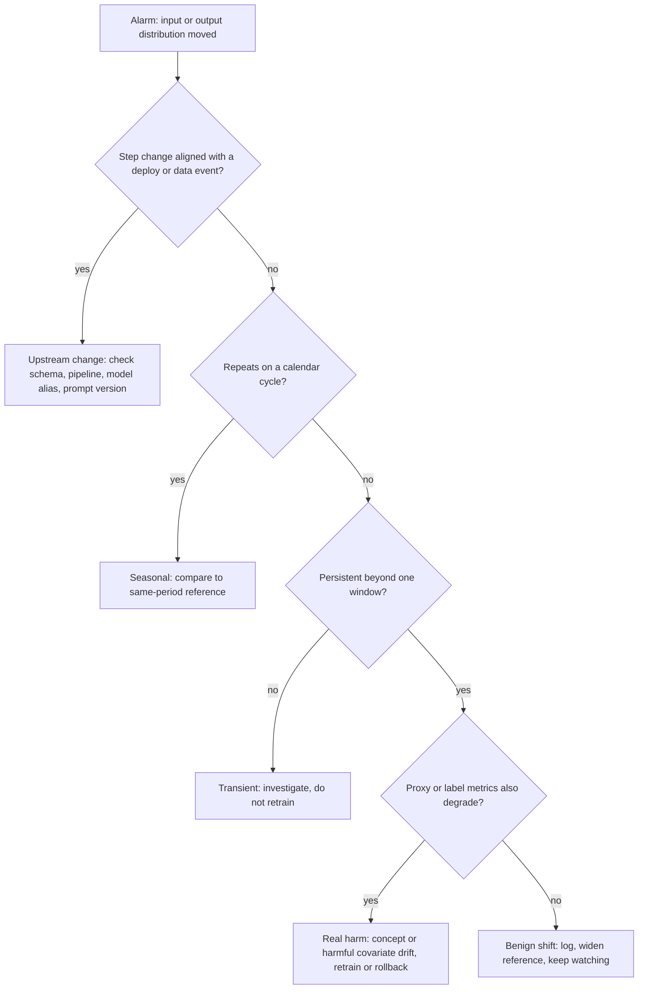
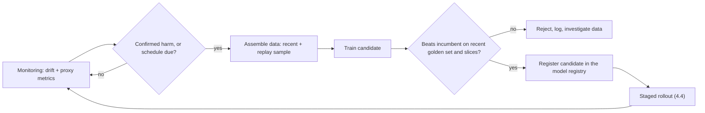

# Drift Detection & Rollback

Module 3 gave you the signals: latency, errors, quality proxies, cost. This module
closes the loop. A model is a frozen function of the world as it looked at training
time, and the world keeps moving. Eventually either the inputs change, the meaning of
the target changes, or a release you shipped is simply worse than the last one. You
need to *notice* quickly, *decide* with few false alarms, and *recover* in minutes
without a deploy. Four parts:

- **A taxonomy of drift** — what can change, and how fast.
- **Detecting drift** — PSI, KS, chi-square, divergences, embedding drift, and
  false-alarm control.
- **Performance without labels, and retraining** — estimating damage early and
  choosing when to retrain.
- **Safe release and rollback** — shadow, canary, blue/green, kill switches, registry
  rollback, and incident response.

---

## 4.1 — A Taxonomy of Drift

Let $X$ be the inputs and $Y$ the target. A model learns $P(Y \mid X)$ from a training
joint distribution $P_{\text{train}}(X, Y) = P_{\text{train}}(X)\,P_{\text{train}}(Y \mid X)$.
Production traffic has its own joint $P_{\text{prod}}(X, Y)$. Drift is any gap between
the two, and *which factor moved* determines the symptom, the detector, and the fix.

| Type | What changes | Example | Detectable without labels? | Typical fix |
| --- | --- | --- | --- | --- |
| Covariate shift | $P(X)$ moves, $P(Y \mid X)$ fixed | New user cohort, new device mix | Yes | Reweight, retrain on new region |
| Label / prior shift | $P(Y)$ moves, $P(X \mid Y)$ fixed | Fraud rate doubles in a holiday week | Partly (via outputs) | Recalibrate priors, adjust threshold |
| Concept drift | $P(Y \mid X)$ moves | "Good lead" redefined, fraudsters adapt | **No**, needs labels or proxies | Relabel and retrain |
| Upstream / schema change | Feature pipeline output changes | Unit switches cents to dollars, a column goes null | Yes, and loudly | Fix the pipeline, add contracts |

Two points matter more than the names. **Covariate shift is not necessarily harmful**:
if inputs move where the learned function is still correct, accuracy is unchanged, so an
input alarm is a *hypothesis* of damage. And **concept drift is invisible to input
monitoring**: the inputs look identical while the right answer changed, so you catch it
only through labels or proxies (4.3). For LLM systems, covariate shift is the prompt mix
changing, concept drift is the world moving under a frozen model, and upstream change
includes a provider silently updating a model alias, a rebuilt retriever index, or an
edited prompt template. None touch your weights; all change behavior.

### Shape in time

The same cause produces different signatures depending on its tempo, and the tempo
dictates the detector window.

- **Sudden**: a step change at time $t_0$ (pipeline bug, schema break, deploy). Easy to
  detect, hard to *attribute* unless you log deploy and data-version events beside the
  metric.
- **Gradual**: a slow ramp as one regime replaces another (user base maturing). Each
  daily comparison is within noise but the cumulative gap is large. Compare against a
  *fixed reference*, not yesterday, or you will adapt your baseline into the drift.
- **Seasonal / recurring**: weekly, monthly, holiday cycles. A naive detector fires every
  Monday. Choose the reference window to match the period (same weekday, same season
  last year) or model the seasonality explicitly.
- **Blips**: short anomalies (an outage, a bot burst) that revert. Page, do not retrain.



---

## 4.2 — Detecting Drift: The Statistics

Every detector compares a **reference** sample (training data or a trusted recent
window) with a **current** window of production data, feature by feature and on the
model's outputs. The tools split by feature type.

### Population Stability Index (PSI)

PSI is the industry workhorse, from credit scoring. Bin the feature using quantiles of
the *reference* (so each reference bin holds about equal mass), then with bin
proportions $p_i$ (reference) and $q_i$ (current):

$$
\text{PSI} = \sum_{i=1}^{B} (q_i - p_i)\,\ln\frac{q_i}{p_i}
$$

This is the symmetrized KL divergence, so it is non-negative and zero only when the
histograms match. Common rules of thumb: below 0.1 stable, 0.1 to 0.25 moderate shift,
above 0.25 major shift. Treat these as starting thresholds to calibrate on your own
data, not laws. Empty bins make the log blow up, so add a small epsilon.

### Kolmogorov-Smirnov test (continuous features)

The two-sample KS statistic is the largest gap between the empirical CDFs, with no
binning and no distributional assumption:

$$
D = \sup_x \left| F_{\text{ref}}(x) - F_{\text{cur}}(x) \right|
$$

With millions of rows *any* tiny shift is "significant", so gate alerts on the effect
size $D$ as well as the p-value.

### Chi-square test (categorical features)

For a categorical feature, compare observed counts $O_i$ in the current window to the
counts expected from the reference proportions, $E_i = n\,p_i$:

$$
\chi^2 = \sum_{i=1}^{C} \frac{(O_i - E_i)^2}{E_i}
$$

with $C-1$ degrees of freedom. It needs expected counts of roughly 5 or more per
category, so merge rare categories into "other". A *new* category unseen in the
reference (expected count zero) is itself a drift signal and should alert directly.

### KL and Jensen-Shannon divergence

For discrete distributions $P$ (reference) and $Q$ (current):

$$
D_{\text{KL}}(P \,\|\, Q) = \sum_i p_i \ln\frac{p_i}{q_i}
\qquad
\text{JS}(P, Q) = \tfrac{1}{2} D_{\text{KL}}(P \,\|\, M) + \tfrac{1}{2} D_{\text{KL}}(Q \,\|\, M),\; M = \tfrac{P+Q}{2}
$$

KL is asymmetric and infinite when $q_i = 0$ where $p_i > 0$. **JS fixes both**: it is
symmetric, always finite, and bounded by $\ln 2$ (or 1 using log base 2), which makes a
fixed alert threshold meaningful. Use JS for model output distributions: predicted-class
mix, score histograms, and token-length distributions.

```python
import numpy as np
from scipy import stats
from scipy.spatial.distance import jensenshannon

EPS = 1e-6  # keeps log() finite when a bin is empty

def psi(ref, cur, bins=10):
    """PSI with bin edges from reference quantiles (equal-mass reference bins)."""
    edges = np.quantile(ref, np.linspace(0, 1, bins + 1))
    edges[0], edges[-1] = -np.inf, np.inf               # catch out-of-range values
    p = np.histogram(ref, edges)[0] / len(ref) + EPS
    q = np.histogram(cur, edges)[0] / len(cur) + EPS
    return float(np.sum((q - p) * np.log(q / p)))

def ks_drift(ref, cur):
    """Return (D, p-value). Gate on D (effect size), not p alone."""
    r = stats.ks_2samp(ref, cur)
    return r.statistic, r.pvalue

def js_drift(p_counts, q_counts):
    """Jensen-Shannon DISTANCE (sqrt of divergence), base 2 so range is [0, 1]."""
    p = np.asarray(p_counts, float) + EPS; p /= p.sum()
    q = np.asarray(q_counts, float) + EPS; q /= q.sum()
    return float(jensenshannon(p, q, base=2))
```

### Embedding drift for text

Text has no single column to histogram, so embed it (Course 5) and compare clouds of
vectors. Two practical detectors:

**Centroid distance.** Compare the mean embeddings $\mu_{\text{ref}}$ and $\mu_{\text{cur}}$
by cosine distance, $1 - \cos(\mu_{\text{ref}}, \mu_{\text{cur}})$. It is cheap and
catches a topic or language shift, but it is blind to changes in *spread* (the mean can
stay put while the distribution broadens into new clusters).

**Maximum Mean Discrepancy (MMD).** MMD compares whole distributions through a kernel
$k$ (RBF or cosine):

$$
\widehat{\text{MMD}}^2 = \frac{1}{m^2}\sum_{i,j} k(x_i, x_j) + \frac{1}{n^2}\sum_{i,j} k(y_i, y_j) - \frac{2}{mn}\sum_{i,j} k(x_i, y_j)
$$

It is zero in expectation when the distributions match and detects shape changes the
centroid misses. Get a p-value with a **permutation test**: shuffle the pooled samples,
recompute MMD many times, and see where the observed value falls. Subsample both sides
to a few thousand vectors since it is quadratic.

```python
import numpy as np

def centroid_drift(a, b):
    """Cosine distance between mean embeddings (rows are vectors)."""
    m1, m2 = a.mean(0), b.mean(0)
    return 1 - float(m1 @ m2 / (np.linalg.norm(m1) * np.linalg.norm(m2)))

def mmd2(x, y, gamma=0.5):
    """Biased MMD^2, RBF kernel. Permute pooled samples to get a p-value."""
    k = lambda p, q: np.exp(-gamma * ((p[:, None] - q[None]) ** 2).sum(-1))
    return k(x, x).mean() + k(y, y).mean() - 2 * k(x, y).mean()
```

### Windowing and false-alarm control

A detector that cries wolf gets muted, and a muted detector is worse than none. Three
design decisions keep alarms trustworthy.

**Reference and window choice.** Use a *fixed* reference (the training snapshot, or a
"golden" validated week) for slow-drift sensitivity, and a *sliding* current window
(for example 24 hours or the last 10k requests) sized so each bin has enough samples.
For seasonal data, build the reference from the matching period.

**Multiple testing.** Monitoring 200 features at $\alpha = 0.05$ yields about 10 false
alarms per window by pure chance. Correct for it: **Bonferroni** uses $\alpha/m$ (strict,
simple), while **Benjamini-Hochberg** controls the false discovery rate and is usually the
right default: sort the $m$ p-values, find the largest $k$ with $p_{(k)} \le \tfrac{k}{m}q$,
and flag the first $k$ (`scipy.stats.false_discovery_control` does this). Alternatively alert on the *fraction* of drifted features
(say above 20 percent) rather than any single one.

**Persistence.** Require the breach on $k$ of the last $n$ windows (for example 3 of 4)
before paging, and use two tiers: a *warning* for investigation and a *critical* only
when drift coincides with a health metric degrading.

---

## 4.3 — Performance Without Labels, and Retraining

Drift statistics say the world *moved*. What you actually want to know is whether the
model got *worse*, and ground-truth labels are often delayed (loan default after 12
months), partial (only clicked items), or absent (open-ended generation). Until labels
land you work with estimators of damage.

**Confidence-based estimation.** For a calibrated classifier, mean predicted confidence
estimates accuracy; falling max-probability, rising entropy, or more low-margin
predictions is an early warning. But **calibration breaks under shift**: deep nets are
often confidently wrong out of distribution, so treat confidence as a tripwire, not a
measurement.

**Proxy and behavioral metrics.** Pick signals causally downstream of correctness:
user thumbs-down or regenerate rate, edit distance between the suggestion and the final
text, escalation-to-human rate, abandonment, refusal rate, retry rate, and for retrieval
systems the share of queries with no result above a similarity floor. For LLMs add an
**LLM-judge on a sampled slice** (1 to 5 percent of traffic scored against a rubric, as
in Course 4) and track the score as a time series.

### Retraining strategies

| Strategy | Trigger | Strength | Weakness |
| --- | --- | --- | --- |
| Scheduled | Calendar (weekly, monthly) | Simple, predictable, easy to audit | Retrains when unneeded, or too late |
| Triggered | Drift or metric breach | Reacts to real change, saves compute | Needs trustworthy detectors, can thrash |
| Continual / online | Every batch or event | Freshest model | Unstable, hard to reproduce, poisonable |

Most teams use **scheduled retraining as a floor and triggered retraining as an
accelerator**. The trigger should be *confirmed harm* (proxy metrics degraded, not just a
PSI bump), and it starts a pipeline, never swaps a model in directly: the candidate must
beat the incumbent on recent held-out data and slices, then pass the rollout in 4.4.

**Continual learning risks.** Updating weights from live data invites catastrophic
forgetting (Course 6; mitigate with replay), feedback loops (the model's outputs shape
its future training data, so log propensities and keep an exploration slice), poisoning
by anyone who can influence traffic, and irreproducibility: if weights change hourly,
"which model answered" and "what do we roll back to" lose their answers.



---

## 4.4 — Safe Release Engineering & Rollback

Retraining produces candidates. Shipping them safely is a separate discipline, built on
one principle: **limit the blast radius of being wrong, and make undoing cheap.** The
patterns below trade exposure for evidence.

| Pattern | What it does | User impact | Best for |
| --- | --- | --- | --- |
| Shadow | New model gets a copy of live traffic; outputs logged, never returned | None | Catching crashes, latency, and output differences cheaply |
| Canary | 1, 5, 25, 100 percent of real traffic to new version | Small, bounded | Detecting real-world regressions under live load |
| Blue/green | Two full environments, flip the router | None if flip is clean | Instant cutover and instant rollback |
| A/B test | Randomized split measured on a business metric | Half the users, by design | Proving the new model is *better*, not just not-broken |

Shadow cannot observe user reaction, so it validates sanity, not quality. Canary
assignment should be sticky by user. A/B needs pre-registered metrics and a power
calculation, and no peeking.

### Automated rollback on SLO breach

Rollback must not wait for a human to read a dashboard. Define guardrail metrics
before the canary starts, compare canary to baseline *at the same time* (so a global
traffic spike does not blame the new model), and revert automatically on breach.

```yaml
# rollout.yaml: progressive canary with automatic rollback (declarative, GitOps style)
model: support-classifier
candidate: registry://support-classifier/versions/17   # immutable registry artifact (Module 2)
baseline:  registry://support-classifier/versions/16   # known-good, kept warm
stages: [shadow 0% 2h, canary 5% 1h, canary 25% 2h, full 100% 24h]  # baseline warm after
guardrails:                                             # all compared canary vs baseline
  - { metric: error_rate,      max_ratio: 1.5 }
  - { metric: p95_latency_ms,  max_ratio: 1.3 }
  - { metric: thumbs_down_rate, max_delta: 0.02 }
  - { metric: js_output_drift, max_abs: 0.15 }
min_samples_per_stage: 2000                             # no verdicts on tiny samples
on_breach: { action: rollback, page: oncall-ml, freeze_pipeline: true }
```

### Kill switches and fallbacks

Some failures are not "roll back to the previous model" but "stop calling the model".
Build graceful degradation in advance, not during the incident:

- **Kill switch**: a feature flag, checked per request and changeable at runtime without a
  deploy, that routes around the ML path entirely. Test it quarterly, because an untested
  kill switch is a hope, not a control.
- **Fallback ladder**: primary model, then the previous registry version, then a smaller
  or cheaper model, then a rules-based or cached answer, then an honest "unavailable".
  Each rung should be cheaper and more predictable than the one above.
- **Circuit breaker**: after $N$ failures or timeouts in a window, stop sending traffic to
  the failing dependency for a cool-down, then probe with a trickle before closing.

### Rollback tied to the registry (Module 2)

Rollback is only as good as your versioning. This is where Module 2 pays off: every
served behavior is the product of *pinned, immutable artifacts*, so reverting is pointing
a pointer back, not rebuilding anything.

- **Model rollback**: serving resolves an alias such as `production` to a registry
  version. Rolling back repoints the alias to the prior version, already stored,
  already validated, with its lineage. Keep the previous version loadable and warm for a
  soak period after promotion.
- **Prompt rollback**: prompts are versioned artifacts too. A prompt edit is a deploy and
  gets the same canary and the same instant revert. For LLM apps, a regression is as
  often a prompt change or a silently updated provider model as a weight change, so
  **pin provider model snapshots** instead of floating aliases.
- **Coupled rollback**: model, prompt, retrieval index, and feature pipeline are a
  *bundle*; roll it back atomically via a manifest of all four versions, or you pair an
  old prompt with a new embedding model, a state you never tested.
- **Data and schema caveats**: rolling back a model does not undo a corrupted feature
  store or a polluted training set. Keep data snapshots versioned so you can retrain from
  the last known-good state.

### Incident response and ML postmortems

Treat a model regression as an incident: **mitigate first, diagnose second**. The first
action is almost always rollback or the kill switch, not root-causing on live traffic.
Then run the usual loop with ML-specific additions.

1. **Detect and declare**: page on-call, name an incident commander, record *when harm
   began* (usually earlier than when you noticed).
2. **Mitigate**: roll back, flip the kill switch, or fall back; confirm recovery on the
   metric that alarmed.
3. **Scope**: use Module 3's request logs (model, prompt, feature snapshot ids) to find
   affected users and decide whether to re-score, notify, or reverse decisions.
4. **Diagnose**: bisect the bundle (data, model, prompt, index, provider alias) offline
   using logged inputs.
5. **Blameless postmortem**: timeline, impact, root cause, why checks missed it, and
   owned action items.

ML-specific postmortem questions: Which guardrail should have fired and did not? Was the
golden set representative of the slice that broke? Could the drift detector have warned
a week earlier? Was rollback fast, and was the fallback acceptable to users? The most
valuable outcome is a **new regression test**: add the failing inputs to the golden set
so this exact failure can never ship twice.

---

## Key takeaways

- **Drift is four different problems.** Covariate shift moves $P(X)$, prior shift moves
  $P(Y)$, concept drift moves $P(Y \mid X)$ and is invisible to input monitoring, and
  upstream changes (schemas, provider aliases, prompts) break things loudly. Tempo
  (sudden, gradual, seasonal) decides the reference window.
- **Match the statistic to the data.** PSI for binned numeric features, KS for continuous
  with effect size, chi-square for categoricals, Jensen-Shannon for output distributions
  because it is symmetric and bounded, centroid distance and MMD for text embeddings.
- **Control false alarms.** Use a fixed reference, a sliding window with enough samples,
  Benjamini-Hochberg across many features, persistence over several windows, and a
  warning/critical split, because a muted detector protects nothing.
- **Estimate damage before labels arrive** with calibrated confidence, behavioral
  proxies, and sampled LLM-judge scores, but remember confidence can lie under shift.
- **Retrain on confirmed harm** with scheduled retraining as a floor. Candidates earn
  promotion through the same gates as any release; continual learning adds forgetting,
  feedback loops, poisoning, and irreproducibility.
- **Release in stages, revert in seconds.** Shadow, canary, blue/green, and A/B trade
  exposure for evidence; SLO guardrails roll back automatically; kill switches and a
  fallback ladder handle the cases where no model version is safe.
- **Rollback is registry-native.** Pin immutable versions of model, prompt, index, and
  features, move them as one bundle, and treat incidents as mitigate-first with blameless
  postmortems that end in a new regression test.

## Exercises

1. **Detector bake-off.** Take a numeric feature and inject three drifts: a mean shift, a
   variance increase with the mean unchanged, and a 2 percent fraction of outliers.
   Compute PSI, KS $D$, and JS distance for each, and tabulate which detector catches
   which. Then do the same on text embeddings and show that centroid distance misses the
   variance-only case that MMD catches.

2. **Control the false alarms.** Simulate 200 features with *no* drift over 30 daily
   windows. Count alerts at raw $\alpha = 0.05$, with Bonferroni, and with
   Benjamini-Hochberg, then add a 3-of-4 persistence rule. Plot alerts per day for each
   policy, then inject real drift in 10 features and report detection delay versus false
   alarms.

3. **Estimate accuracy blind.** Train a classifier, then shift the test inputs
   progressively (noise, rotation, or a covariate resample). Plot true accuracy against
   mean max-softmax confidence, and again after temperature scaling. Find the shift
   strength at which confidence stops tracking accuracy and propose a backup proxy.

4. **Build a rollout gate.** Write a gate function (continue, wait, or rollback) for a simulated canary where
   the new model has a 10 percent latency regression only above 50 requests per second.
   Run the staged rollout of `rollout.yaml`, show the automatic rollback firing, repoint
   a registry alias back to the baseline, and write a one-page blameless postmortem
   ending with the regression test you would add.

## Course complete: MLOps & Deployment

You took a model from a notebook to a system that can be trusted in production. Module 1
turned a notebook into a reproducible, containerized endpoint; Module 2 versioned the
four things that define behavior (code, data, model, and prompts) with a registry and
lineage; Module 3 instrumented the service so you can see latency, errors, cost, and
quality; and Module 4 closed the loop with drift detection, retraining discipline, staged
releases, and rollback that works in seconds.

The through-line: **a deployed model is a hypothesis about a world that keeps changing,
so production ML is the discipline of making that hypothesis observable, testable, and
reversible.** Every control in this course exists to shorten one of two clocks: the time
to *notice* something is wrong, and the time to *undo* it.

## Roadmap complete: all ten courses

This was the last course on the roadmap, and the ten courses form one stack. Prompt
engineering, LLM engineering, and fine-tuning taught you to shape and adapt models.
Vector search and RAG gave them memory and grounded knowledge. Agentic AI let them act,
and AI products put them in front of people. MLOps made all of it operable, observable,
and recoverable. You now have the full path from the math inside a transformer to a
monitored, rollback-ready system running in production. Build something real with it,
instrument it from day one, and keep the rollback button warm.
