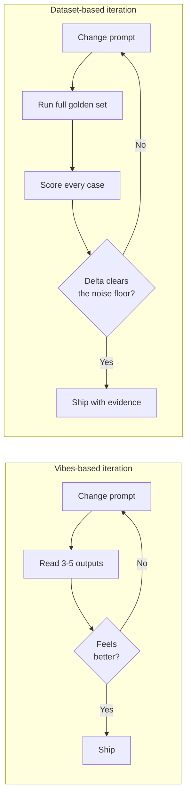
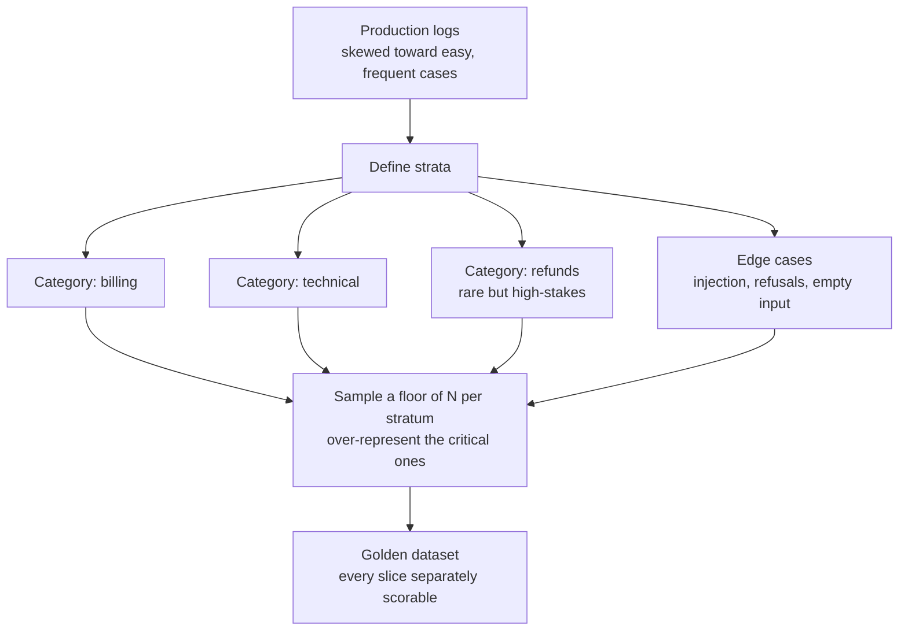
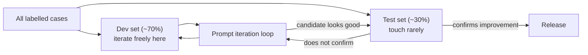
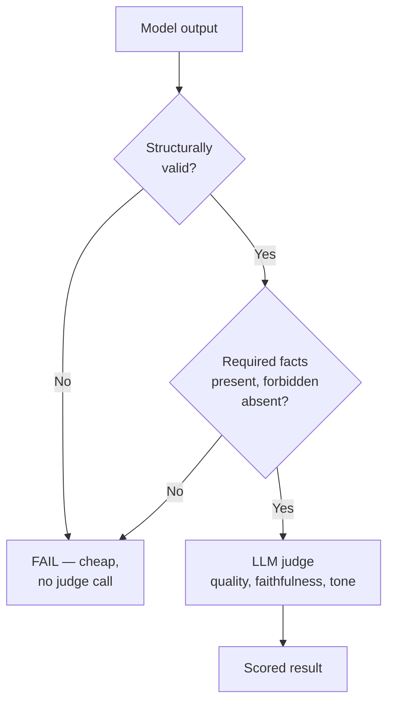
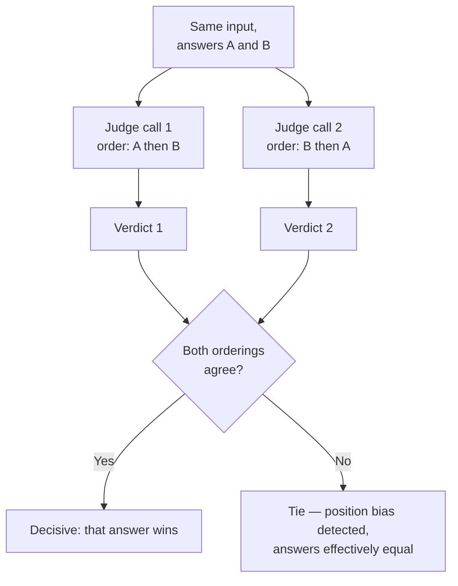
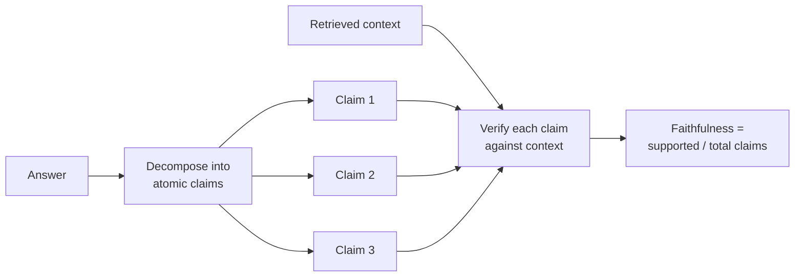
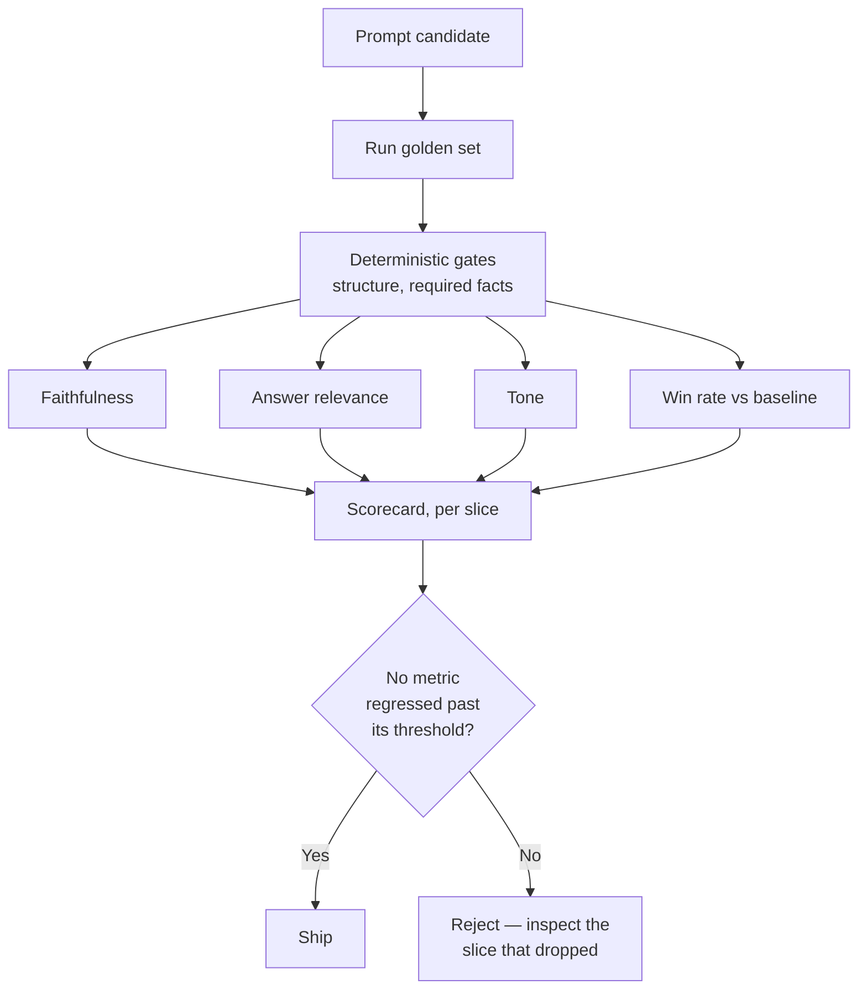

# Module 3 — Evaluation and Iteration

Modules 1 and 2 gave you levers: sampling settings, reasoning patterns, output contracts, defences. Every one of them is a change you might make to a prompt. This module answers the only question that makes those levers usable in production: **did the change actually help, or did it just help the three examples you happened to look at?**

Evaluation is the discipline that turns prompt engineering from a craft into engineering. Without it you are tuning a probabilistic system by feel, and a probabilistic system will happily convince you that a regression is an improvement. With it, "I think this is better" becomes "faithfulness rose 6 points on 200 cases, and the confidence interval clears the noise floor."

> **Prerequisites.** Modules 1 and 2. You will reuse structured outputs (2.2) to make judges return parseable verdicts, and the faithfulness-versus-hit-rate split appears again here as a first-class metric.

**By the end of this module you will be able to:**

- Explain why manual review silently fails past a handful of examples
- Construct a golden dataset with real variance, stratified coverage, and no leakage
- Choose deterministic checks over an LLM judge wherever correctness is programmable
- Build an LLM judge that survives position, verbosity, and self-enhancement bias
- Measure faithfulness, answer relevance, and domain tone as concrete numbers

---

## 3.1 The Evaluation Baseline

### Why eyeballing fails

Everyone starts by reading outputs and deciding whether they look good. It works for exactly as long as you have a handful of examples and a fresh memory, which is to say, never in production. It fails for reasons that are structural, not disciplinary.

- **It does not scale.** You cannot re-read 300 outputs on every prompt tweak. So you re-read five, and those five become your entire notion of quality.
- **It cannot detect regressions.** You tune the prompt to fix a bad refund reply. Three other categories quietly get worse, because you optimised against the cases in front of you. Nobody re-checked the others, so nobody knows. This is the single most common failure mode in prompt work, and it has a name: **whack-a-mole**.
- **A single output is not a signal.** From Module 1: output is sampled. One good response at `temperature=0.7` tells you almost nothing, because the next draw might be bad. You are reading one sample from a distribution and treating it as the distribution's mean.
- **Confirmation bias is unavoidable.** You wrote the prompt; you want it to work; you read generously. Human graders rate an output higher when they know it came from "the new version". Blind evaluation exists because unblinded evaluation is compromised.
- **Memory is not a baseline.** "This feels better than last week" compares the current output to a fuzzy recollection of a different output on a different input. It is not a comparison. It is a feeling wearing a lab coat.

> **Warning.** The danger is not that eyeballing gives you no information. It is that it gives you *confident wrong* information. A test suite that does not exist cannot mislead you; a mental model built from five cherry-picked successes will, repeatedly and with conviction.

The fix is a **golden dataset**: a fixed, versioned collection of inputs paired with the information needed to score outputs, chosen to represent the real distribution of what your system faces. Every prompt change runs against it. "Better" stops being a feeling and becomes a delta with an error bar.



### Anatomy of a golden dataset

A golden case is more than an input and a hoped-for answer. Each entry carries what you need to *score* it and to *slice* the results afterwards.

```python
from dataclasses import dataclass, field
from enum import Enum

class Difficulty(str, Enum):
    EASY = "easy"
    MEDIUM = "medium"
    HARD = "hard"

@dataclass
class GoldenCase:
    id: str
    input: str
    # A reference answer where one exists. Optional: many good tasks have no
    # single correct answer, only correct properties — see 3.2.
    reference: str | None = None
    # The slices you will break results down by. Stratification lives here.
    category: str = "general"
    difficulty: Difficulty = Difficulty.MEDIUM
    tags: list[str] = field(default_factory=list)
    # Machine-checkable assertions: substrings that must / must not appear,
    # a schema the output must satisfy, a numeric answer with tolerance.
    must_contain: list[str] = field(default_factory=list)
    must_not_contain: list[str] = field(default_factory=list)
    # Provenance, so you can trust and refresh the case later.
    source: str = "unknown"     # "prod-log", "support-ticket", "hand-written"
    created_at: str = ""
    # Frozen: once a case is in the set, its expectations do not move to make
    # a failing prompt pass. That is how you cheat without noticing.
    frozen: bool = True
```

> **Tip.** The `source` field earns its place the first time someone asks "is this a real question users ask, or one you invented to make the demo look good?" Cases drawn from production logs are worth ten hand-written ones, because they carry the distribution's real weirdness — the typos, the half-questions, the two-questions-in-one.

### Size, variance, and the noise floor

The first question is always "how many cases?" and the honest answer is "enough to distinguish a real change from sampling noise" — which depends on how noisy your metric is and how large a change you care about.

Here is the intuition made concrete. Your eval metric is itself a random variable: outputs are sampled (Module 1), and if you use an LLM judge (3.3), the judge is sampled too. Run the *same* prompt twice and the score moves. That movement is the **noise floor**. Any improvement smaller than it is indistinguishable from luck.

For a pass/fail metric with true pass rate `p` measured over `n` cases, the standard error is roughly:

```text
SE ≈ sqrt( p * (1 - p) / n )
```

| Cases `n` | SE at p=0.8 | Smallest change you can trust (~2·SE) |
| --- | --- | --- |
| 20 | 0.089 | ±18 points — almost nothing is detectable |
| 50 | 0.057 | ±11 points |
| 100 | 0.040 | ±8 points |
| 200 | 0.028 | ±6 points |
| 500 | 0.018 | ±4 points |

Read the last column as the reason "we improved from 82% to 85% on 50 cases" is **not a result**. That 3-point move is well inside the ±11-point noise band. You have measured nothing.

- **30 cases** is the floor for catching gross regressions. Below it you are guessing.
- **100–200 cases** is the practical sweet spot for iterating on a feature.
- **500+** when a few points genuinely matter and you can afford the eval cost.

> **Warning.** Reducing judge temperature toward 0 shrinks judge noise but does not shrink the noise from your system's own sampled outputs. If you evaluate a `temperature=0.8` product, the outputs vary regardless of how deterministic your judge is. Either evaluate at the temperature you ship, or evaluate each case several times and average.

### Stratified sampling: coverage, not proportion

The naive approach is to sample uniformly from production logs. It produces a dataset that looks representative and hides exactly the cases you most need to watch.

The problem is that **frequency and importance are different axes**. If 90% of your traffic is easy FAQ lookups and 2% is refund disputes, a proportional sample is 90% FAQs — and a prompt change that breaks refund handling barely moves the aggregate score, because refunds are 2% of it. The catastrophe is invisible in the average.

Stratified sampling fixes this by defining the slices that matter and ensuring each has enough cases to produce a trustworthy per-slice score, **regardless of its real-world frequency**.



```python
import random
from collections import defaultdict
from typing import Callable

def stratified_sample(
    cases: list[GoldenCase],
    key: Callable[[GoldenCase], str],
    *,
    per_stratum: int,
    rng: random.Random,
) -> list[GoldenCase]:
    """Take up to `per_stratum` cases from EACH stratum.

    This deliberately breaks proportionality: a stratum that is 2% of traffic
    still contributes `per_stratum` cases, so a regression there is as visible
    as one in your biggest category.
    """
    buckets: dict[str, list[GoldenCase]] = defaultdict(list)
    for case in cases:
        buckets[key(case)].append(case)

    selected: list[GoldenCase] = []
    for stratum, items in buckets.items():
        take = min(per_stratum, len(items))
        if take < per_stratum:
            # A thin stratum is a coverage gap. Say so — do not let it hide.
            print(f"WARNING: stratum '{stratum}' has only {len(items)} cases (< {per_stratum})")
        selected.extend(rng.sample(items, take))
    return selected
```

> **Tip.** Over-represent the cases that are rare in traffic but expensive when wrong: safety refusals, adversarial inputs (Module 2), empty and malformed input, and your two or three highest-revenue categories. Aggregate score is a summary; the per-slice breakdown is where decisions actually get made.

### Avoiding data leakage

Leakage is when information from your evaluation contaminates the thing being evaluated, so the score measures memorisation rather than capability. It inflates results and rots slowly, and there are three flavours in prompt work.

- **Few-shot contamination.** You put example Q&As in the prompt (Module 2 territory) and one of them is also a golden case. The model now has the answer sitting in its context. It will "pass" that case forever, telling you nothing. **The examples in your prompt and the cases in your eval set must be disjoint.** Enforce it in code.
- **Tuning on the test set.** You iterate: change prompt, check score, repeat, twenty times. By iteration twenty you have fitted the prompt to the quirks of *those specific cases*. The score is now optimistic about the set and silent about everything else. The fix is the classic split: a **development set** you iterate against freely, and a **held-out test set** you touch rarely — ideally only to confirm a release.
- **Training-data contamination.** For public benchmarks, the model may have seen the test during pretraining. You cannot fix a frozen model's training data, but you can prefer **private, recent, domain-specific** cases the model could not have memorised — another reason production logs beat textbook examples.

```python
def assert_no_leakage(
    fewshot_examples: list[str],
    eval_cases: list[GoldenCase],
) -> None:
    """Fail loudly if any few-shot example also appears in the eval set.

    Run this in CI. Leakage is silent by nature; the only defence is an
    automated check that refuses to let the two pools overlap.
    """
    def canon(text: str) -> str:
        return " ".join(text.lower().split())

    shots = {canon(ex) for ex in fewshot_examples}
    collisions = [c.id for c in eval_cases if canon(c.input) in shots]
    if collisions:
        raise AssertionError(
            f"Leakage: {len(collisions)} eval cases appear in the prompt's "
            f"few-shot examples: {collisions[:5]}"
        )
```



---

## 3.2 Deterministic vs Non-Deterministic Evals

Not every check needs a language model. The most common mistake in evaluation is reaching for an expensive, noisy LLM judge to verify something a five-line function could confirm exactly, for free, in a millisecond.

**The rule: make the check as deterministic as the task allows. Escalate to a judge only for what genuinely cannot be programmed.**

### Deterministic checks

A deterministic check is a pure function from output to pass/fail. Same input, same verdict, every time. No sampling, no cost, no bias.

| Check | Verifies | Example task |
| --- | --- | --- |
| **Exact match** | Output equals reference | Classification label, routing decision |
| **Normalised match** | Equal after lowercasing / trimming / unit-folding | Short factual answers |
| **Regex / pattern** | Output matches a shape | Date format, ID format, currency |
| **Contains / excludes** | Required substrings present, forbidden absent | Must cite a source; must not leak a secret |
| **Structural validity** | Parses and conforms to a schema | JSON output (2.2), valid SQL |
| **Numeric tolerance** | `abs(value - expected) < ε` | Calculations, extracted amounts |
| **Executable** | Generated code runs and passes tests | Codegen |

They compose into a fast suite that runs on every change:

```python
import json
import re
from dataclasses import dataclass

@dataclass
class CheckResult:
    passed: bool
    detail: str = ""

def check_exact(output: str, expected: str) -> CheckResult:
    ok = output.strip().lower() == expected.strip().lower()
    return CheckResult(ok, "" if ok else f"expected {expected!r}, got {output.strip()!r}")

def check_contains_all(output: str, required: list[str]) -> CheckResult:
    missing = [s for s in required if s.lower() not in output.lower()]
    return CheckResult(not missing, "" if not missing else f"missing: {missing}")

def check_excludes(output: str, forbidden: list[str]) -> CheckResult:
    present = [s for s in forbidden if s.lower() in output.lower()]
    return CheckResult(not present, "" if not present else f"forbidden present: {present}")

def check_regex(output: str, pattern: str) -> CheckResult:
    ok = re.search(pattern, output) is not None
    return CheckResult(ok, "" if ok else f"no match for /{pattern}/")

def check_json_schema(output: str, validate) -> CheckResult:
    """`validate` raises on a non-conforming object (e.g. a pydantic model)."""
    try:
        validate(json.loads(output))
        return CheckResult(True)
    except Exception as exc:
        return CheckResult(False, f"schema: {exc}")

def check_numeric(output: str, expected: float, tol: float = 1e-6) -> CheckResult:
    nums = re.findall(r"-?\d+\.?\d*", output.replace(",", ""))
    if not nums:
        return CheckResult(False, "no number found")
    got = float(nums[-1])
    ok = abs(got - expected) <= tol
    return CheckResult(ok, "" if ok else f"expected {expected}, got {got}")
```

The TypeScript equivalent, structured as a composable suite you run per case:

```ts
export interface CheckResult {
  passed: boolean;
  detail?: string;
}

export type Check = (output: string) => CheckResult;

export const exact = (expected: string): Check => (o) => {
  const passed = o.trim().toLowerCase() === expected.trim().toLowerCase();
  return { passed, detail: passed ? undefined : `expected "${expected}"` };
};

export const containsAll = (required: string[]): Check => (o) => {
  const missing = required.filter((s) => !o.toLowerCase().includes(s.toLowerCase()));
  return { passed: missing.length === 0, detail: missing.length ? `missing: ${missing}` : undefined };
};

export const excludes = (forbidden: string[]): Check => (o) => {
  const present = forbidden.filter((s) => o.toLowerCase().includes(s.toLowerCase()));
  return { passed: present.length === 0, detail: present.length ? `forbidden: ${present}` : undefined };
};

export const matches = (re: RegExp): Check => (o) => ({
  passed: re.test(o),
  detail: re.test(o) ? undefined : `no match for ${re}`,
});

/** Run every check; the case passes only if all pass. */
export function runChecks(output: string, checks: Check[]): CheckResult {
  for (const check of checks) {
    const r = check(output);
    if (!r.passed) return r;
  }
  return { passed: true };
}
```

### When determinism runs out

Deterministic checks answer "is this output *shaped* correctly and does it contain the required facts". They cannot answer the questions that decide whether a product is good:

- Is this summary *faithful* to the source, or does it add a claim that was not there?
- Does this answer actually *address* the question, or dodge it fluently?
- Is the tone appropriate for a grieving customer, or cheerfully robotic?
- Of two valid answers, which is *better*?

There is no reference string for "good", so exact match is meaningless, and no regex expresses "empathetic but not saccharine". This is the irreducible subjective core, and it is where an LLM judge earns its cost.

### The cost gradient, and the hybrid pattern

| Property | Deterministic | LLM-as-a-Judge |
| --- | --- | --- |
| Cost per case | ~free | A model call, sometimes several |
| Latency | Microseconds | Hundreds of ms to seconds |
| Reproducible | Perfectly | No — sampled and biased |
| Handles subjective quality | No | Yes |
| Trustworthy without calibration | Yes | **No** — must be validated against humans (3.3) |

The production pattern is not "pick one". It is a **gated pipeline**: cheap deterministic checks act as hard gates, and only outputs that clear them go to the expensive judge. An output that is not valid JSON, or leaks a secret, or omits the required citation, fails immediately — no judge needed, and you never pay to have a model rate something already disqualified.



> **Tip.** Ordering the gates cheapest-first is a real cost lever at scale. If 15% of outputs fail a free structural check, that is 15% of judge calls you never make. On a large eval set run on every commit, that is the difference between an eval suite people run and one they skip because it is too slow and too expensive.

---

## 3.3 Engineering the Judge

An LLM judge is a measurement instrument, and like any instrument it has systematic error. Using one without correcting for its biases is like weighing yourself on a scale that reads three kilos heavy: the number feels precise and is consistently wrong. The biases are documented and reproducible (Zheng et al., 2023, *Judging LLM-as-a-Judge*), which is the good news — reproducible error can be engineered around.

### The three biases that matter most

| Bias | The judge tends to... | Why it happens | Mitigation |
| --- | --- | --- | --- |
| **Position bias** | Prefer the answer in a fixed slot (often the first) | Attention and formatting asymmetry between positions | Run both orderings; only count a win if it survives the swap |
| **Verbosity bias** | Rate longer answers higher | Length correlates with thoroughness in training data | Reference-backed scoring; instruct to ignore length; control for length |
| **Self-enhancement bias** | Rate outputs from its own family higher | Stylistic self-similarity read as quality | Judge with a *different* model family than the one being judged |

Two more worth naming: **sycophancy** (the judge agrees with any assertion you smuggle into the prompt — so never tell it which answer you produced or prefer) and **formatting bias** (bullet points and bold text score higher than identical content in prose).

### Pairwise beats absolute scoring

Ask a model to score one answer from 1 to 10 and you get mush: the scale drifts between calls, 7 means something different each time, and the numbers are not comparable across runs. Models — like people — are far more reliable at **relative** judgments than absolute ones. "Is A better than B?" is a question with a stable answer; "how good is A on an abstract 10-point scale?" is not.

So the workhorse of serious evaluation is **pairwise comparison**: show the judge two answers to the same input and ask which is better. Aggregate across many cases into a **win rate** — the share of comparisons a prompt wins against a baseline. That single number is interpretable ("version B beats version A on 63% of cases") and directly decision-relevant.

Position bias makes the naive version unreliable, so the correct implementation **runs each comparison twice, swapping the order**, and only records a decisive result when both orderings agree. Disagreement is registered as a tie — which is itself honest information: the two answers are close enough that the judge cannot tell them apart consistently.



Here is the debiased pairwise judge in Python, returning a structured verdict (2.2) rather than free text so aggregation is trivial:

```python
import asyncio
import json
from dataclasses import dataclass
from enum import Enum

class Winner(str, Enum):
    A = "A"
    B = "B"
    TIE = "tie"

PAIRWISE_TEMPLATE = """You are an impartial evaluator comparing two AI responses \
to the same request. Judge only on how well each satisfies the request.

REQUEST:
{request}

{reference_block}RESPONSE A:
{answer_a}

RESPONSE B:
{answer_b}

Evaluation rules:
- Judge accuracy, relevance, and completeness. IGNORE length — a longer answer \
is not automatically better, and a concise correct answer beats a padded one.
- Do not favour a particular position. Judge the content, not the order.
- If the responses are of genuinely equal quality, say so.

First give one sentence of reasoning. Then output your verdict as JSON on the \
final line, exactly: {{"winner": "A" | "B" | "tie"}}"""

def _parse_verdict(text: str) -> Winner:
    match = text.strip().splitlines()[-1]
    try:
        raw = json.loads(match)["winner"]
        return Winner(raw)
    except Exception:
        return Winner.TIE  # unparseable verdict is treated as no signal

async def judge_once(call_judge, request, answer_a, answer_b, reference=None) -> Winner:
    ref_block = f"REFERENCE (the ideal answer):\n{reference}\n\n" if reference else ""
    prompt = PAIRWISE_TEMPLATE.format(
        request=request, answer_a=answer_a, answer_b=answer_b, reference_block=ref_block
    )
    return _parse_verdict(await call_judge(prompt, temperature=0.0))

async def pairwise_compare(
    call_judge, request, answer_a, answer_b, reference=None
) -> Winner:
    """Position-debiased comparison. A wins only if it wins BOTH orderings."""
    # Second call swaps the answers; we relabel its verdict back to A/B space.
    forward, swapped = await asyncio.gather(
        judge_once(call_judge, request, answer_a, answer_b, reference),
        judge_once(call_judge, request, answer_b, answer_a, reference),
    )
    swapped_relabelled = {Winner.A: Winner.B, Winner.B: Winner.A, Winner.TIE: Winner.TIE}[swapped]

    if forward == swapped_relabelled:
        return forward           # consistent across both orders → trust it
    return Winner.TIE            # order-dependent → position bias → call it a tie


async def win_rate(
    call_judge, cases, answers_new: dict, answers_base: dict, reference: dict | None = None
) -> dict:
    """Fraction of cases where the new prompt decisively beats the baseline."""
    verdicts = await asyncio.gather(*[
        pairwise_compare(
            call_judge, c.input, answers_new[c.id], answers_base[c.id],
            (reference or {}).get(c.id),
        )
        for c in cases
    ])
    wins = sum(v is Winner.A for v in verdicts)
    losses = sum(v is Winner.B for v in verdicts)
    ties = sum(v is Winner.TIE for v in verdicts)
    n = len(verdicts)
    return {
        "win_rate": wins / n,
        "loss_rate": losses / n,
        "tie_rate": ties / n,
        # Wins minus losses over decisive comparisons — robust to a high tie rate.
        "net_win_rate": (wins - losses) / max(1, wins + losses),
        "n": n,
    }
```

### Reference-backed scoring

Even a debiased comparison drifts when "better" is left to the judge's taste. **Anchoring the judge to a reference answer** collapses that variance dramatically: instead of "which of these is better in the abstract", the question becomes "which of these is closer to *this* known-good answer", which is far more stable and far less swayed by verbosity or style.

The reference does not have to be perfect or the only acceptable answer — it just has to be a concrete point of comparison. In the template above, the optional `REFERENCE` block does exactly this. Use it whenever your golden cases carry a reference; reserve reference-free judging for genuinely open-ended tasks where no single ideal exists.

### Rubric scoring and the calibration you cannot skip

When you need an absolute score rather than a comparison — say, to track a single prompt's quality over time — decompose it. A single "rate this 1–10" is unreliable; **scoring specific dimensions against explicit criteria** is far better. Ask separately: is it accurate (yes/no), is it complete (yes/no), is the tone appropriate (yes/no). Discrete, criteria-bound judgments are more consistent than a holistic number, and they tell you *what* is wrong, not just *that* something is.

But none of this matters until you have done the step almost everyone skips: **calibrating the judge against human labels.**

> **Warning.** An LLM judge is an unvalidated instrument until you have measured its agreement with human judgment. Hand-label 30 to 50 cases yourself, run the judge on the same cases, and compute agreement (Cohen's kappa for categorical verdicts). If the judge agrees with you 60% of the time, its scores are barely better than a coin flip and every downstream decision built on them is compromised. You are not measuring your prompt; you are measuring a broken ruler.

```python
def cohens_kappa(human: list[str], judge: list[str]) -> float:
    """Agreement corrected for chance. >0.6 is usually the minimum bar for a
    judge you will make decisions on; >0.8 is strong."""
    assert len(human) == len(judge) and human
    n = len(human)
    labels = set(human) | set(judge)

    observed = sum(h == j for h, j in zip(human, judge)) / n

    expected = 0.0
    for label in labels:
        p_h = human.count(label) / n
        p_j = judge.count(label) / n
        expected += p_h * p_j

    if expected == 1.0:
        return 1.0
    return (observed - expected) / (1 - expected)
```

Re-run this calibration whenever you change the judge model, the judge prompt, or the domain. A judge calibrated on billing questions is an unvalidated instrument the moment you point it at medical ones.

The same structured verdict in TypeScript with Zod, for a Node evaluation service:

```ts
import { z } from "zod";

export const Verdict = z.object({
  reasoning: z.string(),
  accurate: z.boolean(),
  complete: z.boolean(),
  toneAppropriate: z.boolean(),
  // A single derived score is fine ONCE the dimensions are explicit.
  overall: z.union([z.literal(1), z.literal(2), z.literal(3), z.literal(4), z.literal(5)]),
});
export type Verdict = z.infer<typeof Verdict>;

const RUBRIC = (request: string, answer: string, reference: string) => `
You are a strict, impartial evaluator. Score the response against the reference.

REQUEST:
${request}

REFERENCE (ideal answer):
${reference}

RESPONSE TO SCORE:
${answer}

Score each dimension independently. Ignore length and formatting flourishes;
judge substance. Return ONLY JSON:
{"reasoning": "...", "accurate": bool, "complete": bool,
 "toneAppropriate": bool, "overall": 1-5}`;

export async function scoreAnswer(
  callJudge: (prompt: string) => Promise<string>,
  request: string,
  answer: string,
  reference: string,
): Promise<Verdict> {
  const raw = await callJudge(RUBRIC(request, answer, reference));
  const cleaned = raw.trim().replace(/^```(?:json)?\s*|\s*```$/g, "");
  return Verdict.parse(JSON.parse(cleaned));
}
```

---

## 3.4 Metrics in Practice

Aggregate quality is a slogan until you decompose it into metrics that each catch a specific failure. Four carry most of the weight for LLM applications. Note which are deterministic-friendly and which need a judge — that determines their cost.

| Metric | Catches | How measured | Judge needed? |
| --- | --- | --- | --- |
| **Faithfulness** | Hallucination — claims not supported by the source | Decompose into claims, verify each against context | Yes |
| **Answer relevance** | Fluent dodging — not actually answering | Reverse-question similarity | Partly |
| **Context relevance** | Retrieval noise — irrelevant context supplied | Fraction of context sentences that are used | Yes |
| **Domain tone** | Off-brand or inappropriate voice | Rubric judge against exemplars | Yes |

### Faithfulness

Faithfulness (groundedness) asks: **is every claim in the answer supported by the provided context?** It is the single most important metric for any retrieval-grounded system, because it measures hallucination directly. Note it is orthogonal to correctness — an answer can be perfectly faithful to the context and still wrong if the context was wrong. Faithfulness measures the *model's* honesty, not the corpus's accuracy.

The reliable way to measure it is **claim decomposition**, popularised by the RAGAS framework. A holistic "is this faithful, yes or no?" is coarse and easy for the judge to get wrong on a long answer. Instead:

1. Break the answer into atomic factual claims.
2. For each claim, ask whether the context supports it.
3. Faithfulness is the fraction of claims that are supported.

This turns one fuzzy judgment into several sharp ones and yields a graded score instead of a coin flip.



```python
import json

DECOMPOSE = """Break the following answer into a list of atomic factual claims.
Each claim must be a single, self-contained statement. Ignore opinions,
questions, and filler.

ANSWER:
{answer}

Return ONLY a JSON array of strings."""

VERIFY = """Given the CONTEXT, can the CLAIM be directly inferred from it?
Answer strictly with "yes" or "no". If the context does not contain enough
information to support the claim, answer "no".

CONTEXT:
{context}

CLAIM:
{claim}

Answer (yes/no):"""

async def faithfulness(call_model, answer: str, context: str) -> dict:
    """RAGAS-style: fraction of the answer's claims supported by the context."""
    raw = await call_model(DECOMPOSE.format(answer=answer), temperature=0.0)
    try:
        claims = json.loads(raw.strip().strip("`"))
    except Exception:
        claims = [answer]  # decomposition failed → treat whole answer as one claim

    if not claims:
        return {"score": 1.0, "supported": 0, "total": 0}

    verdicts = []
    for claim in claims:
        v = await call_model(VERIFY.format(context=context, claim=claim), temperature=0.0)
        verdicts.append(v.strip().lower().startswith("yes"))

    supported = sum(verdicts)
    return {
        "score": supported / len(claims),
        "supported": supported,
        "total": len(claims),
        "unsupported_claims": [c for c, ok in zip(claims, verdicts) if not ok],
    }
```

> **Tip.** The `unsupported_claims` list is the actionable output, not the score. A faithfulness of 0.7 tells you there is a problem; the three specific unsupported claims tell you *what the model invented*, which is what you actually debug. Always surface the failures, never just the number.

### Answer relevance

An answer can be entirely faithful and still useless if it does not address the question. Answer relevance catches the fluent dodge — the response that stays on-topic and sounds helpful while never actually answering.

The clever trick (again from RAGAS) is the **reverse question**: prompt a model to generate the question that the *answer* appears to be responding to, do this a few times, and measure how similar those reconstructed questions are to the *original*. If the answer genuinely addresses the question, the reverse-generated questions cluster near the original. If the answer wandered, they scatter.

```python
import numpy as np

REVERSE = """Read the ANSWER and write the single most likely question it is
responding to. Return only the question.

ANSWER:
{answer}"""

async def answer_relevance(call_model, embed, question: str, answer: str, n: int = 3) -> float:
    """Cosine similarity between the original question and questions
    reverse-generated from the answer. High = the answer is on-target."""
    generated = [
        await call_model(REVERSE.format(answer=answer), temperature=0.5)
        for _ in range(n)
    ]
    q_vec = np.array(await embed(question))
    sims = []
    for g in generated:
        g_vec = np.array(await embed(g))
        cos = float(q_vec @ g_vec / (np.linalg.norm(q_vec) * np.linalg.norm(g_vec)))
        sims.append(cos)
    return sum(sims) / len(sims)
```

> **Warning.** Answer relevance does not measure correctness. A confidently wrong answer to the right question scores *high* on relevance, because it is clearly answering that question. Relevance and faithfulness are orthogonal axes; you need both, plus correctness against a reference where you have one. No single metric is the whole picture — that is why you track a scorecard, not a number.

### Domain-specific tone

Tone is pure judge territory — there is no regex for "empathetic and professional without being cold". The reliable approach is a **rubric anchored to exemplars**: give the judge two or three examples of on-brand responses and one or two off-brand ones, then ask it to score the candidate against that concrete standard. Exemplars ground an otherwise vague criterion the same way a reference answer grounds faithfulness.

```ts
import { z } from "zod";

const ToneScore = z.object({
  reasoning: z.string(),
  onBrand: z.boolean(),
  issues: z.array(z.enum(["too_casual", "too_cold", "jargon", "pushy", "verbose"])),
  score: z.union([z.literal(1), z.literal(2), z.literal(3), z.literal(4), z.literal(5)]),
});

const TONE_RUBRIC = (answer: string) => `
You are the brand-voice reviewer for a support team. Our voice is: warm,
concise, plain-language, and never pushy.

ON-BRAND EXAMPLES:
- "That's frustrating — let's sort it out. Here's what I found..."
- "Good question. The short version: yes, and here's why."

OFF-BRAND EXAMPLES:
- "We sincerely apologise for any inconvenience this may have caused." (cold, canned)
- "Leverage our synergistic platform to maximise your outcomes!" (jargon, pushy)

Score this response against our voice. Return ONLY JSON:
{"reasoning": "...", "onBrand": bool,
 "issues": ["too_casual"|"too_cold"|"jargon"|"pushy"|"verbose"], "score": 1-5}

RESPONSE:
${answer}`;

export async function scoreTone(
  callJudge: (prompt: string) => Promise<string>,
  answer: string,
): Promise<z.infer<typeof ToneScore>> {
  const raw = await callJudge(TONE_RUBRIC(answer));
  return ToneScore.parse(JSON.parse(raw.trim().replace(/^```(?:json)?\s*|\s*```$/g, "")));
}
```

### The scorecard

No single metric is the answer. A prompt change might raise faithfulness while quietly hurting tone, and an aggregate would hide the trade. Track them **side by side, per slice**, and set explicit **regression thresholds** — a change ships only if no metric drops more than its allowed margin.



| Metric | This release | Baseline | Δ | Threshold | Status |
| --- | --- | --- | --- | --- | --- |
| Faithfulness | 0.91 | 0.88 | +0.03 | ≥ −0.02 | ✅ |
| Answer relevance | 0.86 | 0.87 | −0.01 | ≥ −0.02 | ✅ |
| Tone (on-brand %) | 0.79 | 0.84 | −0.05 | ≥ −0.02 | ❌ |
| Win rate vs baseline | 0.58 | — | — | > 0.50 | ✅ |

The row that matters is the failing one. This candidate improved faithfulness and wins the pairwise comparison, and a naive "it's better" would ship it. The scorecard catches that it **regressed tone by 5 points** — past the threshold — so it is rejected until that slice is understood. That single caught regression is the entire return on building this machinery.

---

## Module Recap

- **Eyeballing gives confident wrong information.** It cannot scale, cannot catch regressions, and reads a single sample as if it were the distribution.
- **A golden dataset makes "better" a measurable delta.** Carry references, slices, and machine-checkable assertions on every case.
- **Respect the noise floor.** A 3-point move on 50 cases is not a result; size the set to the change you care about.
- **Stratify for coverage, not proportion.** Over-represent rare-but-critical slices, or the average will hide catastrophes.
- **Leakage is silent.** Keep few-shot examples out of the eval set, hold out a test set, and enforce both in CI.
- **Make checks as deterministic as the task allows.** Gate cheaply; escalate to a judge only for irreducible subjectivity.
- **An LLM judge is a biased instrument.** Debias position with order-swapping, verbosity with references, self-enhancement with a different model — and calibrate against humans before you trust it.
- **Pairwise beats absolute; reference-backed beats reference-free.**
- **Decompose quality into faithfulness, relevance, and tone, and track a per-slice scorecard** with regression thresholds. The failing row is the whole point.

## Exercises

1. **Measure your noise floor.** Run the *same* prompt through your eval set five times. Report the spread of the aggregate score. Any future improvement smaller than that spread is noise — write the number on the wall.
2. **Find the hidden regression.** Build a 60-case stratified set with a deliberately under-represented high-stakes slice. Make a prompt change that improves the common case and breaks the rare one. Confirm the aggregate score rises while the per-slice score for the rare slice falls.
3. **Catch your judge cheating.** Take ten pairs of answers where one is clearly padded with correct-but-irrelevant detail. Judge them without order-swapping, then with. Measure how often position or verbosity flipped the verdict.
4. **Calibrate.** Hand-label 30 outputs as pass/fail. Run your judge on the same 30. Compute Cohen's kappa. If it is under 0.6, rewrite the judge prompt and try again — and notice that you could not have known it was broken without this step.

---

**Next:** *Module 4 — Optimization and Deployment*, where evaluated prompts become a shipped system: cutting cost and latency without losing quality, prompt versioning and rollback, A/B testing prompts as controlled experiments, and monitoring the metrics from this module live in production.
