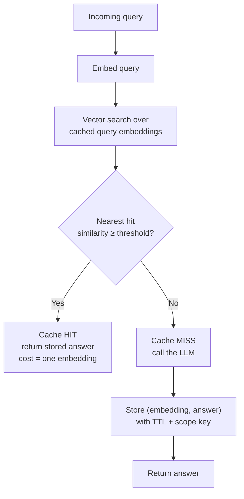
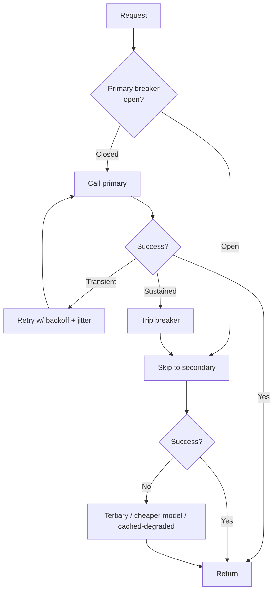
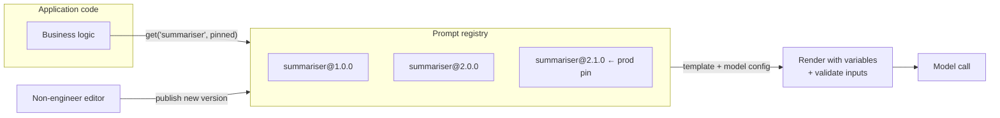
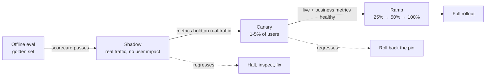
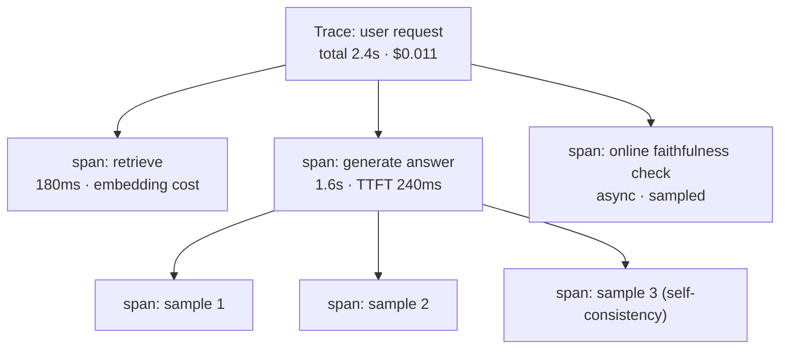
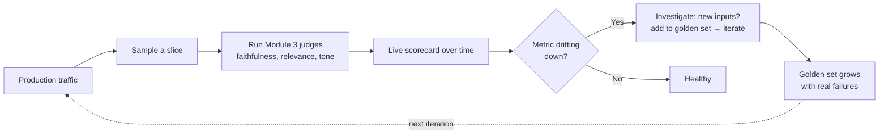

# Module 4 — Optimization and Deployment

You have a prompt that works (Modules 1 and 2) and a number that proves it (Module 3). This module is about the distance between "it scores well in eval" and "it runs reliably, affordably, and observably for real users" — a distance where most LLM projects quietly stall.

Production is a different discipline from prompting. It is caching layers that must never serve the wrong answer, fallback chains that survive a provider's bad afternoon, a registry that lets you change a prompt without a deploy and roll it back in seconds, a release process that de-risks every change on real traffic before a single user sees it, and telemetry that tells you what your system is doing and what it costs — per user, per feature, over time.

> **Prerequisites.** The whole course. The scorecard from Module 3 is the gate every rollout stage in 4.3 checks against, and the token-cost model from Module 1 is what the caching and telemetry in 4.1 and 4.4 are trying to control.

**By the end of this module you will be able to:**

- Add a semantic cache without silently serving wrong answers
- Build a fallback chain that degrades gracefully under rate limits and outages
- Reason about TTFT versus throughput and optimise the one your users feel
- Treat prompts as versioned artifacts with instant rollback
- Roll out a prompt change through shadow and canary stages, gated on metrics
- Instrument calls so cost, traces, and drift are visible before they become incidents

---

## 4.1 Cost and Latency Optimization

### Semantic caching: the answer you already computed

The cheapest LLM call is the one you never make. An exact-match cache — key on the literal prompt string — is the obvious first step, and it is nearly useless in practice: natural-language queries almost never repeat verbatim. *What's your refund policy?* and *how do refunds work?* are the same question and two different cache keys, so exact matching misses the hit.

**Semantic caching** closes that gap. Instead of matching strings, it matches *meaning*: embed the query (Module 1's vectors again), search a cache of past query embeddings, and if the nearest one is similar enough, return its stored answer — skipping the LLM entirely.



The economics are compelling: a hit costs one embedding call — often two or three orders of magnitude cheaper than a generation — plus a vector lookup. At a 40% hit rate you have removed 40% of your generation spend and served those users in milliseconds.

| Strategy | Hit rate on NL queries | Risk | Cost of a hit |
| --- | --- | --- | --- |
| No cache | 0% | None | Full generation |
| Exact-match | Very low | None | Lookup only |
| **Semantic** | **Moderate to high** | **Serving a subtly-wrong answer** | Embedding + lookup |

That risk column is the entire subject, and it is where naive semantic caches cause incidents.

> **Warning.** Semantic similarity is not semantic equivalence. *What is the refund window for EU customers?* and *what is the refund window for US customers?* have nearly identical embeddings and opposite answers. A threshold tuned for hit rate will confidently serve the EU policy to a US customer. The cache does not know it is wrong — it only knows the vectors were close. **A false positive here is not a slow response; it is an incorrect answer delivered with full confidence.**

Three defences, all mandatory for anything beyond a demo:

- **Set the threshold for precision, not hit rate.** Start high (cosine ≥ 0.95) and lower it only with eval evidence that the merged queries genuinely share an answer. A lower hit rate is cheap; a wrong answer is not.
- **Scope the cache key by anything that changes the answer.** Tenant, locale, user entitlements, feature flags, and any retrieval filters must be part of the key, not the embedding. Two queries with identical text but different scope must never collide.
- **Never cache what is personal or time-sensitive.** Account balances, order status, anything containing PII, anything whose correct answer depends on *now*. A TTL bounds staleness but does not make a per-user answer shareable.

```python
import hashlib
import json
import numpy as np
import redis

class SemanticCache:
    """Semantic cache over Redis. Requires RediSearch with a vector index:

        FT.CREATE idx ON HASH PREFIX 1 cache: SCHEMA
          scope TAG  embedding VECTOR FLAT 6 TYPE FLOAT32 DIM 1536 DISTANCE_METRIC COSINE
    """

    def __init__(self, client: redis.Redis, embed, *, threshold: float = 0.95, ttl: int = 3600):
        self.client = client
        self.embed = embed          # (text) -> list[float]
        self.threshold = threshold
        self.ttl = ttl

    def _scope_key(self, scope: dict) -> str:
        # Scope is part of the KEY, never the embedding: identical text under a
        # different tenant/locale must not collide.
        blob = json.dumps(scope, sort_keys=True)
        return hashlib.sha256(blob.encode()).hexdigest()[:16]

    async def get(self, query: str, scope: dict) -> str | None:
        vec = np.asarray(await self.embed(query), dtype=np.float32)
        scope_tag = self._scope_key(scope)

        # KNN limited to the caller's scope; distance is 1 - cosine similarity.
        res = self.client.ft("idx").search(
            f"(@scope:{{{scope_tag}}})=>[KNN 1 @embedding $v AS dist]",
            query_params={"v": vec.tobytes()},
        )
        if not res.docs:
            return None

        similarity = 1.0 - float(res.docs[0].dist)
        if similarity < self.threshold:
            return None            # close but not close enough → miss, not a guess
        return res.docs[0].answer

    async def set(self, query: str, scope: dict, answer: str) -> None:
        vec = np.asarray(await self.embed(query), dtype=np.float32)
        key = f"cache:{self._scope_key(scope)}:{hashlib.sha256(query.encode()).hexdigest()[:16]}"
        self.client.hset(key, mapping={
            "scope": self._scope_key(scope),
            "answer": answer,
            "embedding": vec.tobytes(),
        })
        self.client.expire(key, self.ttl)  # bound staleness
```

> **Tip.** Instrument hit rate, and the *near-miss* rate — queries that landed just under the threshold. A high near-miss rate means your threshold is leaving cheap hits on the table; a rise in hit rate paired with a drop in answer quality (measured by your Module 3 online evals in 4.4) means the threshold is too loose and you are serving wrong answers. The cache is not fire-and-forget; it is a component you evaluate.

### Fallback chains: surviving the provider's bad day

Every model provider has rate limits, outages, and latency spikes. A single-provider system inherits all of them directly: when the provider returns `429` or `503`, your product is down. Resilience means treating providers as fungible and degrading through a chain.

Distinguish the two failure classes, because they need opposite responses:

| Failure | Signal | Right response |
| --- | --- | --- |
| **Transient** | Timeout, `429`, `503`, connection reset | Retry the *same* provider with exponential backoff + jitter |
| **Sustained** | Repeated failures, provider-wide incident | Fail over to a *different* provider; stop retrying the dead one |

Retrying a provider that is down just adds latency before the inevitable failover. A **circuit breaker** solves this: after N consecutive failures it "opens" and routes straight to the fallback for a cooldown, sparing every subsequent request the doomed retry.



```ts
interface Provider {
  name: string;
  complete: (prompt: string) => Promise<string>;
}

class CircuitBreaker {
  private failures = 0;
  private openedAt = 0;
  constructor(
    private readonly threshold = 5,
    private readonly cooldownMs = 30_000,
  ) {}

  get isOpen(): boolean {
    if (this.failures < this.threshold) return false;
    // Half-open after cooldown: let one request test whether it recovered.
    if (Date.now() - this.openedAt > this.cooldownMs) {
      this.failures = this.threshold - 1;
      return false;
    }
    return true;
  }
  recordSuccess(): void {
    this.failures = 0;
  }
  recordFailure(): void {
    this.failures++;
    if (this.failures >= this.threshold) this.openedAt = Date.now();
  }
}

const TRANSIENT = new Set([429, 500, 502, 503, 504]);

async function withBackoff(fn: () => Promise<string>, tries = 3): Promise<string> {
  for (let attempt = 0; attempt < tries; attempt++) {
    try {
      return await fn();
    } catch (err) {
      const status = (err as { status?: number }).status;
      const last = attempt === tries - 1;
      if (last || (status !== undefined && !TRANSIENT.has(status))) throw err;
      // Exponential backoff with full jitter — avoids a thundering-herd retry
      // that hammers a provider the instant it comes back.
      const base = 250 * 2 ** attempt;
      await new Promise((r) => setTimeout(r, Math.random() * base));
    }
  }
  throw new Error("unreachable");
}

export function makeFallbackChain(providers: Provider[]) {
  const breakers = new Map(providers.map((p) => [p.name, new CircuitBreaker()]));

  return async function complete(prompt: string): Promise<{ text: string; provider: string }> {
    let lastError: unknown;
    for (const provider of providers) {
      const breaker = breakers.get(provider.name)!;
      if (breaker.isOpen) continue; // dead provider — skip without paying the timeout

      try {
        const text = await withBackoff(() => provider.complete(prompt));
        breaker.recordSuccess();
        return { text, provider: provider.name };
      } catch (err) {
        breaker.recordFailure();
        lastError = err;
        // fall through to the next provider
      }
    }
    throw new Error(`All providers failed. Last error: ${String(lastError)}`);
  };
}
```

> **Warning.** Fallback providers are not interchangeable in *behaviour*, only in *interface*. A prompt tuned and evaluated (Module 3) against your primary model may produce meaningfully different output on the fallback — different formatting, different refusal behaviour, different JSON reliability. **Evaluate every model in the chain against your golden set**, or your resilience story is "stay up while silently degrading quality". Keep prompts that are portable, and pin output validation (2.2) regardless of which provider answered.

### TTFT versus throughput: two different latencies

"It feels slow" is not one problem. Generation latency has two distinct components, driven by two different phases of inference, and they have different fixes.

- **Time-To-First-Token (TTFT)** — the wait from request to the first streamed token. Dominated by the **prefill** phase, where the model processes your entire prompt in parallel, plus any queue time. **Long prompts inflate TTFT.**
- **Generation throughput** — tokens per second once streaming has begun. Governed by the **decode** phase, which produces one token per forward pass, sequentially. It is bounded by memory bandwidth, not prompt length.

Total wall-clock time is the sum:

```text
total_latency ≈ TTFT + (output_tokens / throughput)
```

| Metric | Measures | Inference phase | Dominant factor | Primary lever |
| --- | --- | --- | --- | --- |
| **TTFT** | Time to first token | Prefill (parallel) | Prompt length, queue | Shorter prompts; prompt caching; smaller model |
| **Throughput** | Tokens/sec while generating | Decode (sequential) | Model size, hardware | Smaller/faster model; fewer output tokens |

The practical consequences flip depending on which number your users feel:

- **For an interactive chat, TTFT dominates the *perception* of speed.** A response that starts streaming in 200ms feels instant even if it takes four seconds to finish. **Always stream** — it does not reduce total time or cost (Module 1) but it collapses perceived latency. Prompt caching, where the provider supports it, cuts TTFT directly by skipping re-processing of a stable prefix.
- **For a batch job or a long document, throughput and output length dominate.** Here streaming is irrelevant; the win is a faster model and a tighter output. *"Answer in at most three sentences"* is a latency optimisation as much as a cost one — every output token is one sequential decode step you pay for in both dollars and milliseconds.

> **Tip.** Before optimising, measure both numbers separately. Teams routinely attack the wrong one — buying a faster model (throughput) to fix a slow *start* (TTFT), which is really a 4,000-token prompt they could have cached or trimmed. Total latency is a sum; optimise the term that is actually large.

---

## 4.2 The Prompt Registry

### Prompts are code, so stop hard-coding them

The default way prompts enter a codebase is as string literals, interpolated inline, scattered across the business logic that uses them. It works until the day you need to change a prompt — and then every one of these becomes true at once:

- Changing a word requires a **code deploy**, with all its latency and risk, to alter *content*.
- A non-engineer — a support lead who owns the assistant's voice — **cannot touch it**.
- There is **no version history** of the prompt as an artifact, so you cannot see what changed, when, or diff two versions.
- You **cannot A/B test or roll back** without shipping code both ways.
- The prompt is **entangled with logic**, so you cannot reuse it or evaluate it in isolation.

The fix is the same one software learned for configuration and database schemas: **decouple the artifact from the code that consumes it.** A prompt *registry* stores templates as versioned, addressable artifacts. Business logic asks the registry for `ticket-summariser@2.1.0`, supplies variables, and gets a rendered prompt. The logic knows *which* prompt it wants; it does not contain the prompt.



### Semantic versioning for prompts

Prompts need version *semantics*, not just an incrementing number, so a consumer knows whether an update is safe to adopt automatically. Adapt semver to the thing that matters for a prompt: its **contract** — the input variables it expects and the output shape it produces.

| Bump | Meaning | Examples | Consumer impact |
| --- | --- | --- | --- |
| **MAJOR** (2.x → 3.0) | Breaking change to the contract | Output schema changes; a new required variable; different output language | Consumers **must** update code |
| **MINOR** (2.1 → 2.2) | Backward-compatible behaviour change | Clearer instructions, better few-shot examples, same inputs and output shape | Safe to adopt; re-evaluate |
| **PATCH** (2.1.0 → 2.1.1) | No behavioural intent | Typo fix, whitespace, a reworded sentence with identical meaning | Safe; drop-in |

Two rules make this trustworthy:

- **Published versions are immutable.** Once `2.1.0` exists, it never changes. An edit is a new version. This is what makes rollback and reproducibility possible — a logged request that used `2.1.0` can be replayed exactly.
- **Production pins an explicit version, never "latest".** Pinning to latest means a prompt edit auto-deploys to all users with no gate, which is the entire problem you were solving. The pin is the deploy.

```ts
import { z } from "zod";

interface PromptVersion<V extends z.ZodTypeAny> {
  id: string;
  version: `${number}.${number}.${number}`;
  template: string;                 // uses ${variableName} placeholders
  inputs: V;                        // schema for the variables — validated on render
  model: { name: string; temperature: number };
  /** The Module 3 scorecard this version was promoted on. */
  evalBaseline?: { faithfulness: number; winRate: number };
}

export class PromptRegistry {
  private versions = new Map<string, PromptVersion<z.ZodTypeAny>>();
  private pins = new Map<string, string>(); // id -> pinned version

  register<V extends z.ZodTypeAny>(v: PromptVersion<V>): void {
    const key = `${v.id}@${v.version}`;
    if (this.versions.has(key)) {
      throw new Error(`${key} is already published and immutable`);
    }
    this.versions.set(key, v);
  }

  /** The pin IS the deploy. Rollback is repointing it — see below. */
  pin(id: string, version: string): void {
    if (!this.versions.has(`${id}@${version}`)) {
      throw new Error(`cannot pin unknown version ${id}@${version}`);
    }
    this.pins.set(id, version);
  }

  render(id: string, variables: Record<string, unknown>): { prompt: string; version: string; model: PromptVersion<z.ZodTypeAny>["model"] } {
    const version = this.pins.get(id);
    if (!version) throw new Error(`no production pin for prompt "${id}"`);
    const v = this.versions.get(`${id}@${version}`)!;

    // Validate inputs against the version's declared contract — a missing or
    // mistyped variable fails here, not silently inside the model.
    const parsed = v.inputs.parse(variables) as Record<string, unknown>;
    const prompt = v.template.replace(/\$\{(\w+)\}/g, (_, name: string) => {
      if (!(name in parsed)) throw new Error(`template references undefined variable "${name}"`);
      return String(parsed[name]);
    });
    return { prompt, version, model: v.model };
  }
}
```

### The rollback strategy

Because versions are immutable and production references a pin, **rollback is not a code change — it is repointing the pin to the last-known-good version.** It takes seconds, needs no deploy, and is reliable precisely because the old version is byte-for-byte what it was.

The discipline around it:

- **Keep the previous pin recorded** so rollback is a single documented operation, not an archaeology exercise.
- **Never promote a version whose Module 3 scorecard regressed.** The `evalBaseline` on each version is the promotion gate; a version that has not cleared eval cannot be pinned to production.
- **Log the prompt id and version on every request** (this is also a telemetry requirement — 4.4). When quality drops, the first question is "what version served that request?", and the logs must answer it.

> **Tip.** Store the rendered prompt's version alongside every logged output. When a user reports a bad answer three days later, you can pull the exact prompt version that produced it, reproduce it, and add it to your golden set (Module 3). Without version-stamped logs, every production bug report is unreproducible folklore.

---

## 4.3 A/B Testing and Shadow Deployments

Offline eval (Module 3) tells you a prompt is better *on your golden set*. It cannot tell you it is better on the live traffic distribution, which always contains inputs your set does not — new phrasings, new topics, the long tail. So a prompt change earns production exposure through **progressive de-risking**: each stage tests on more reality while risking less than the next.



### Shadow deployment: measuring on real traffic at zero user risk

A shadow deployment mirrors live traffic to the new prompt version **without ever showing its output to the user.** The user is served by the current version as always; in parallel, the request is also run through the candidate, and both outputs are logged for offline comparison.

This is the highest-value, lowest-risk stage. You are evaluating the candidate on the *exact real distribution* of production traffic — not a curated set — and a user cannot be harmed by an output they never see.

```ts
interface Variant {
  version: string;
  run: (input: string) => Promise<string>;
}

/**
 * Serve `live`. Fire `shadow` in the background, compare, log — but NEVER
 * block the user's response on it and NEVER let it throw into their path.
 */
export async function withShadow(
  input: string,
  live: Variant,
  shadow: Variant,
  log: (record: object) => void,
): Promise<string> {
  const liveResult = await live.run(input);

  // Fire-and-forget. The user's latency and reliability are untouched by the
  // shadow; a shadow failure is a log line, not an incident.
  void (async () => {
    const started = Date.now();
    try {
      const shadowResult = await shadow.run(input);
      log({
        kind: "shadow",
        input,
        liveVersion: live.version,
        shadowVersion: shadow.version,
        liveResult,
        shadowResult,
        shadowLatencyMs: Date.now() - started,
      });
    } catch (err) {
      log({ kind: "shadow_error", shadowVersion: shadow.version, error: String(err) });
    }
  })();

  return liveResult;
}
```

The logged pairs feed straight into the pairwise judge from Module 3.3: run the debiased comparison over the shadow pairs and you get the candidate's win rate *on real traffic* before a single user has been exposed to it.

> **Warning.** Shadowing **doubles inference cost** on the shadowed fraction, and any *side effects* in the candidate path — a tool that sends email, writes to a database, charges a card (Module 2's ReAct tools) — will fire for real. Shadow only read-only, side-effect-free paths, or stub every effectful tool. A shadow deployment that actually sent duplicate emails is a classic, expensive mistake.

### Canary and A/B: controlled live exposure

Once shadow metrics hold, a **canary** serves the candidate to a small slice of real users (1–5%) while watching live signals the shadow could not measure: user satisfaction, resolution rate, escalation rate, latency, error rate. If the canary stays healthy, ramp the percentage; if it regresses, roll back the pin (4.2).

The one detail that breaks naive implementations: **assignment must be sticky.** A user flipped between variants request-to-request gets an incoherent experience and pollutes your measurement. Assign by hashing a stable user id, so a given user always lands in the same bucket for a given experiment.

```python
import hashlib

def assign_variant(user_id: str, experiment: str, canary_pct: float) -> str:
    """Deterministic, sticky bucketing. The same user always lands in the same
    variant for a given experiment, so their experience is coherent and the
    measurement is not contaminated by per-request flapping."""
    digest = hashlib.sha256(f"{experiment}:{user_id}".encode()).hexdigest()
    # First 8 hex chars → a stable float in [0, 1).
    bucket = int(digest[:8], 16) / 0xFFFFFFFF
    return "canary" if bucket < canary_pct else "control"
```

| Stage | User risk | Traffic | Measures | Gate to advance |
| --- | --- | --- | --- | --- |
| **Offline eval** | None | Golden set | Faithfulness, tone, win rate | Scorecard clears thresholds |
| **Shadow** | None | 100% mirrored, 0% served | Win rate on *real* distribution | Holds vs baseline; no cost blowout |
| **Canary** | Low | 1–5% served | Live + business metrics | Healthy over a real time window |
| **Ramp** | Growing | 25 → 50 → 100% | Same, at scale | No regression at each step |

> **Warning.** Do not call a canary winner on twenty conversions. This is Module 3's noise floor wearing a deployment hat: with small live samples, the difference between variants is dominated by variance, and business metrics (conversion, satisfaction) are noisier than eval scores. Pre-commit to a sample size and a minimum run duration — long enough to span a full daily traffic cycle — before you read the result. Peeking early and stopping when the number looks good is how teams ship regressions with statistical confidence in the wrong direction.

---

## 4.4 Production Telemetry

A deployed LLM system you cannot observe is a system you cannot operate. Unlike a deterministic service, its cost varies per request, its quality drifts silently, and a single user action can fan out into a tree of retrieval, tool, and generation calls. Telemetry is what makes all of that visible.

### What to capture on every call

Instrument once, at the boundary where you call a model, and record a consistent set of attributes. The emerging standard is **OpenTelemetry** spans (with GenAI semantic conventions); specialised platforms — Langfuse, Arize Phoenix, and others — build on the same span model with LLM-aware UIs.

| Attribute | Enables |
| --- | --- |
| Prompt id + **version** | Correlating quality with a specific prompt (4.2) |
| Model + provider | Attributing behaviour and cost to a model; fallback analysis |
| Input / output **tokens**, computed **cost** | Cost attribution and trend (Module 1) |
| **TTFT** and total latency | Latency SLOs, the two-number analysis from 4.1 |
| Cache hit / miss + similarity | Cache effectiveness and the near-miss danger signal |
| **user / session / feature / tenant** | Cost *attribution* — the point of this section |
| trace id + parent span id | The execution tree (below) |
| Success / error / fallback-used | Reliability and degradation |

```python
import time
from contextlib import asynccontextmanager
from dataclasses import dataclass, field

@dataclass
class LLMSpan:
    name: str
    attributes: dict = field(default_factory=dict)
    start: float = field(default_factory=time.perf_counter)
    ttft: float | None = None

    def set(self, **kw) -> None:
        self.attributes.update(kw)

    def first_token(self) -> None:
        if self.ttft is None:
            self.ttft = time.perf_counter() - self.start

# Illustrative price table — resolve from your provider, do not hard-code rates.
PRICES = {"gpt-x": (3.0, 15.0)}  # (input $/Mtok, output $/Mtok)

def cost(model: str, in_tok: int, out_tok: int) -> float:
    pin, pout = PRICES.get(model, (0.0, 0.0))
    return in_tok / 1_000_000 * pin + out_tok / 1_000_000 * pout

@asynccontextmanager
async def instrument(name: str, *, exporter, **attrs):
    """Wrap a model call; emit a fully-attributed span even on error."""
    span = LLMSpan(name=name, attributes=attrs)
    try:
        yield span
        span.set(status="ok")
    except Exception as exc:
        span.set(status="error", error=type(exc).__name__)
        raise
    finally:
        span.set(
            total_latency_ms=round((time.perf_counter() - span.start) * 1000, 1),
            ttft_ms=round(span.ttft * 1000, 1) if span.ttft else None,
            cost_usd=cost(
                span.attributes.get("model", ""),
                span.attributes.get("input_tokens", 0),
                span.attributes.get("output_tokens", 0),
            ),
        )
        exporter(span)  # → OTel / Langfuse / your warehouse

# Usage — note the attribution tags that make spend queryable per user + feature.
async def answer(query, user_id, exporter):
    async with instrument(
        "chat.completion", exporter=exporter,
        user_id=user_id, feature="support-chat",
        prompt_id="summariser", prompt_version="2.1.0", model="gpt-x",
    ) as span:
        ...  # call model; span.first_token() on first chunk;
             # span.set(input_tokens=.., output_tokens=..)
        return ...
```

### Cost attribution: finding the expensive 3%

Aggregate spend tells you nothing actionable — "$14,000 this month" is not a lever. Attribution is: because every span is tagged with `user`, `session`, `feature`, and `tenant`, you can slice the bill and answer the questions that save money.

- **Which feature is 80% of spend?** Usually one, and often it is not the one driving 80% of value.
- **Is one user or tenant costing multiples of the rest?** A single automated client looping your API can dwarf thousands of humans.
- **Did the new prompt version raise cost per request?** A `MINOR` bump that quietly doubled output length shows up here and nowhere else.

> **Tip.** Cost attribution routinely finds that a small fraction of users or one runaway feature drives a large share of spend. You cannot fix — or price — a cost you cannot attribute, and provider dashboards aggregate away exactly the per-user, per-feature dimension you need. Tag at the source.

### Tracing the execution tree

One user request is rarely one model call. A single "answer this" may fan out into a retrieval, a self-consistency vote (Module 2, five sampled chains), a faithfulness check (Module 3), and a generation — each its own span. **Distributed tracing** ties them into a single trace with parent-child spans, so you see the whole tree: where the time went, where the cost went, and which sub-call failed.



Without the tree, a slow request is a single opaque 2.4-second number. With it, you see the 1.6 seconds is generation and the retrieval is fine — so you optimise output length or model, not the vector store. The trace turns "it's slow" into "*this span* is slow".

### Monitoring over time: drift and spikes

A prompt that was excellent at launch degrades not because it changed, but because *the world did*. Track these continuously and alert on the trend, not the absolute value:

| Signal | Catches | Watch |
| --- | --- | --- |
| Latency **p95 / p99** | Provider slowdowns, prompt bloat | Percentiles over time; alert on regression, never the mean |
| Cost per request | Output-length creep, model change | Trend by feature; step-changes at deploys |
| **Input drift** | New topics, longer inputs, new languages | Distribution of input length + embedding clusters |
| Refusal / error rate | Guardrails misfiring, upstream changes | Sudden rises |
| Cache hit + near-miss | Cache effectiveness and the wrong-answer risk (4.1) | Hit rate up *with* quality down = threshold too loose |
| **Online eval score** | Silent quality decay | Module 3 metrics on sampled live traffic |

**Data drift** deserves emphasis because it is the quiet killer. Your prompt and evals were tuned on one input distribution; production slowly shifts — users ask new things, a new market brings a new language, an integration starts sending longer inputs. Nothing errors. Quality just erodes. Detect it by monitoring the *distribution* of inputs (length, language, embedding cluster membership) and by running your Module 3 judges on a **sampled slice of live traffic**, continuously. That last point closes the loop of this whole course:



> **Warning.** Do not run expensive judges on 100% of production traffic — the eval cost can exceed the inference cost. Sample: a few percent, stratified (Module 3.1) so rare-but-critical slices are still watched. The goal is a trend line sensitive enough to catch drift, not a per-request grade.

---

## Module Recap

- **Semantic caching bypasses the model for similar queries, but similarity is not equivalence.** Set the threshold for precision, scope the key by anything that changes the answer, and never cache personal or time-sensitive results.
- **Fallback chains survive provider failures**: retry transient errors with backoff and jitter, fail over on sustained ones, and use a circuit breaker to stop hammering a dead provider — but evaluate every model in the chain.
- **TTFT and throughput are different latencies.** Stream to collapse perceived latency; trim prompts and cache prefixes for TTFT; trim output and shrink the model for throughput. Optimise the term that is actually large.
- **Prompts are versioned artifacts.** Decouple them from logic, use semver on the contract, keep versions immutable, pin explicitly, and roll back by repointing the pin.
- **De-risk rollouts progressively**: offline eval, then shadow on real traffic at zero user risk, then canary with sticky assignment, then ramp. Each stage gated on metrics, and never called early on small samples.
- **Instrument every call** with version, tokens, cost, latency, and user/feature tags. Attribution finds the expensive few; tracing turns "it's slow" into "this span is slow"; sampled online evals catch drift before users do.

## Exercises

1. **Cache the danger.** Build a tiny semantic cache over 20 query pairs, including two that are textually similar but need different answers (e.g. EU vs US policy). Tune the threshold until the wrong-answer collision appears, then add scope keys and confirm it disappears. Record the threshold at which precision broke.
2. **Break the chain.** Implement the fallback chain with two mock providers. Make the primary throw `503` five times, then recover. Verify the breaker opens, traffic fails over, and the breaker half-opens after cooldown.
3. **Split the latency.** Instrument one real call to record TTFT and total time separately, at two prompt lengths (short and 3,000-token) and two output lengths. Attribute each change in total latency to the correct term of `TTFT + output/throughput`.
4. **Run the ladder.** Take a prompt change you believe is better. Shadow it over 100 real (or replayed) requests, run the Module 3 pairwise judge on the pairs, and only then decide whether it earns a canary. Write down the win rate and whether it cleared your pre-committed bar.

---

## Course complete

You began with integers and a sampler and finished with a versioned, cached, observable, continuously-evaluated production system. The through-line was one idea in four costumes: **a language model is a probabilistic component, and everything around it — the prompt, the output contract, the eval, the deployment — exists to make a probabilistic component safe to build on.**

- **Module 1** gave you the mechanics: tokens, context, and sampling as levers you can predict.
- **Module 2** turned single prompts into pipelines and hardened them against untrusted input.
- **Module 3** replaced opinion with measurement: golden datasets, debiased judges, real metrics.
- **Module 4** shipped it: cheaper, faster, versioned, de-risked, and observable.

Where to go next: the **Retrieval-Augmented Generation** course takes the grounding and faithfulness ideas here and builds the full retrieval engine underneath them; the **Agentic AI** course takes Module 2's ReAct loop and turns it into systems that plan and act. Both assume exactly the foundation you now have.
