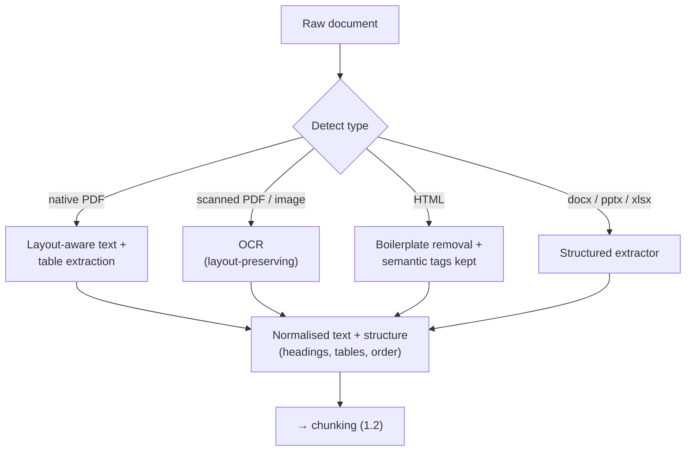
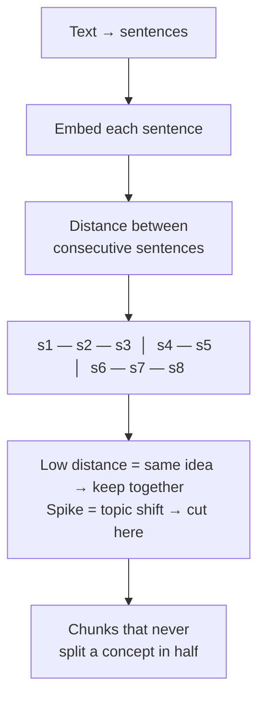
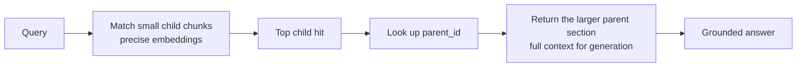
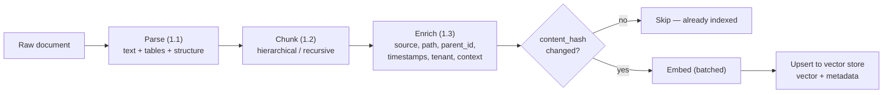

# Module 1 — Document Parsing and Ingestion Pipelines

Every impressive RAG demo runs on a clean markdown file. Every RAG system that fails in production fails on a scanned PDF of a 2011 policy document with a three-column layout and a table that spans two pages.

The gap between those two is the ingestion pipeline, and it is where most RAG quality is actually decided. Teams spend weeks tuning embeddings and rerankers to claw back three points of recall, while a broken PDF parser is silently destroying thirty points at the source. The retriever gets blamed for the parser's sins.

This module is about the layer nobody demos: taking the real, hostile formats enterprise data arrives in, and turning them into clean, correctly-sized, richly-tagged chunks. Get this right and mediocre retrieval works. Get it wrong and no amount of downstream cleverness recovers the meaning you shredded on the way in.

> **Prerequisites.** Comfort with Python or TypeScript. This is the first module of the RAG course; it assumes you know *what* RAG is (retrieve relevant text, put it in the prompt, generate a grounded answer) and now want to build the retrieval corpus properly.

**By the end of this module you will be able to:**

- Parse hostile formats — layout PDFs, tables, boilerplate-laden HTML, scanned images — without shredding meaning
- Choose a chunking strategy from the document's structure, not from fashion
- Explain, with the math, why semantic and hierarchical chunking beat fixed-size on structured text
- Enrich chunks with the metadata that makes pre-filtering, security, and recency possible
- Assemble an idempotent ingestion pipeline end to end

---

## 1.1 Handling Complex Formats

The first and most underestimated truth of enterprise RAG: **your data does not arrive as text.** It arrives as PDFs designed for printing, HTML designed for browsers, spreadsheets designed for humans, and scans designed for filing cabinets. Every one of those is a format that encodes *layout* or *presentation*, and none of them encodes *meaning* in a way a retriever can use directly.

Parsing is the act of recovering linear, meaningful text from a format that was never built to give it up. Do it badly and you have poisoned the well: **garbage in, cited garbage out.** No embedding model repairs text that was scrambled before it was ever embedded.



### PDFs: a layout format pretending to be a document

A PDF does not contain paragraphs. It contains instructions to *place this glyph at these coordinates on this page*. There is no inherent notion of reading order, no concept of "this is a heading" versus "this is body text", and no structural link between a number in a table and its column header. Everything you think of as document structure is a visual illusion your eyes reconstruct — and your parser has to reconstruct it too, or lose it.

This produces failure modes that look like model stupidity and are actually parser failures:

- **Reading order scrambling.** A two-column academic paper or newsletter, read left-to-right top-to-bottom by a naive extractor, interleaves the columns: line 1 of column A, line 1 of column B, line 2 of column A… The result is fluent-looking nonsense.
- **Header/footer pollution.** Running headers, page numbers, and footers get spliced into the middle of sentences that happened to straddle a page break.
- **Hyphenation and ligatures.** `inter-\nnational` becomes two tokens; the ligature `fi` may extract as a single odd glyph or vanish.
- **Scanned PDFs have no text at all.** They are images of pages. A text extractor returns an empty string, and teams discover this only when retrieval mysteriously returns nothing for whole documents.

The fix is a **layout-aware** extractor that understands blocks and coordinates, plus explicit reading-order reconstruction. Libraries like PyMuPDF (`fitz`) and `pdfplumber` expose position data you can use to sort and de-column.

```python
import pdfplumber

def extract_pdf(path: str) -> list[dict]:
    """Extract text page by page, keeping tables separate from prose.

    Returning per-page structured records (not one blob) lets the chunker
    respect page boundaries and attach page numbers as metadata (1.3).
    """
    pages: list[dict] = []
    with pdfplumber.open(path) as pdf:
        for i, page in enumerate(pdf.pages):
            # Extract tables FIRST, then remove their bounding boxes from the
            # text pass, so table cells are not also scraped as loose prose.
            tables = page.find_tables()
            table_bboxes = [t.bbox for t in tables]

            def not_in_table(obj):
                x, top = obj["x0"], obj["top"]
                return not any(
                    b[0] <= x <= b[2] and b[1] <= top <= b[3] for b in table_bboxes
                )

            prose = page.filter(not_in_table).extract_text() or ""
            pages.append({
                "page": i + 1,
                "text": prose,
                "tables": [linearize_table(t.extract()) for t in tables],
            })
    return pages
```

> **Warning.** Always detect scanned PDFs explicitly. A simple, reliable check: extract the text layer; if a page yields near-zero characters but has a large image, it is scanned and must go to OCR. Skipping this check is the classic reason "some documents just never show up in search" — they were silently ingested as empty strings.

### Tables: where linear text goes to die

A table is a two-dimensional relationship flattened onto a page. Flatten it a second time into a linear string and the relationship is gone:

```text
Region  2023  2024
US      5.2   7.1
EU      3.4   4.0
```

Extracted naively as `Region 2023 2024 US 5.2 7.1 EU 3.4 4.0`, the fact "EU revenue in 2024 was 4.0" is no longer recoverable — the model cannot know 4.0 belongs to EU and 2024 rather than US and 2023. A user asking "what was EU revenue in 2024?" retrieves this chunk and gets a confident guess.

The fix is **table linearization**: convert each table into a form that preserves the row/column association in linear text. Two good options:

- **Markdown or HTML table syntax**, which keeps structure the model can read.
- **Row-wise natural language**, one self-contained sentence per cell or row: `"EU revenue in 2024: 4.0"`. This is often *better* for retrieval, because each fact becomes an independently embeddable, matchable unit.

```python
def linearize_table(rows: list[list[str]]) -> str:
    """Turn a table into header-qualified sentences, one per data cell.

    'EU revenue in 2024: 4.0' embeds and retrieves far better than a naked
    number stripped of its row and column meaning.
    """
    if not rows or len(rows) < 2:
        return ""
    headers = [h.strip() for h in rows[0]]
    lines: list[str] = []
    for row in rows[1:]:
        label = row[0].strip()  # first column is usually the row key
        for col_idx, cell in enumerate(row[1:], start=1):
            if col_idx < len(headers) and cell.strip():
                lines.append(f"{label} — {headers[col_idx]}: {cell.strip()}")
    return "\n".join(lines)
```

> **Tip.** Keep the original table *and* the linearized version. Store the markdown table for display and citation, and embed the row-wise sentences for retrieval. The two jobs — being found and being shown — have different ideal representations.

### HTML: 90% of the bytes are noise

A scraped web page is mostly not content. Navigation menus, cookie banners, ad slots, "related articles" rails, footers, and analytics scripts routinely outweigh the actual article. Embed all of it and every chunk is diluted with boilerplate that matches the wrong queries — a search for your refund policy surfaces the cookie banner that appears on the refund page.

You need **main-content extraction** (the job that "reader mode" does): isolate the primary content and discard the chrome. Readability-style algorithms (`trafilatura`, `readability-lxml`) score DOM nodes by text density and link ratio to find the content block. Crucially, preserve the *semantic* tags inside it — headings, lists, tables — because those drive structure-aware chunking (1.2).

```python
import trafilatura

def extract_html(html: str, url: str = "") -> str | None:
    """Strip boilerplate, keep the article and its structure as markdown."""
    return trafilatura.extract(
        html,
        url=url,
        output_format="markdown",   # preserves headings, lists, tables
        include_tables=True,
        include_comments=False,     # drop comment sections
        favor_precision=True,       # prefer dropping boilerplate over keeping noise
    )
```

### OCR: text recovered under uncertainty

Scanned documents and images have no text layer — you must recognise the characters from pixels. Options range from local (`Tesseract`) to layout-aware cloud services (AWS Textract, Google Document AI, Azure Document Intelligence) that also reconstruct tables and form key-value pairs.

The honest reality of OCR:

- **It is probabilistic and it makes mistakes.** A misread `0`/`O`, `1`/`l`, or a decimal point in a financial table produces a *wrong fact* that is confidently retrieved. Quality depends on scan resolution, skew, and font.
- **Confidence scores are your friend.** Good OCR emits per-token confidence. Flag or quarantine low-confidence extractions rather than silently trusting them.
- **Layout-aware OCR preserves structure** — tables and forms — where plain OCR returns a jumble. For anything with tables, use a layout-aware service.

| Format | Core challenge | Right approach |
| --- | --- | --- |
| **Native PDF** | No reading order; headers/footers; hyphenation | Layout-aware extractor; reconstruct order; strip running headers |
| **Scanned PDF / image** | No text layer at all | Detect, then OCR (layout-aware); keep confidence scores |
| **Tables** | 2-D relationships flattened to 1-D | Linearize to markdown + row-wise sentences; keep both |
| **HTML** | Boilerplate dwarfs content | Readability extraction; keep semantic tags |
| **docx / pptx** | Structure is present but nested | Structured extractor; preserve heading hierarchy |
| **xlsx / csv** | Rows are records, not prose | One record per row; qualify cells with headers |

> **Warning.** Parsing is the least glamorous and highest-leverage part of a RAG system, and it is almost always under-resourced. Before you tune a single embedding, take twenty of your real documents, run them through your parser, and *read the raw output*. You will find scrambled columns, vanished tables, and boilerplate — and fixing those will beat any model upgrade. Budget for parsing like it is the product, because for retrieval quality, it is.

---

## 1.2 Chunking Strategies

Once you have clean text, you must cut it into chunks — the atomic units that get embedded, retrieved, and handed to the model. This is not preprocessing; it is the decision that caps retrieval quality, because **the chunk is the smallest thing you can retrieve.** A fact split across two chunks is a fact your system can no longer answer cleanly, and a chunk bloated with five topics is a vector that means none of them.

Two failure modes bound the whole problem:

- **Chunks too large** average many ideas into one blurry embedding that is weakly similar to everything and strongly similar to nothing.
- **Chunks too small** sever the context a statement needs — `"It expires after 30 days"` is useless once separated from the sentence naming what *it* is.

Every strategy below is an attempt to place the cuts where they do the least damage. They differ in how much structure they respect and how much they cost.

### Fixed-size chunking

Cut every N tokens (or characters), with an overlap. It is the baseline: trivial, fast, format-blind — and it will cheerfully slice through the middle of a sentence, a table, or a code block.

The overlap is what makes it tolerable. With chunk size `S` and overlap `O`, a document of length `L` produces roughly:

```text
chunks ≈ L / (S − O)
```

Overlap buys boundary safety at the cost of redundancy: a fact that lands on a boundary survives because it appears in the tail of one chunk and the head of the next. Typical overlap is 10–20% of chunk size. Set overlap to zero and every boundary is a coin-flip on whether a straddling fact is destroyed.

```python
def chunk_fixed(text: str, size: int = 800, overlap: int = 120) -> list[str]:
    step = size - overlap
    return [text[i : i + size] for i in range(0, len(text), step) if text[i : i + size].strip()]
```

Use fixed-size only for genuinely unstructured text (a wall of prose with no markup), or as a last-resort fallback inside a smarter splitter.

### Recursive character chunking

The pragmatic default. Instead of one blind cut length, define a *hierarchy of separators* from coarsest to finest — paragraph breaks, then line breaks, then sentences, then words — and split on the coarsest one that keeps chunks under the size budget, recursing into any piece that is still too big.

The effect is that it cuts at the most natural boundary available before it is forced to cut at an unnatural one. A clean paragraph break is preferred to a mid-sentence slice; a sentence break is preferred to a mid-word slice. It respects structure *opportunistically* without needing to understand the document.

```python
def chunk_recursive(
    text: str,
    size: int = 800,
    overlap: int = 120,
    separators: tuple[str, ...] = ("\n\n", "\n", ". ", " ", ""),
) -> list[str]:
    """Split on the coarsest separator that fits; recurse when a piece is too big."""
    if len(text) <= size:
        return [text] if text.strip() else []

    sep = next((s for s in separators if s and s in text), "")
    parts = list(text) if sep == "" else text.split(sep)

    chunks: list[str] = []
    buffer = ""
    for part in parts:
        piece = part if sep == "" else part + sep
        if len(buffer) + len(piece) > size and buffer:
            chunks.append(buffer.strip())
            buffer = buffer[-overlap:] if overlap else ""  # carry overlap forward
        # A single part larger than the budget: recurse with the next separator.
        if len(piece) > size:
            chunks.extend(chunk_recursive(piece, size, overlap, separators[1:]))
            buffer = ""
        else:
            buffer += piece
    if buffer.strip():
        chunks.append(buffer.strip())
    return chunks
```

### Semantic chunking

Recursive splitting respects *typographic* boundaries (paragraphs), not *meaning*. Semantic chunking places cuts where the topic actually shifts, so a single concept is never split and two unrelated concepts are never merged.

The mechanism is elegant. Split the text into sentences, embed each one, then walk the sequence measuring the cosine distance between consecutive sentence embeddings. Adjacent sentences about the same idea sit close together; a sentence that starts a new idea jumps away. Those **distance spikes are the semantic boundaries** — cut there.



You need a threshold for "how big a jump counts as a boundary". A fixed number does not transfer across documents, so use a **percentile of the distances within this document** (e.g. cut at the 95th percentile) — the boundaries are defined relative to how much this particular text moves around.

```python
import numpy as np

def chunk_semantic(sentences: list[str], embed, percentile: float = 95.0) -> list[str]:
    """Cut where consecutive-sentence distance spikes — i.e. where the topic
    shifts. Threshold is a within-document percentile, so it adapts per text."""
    if len(sentences) <= 1:
        return [" ".join(sentences)]

    vecs = np.array([embed(s) for s in sentences])
    # Cosine distance between each sentence and the next.
    dists = [
        1 - float(np.dot(vecs[i], vecs[i + 1]) /
                  (np.linalg.norm(vecs[i]) * np.linalg.norm(vecs[i + 1])))
        for i in range(len(vecs) - 1)
    ]
    threshold = float(np.percentile(dists, percentile))

    chunks, current = [], [sentences[0]]
    for i, d in enumerate(dists):
        if d > threshold:                 # topic shift → close the chunk
            chunks.append(" ".join(current))
            current = [sentences[i + 1]]
        else:
            current.append(sentences[i + 1])
    chunks.append(" ".join(current))
    return chunks
```

> **Warning.** Semantic chunking embeds every sentence at ingestion time — real compute and cost on a large corpus — and it is *not universally better*. It shines on flowing prose with implicit topic shifts and underperforms on already-structured documents, where the author's own headings are a better boundary than any distance metric. It is a tool, not a default. Measure it against recursive chunking on your retrieval eval set before adopting it.

### Markdown and hierarchical chunking

When a document *has* structure — markdown, HTML, or anything with headings — the author has already drawn the boundaries for you. Hierarchical chunking splits on the heading structure and, critically, **carries the heading path into every chunk** so a fragment always knows where it lives.

A chunk that reads `"Must be filed within 30 days."` is ambiguous. The same chunk prefixed with its section path — `"Refunds > Enterprise > Filing window: Must be filed within 30 days."` — is self-locating and embeds far more usefully, because the section context is now part of what gets matched.

```python
import re

def chunk_by_headings(markdown: str, max_size: int = 1200) -> list[dict]:
    """Split on markdown headings, keeping the full heading path as context.
    Oversized sections fall back to recursive splitting, path preserved."""
    lines = markdown.split("\n")
    path: list[str] = []           # current heading stack, e.g. ["Refunds", "Enterprise"]
    sections: list[dict] = []
    buffer: list[str] = []

    def flush():
        body = "\n".join(buffer).strip()
        if not body:
            return
        prefix = " > ".join(path)
        for piece in chunk_recursive(body, max_size):
            sections.append({"path": prefix, "text": f"{prefix}: {piece}" if prefix else piece})

    for line in lines:
        m = re.match(r"^(#{1,6})\s+(.*)", line)
        if m:
            flush()
            buffer = []
            level = len(m.group(1))
            path = path[: level - 1] + [m.group(2).strip()]  # trim stack to this depth
        else:
            buffer.append(line)
    flush()
    return sections
```

This also sets up **hierarchical (small-to-big) retrieval**, which we wire up with metadata in 1.3: match on precise child chunks, but return their parent section for generation.

| Strategy | Cuts on | Cost | Strength | Weakness |
| --- | --- | --- | --- | --- |
| **Fixed-size** | A character/token count | Negligible | Trivial, universal | Slices through sentences, tables, ideas |
| **Recursive** | Best available separator | Negligible | Great default; respects structure opportunistically | Still typographic, not semantic |
| **Semantic** | Topic-shift distance spikes | Embed every sentence | Never splits a concept | Expensive; weaker on already-structured docs |
| **Hierarchical** | Document headings | Negligible | Self-locating chunks; enables small-to-big | Needs real structure to exist |

> **Tip.** The decision tree is simpler than the discourse suggests. **Has the document real heading structure?** Chunk hierarchically. **Is it flowing prose where topic shifts matter and the budget allows?** Try semantic and measure. **Otherwise?** Recursive character chunking, and move on. Fixed-size is a fallback, never a first choice.

---

## 1.3 Metadata Enrichment

A chunk of raw text is a fact with no address. It cannot tell you where it came from, when it was written, which tenant owns it, or where it sits in its document. Strip a chunk of that and you have thrown away most of what makes retrieval *usable* and *safe* — you can find text by meaning, but you cannot filter, secure, or contextualise it.

Metadata is the structured envelope around each chunk. It is not decoration; it is what turns a similarity search into a production retrieval system.

### Why metadata is half the value: pre-filtering

The single biggest reason to enrich chunks is **pre-filtering** — constraining the search space by metadata *before or during* the vector similarity step, rather than filtering results afterward. This is not an optimisation; three things are impossible without it:

- **Tenant isolation.** In a multi-tenant product, a query from customer A must *never* retrieve customer B's documents. This is enforced by a hard metadata filter (`tenant_id = A`) on every search. It is a **security control**, not a nicety — get it wrong and you have a data breach, not a relevance bug.
- **Recency.** "What is our *current* refund policy?" must not surface the 2019 version. A `updated_at` timestamp lets you filter to recent documents or boost them, so a superseded-but-similar chunk does not win.
- **Scoping.** Filter by document type, language, department, or access level so results are constrained to what the user is allowed and expects to see.

> **Warning.** Apply hard filters (tenant, ACL, language) as *constraints on the search*, not as a post-processing pass over the top-k. If you retrieve the top 10 by similarity and *then* drop the ones the user can't see, you can return two results when ten existed — or, far worse, mis-implement it and leak. Tenant and access filters belong inside the query, evaluated before ranking.

### Parent IDs: small-to-big retrieval

There is a fundamental tension in chunk sizing: **small chunks retrieve precisely** (a tight embedding matches a specific query) but **large chunks generate well** (the model needs surrounding context to answer). You cannot have both in a single chunk size — unless you decouple them.

The pattern is *small-to-big* (parent-document) retrieval. Chunk small for matching, but tag each small chunk with a `parent_id` pointing at the larger section it came from. At query time you **match on the child, but return the parent** to the model.



Every child chunk carries `parent_id`; the parent sections are stored (in the vector DB's metadata, or a separate document store keyed by id) and fetched after the match. Precision on the way in, context on the way out.

### Summary tags and contextual retrieval

A chunk pulled from the middle of a document loses the context that made it meaningful. The sentence `"The limit was raised to 500."` is nearly unretrievable — raised from what, for what, when? — because the *subject* lived three paragraphs earlier.

**Contextual retrieval** fixes this by prepending a short, chunk-specific context — generated once at ingestion — that situates the chunk before it is embedded: `"This chunk is from the 2024 API rate-limit policy, describing the enterprise tier. The limit was raised to 500 requests per second."` The embedding now captures what the chunk is *about*, not just the bare sentence, and retrieval accuracy rises substantially.

The cost is one LLM call per chunk at ingestion. That is real, but it is a one-time ingestion cost, not a per-query cost, and prompt caching over the shared document text makes it cheap. Alternatively, generate a lighter `summary` and store it as metadata for filtering and display without prepending it to the embedding.

> **Tip.** Contextual retrieval is one of the highest-leverage upgrades available to a RAG system, and it lives entirely in the ingestion pipeline — no change to your retriever or model. Generate the context once, store it, embed the contextualised chunk. You pay at ingestion and profit on every query forever.

### The metadata schema

| Field | Enables |
| --- | --- |
| `source`, `url`, `doc_id` | Citations the user can verify; re-fetching the origin |
| `section_path`, `page` | Self-locating chunks; small-to-big; precise citations |
| `parent_id` | Parent-document retrieval (match child, return parent) |
| `created_at`, `updated_at` | Recency filtering and boosting |
| `tenant_id`, `acl` | **Security** — hard isolation between customers |
| `doc_type`, `language` | Scoped, correct results |
| `content_hash` | **Idempotency** — skip re-embedding unchanged chunks |
| `context` / `summary` | Contextual retrieval; display; filtering |

### The ingestion pipeline, end to end

Everything in this module composes into one pipeline: parse → chunk → enrich → embed → upsert. The two production details that separate a script from a system are **idempotency** (a content hash so re-ingesting an unchanged document is a cheap no-op) and **batching** (embed in batches, not one call per chunk).



```python
import hashlib
from dataclasses import dataclass, field
from datetime import datetime, timezone

@dataclass
class Chunk:
    id: str
    text: str            # the contextualised text that gets embedded
    metadata: dict = field(default_factory=dict)

def content_hash(text: str) -> str:
    return hashlib.sha256(text.encode()).hexdigest()[:16]

async def ingest_document(
    doc: dict,          # {"id", "bytes"/"html", "type", "tenant_id", "url"}
    *,
    parse,              # (doc) -> list[{"text", "page", ...}]
    embed_batch,        # (list[str]) -> list[list[float]]
    contextualise,      # (chunk_text, doc_summary) -> str   (one LLM call/chunk)
    store,              # vector store with .exists() and .upsert()
    doc_summary: str,
) -> int:
    parsed = parse(doc)
    now = datetime.now(timezone.utc).isoformat()

    chunks: list[Chunk] = []
    for section in parsed:
        for i, piece in enumerate(chunk_by_headings(section["text"])):
            body = piece["text"]
            ctx = contextualise(body, doc_summary)      # contextual retrieval
            contextualised = f"{ctx}\n\n{body}"
            h = content_hash(contextualised)
            chunk_id = f"{doc['id']}:{section.get('page', 0)}:{i}"
            chunks.append(Chunk(
                id=chunk_id,
                text=contextualised,
                metadata={
                    "doc_id": doc["id"],
                    "parent_id": f"{doc['id']}:{section.get('page', 0)}",
                    "source": doc.get("url", ""),
                    "section_path": piece["path"],
                    "page": section.get("page"),
                    "tenant_id": doc["tenant_id"],   # security filter (1.3)
                    "updated_at": now,
                    "content_hash": h,
                },
            ))

    # Idempotency: only embed chunks whose hash is new or changed.
    fresh = [c for c in chunks if not await store.exists(c.id, c.metadata["content_hash"])]
    if not fresh:
        return 0

    # Batch embedding — one call per batch, never one per chunk.
    vectors = await embed_batch([c.text for c in fresh])
    await store.upsert([
        {"id": c.id, "vector": v, "metadata": {**c.metadata, "text": c.text}}
        for c, v in zip(fresh, vectors)
    ])
    return len(fresh)
```

The TypeScript shape, for a Node ingestion worker — same idempotency and batching contract:

```ts
import { createHash } from "node:crypto";

export interface Chunk {
  id: string;
  text: string;
  metadata: Record<string, unknown>;
}

const contentHash = (text: string) =>
  createHash("sha256").update(text).digest("hex").slice(0, 16);

interface IngestDeps {
  parse: (doc: RawDoc) => Array<{ text: string; page?: number }>;
  chunk: (text: string) => Array<{ text: string; path: string }>;
  contextualise: (chunkText: string, docSummary: string) => Promise<string>;
  embedBatch: (texts: string[]) => Promise<number[][]>;
  store: {
    exists: (id: string, hash: string) => Promise<boolean>;
    upsert: (rows: Array<{ id: string; vector: number[]; metadata: Record<string, unknown> }>) => Promise<void>;
  };
}
interface RawDoc {
  id: string;
  tenantId: string;
  url?: string;
}

export async function ingestDocument(
  doc: RawDoc,
  rawParsed: RawDoc,
  docSummary: string,
  deps: IngestDeps,
): Promise<number> {
  const now = new Date().toISOString();
  const chunks: Chunk[] = [];

  for (const section of deps.parse(rawParsed)) {
    deps.chunk(section.text).forEach(async (piece, i) => {
      const ctx = await deps.contextualise(piece.text, docSummary);
      const text = `${ctx}\n\n${piece.text}`;
      chunks.push({
        id: `${doc.id}:${section.page ?? 0}:${i}`,
        text,
        metadata: {
          docId: doc.id,
          parentId: `${doc.id}:${section.page ?? 0}`,
          source: doc.url ?? "",
          sectionPath: piece.path,
          page: section.page ?? null,
          tenantId: doc.tenantId, // hard security filter (1.3)
          updatedAt: now,
          contentHash: contentHash(text),
        },
      });
    });
  }

  // Idempotency: embed only what changed.
  const fresh: Chunk[] = [];
  for (const c of chunks) {
    if (!(await deps.store.exists(c.id, c.metadata.contentHash as string))) fresh.push(c);
  }
  if (fresh.length === 0) return 0;

  const vectors = await deps.embedBatch(fresh.map((c) => c.text)); // batched
  await deps.store.upsert(
    fresh.map((c, i) => ({ id: c.id, vector: vectors[i]!, metadata: { ...c.metadata, text: c.text } })),
  );
  return fresh.length;
}
```

> **Tip.** Make ingestion idempotent from day one via the `content_hash`. Documents get re-crawled, pipelines get re-run, and without a hash check you re-embed the entire corpus every time — burning money and rate limits to produce identical vectors. The hash turns a full re-ingest into "only what actually changed", which is what lets you run ingestion continuously.

---

## Module Recap

- **Parsing is where most RAG quality is won or lost**, and it is chronically under-resourced. Read your parser's raw output on real documents before touching a model.
- **PDFs encode layout, not meaning** — reconstruct reading order, strip running headers, and detect scanned pages for OCR.
- **Tables must be linearized** into header-qualified sentences, or their 2-D facts become unretrievable. Keep the original for display.
- **HTML is mostly boilerplate** — extract main content, keep semantic tags. OCR is probabilistic; respect confidence scores.
- **Chunk from the document's structure**: hierarchical when headings exist, semantic for flowing prose (measured), recursive as the default, fixed-size only as a fallback.
- **Semantic chunking cuts at topic-shift distance spikes** using a within-document percentile threshold — powerful but expensive and not universally better.
- **Metadata is half the value.** Pre-filtering enables tenant security, recency, and scoping; `parent_id` enables small-to-big retrieval; a generated context enables contextual retrieval.
- **A production pipeline is idempotent (content hash) and batched.** Without the hash you re-embed the world on every run.

## Exercises

1. **Read the raw output.** Take five real PDFs from your domain — ideally including one scanned and one with a table. Run them through a basic extractor and read the output verbatim. Catalogue every failure: scrambled columns, vanished tables, header pollution. This list *is* your parsing backlog.
2. **Linearize a table.** Take a real table and produce both a markdown version and a row-wise sentence version. Embed a query like "X in year Y" against each and confirm the row-wise form retrieves the correct cell where the flattened form does not.
3. **Compare chunkers.** Chunk one structured document three ways — fixed, recursive, hierarchical. For five real questions, check whether the answer-bearing text survives as a coherent unit in each. Record which strategy kept the most concepts intact.
4. **Prove pre-filtering matters.** Build a tiny two-tenant index. Issue a query that matches documents in both tenants. Show that without a `tenant_id` filter you retrieve the wrong tenant's data, and that adding the filter to the query (not as a post-step) fixes it.

---

**Next:** *Module 2 — Embeddings and Vector Indexing*, where these clean, tagged chunks become searchable: choosing an embedding model, dense vs sparse vs hybrid retrieval, ANN indexes and the recall trade-off, and the metadata filters from this module enforced inside the query.
