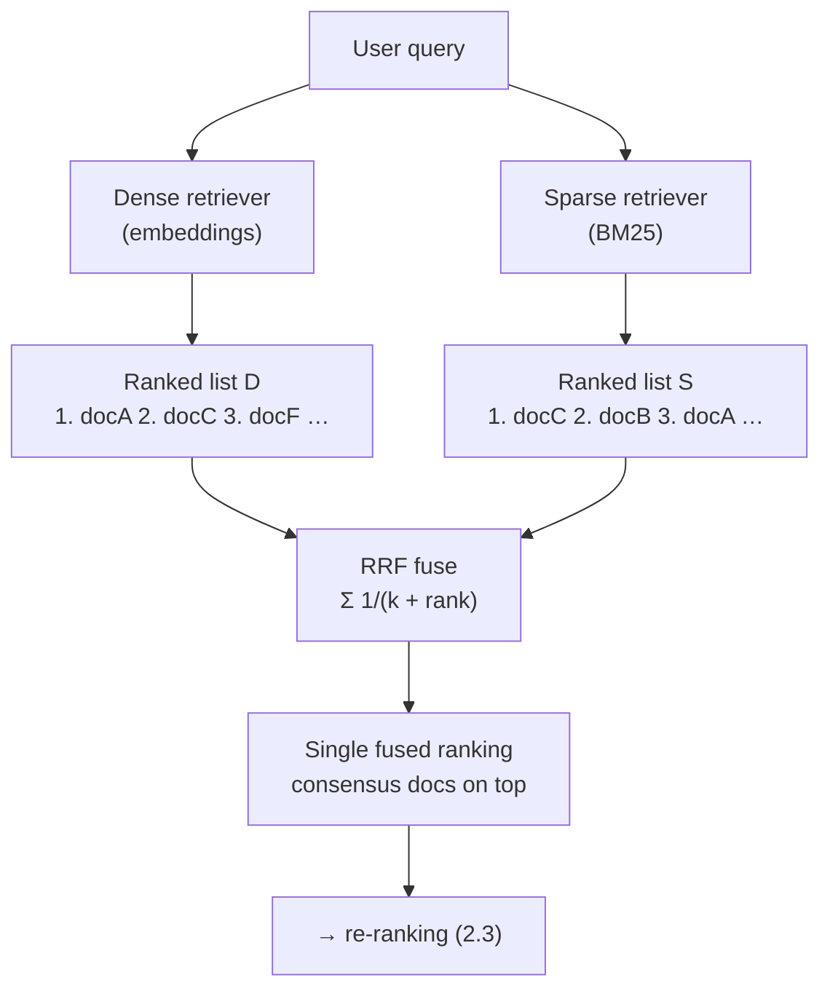
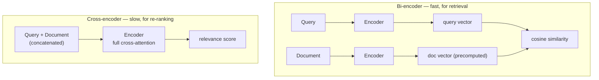
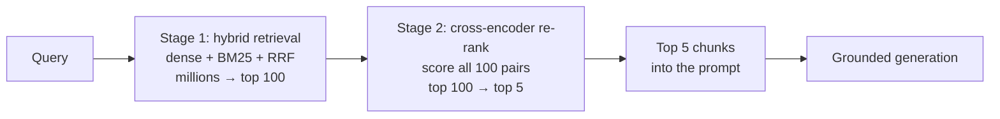

# Module 2 — Hybrid Retrieval and Re-ranking

Module 1 gave you clean, chunked, metadata-rich units in a store. Now you have to *find* the right ones. This is the part of RAG that most directly determines answer quality, because the model can only be as good as the passages you hand it. Retrieve the wrong three chunks and even a perfect prompt produces a confidently wrong answer.

Most teams reach for a single retrieval method — usually dense vector search, because it is what the tutorials show — and hit a wall they cannot explain: the system nails paraphrased questions but fails on the exact ones, the invoice number, the error code, the person's name. The wall is real and it is structural. This module is about getting over it with two moves: **fuse two retrievers that fail in opposite ways**, then **re-rank the survivors with a slower, sharper model**.

> **Prerequisites.** Module 1 (your chunks and their metadata) and a working notion of embeddings and vector similarity. This module deliberately does *not* cover index internals — HNSW, IVF, quantization, the vector math — which get a dedicated course of their own. Here we treat the vector index as a black box that returns a ranked list.

**By the end of this module you will be able to:**

- Explain, mechanically, why dense search fails on exact tokens and sparse search fails on meaning
- Implement BM25 and reason about its `k1` and `b` parameters
- Fuse two ranked lists with Reciprocal Rank Fusion, and say why it needs no score normalization
- Distinguish bi-encoders from cross-encoders and know exactly where each belongs
- Add a re-ranking stage that drastically lifts the precision of what reaches the model

---

## 2.1 Dense vs Sparse Retrieval

There are two fundamentally different ways to decide whether a chunk matches a query, and they are good at opposite things.

**Dense retrieval** is what you built on in Module 1: embed the query and the chunks into vectors, and rank by cosine similarity. Because embeddings encode *meaning*, dense search connects `"how do I cancel my subscription"` to `"steps to end your plan"` even though they share no words. This is its superpower — and the source of its blind spot.

**Sparse retrieval** is the classic lexical approach, decades older and still the backbone of every serious search engine. It represents text as a high-dimensional sparse vector over the vocabulary and scores by *term overlap*, weighted cleverly. It matches words, not meanings.

### Why dense search fumbles exact matches

An embedding is a lossy compression of text into a fixed-length vector optimised to place *similar meanings* nearby. That objective actively discards surface form — which is exactly what you want for paraphrase and exactly what you do not want for identifiers.

Consider a user searching for error code `ERR_2043`. To an embedding model:

- `ERR_2043` and `ERR_2044` are almost identical vectors. They share a prefix, a structure, a "shape" of meaning (both are error codes). Semantically they are neighbours; literally they are different errors with different fixes.
- Rare tokens — serial numbers, SKUs, proper names, code identifiers, one-off acronyms — appear seldom in training data, so the model has learned weak, smeared representations for them. It cannot reliably distinguish `INV-2024-8891` from `INV-2024-8819`.

The failure is not a tuning problem; it is the embedding doing its job. It was trained to capture meaning, and a serial number has almost no *meaning* — only *identity*. A user who searches for invoice `#INV-2024-8891` and gets back three *semantically similar* invoices has been failed by the paradigm, not the model.

### BM25: exact-match retrieval done right

Sparse retrieval's workhorse is **BM25** (Best Matching 25), a refinement of TF-IDF that has anchored search for thirty years. The intuition is two ideas layered together:

- **Term frequency (TF):** a chunk that contains a query term many times is probably more about it.
- **Inverse document frequency (IDF):** a term that is rare across the whole corpus is more discriminating than a common one. Matching on `ERR_2043` (rare) tells you far more than matching on `the` (everywhere).

BM25 combines them, but with two crucial corrections that TF-IDF lacks. For a query `Q` and document `D`:

```text
score(D, Q) = Σ_{t ∈ Q}  IDF(t) ·  ( f(t,D) · (k1 + 1) )
                                    ─────────────────────────────────────
                                    f(t,D) + k1 · (1 − b + b · |D| / avgdl)
```

where `f(t,D)` is the term's frequency in `D`, `|D|` is the document length, and `avgdl` is the average document length. The two parameters are what make BM25 better than naive TF-IDF:

- **`k1` (term-frequency saturation, ~1.2–2.0).** Repeated terms have *diminishing* returns. A chunk mentioning a term ten times is more relevant than one mentioning it once, but not ten times more. `k1` bends the TF curve so it saturates instead of growing linearly.
- **`b` (length normalization, ~0.75).** Long documents match more terms simply by being long. `b` penalizes length so a sprawling page doesn't out-score a tight, on-point chunk purely by volume.

BM25 nails the exact-match case dense search fumbles: `ERR_2043` is a rare term (high IDF), an exact occurrence scores high, and `ERR_2044` — sharing no term — scores zero. There is no smearing, because there is no compression; the token either appears or it does not.

```python
import math
from collections import Counter

class BM25:
    def __init__(self, corpus: list[list[str]], k1: float = 1.5, b: float = 0.75):
        self.k1, self.b = k1, b
        self.corpus = corpus
        self.N = len(corpus)
        self.avgdl = sum(len(d) for d in corpus) / self.N
        # Document frequency: in how many docs does each term appear?
        self.df: Counter[str] = Counter()
        for doc in corpus:
            for term in set(doc):
                self.df[term] += 1
        self.tf = [Counter(doc) for doc in corpus]

    def idf(self, term: str) -> float:
        n = self.df.get(term, 0)
        # +0.5 smoothing; +1 keeps IDF non-negative for very common terms.
        return math.log((self.N - n + 0.5) / (n + 0.5) + 1)

    def score(self, query: list[str], doc_idx: int) -> float:
        doc_len = len(self.corpus[doc_idx])
        tf = self.tf[doc_idx]
        total = 0.0
        for term in query:
            if term not in tf:
                continue
            f = tf[term]
            numerator = f * (self.k1 + 1)
            denominator = f + self.k1 * (1 - self.b + self.b * doc_len / self.avgdl)
            total += self.idf(term) * numerator / denominator
        return total

    def search(self, query: list[str], top_k: int = 10) -> list[tuple[int, float]]:
        scored = [(i, self.score(query, i)) for i in range(self.N)]
        return sorted(scored, key=lambda x: x[1], reverse=True)[:top_k]
```

> **Tip.** You rarely implement BM25 yourself in production — Elasticsearch, OpenSearch, Lucene, and most vector databases ship a battle-tested version, and many vector DBs now offer hybrid search natively. But knowing the formula is what lets you reason about *why* a long document out-ranked the right one (raise `b`) or why a term-stuffed chunk won (lower `k1`). It is the difference between tuning search and cargo-culting it.

### The complementarity

The reason to care about both is that **they fail in exactly opposite directions**:

| | Dense (embeddings) | Sparse (BM25) |
| --- | --- | --- |
| Matches on | Meaning | Exact terms |
| Strong on | Paraphrase, synonyms, intent | Identifiers, names, codes, rare words |
| Blind to | Exact tokens it smears together | Synonyms — zero shared terms, zero score |
| `cancel` vs `end plan` | Matches (same meaning) | Misses (no shared word) |
| `ERR_2043` vs `ERR_2044` | Confuses (near-identical vectors) | Distinguishes perfectly |
| Precompute | Doc vectors at ingestion | Inverted index at ingestion |

Neither is a superset of the other. A dense-only system silently fails every exact-identifier query; a sparse-only system silently fails every paraphrase. The obvious move is to run both and combine them — which is only useful if you can combine them *well*.

> **Warning.** Metadata pre-filtering from Module 1 applies to both retrievers and must be enforced on *both*. A `tenant_id` filter that guards your dense search but not your BM25 index is a data leak through the back door. Whatever constrains one arm of a hybrid search must constrain the other.

---

## 2.2 Reciprocal Rank Fusion

You have two ranked lists — one from dense search, one from BM25 — and you need one. The naive approach is to normalize both sets of scores to a common range and add them. This is fragile, and understanding *why* is the whole point.

Dense cosine similarities live in roughly `[0, 1]`. BM25 scores are unbounded, vary wildly with query length and corpus statistics, and have no fixed maximum. To add them you must normalize — usually min-max, per query — and min-max normalization is brittle: a single outlier score stretches the range and compresses everything else, the distributions differ per query, and a score of "0.8 normalized" means something different in each list. **Score-based fusion inherits the incomparability of the two scoring systems.** You are trying to average two numbers that were never on the same scale.

**Reciprocal Rank Fusion (RRF)** sidesteps the problem entirely by throwing away the scores and fusing on **rank position** instead. A document's contribution from each retriever depends only on *where it placed*, not on what score it got:

```text
RRF_score(d) = Σ_{r ∈ retrievers}  1 / (k + rank_r(d))
```

where `rank_r(d)` is `d`'s 1-based position in retriever `r`'s list (and a document absent from a list contributes nothing from it). `k` is a constant, conventionally **60**.

The elegance is that **rank is already a universal scale.** Position 1, 2, 3… means the same thing whether it came from cosine similarity or BM25 or a coin flip. There is nothing to normalize because rank carries no units. Two utterly incomparable scoring systems produce two perfectly comparable *rankings*, and RRF fuses those.

### Why it behaves well

Work through what the formula rewards. A document ranked #1 by *both* retrievers scores `1/(60+1) + 1/(60+1) = 0.0328`. A document ranked #1 by one retriever and absent from the other scores `1/(60+1) = 0.0164`. A document ranked #1 by one and #50 by the other scores `1/61 + 1/110 = 0.0255`.

So **documents that both retrievers rank highly rise to the top**, documents only one retriever likes are demoted but not discarded, and a document loved by one and buried by the other lands in between. That is exactly the behaviour you want from a fusion: consensus wins, but a strong single signal still counts.

The `k` parameter (default 60, from Cormack et al., 2009) tunes how top-heavy the fusion is. The reciprocal `1/(k + rank)` means the *gap* between rank 1 and rank 2 shrinks as `k` grows:

- **Small `k`** (e.g. 10) makes the top ranks dominate — being #1 is worth far more than being #3.
- **Large `k`** (e.g. 100) flattens the curve, letting deeper results contribute more and rewarding broad agreement over a single top placement.
- **`k = 60`** is the robust default that works across most corpora; tune it only with an eval set (Course 1, Module 3) telling you it helps.



| | Score fusion (normalize + add) | Rank fusion (RRF) |
| --- | --- | --- |
| Uses | Raw scores | Rank positions only |
| Needs normalization | Yes — and it is brittle | **No — rank is unitless** |
| Sensitive to score outliers | Yes | No |
| Tuning | Per-retriever weights + norm params | One constant `k` |
| Robustness across queries | Poor | Strong |

```python
def reciprocal_rank_fusion(
    ranked_lists: list[list[str]],
    k: int = 60,
    weights: list[float] | None = None,
) -> list[tuple[str, float]]:
    """Fuse ranked ID lists by position. `weights` lets you trust one retriever
    more than another without ever touching their (incomparable) raw scores."""
    weights = weights or [1.0] * len(ranked_lists)
    scores: dict[str, float] = {}
    for lst, w in zip(ranked_lists, weights):
        for rank, doc_id in enumerate(lst, start=1):   # 1-based rank
            scores[doc_id] = scores.get(doc_id, 0.0) + w * (1 / (k + rank))
    return sorted(scores.items(), key=lambda x: x[1], reverse=True)


async def hybrid_search(query: str, *, dense_search, sparse_search, top_k: int = 100):
    """Run both retrievers, fuse with RRF. Retrieve deep (top_k large) here;
    precision comes from the re-ranker in 2.3, not from this stage."""
    import asyncio
    dense, sparse = await asyncio.gather(
        dense_search(query, top_k=top_k),
        sparse_search(query, top_k=top_k),
    )
    fused = reciprocal_rank_fusion([[d.id for d in dense], [s.id for s in sparse]])
    return fused
```

The TypeScript version — the same rank-only fusion, weights optional:

```ts
export function reciprocalRankFusion(
  rankedLists: string[][],
  k = 60,
  weights?: number[],
): Array<{ id: string; score: number }> {
  const w = weights ?? rankedLists.map(() => 1);
  const scores = new Map<string, number>();

  rankedLists.forEach((list, i) => {
    list.forEach((id, index) => {
      const rank = index + 1; // 1-based
      scores.set(id, (scores.get(id) ?? 0) + w[i]! * (1 / (k + rank)));
    });
  });

  return [...scores.entries()]
    .map(([id, score]) => ({ id, score }))
    .sort((a, b) => b.score - a.score);
}
```

> **Tip.** Retrieve *deep* before fusing — top 100 from each retriever, not top 10. The fusion stage is about recall (get the right document into the candidate pool at all), and the precision comes next, from re-ranking. A shallow retrieve-and-fuse throws away good candidates before the sharp model ever sees them.

---

## 2.3 Cross-Encoder Re-ranking

Hybrid retrieval gives you a strong candidate list, but "strong" is not "precise". The fused #1 is not reliably the *most* relevant chunk; the right passage is often sitting at rank 4 or rank 12. Re-ranking is a second pass that reorders the top candidates with a much more accurate — and much more expensive — model. To understand why it works, you have to understand the two architectures.

### Bi-encoders vs cross-encoders

**Bi-encoders** are what all the retrieval so far has used. The query and each document are encoded *separately* into vectors, and relevance is their cosine similarity. The critical property: document vectors are computed once, at ingestion, and stored. At query time you encode the query once and do cheap dot products against millions of precomputed vectors. It scales beautifully — and it is fundamentally limited, because **the query and the document never meet inside the model.** Each is compressed in ignorance of the other, so the model cannot reason about how a specific query term relates to a specific document phrase. It compares two summaries made in separate rooms.

**Cross-encoders** feed the query and the document *together* — concatenated into one input — through the model, with full attention across both. The output is a single relevance score. Because every query token can attend to every document token, the model directly judges the *interaction*: does this document actually answer this query? That is dramatically more accurate. The catch is fatal to using it for retrieval: **nothing can be precomputed.** Every `(query, document)` pair needs its own forward pass at query time. Scoring one query against 10 million documents means 10 million forward passes. It is `O(N)` model calls, where the bi-encoder was `O(N)` cheap dot products plus one encode.



| | Bi-encoder | Cross-encoder |
| --- | --- | --- |
| Input | Query and doc encoded **separately** | Query and doc encoded **together** |
| Cross-attention | None — they never interact | Full — every token attends across both |
| Precompute doc vectors | Yes | **No — impossible** |
| Cost at query time | One encode + cheap dot products | One forward pass **per document** |
| Scales to | Millions of docs | Tens to low hundreds |
| Accuracy | Good | **Much higher** |
| Role | Stage-1 retrieval | Stage-2 re-ranking |

### The retrieve-then-rerank pattern

The two architectures are not competitors; they are stages. You use the cheap, scalable bi-encoder (plus BM25, fused) to go from millions of documents down to a manageable candidate set, then unleash the expensive, accurate cross-encoder on just those survivors.



This is **recall then precision**. Stage 1 casts a wide, cheap net optimised to get the right chunk *somewhere* in the top 100 (high recall). Stage 2 applies the expensive, accurate filter to those 100 to get the right chunk into the top 5 (high precision). A cross-encoder over 100 documents is ~100 batched forward passes — a few hundred milliseconds — which is feasible per query; over 10 million it is not. The bi-encoder makes the cross-encoder affordable by shrinking its workload by five orders of magnitude.

The payoff is large and it compounds downstream. A precise top-5 means the model's context window (Course 1, Module 1) is spent on genuinely relevant passages instead of near-misses, which directly reduces distraction, mitigates "lost in the middle", and raises faithfulness — fewer irrelevant chunks means fewer chances for the model to ground its answer in the wrong one.

### Implementing a re-ranker

You have two good options: a managed API (Cohere Rerank, and similar) or a local open cross-encoder (BGE reranker, or any sentence-transformers `CrossEncoder`).

A local BGE reranker — no per-call cost, needs a GPU for low latency at scale:

```python
from sentence_transformers import CrossEncoder

# A cross-encoder: it takes PAIRS and outputs a single relevance score each.
reranker = CrossEncoder("BAAI/bge-reranker-base")

def rerank(query: str, candidates: list[dict], top_k: int = 5) -> list[dict]:
    """Re-score stage-1 candidates with a cross-encoder, keep the best top_k.

    `candidates` are the fused hybrid results from 2.2 — pass ~100 in,
    get the most relevant handful out."""
    pairs = [(query, c["text"]) for c in candidates]
    scores = reranker.predict(pairs)          # one forward pass per pair (batched)
    for c, s in zip(candidates, scores):
        c["rerank_score"] = float(s)
    return sorted(candidates, key=lambda c: c["rerank_score"], reverse=True)[:top_k]
```

A managed reranker (Cohere) — no infrastructure, per-call cost, strong quality:

```python
import cohere

co = cohere.Client()  # key from env, never hard-coded (Course 1, Module 4)

def rerank_cohere(query: str, candidates: list[dict], top_k: int = 5) -> list[dict]:
    resp = co.rerank(
        model="rerank-english-v3.0",
        query=query,
        documents=[c["text"] for c in candidates],
        top_n=top_k,
    )
    # The API returns indices into the input list, with relevance scores.
    return [
        {**candidates[r.index], "rerank_score": r.relevance_score}
        for r in resp.results
    ]
```

The same managed call from a Node service:

```ts
import { CohereClient } from "cohere-ai";

const cohere = new CohereClient(); // COHERE_API_KEY from env

export async function rerank(
  query: string,
  candidates: Array<{ id: string; text: string }>,
  topK = 5,
): Promise<Array<{ id: string; text: string; rerankScore: number }>> {
  const resp = await cohere.rerank({
    model: "rerank-english-v3.0",
    query,
    documents: candidates.map((c) => c.text),
    topN: topK,
  });
  // API returns indices into `candidates`, so we map back to the full objects.
  return resp.results.map((r) => ({
    ...candidates[r.index]!,
    rerankScore: r.relevanceScore,
  }));
}
```

> **Warning.** Re-ranking is a *second model call* on the request's hot path — it adds latency and, for managed rerankers, per-query cost. It is one of the highest-ROI additions to a RAG system, but "high ROI" is not "always worth it". Keep the candidate set bounded (50–100 is typical; more is diminishing returns and rising latency), batch the pairs, and — this is the part teams skip — **measure the precision lift on your eval set (Course 1, Module 3) against the added latency.** If stage-1 hybrid retrieval already puts the right chunk in the top 3, a re-ranker buys you little for real cost. Prove the gain; don't assume it.

---

## Module Recap

- **Dense and sparse retrieval fail in opposite directions.** Dense understands meaning and smears exact tokens; BM25 nails identifiers and is blind to synonyms. Neither is a superset of the other.
- **BM25's `k1` saturates repeated terms and `b` normalizes for length** — the two corrections that make it beat naive TF-IDF, and the two knobs you tune when the wrong document wins.
- **RRF fuses on rank, not score, so it needs no normalization** — rank is a unitless common scale, which is why it robustly combines two incomparable scoring systems. `k = 60` is the default; consensus documents rise.
- **Retrieve deep, then re-rank.** Fusion is for recall; precision comes from the second stage.
- **Bi-encoders encode query and document separately (fast, scalable, for retrieval); cross-encoders encode them together (accurate, expensive, for re-ranking).** The cross-encoder's cross-attention is why it is more accurate and why it cannot be precomputed.
- **The retrieve-then-rerank pattern is recall then precision**: hybrid gets millions down to 100, a cross-encoder gets 100 down to a precise 5 — which lifts faithfulness downstream by spending the context window on genuinely relevant passages.
- **Measure the re-ranker's lift against its latency.** It is usually worth it; prove it is.

## Exercises

1. **Reproduce the blind spots.** Build a tiny corpus and index it both densely and with BM25. Query it with a paraphrase (no shared words with the target) and with an exact identifier. Confirm dense wins the first and BM25 wins the second — then confirm RRF wins both.
2. **Feel the parameters.** Take a BM25 index and a query where a long, term-stuffed document out-ranks a short precise one. Raise `b`, then lower `k1`. Record which correction fixed it and explain why in one sentence each.
3. **Fuse by hand.** Given two ranked lists of five documents each, compute the RRF score for every document with `k = 60`. Verify that a document ranked #1 in both beats one ranked #1 in only one, and that no score normalization was ever needed.
4. **Prove the re-ranker earns its latency.** On a 30-question eval set, measure precision@5 for hybrid retrieval alone, then hybrid + cross-encoder re-ranking. Record the precision lift and the added latency, and decide — with your own numbers — whether you would ship it.

---

**Next:** *Module 3 — Query Understanding and Advanced Retrieval*, where the query itself becomes the lever: rewriting and expanding vague questions, HyDE and multi-query retrieval, and self-querying that turns natural language into the metadata filters you built in Module 1.
