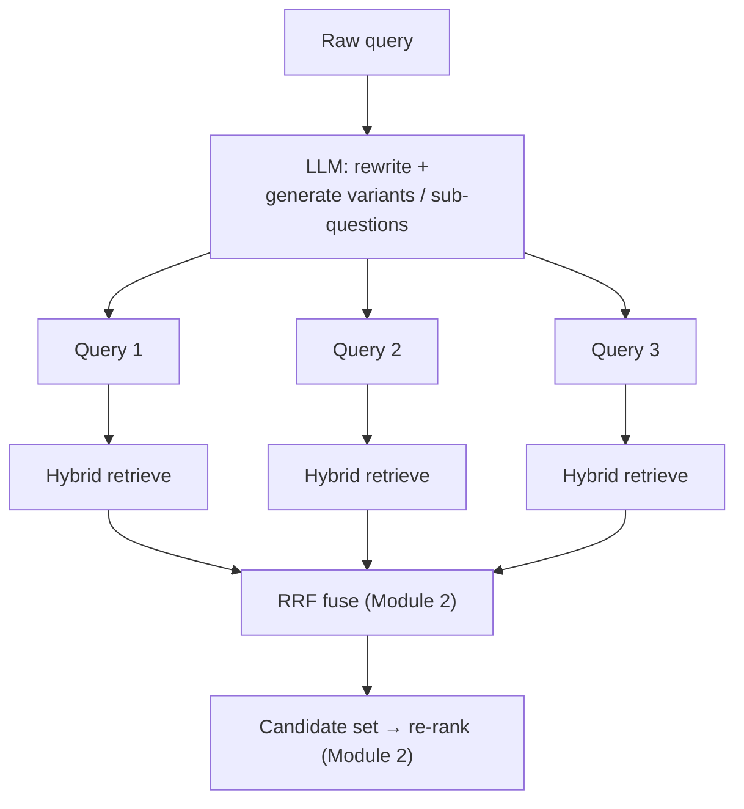
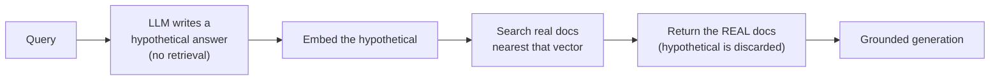
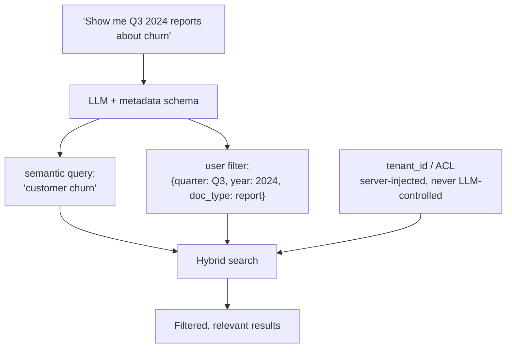
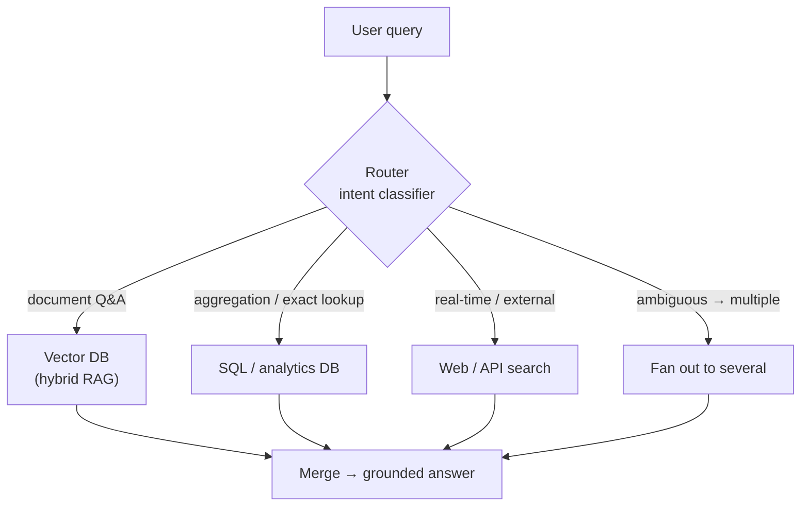

# Module 3 — Query Understanding and Advanced Retrieval

Modules 1 and 2 optimised everything on the *document* side: parse well, chunk well, index densely and sparsely, fuse, re-rank. All of that assumed the query was fixed and good. It usually is not.

The raw string a user types is frequently the weakest link in the entire pipeline. It is vague, conversational, misspelled, overloaded with several questions at once, or phrased nothing like the documents that hold the answer. A flawless retriever fed a flawed query returns flawless matches for the wrong thing. This module moves the leverage to the *query* side — transforming, expanding, decomposing, and routing the query before it ever touches an index.

The unifying idea: **the query as typed is raw material, not a fixed input.** Everything here is a transformation applied between the user and the retriever, and each one trades an LLM call and some latency for recall, precision, or reaching a backend a vector index could never serve.

> **Prerequisites.** Modules 1 (metadata) and 2 (hybrid retrieval, RRF, re-ranking). Self-querying (3.3) writes directly into the pre-filtering layer from Module 1, and multi-query (3.1) fuses with the RRF from Module 2. Structured outputs from the Prompt Engineering course (Module 2) are the enabling technique throughout.

**By the end of this module you will be able to:**

- Rewrite conversational and ambiguous queries into standalone, retrievable ones
- Fan a query out into multiple sub-queries to raise recall, and fuse the results
- Apply HyDE to beat question-answer asymmetry — and mitigate its hallucination risk
- Extract structured metadata filters from natural language and feed the pre-filter safely
- Route queries to the backend that can actually answer them, instead of forcing everything through a vector index

---

## 3.1 Query Rewriting and Multi-Query

There is a persistent gap between **how users ask** and **how answers are written**. A user types `"that pricing thing from the last email"`; the document says `"Enterprise tier: $2,000/month, billed annually"`. They share almost nothing an embedding or a BM25 index can latch onto. Retrieval on the raw query fails not because the index is bad but because the query never described the answer.

Three transformations close different parts of that gap.

### Rewriting: make the query standalone and clean

The most common and highest-value rewrite is **contextualization** — collapsing a conversational, context-dependent query into a self-contained one. In a chat RAG system, users speak in fragments that only make sense against the history:

- User: "What's the refund policy?" → Assistant answers → User: "What about for enterprise?"

The query `"What about for enterprise?"` retrieves nothing useful on its own — it has no subject. Before retrieval, an LLM condenses the history plus the new turn into a standalone query: `"What is the refund policy for enterprise plans?"` Now it retrieves.

Rewriting also fixes spelling, expands acronyms the corpus spells out, and strips conversational noise. It is cheap insurance against the messiness of real input.

```python
CONDENSE = """Given the conversation and a follow-up question, rewrite the
follow-up as a standalone question that makes sense without the history.
Preserve the user's intent exactly. Do not answer it. Do not add specifics
that were not stated.

Conversation:
{history}

Follow-up: {question}

Standalone question:"""

async def condense_query(call_model, history: str, question: str) -> str:
    rewritten = await call_model(CONDENSE.format(history=history, question=question), temperature=0.0)
    return rewritten.strip()
```

> **Warning.** Rewriting is a place the meaning can **drift**. An over-eager model turns `"what about enterprise?"` into `"what is the enterprise refund policy for annual contracts over $10,000?"` — inventing specificity the user never expressed, which then narrows retrieval to the wrong place. Instruct the rewriter to preserve intent and add nothing, use `temperature=0`, and treat a rewrite that changes the *question* rather than its *phrasing* as a bug.

### Multi-query: fan out for recall

A single query is a single point in embedding space. The answer-bearing chunk might sit near a *different* phrasing of the same question — and your one query missed it. **Multi-query retrieval** generates several diverse formulations, retrieves for each, and fuses the results. More query points cover more of the space where the answer might live.

There are two distinct patterns, and they solve different problems:

- **Paraphrase fan-out.** Generate N rewordings of the *same* question (`"how to reset password"`, `"steps to change my login credentials"`, `"recover account access"`). Each hits different vocabulary in the corpus. Retrieve for all, fuse — pure recall boost for a single-answer question.
- **Decomposition.** Break a *complex, multi-part* question into sub-questions that can each be answered independently. `"Compare the refund policies for enterprise and free plans"` → `["What is the enterprise refund policy?", "What is the free plan refund policy?"]`. No single chunk answers the original; the sub-questions retrieve the pieces, and generation composes them.

The results from every sub-query are combined with **Reciprocal Rank Fusion from Module 2** — the same rank-based fusion that merged dense and sparse, now merging N query variants. Rank fusion is exactly right here because the sub-queries' scores are, again, not directly comparable.



```python
import asyncio
import json

MULTI = """Generate {n} diverse search queries that together would retrieve
everything needed to answer the user's question. If the question has multiple
parts, split them. Preserve intent; invent no new constraints.

Question: {question}

Return ONLY a JSON array of query strings."""

async def multi_query_retrieve(call_model, hybrid_search, rrf, question: str, n: int = 3):
    raw = await call_model(MULTI.format(n=n, question=question), temperature=0.3)
    try:
        queries = json.loads(raw.strip().strip("`"))
    except Exception:
        queries = [question]                    # fall back to the raw query
    queries = [question, *queries][: n + 1]     # always include the original

    # Retrieve for every variant in parallel, then fuse by rank.
    results = await asyncio.gather(*(hybrid_search(q, top_k=50) for q in queries))
    return rrf([[hit.id for hit in r] for r in results])
```

The TypeScript shape — same fan-out, same fusion:

```ts
export async function multiQueryRetrieve(
  question: string,
  deps: {
    generateQueries: (q: string, n: number) => Promise<string[]>;
    hybridSearch: (q: string, k: number) => Promise<Array<{ id: string }>>;
    rrf: (lists: string[][]) => Array<{ id: string; score: number }>;
  },
  n = 3,
): Promise<Array<{ id: string; score: number }>> {
  const variants = await deps.generateQueries(question, n).catch(() => []);
  const queries = [question, ...variants].slice(0, n + 1);

  const results = await Promise.all(queries.map((q) => deps.hybridSearch(q, 50)));
  return deps.rrf(results.map((r) => r.map((hit) => hit.id)));
}
```

| Technique | Fixes | Mechanism | Cost |
| --- | --- | --- | --- |
| **Rewrite / condense** | Conversational, vague, misspelled queries | LLM → one clean standalone query | 1 LLM call |
| **Paraphrase fan-out** | Vocabulary mismatch with the corpus | LLM → N rewordings, retrieve all, fuse | 1 LLM call + N retrievals |
| **Decomposition** | Multi-part questions no chunk answers alone | LLM → sub-questions, retrieve each, fuse | 1 LLM call + N retrievals |

> **Tip.** Always keep the original query in the fan-out set. The rewrites are hypotheses about better phrasings; the original is the ground truth of what was asked. Fusing them together means a good rewrite helps and a bad one is outvoted, rather than replacing a correct query with a mangled one.

---

## 3.2 Hypothetical Document Embeddings (HyDE)

Dense retrieval has a subtle structural mismatch that no amount of query cleaning fixes: **a question and its answer are written differently and live in different regions of embedding space.**

`"How do I reset my password?"` is a short interrogative. The passage that answers it — `"To reset your password, open Settings, select Security, and click Reset. A link is emailed to the address on file."` — is a declarative procedure. They are *about* the same thing, but their surface forms, lengths, and structures differ, so their embeddings are farther apart than you would like. You are asking the model to match a question-shaped vector against answer-shaped vectors: a cross-domain match.

**HyDE (Hypothetical Document Embeddings)** inverts the problem. Instead of embedding the question, ask an LLM to *write a hypothetical ideal answer* to it — with no retrieval, purely from the model's own knowledge — and embed *that*. The fake answer is answer-shaped, so its embedding lands in the same region as the real answer passages. You have converted a question-to-answer match into an **answer-to-answer** match, which dense retrieval does far better.



The crucial, counterintuitive point: **the hypothetical answer is used only as a search vector and then thrown away.** It never reaches the user and it never grounds the final answer — the *real* retrieved documents do that. This is why it can tolerate being wrong.

```python
HYDE = """Write a short, direct passage that would perfectly answer this
question, as if it were an excerpt from a documentation page. Two to four
sentences. Do not hedge; write it as confident documentation.

Question: {question}

Passage:"""

async def hyde_retrieve(call_model, embed, vector_search, question: str, top_k: int = 20):
    # 1. Generate an answer-shaped hypothetical (may be factually wrong — fine).
    hypothetical = await call_model(HYDE.format(question=question), temperature=0.3)
    # 2. Embed the HYPOTHETICAL, not the question.
    vec = await embed(hypothetical)
    # 3. Retrieve REAL documents near it; the hypothetical is now discarded.
    return await vector_search(vec, top_k=top_k)
```

### The risk, honestly

HyDE embeds a fabrication, and fabrications have failure modes:

- **Hallucinated specifics can mislead retrieval.** If the fake answer invents a product name, a version number, or a statistic, those tokens shape the embedding and can pull retrieval toward documents about the *wrong* thing. The more specific and confident the hallucination, the more it can distort the search vector.
- **Out-of-domain queries produce useless hypotheticals.** For a niche internal system the model has never seen, the fake answer is generic filler that points nowhere near your actual corpus.
- **It costs an LLM generation on every query**, before retrieval even starts — latency on the hot path.

Two mitigations matter. First, **generate several hypotheticals and average their embeddings**: any single hallucination is noise, and averaging several independent drafts cancels the idiosyncratic inventions while reinforcing the shared, correct "shape" of the answer. Second, **retrieve with both** the hypothetical embedding and the raw query embedding and fuse — so HyDE augments rather than replaces the honest signal.

```python
import numpy as np

async def hyde_multi(call_model, embed, vector_search, question: str, n: int = 3, top_k: int = 20):
    """Average N hypothetical embeddings so no single hallucination dominates."""
    hypos = await asyncio.gather(
        *(call_model(HYDE.format(question=question), temperature=0.7) for _ in range(n))
    )
    vecs = [np.array(await embed(h)) for h in hypos]
    mean_vec = np.mean(vecs, axis=0)                 # cancels idiosyncratic invention
    return await vector_search(mean_vec.tolist(), top_k=top_k)
```

| | Embed the raw query | HyDE (embed a hypothetical answer) |
| --- | --- | --- |
| Match type | Question → answer (cross-domain) | Answer → answer (same domain) |
| Strong when | Embedder trained on QA pairs; query is document-like | Zero-shot / out-of-domain; strong QA asymmetry |
| Risk | Misses answer-shaped passages | Hallucinated specifics skew the search vector |
| Extra cost | None | An LLM generation per query |

> **Warning.** HyDE is not a free upgrade, and many modern embedding models are already trained on question-answer pairs and handle the asymmetry well — on those, HyDE can *hurt* by injecting hallucination noise. It is most valuable for zero-shot retrieval and out-of-domain corpora. As with everything in this course: measure it on your eval set (Course 1, Module 3) before adopting it as a default.

---

## 3.3 Self-Querying: Natural Language to Metadata Filters

Users routinely fold **structured constraints** and **semantic intent** into a single sentence:

> "Show me Q3 2024 reports about customer churn."

There are two completely different requests tangled together here. `"customer churn"` is a *semantic* query — the thing to match by meaning. `"Q3 2024"` and `"reports"` are *structured filters* — exact constraints on metadata. Embed the whole sentence and you corrupt both: the vector now half-encodes `"Q3 2024 report"` as if it were content, diluting the churn signal, while the actual constraints are never enforced as filters. You retrieve churn-ish documents from any quarter, any type.

**Self-querying** untangles them. An LLM parses the natural-language query into two parts — a clean semantic query for the vector search, and a structured filter for the metadata pre-filter you built in Module 1:

```text
"Show me Q3 2024 reports about customer churn"
   ↓
{ query:  "customer churn",
  filter: { quarter: "Q3", year: 2024, doc_type: "report" } }
```

The filter then drives the **pre-filtering layer from Module 1** — constraining the search *inside the query*, not after the top-k. This is the payoff of all that metadata enrichment: it is only reachable if natural language can be translated into it, and self-querying is the translator.



The technique is a direct application of **structured outputs (Prompt Engineering, Module 2)**: give the model the metadata schema — the exact fields, their types, and allowed values — and force a JSON object conforming to it. Enums for closed fields (`doc_type`, `quarter`) eliminate an entire class of invalid-filter bugs.

```python
from pydantic import BaseModel
from typing import Literal
import json

class QueryFilter(BaseModel):
    # Only fields that exist in the index; the model cannot invent columns.
    doc_type: Literal["report", "email", "policy", "spec"] | None = None
    quarter: Literal["Q1", "Q2", "Q3", "Q4"] | None = None
    year: int | None = None

class SelfQuery(BaseModel):
    query: str                       # the semantic part, filters stripped out
    filter: QueryFilter

SELF_QUERY = """Split the user's request into a semantic search query and a
metadata filter. Put ONLY the meaning-based part in `query`. Extract constraints
into `filter` using ONLY these fields: doc_type (report|email|policy|spec),
quarter (Q1..Q4), year (integer). Use null for anything not mentioned.

Request: {request}

Return ONLY the JSON object."""

async def self_query(call_model, request: str) -> SelfQuery:
    raw = await call_model(SELF_QUERY.format(request=request), temperature=0.0)
    try:
        return SelfQuery.model_validate_json(raw.strip().strip("`"))
    except Exception:
        # On any extraction failure, degrade to pure semantic search — never
        # block the query on a bad filter.
        return SelfQuery(query=request, filter=QueryFilter())
```

> **Warning (security).** Self-querying extracts the *user's* filters — quarter, type, topic. It must **never** control access filters. `tenant_id`, `acl`, and any permission boundary are injected **server-side** from the authenticated session and are non-negotiable; the LLM never sees them and cannot override them. If you let extracted filters set or relax `tenant_id`, a prompt-injected document (Prompt Engineering, Module 2) could rewrite the query to read another tenant's data. **User intent filters and security filters are separate layers — merge them in code, with security always winning.**

```python
async def secure_search(call_model, hybrid_search, request: str, tenant_id: str):
    sq = await self_query(call_model, request)
    user_filter = sq.filter.model_dump(exclude_none=True)
    # Security filter is added HERE, in code — never from the LLM's output.
    combined = {**user_filter, "tenant_id": tenant_id}
    return await hybrid_search(sq.query, filter=combined, top_k=50)
```

> **Tip.** Give the extractor the *allowed values*, not just field names, and validate its output against them. A model told `quarter` is a free string will emit `"third quarter"`, `"Q3 2024"`, and `"3Q"` interchangeably, none of which match your stored `"Q3"`. Enums in the schema make the filter align with the index by construction.

---

## 3.4 Router-based Retrieval

Every technique so far assumed the answer lives in your vector index. Often it does not.

- `"What was our total revenue in 2024?"` needs a **SUM over a structured table** — an aggregation. A vector index retrieves passages that *mention* revenue; it cannot add numbers. This is a SQL question.
- `"What's the latest news about our competitor?"` needs **real-time external data** not in your corpus at all. This is a web-search question.
- `"Summarise our onboarding guide"` is a genuine **document-retrieval** question. This is a vector-RAG question.

Forcing all three through a dense index gives a confident, wrong answer to two of them. **Router-based retrieval** puts a classifier in front that inspects the query and dispatches it to the backend that can actually answer it.



### Two ways to build the router

**LLM classifier** — prompt the model with the available routes and their descriptions, and force a structured choice (an enum, again — Prompt Engineering, Module 2). Flexible, handles nuance and multi-route cases, but costs a call and adds latency.

```python
from typing import Literal
from pydantic import BaseModel

class Route(BaseModel):
    backend: Literal["vector", "sql", "web"]
    reason: str

ROUTER = """Choose the single best backend for this query.
- vector: questions answered by our internal documents (policies, guides, specs)
- sql: questions needing aggregation or exact records (totals, counts, "how many")
- web: questions needing current or external information not in our documents

Query: {query}

Return ONLY JSON: {{"backend": "vector"|"sql"|"web", "reason": "..."}}"""

async def route_llm(call_model, query: str) -> Route:
    raw = await call_model(ROUTER.format(query=query), temperature=0.0)
    return Route.model_validate_json(raw.strip().strip("`"))
```

**Semantic router** — embed the query and compare it to embedded descriptions or exemplars of each route; pick the nearest. No LLM call, so it is fast and cheap, at the cost of some flexibility on genuinely ambiguous queries.

```python
import numpy as np

class SemanticRouter:
    """Route by nearest exemplar. Fast, no LLM call. Good first-pass classifier."""
    def __init__(self, routes: dict[str, list[str]], embed):
        self.embed = embed
        # Average each route's exemplar embeddings into a centroid.
        self.centroids = {
            name: np.mean([embed(x) for x in examples], axis=0)
            for name, examples in routes.items()
        }

    def route(self, query: str) -> str:
        q = np.array(self.embed(query))
        def cos(c):
            return float(q @ c / (np.linalg.norm(q) * np.linalg.norm(c)))
        return max(self.centroids, key=lambda name: cos(self.centroids[name]))

# router = SemanticRouter({
#     "vector": ["what does our policy say", "summarise the onboarding guide"],
#     "sql":    ["total revenue in 2024", "how many tickets last week"],
#     "web":    ["latest news about", "current stock price of"],
# }, embed)
```

The TypeScript dispatcher tying a router to its backends:

```ts
type Backend = "vector" | "sql" | "web";

interface RouterDeps {
  route: (query: string) => Promise<Backend>;
  backends: Record<Backend, (query: string) => Promise<string[]>>;
}

export async function routedRetrieve(query: string, deps: RouterDeps): Promise<string[]> {
  const backend = await deps.route(query);
  return deps.backends[backend](query);
}
```

| Backend | Good for | Bad for | Example query |
| --- | --- | --- | --- |
| **Vector DB** | Semantic Q&A over documents | Aggregation, exact math, live data | "What does our refund policy say?" |
| **SQL / analytics** | Totals, counts, exact records, filtering | Fuzzy / semantic questions | "Total revenue in Q3 2024?" |
| **Web / API** | Current events, external facts | Anything private or internal | "Latest news on our competitor?" |

> **Warning.** A router is a *classifier*, and classifiers misfire. A misrouted query goes to a backend that cannot answer it and produces a confident wrong result — worse than a "no results". Keep routes few and sharply described, start with two or three, and **evaluate routing accuracy as its own metric** (Course 1, Module 3): a labelled set of queries with their correct backend, scored like any classification. Do not add a fourth route until the first three route reliably.

> **Tip.** A router is really a constrained agent — the same "decide, then act with a tool" loop from the Prompt Engineering course (Module 2, ReAct), narrowed to a single routing decision over a fixed toolset. If your routing needs multi-step reasoning ("first look up the customer id in SQL, then retrieve their contract from the vector store"), you have outgrown a router and want a full agent. That is the subject of the Agentic AI course.

---

## Module Recap

- **The query as typed is raw material, not a fixed input.** Every technique here transforms it before retrieval, trading an LLM call for recall, precision, or reach.
- **Rewrite to make queries standalone and clean** — especially condensing conversational history — but guard against meaning drift; preserve intent, add nothing.
- **Multi-query fans out for recall**: paraphrases for vocabulary coverage, decomposition for multi-part questions, results fused with RRF (Module 2). Always keep the original.
- **HyDE embeds a hypothetical answer to beat question-answer asymmetry** — answer-to-answer matching — but it embeds a fabrication; average several and fuse with the raw query, and only use it where it measurably helps.
- **Self-querying splits natural language into a semantic query and a metadata filter**, feeding Module 1's pre-filter via structured outputs. Security filters (`tenant_id`, ACL) are server-injected and never LLM-controlled.
- **Routing sends each query to the backend that can answer it** — vector, SQL, or web — instead of forcing everything through a dense index. It is a classifier; evaluate its accuracy, and recognise it as a constrained agent.

## Exercises

1. **Condense a conversation.** Build a three-turn chat where the final question is a fragment ("what about the annual price?"). Retrieve on the raw fragment, then on the condensed standalone query. Confirm the fragment retrieves nothing useful and the condensed query retrieves the right passage.
2. **Fan out and fuse.** Take one multi-part question. Decompose it into sub-questions, retrieve each, and fuse with RRF. Verify the fused set contains passages that answer *both* parts, which no single-query retrieval returned.
3. **Break HyDE on purpose.** Craft a query about a niche internal system the model cannot know. Inspect the hypothetical it generates and confirm it is generic filler. Then average three hypotheticals and observe whether retrieval improves — and decide whether HyDE earns its place for your corpus.
4. **Extract and secure a filter.** Implement self-querying for "show me last quarter's engineering specs about latency". Confirm it produces `{query: "latency", filter: {doc_type: "spec", ...}}`. Then attempt a prompt-injected query trying to change `tenant_id`, and prove your code injects the real tenant regardless of what the LLM emitted.

---

**Next:** *Module 4 — Grounding, Generation, and Evaluation*, the final module, where the retrieved context becomes a trustworthy answer: grounding prompts that forbid invention, verifiable citations, and the faithfulness and context-relevance metrics that tell you — with numbers — whether your RAG system is actually working.
