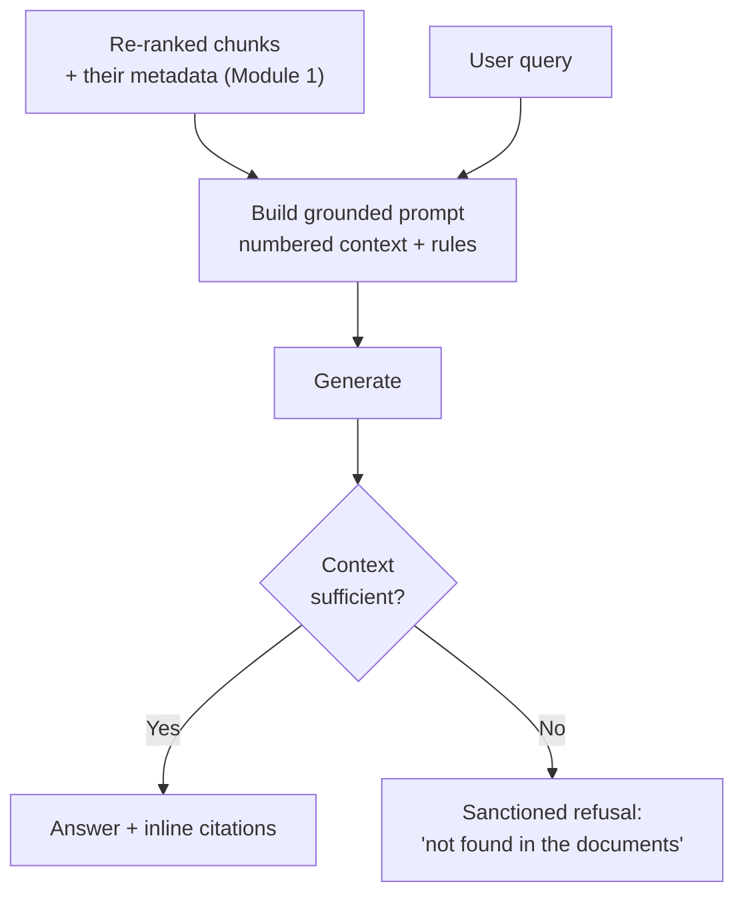
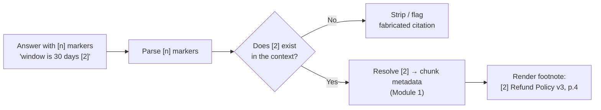
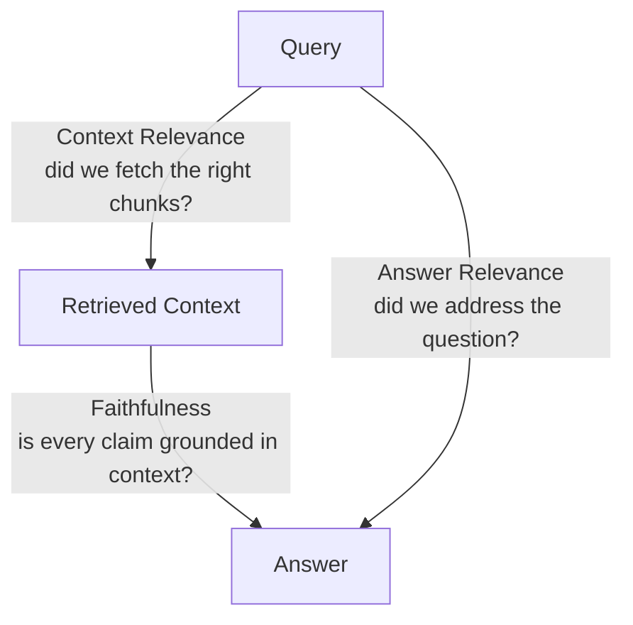
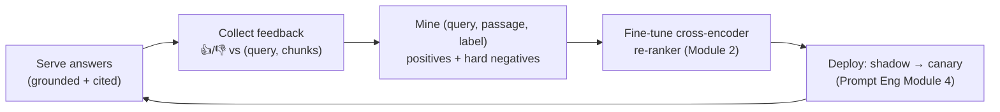

# Module 4 — Grounding, Generation, and Evaluation

Everything so far has been about getting the *right context* in front of the model: parse it cleanly (Module 1), retrieve it with hybrid search and re-ranking (Module 2), and shape the query so retrieval succeeds (Module 3). This final module is about the last mile and the loop around it — turning that context into a *trustworthy answer*, proving where the answer came from, measuring whether the whole system actually works, and using production feedback to make it better over time.

This is where most of the trust is won or lost. A user does not see your chunking strategy or your fusion algorithm. They see an answer, and they decide in seconds whether to believe it. A confident answer that invented a detail, cited nothing, and cannot be checked destroys trust faster than a slow one — and it does it silently, because nobody flags an answer that *looks* right.

> **Prerequisites.** The whole RAG course. This module leans especially on the evaluation discipline from the Prompt Engineering course (Module 3: faithfulness, answer relevance, golden datasets, LLM judges) and its production practices (Module 4: telemetry, online eval, shadow/canary). The RAG triad here is a specialization of that eval framework.

**By the end of this module you will be able to:**

- Write a grounding prompt that constrains the model to context and refuses when it can't answer
- Produce inline citations that map back to real source metadata — and validate them
- Measure the RAG triad — context relevance, faithfulness, answer relevance — and use it to localize failure
- Instrument production RAG and mine user feedback into training data for a better re-ranker

---

## 4.1 Grounding Prompts

You have retrieved excellent context. The generation prompt now decides whether the model *uses* it faithfully or treats it as a loose suggestion and free-associates. **Perfect retrieval with a weak prompt still hallucinates** — the model blends the context with its training knowledge, fills gaps with plausible invention, and presents the mixture in one confident voice.

The grounding prompt is a contract with three clauses:

1. **Answer only from the provided context** — not from training knowledge.
2. **If the context is insufficient, say so** — the sanctioned "I don't know", explicitly.
3. **Cite the source** for every claim (4.2).



### The "I don't know" fallback is the anti-hallucination mechanism

The single most effective thing a grounding prompt does is give the model **a permitted way to fail.** Models invent partly because nothing in the prompt authorises them to decline — faced with a question the context does not answer, "I don't know" is not in the distribution of expected responses, so they produce the next most likely thing: a fabrication.

Hand the model an explicit, exact refusal string and the fabrication rate drops sharply. Crucially, scope the refusal to *retrieval*, not to the model's competence: **"I could not find this in the available documents"** is honest and actionable (it points at a corpus gap), whereas a bare "I don't know" reads as the assistant being broken.

```python
def build_grounded_prompt(chunks: list[dict], question: str) -> str:
    """chunks carry the Module 1 metadata: source, section_path, page, updated_at."""
    context = "\n\n".join(
        f"[{i + 1}] (source: {c['metadata'].get('source', '?')}, "
        f"page {c['metadata'].get('page', '?')})\n{c['text']}"
        for i, c in enumerate(chunks)
    )
    return f"""You are a precise assistant. Answer the question using ONLY the
context below. Follow these rules exactly:

- Use ONLY information in the context. Do not use prior knowledge.
- If the context does not contain the answer, reply EXACTLY:
  "I could not find this in the available documents."
- Cite the passage number for every factual claim, like [2].
- If passages conflict, prefer the most recently updated and note the conflict.
- Do not guess. Do not fabricate a citation.

Context:
{context}

Question: {question}

Answer (grounded, with citations):"""
```

### The details that separate a demo from a system

- **Order the context by relevance, and restate the key rule at the end.** From the Prompt Engineering course (Module 1): models attend best to the start and end of a long context and sag in the middle. Put your best re-ranked chunk first, and repeat "answer only from the context above" after the context — the "lost in the middle" effect applies to your retrieved passages too.
- **Handle partial answers.** When the context answers *part* of the question, the model should answer that part and explicitly flag the gap, not fabricate the rest. Say so in the rules.
- **Handle conflicting context.** Retrieval routinely returns an old policy and its replacement. Instruct the model to surface the conflict and prefer the most recent — which is exactly why you stored `updated_at` in Module 1. Metadata earns its keep here.

| Failure mode | Prompt technique |
| --- | --- |
| Invents an answer the context lacks | Explicit sanctioned refusal string |
| Blends context with training knowledge | "Use ONLY the context; no prior knowledge" |
| Ignores mid-context passages | Best chunk first; restate the rule at the end |
| Fabricates when context is partial | Instruct: answer the covered part, flag the gap |
| Picks the stale version of a fact | Instruct: prefer most-recent; use `updated_at` |

> **Warning.** A grounding prompt *reduces* hallucination; it does not *eliminate* it. Models still occasionally contradict the very context you gave them (intrinsic hallucination) or add unsupported detail (extrinsic). The prompt is necessary and not sufficient — it is the first line of defence, and evaluation (4.3) is how you catch what leaks through. Never treat "we told it to be faithful" as "it is faithful".

---

## 4.2 Verifiable Citations

An answer without sources is unaccountable — the user has to take it on faith, and you have no way to debug it. Citations convert "trust me" into "check for yourself", and they are simultaneously your single fastest debugging tool: when an answer is wrong, the citation tells you instantly whether retrieval fetched the wrong passage or the model misread the right one.

The mechanics are simple and the discipline is where it counts.



**Number the context, ask for the number back, resolve it to metadata.** You numbered the chunks `[1]…[n]` in the prompt (4.1); the model cites `[2]`; you map `[2]` back to that chunk's Module 1 metadata — `doc_id`, `source`, `section_path`, `page`, `updated_at` — and render a footnote a human can follow. **This is the payoff of ingestion-time enrichment: without metadata, `[2]` is a dead reference pointing at nothing.**

```python
import re

def resolve_citations(answer: str, chunks: list[dict]) -> dict:
    """Extract [n] markers, VALIDATE them against the supplied chunks, and
    resolve valid ones to human-readable source metadata."""
    cited = {int(n) for n in re.findall(r"\[(\d+)\]", answer)}

    valid, fabricated = {}, []
    for n in cited:
        if 1 <= n <= len(chunks):
            meta = chunks[n - 1]["metadata"]
            valid[n] = {
                "source": meta.get("source", "unknown"),
                "page": meta.get("page"),
                "section": meta.get("section_path", ""),
                "updated_at": meta.get("updated_at"),
            }
        else:
            fabricated.append(n)  # model invented a passage number

    return {"citations": valid, "fabricated": fabricated}
```

> **Warning.** Validate every citation the model emits. Models invent passage numbers — `[7]` when you supplied five chunks — and, worse, cite a real chunk that does not actually support the claim. A **fabricated citation is more dangerous than none**, because it wears the costume of verifiability: the user sees `[7]`, assumes it was checked, and trusts a claim nothing supports. Strip or flag any `[n]` outside the supplied range, and treat citation *correctness* (does chunk 2 really support this claim?) as a faithfulness question, measured in 4.3 — presence is not proof.

The TypeScript equivalent, returning both the resolved footnotes and any fabrications to log:

```ts
interface Chunk {
  text: string;
  metadata: { source?: string; page?: number; sectionPath?: string; updatedAt?: string };
}

export function resolveCitations(answer: string, chunks: Chunk[]) {
  const cited = new Set([...answer.matchAll(/\[(\d+)\]/g)].map((m) => Number(m[1])));
  const citations: Record<number, Chunk["metadata"]> = {};
  const fabricated: number[] = [];

  for (const n of cited) {
    if (n >= 1 && n <= chunks.length) citations[n] = chunks[n - 1]!.metadata;
    else fabricated.push(n); // invented reference — never render it
  }
  return { citations, fabricated };
}
```

> **Tip.** Inline chunk-level citations (`[2]` → a chunk) are the practical standard and the right default. Span-level attribution — highlighting the exact sentence within the chunk that supports the claim — is stronger for high-stakes domains but costs a second pass to locate the span. Start chunk-level; add span-level only where a wrong citation is expensive. And remember the distinction citations *do* and *do not* prove: they establish **provenance** (where the claim came from), not **correctness** (that the source is right, or that the model read it correctly). You need both, from different mechanisms.

---

## 4.3 The RAG Triad

You cannot improve a RAG system you cannot measure, and "the answers seem good" is not measurement (Prompt Engineering, Module 3). RAG has a specialized, powerful evaluation framework: three metrics that each test a different edge of the pipeline and, together, **localize failure to a specific stage.** That diagnostic power is the whole point — a single "quality" number tells you something is wrong; the triad tells you *where*.

The three metrics sit on the triangle formed by the query, the retrieved context, and the generated answer:



- **Context Relevance / Precision** — of the retrieved chunks, how many are actually relevant to the query? This tests **retrieval** (Modules 1–3). A low score means chunking, hybrid search, re-ranking, or query understanding is the problem.
- **Faithfulness (Groundedness)** — is every claim in the answer supported by the retrieved context? This tests **generation grounding** (4.1). A low score means the model ignored or overran the context — a prompt problem, not a retrieval one.
- **Answer Relevance** — does the answer actually address the user's question? This tests the answer's **usefulness**. A low score means the answer wandered or dodged, even if it was faithful to some context.

### The diagnostic table — why three metrics beat one

The power is in the *combinations*. Each pattern points at a different fix:

| Context Rel. | Faithfulness | Answer Rel. | Diagnosis → fix |
| --- | --- | --- | --- |
| Low | — | — | **Retrieval is failing.** Fix chunking, hybrid, re-ranking, query understanding. |
| High | Low | — | **Generation ignored good context.** Tighten the grounding prompt (4.1). |
| High | High | Low | **Right context, faithful answer, wrong question.** Query understood wrong, or answer off-target. |
| High | High | High | **Working.** Now protect it with regression thresholds. |

A single aggregate score would blur all four of those into one unactionable number. The triad turns "it's worse" into "context relevance dropped six points on the billing slice — retrieval regressed there."

### Measuring the triad

Each metric reuses the machinery from the Prompt Engineering course (Module 3), applied to RAG:

- **Context Relevance** — an LLM judge scores each retrieved chunk relevant/not to the query; the metric is the fraction relevant (precision), optionally weighted by rank (are the relevant ones near the top?). With ground-truth labels you can also compute **context recall** — did retrieval get *all* the needed chunks? — which is what catches the answer that was never retrievable.
- **Faithfulness** — **claim decomposition** (Module 3): break the answer into atomic claims, verify each against the context, report the fraction supported. Surface the *unsupported* claims, not just the score — that list is what you debug.
- **Answer Relevance** — the **reverse-question** technique (Module 3): generate the questions the answer appears to address and measure their similarity to the original.

```python
async def rag_triad(call_model, embed, judge, query: str, chunks: list[dict], answer: str) -> dict:
    """The three RAG metrics. Each localizes failure to a different stage.
    (judge / faithfulness / answer-relevance helpers reuse Prompt Eng Module 3.)"""

    # 1. Context relevance — fraction of retrieved chunks that are relevant.
    verdicts = await asyncio.gather(*[
        judge(f"Is this passage relevant to the query?\nQuery: {query}\nPassage: {c['text']}\n"
              f"Answer yes or no.")
        for c in chunks
    ])
    relevant = sum(v.strip().lower().startswith("yes") for v in verdicts)
    context_relevance = relevant / max(1, len(chunks))

    # 2. Faithfulness — fraction of answer claims supported by the context.
    context = "\n".join(c["text"] for c in chunks)
    faith = await faithfulness(call_model, answer, context)   # from Prompt Eng M3

    # 3. Answer relevance — does the answer address the query?
    ans_rel = await answer_relevance(call_model, embed, query, answer)  # from Prompt Eng M3

    return {
        "context_relevance": context_relevance,
        "faithfulness": faith["score"],
        "unsupported_claims": faith["unsupported_claims"],
        "answer_relevance": ans_rel,
    }
```

> **Warning.** These metrics are LLM-judged, which means they are noisy and biased (Prompt Engineering, Module 3) — you **must** calibrate the judges against human labels before trusting the numbers, and re-calibrate when you change the judge or the domain. And context *recall* needs ground-truth relevant chunks, which is real labeling effort. The triad is a diagnostic instrument; like any instrument, it is worthless until it is calibrated, and it diagnoses rather than fixes.

> **Tip.** Wire the triad into the same discipline as any eval: a **golden dataset** of real queries with known-good answers and relevant chunks, run on every change, broken down **per slice**, with **regression thresholds** so a change ships only if no metric drops past its margin (Prompt Engineering, Module 3). The RAG triad is not a new methodology — it is the eval framework you already know, pointed at the three joints of a retrieval pipeline.

---

## 4.4 RAG Observability and Continuous Improvement

A RAG system is not done at launch; it *decays*. The corpus grows, users ask new things, the world moves on, and quality erodes silently (Prompt Engineering, Module 4: data drift). Observability makes the decay visible; continuous improvement closes the loop so the system gets *better* with use instead of worse.

### Instrument the whole trace

Log every query as a structured trace with the fields that let you debug and measure — extending the telemetry from the Prompt Engineering course (Module 4) with RAG-specific signals:

```python
from dataclasses import dataclass, field

@dataclass
class RagTrace:
    trace_id: str
    query: str
    rewritten_queries: list[str]          # Module 3 fan-out
    route: str                            # Module 3 router decision
    retrieved: list[dict]                 # chunk ids + hybrid scores (Module 2)
    reranked: list[dict]                  # ids + cross-encoder scores (Module 2)
    context_sent: list[str]               # what actually reached the prompt
    answer: str
    citations: dict
    refused: bool                         # did it hit the "I don't know" fallback?
    latency_ms: dict = field(default_factory=dict)   # per stage: retrieve/rerank/generate
    feedback: str | None = None           # "up" | "down" | None — filled in later
```

The production signals to watch on this stream, trending over time and alerted on regression:

| Signal | What a change indicates |
| --- | --- |
| **Refusal rate** ("could not find…") | Rising → retrieval failing, or a corpus gap for new questions |
| **Citation validity rate** | Falling → the model is fabricating references |
| **Triad on sampled traffic** | The online eval loop — context/faithfulness/answer relevance drifting |
| **Retrieval score distribution** | Shifting → query distribution or corpus changed (drift) |
| **Latency p95 per stage** | Which stage (retrieve / rerank / generate) is slowing |

> **Tip.** Run the RAG triad (4.3) on a small, stratified **sample** of live traffic continuously — not on 100% (the eval cost would exceed the serving cost) and not never. This is the online-eval loop from the Prompt Engineering course, and it is the only thing that catches quality drift *before* users churn over it. A trend line on faithfulness is worth more than any launch-day benchmark.

### The feedback loop: from thumbs to a better re-ranker

Here is the payoff that turns a static system into a compounding one. Attach a thumbs up/down to every answer, and log it **against the specific `(query, retrieved chunks, answer)` triple** — not just the answer. That triple is a labeled retrieval example, and labeled retrieval examples are exactly the training data for a cross-encoder re-ranker (Module 2).

The mining logic:

- A **thumbs-up** answer whose claims cited chunk `[2]` is evidence that, *for this query*, chunk 2 was relevant → a **positive** `(query, chunk 2, 1)` training pair.
- Chunks that were **retrieved but not cited**, especially on a **thumbs-down**, are **hard negatives** — passages similar enough to be retrieved yet not actually useful. These are the *most valuable* training signal, because they teach the re-ranker the subtle distinctions a generic model misses.

```python
def mine_training_pairs(trace: RagTrace) -> list[tuple[str, str, int]]:
    """Turn one feedback-labeled trace into (query, passage, label) pairs for
    fine-tuning a cross-encoder re-ranker (Module 2) on YOUR data."""
    pairs: list[tuple[str, str, int]] = []
    cited_ids = {c for c in trace.citations}  # chunk numbers that were cited

    for rank, chunk in enumerate(trace.reranked):
        was_cited = (rank + 1) in cited_ids
        if trace.feedback == "up" and was_cited:
            pairs.append((trace.query, chunk["text"], 1))     # positive
        elif trace.feedback == "down" and not was_cited:
            pairs.append((trace.query, chunk["text"], 0))     # hard negative
        elif trace.feedback == "down" and was_cited:
            pairs.append((trace.query, chunk["text"], 0))     # cited but unhelpful
    return pairs
```

Accumulate these pairs, fine-tune the cross-encoder on your domain's *actual* queries and documents, and redeploy it through the versioned, shadow-then-canary path from the Prompt Engineering course (Module 4). A re-ranker trained on your production distribution beats a generic off-the-shelf one, because it has learned what relevance means *for your users and your corpus*.



> **Warning.** Production feedback is sparse and biased: most users rate nothing, unhappy users rate more than happy ones, and implicit signals (rephrasing, copying, clicking a citation) are noisy proxies. You need volume and careful handling of the selection bias before these labels are trustworthy. But do not let that stop you — **even imperfect labels from your real distribution beat a generic re-ranker**, and the teams that never build feedback capture are the teams whose RAG quality plateaus on day one and never moves. Closing the loop is what makes the system improve; skipping it is why most don't.

---

## Module Recap

- **The grounding prompt is a contract**: answer only from context, refuse explicitly when it can't, cite sources. The sanctioned "could not find this in the documents" is the single strongest anti-hallucination mechanism.
- **A grounding prompt reduces hallucination; it does not eliminate it.** Order context by relevance, restate the rule at the end, and rely on evaluation to catch what leaks.
- **Citations resolve `[n]` back to Module 1 metadata** — doc, page, section — turning trust-me into check-yourself. Validate every citation; a fabricated one is worse than none.
- **The RAG triad localizes failure**: context relevance tests retrieval, faithfulness tests grounding, answer relevance tests usefulness — and their *combination* tells you which stage to fix.
- **The triad is the Prompt Engineering eval framework applied to RAG** — golden datasets, calibrated LLM judges, per-slice scorecards, regression thresholds.
- **Instrument the full trace and run the triad on sampled live traffic** to catch drift before users do.
- **Mine thumbs up/down against `(query, chunks)` into training pairs** — positives and hard negatives — and fine-tune your cross-encoder on your own distribution. This closes the loop and makes retrieval compound.

## Exercises

1. **Earn the refusal.** Ask your RAG system a question your corpus genuinely cannot answer, first with a permissive prompt, then with the explicit refusal clause. Confirm the first invents an answer and the second declines — and that it blames retrieval ("not in the documents"), not itself.
2. **Catch a fabricated citation.** Prompt the model with three chunks and a question, and induce it to cite `[5]`. Run your validator and confirm it flags the fabrication. Then find a case where it cites a *real* chunk that does not support the claim, and note that only faithfulness scoring catches that one.
3. **Localize a failure with the triad.** Construct three broken pipelines: one with bad retrieval, one with a loose grounding prompt, one that answers the wrong question. Compute the triad for each and confirm the metric pattern points at the correct stage every time.
4. **Mine one training pair.** Take a thumbs-down trace where the right answer was in a chunk that ranked #8. Produce the positive pair (query, chunk 8) and the hard-negative pairs (query, the irrelevant chunks that ranked above it). Explain, in one sentence, why those hard negatives are the most useful thing your re-ranker could learn.

---

## Course complete

You have built a full retrieval-augmented generation system, end to end and honestly:

- **Module 1** turned hostile enterprise formats into clean, chunked, metadata-rich units — the layer where most RAG quality is silently won or lost.
- **Module 2** made those units findable, fusing dense and sparse retrieval with RRF and sharpening precision with a cross-encoder re-ranker.
- **Module 3** moved the leverage to the query — rewriting, fanning out, HyDE, self-querying into metadata filters, and routing to the right backend.
- **Module 4** turned retrieved context into a grounded, cited, measured answer, and closed the loop so the system improves from its own use.

The through-line of the whole course: **a RAG system is a pipeline of failure points, and its quality is the product of every stage — not the cleverness of any one.** The model is the last and least of your levers. Parsing, chunking, retrieval, grounding, and evaluation are where the answers are actually made.

Where to go next: the **Vector Search & Embeddings** course opens the index black box this course kept closed — HNSW, IVF, quantization, and the distance math. The **Agentic AI** course takes the router from Module 3 and turns it into systems that plan and act over many steps. Both build directly on what you now know.
