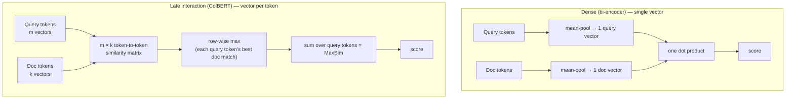
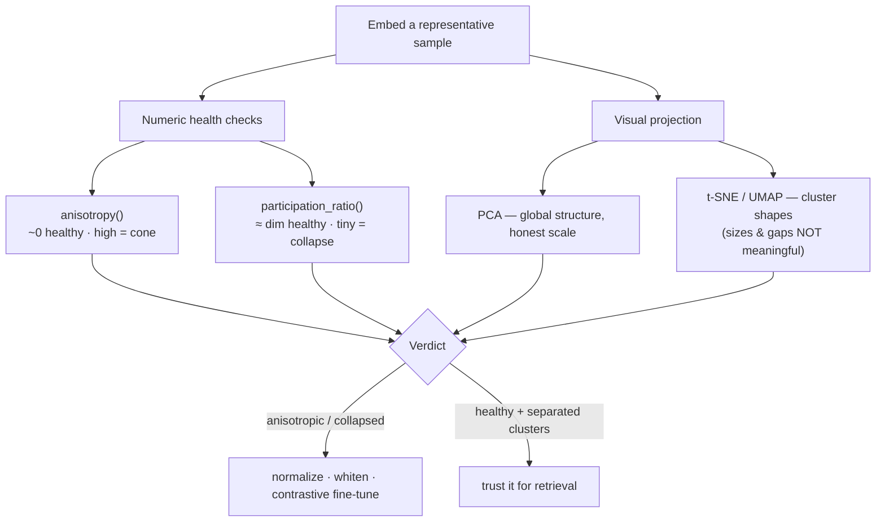

# Vector Math, Embedding Spaces & High-Dimensional Geometry

Every retrieval system in this course — the RAG pipelines from Course 2, the
agent memory from Course 3 — rests on one operation: measure how *close* two
vectors are, and return the closest. That sounds trivial. It is not. "Close" has
four different definitions that disagree with each other, the space these vectors
live in is 1536-dimensional and behaves nothing like the 3-D world your intuition
was trained on, and the vectors themselves come in three structurally different
flavours that match text in completely different ways.

This module is the math under the engine. Get it right and everything downstream
— indexing, hybrid search, re-ranking — has a solid floor. Get it wrong and you
will pick the wrong metric, misread a similarity score, and never understand why
your custom embedding model retrieves garbage.

Four parts:

- **Similarity metrics & distance functions** — cosine, dot product, Euclidean
  ($L_2$), and Manhattan ($L_1$); the proof that dot product and cosine are
  identical on normalized vectors, and how to choose.
- **High-dimensional geometry & the curse of dimensionality** — why distances
  concentrate, why two random 1536-D vectors are almost always orthogonal, and
  what that does to search.
- **Dense, sparse, and late-interaction representations** — single-vector dense
  embeddings vs. sparse lexical vectors vs. ColBERT's per-token matrices, and the
  MaxSim token-to-token matching that sits between them.
- **Dimensionality reduction & visual diagnostics** — PCA, t-SNE, and UMAP, plus
  Python you can run to detect anisotropy and representation collapse in your own
  embedding model.

Let's build the floor.

---

## 1.1 — Similarity Metrics & Distance Functions

### The four functions

Take two vectors $\mathbf{a}, \mathbf{b} \in \mathbb{R}^n$. There are four ways
to turn them into a single number that says "how alike," and they are not
interchangeable.

**Dot product (inner product).** Multiply componentwise and sum:

$$
\mathbf{a} \cdot \mathbf{b} = \sum_{i=1}^{n} a_i b_i = \lVert \mathbf{a} \rVert \, \lVert \mathbf{b} \rVert \cos\theta
$$

It is *unbounded* and *magnitude-sensitive*: a long vector scores high against
everything. That second form — magnitudes times the cosine of the angle between
them — is the hinge the whole section turns on.

**Euclidean distance ($L_2$).** Straight-line distance, the one your intuition
means by "distance":

$$
d_{L_2}(\mathbf{a}, \mathbf{b}) = \lVert \mathbf{a} - \mathbf{b} \rVert_2 = \sqrt{\sum_{i=1}^{n} (a_i - b_i)^2}
$$

**Manhattan distance ($L_1$).** Sum of absolute per-axis differences — "taxicab"
distance, because you can only travel along the grid:

$$
d_{L_1}(\mathbf{a}, \mathbf{b}) = \lVert \mathbf{a} - \mathbf{b} \rVert_1 = \sum_{i=1}^{n} |a_i - b_i|
$$

**Cosine similarity.** The dot product with the magnitudes divided out — pure
angle, no length:

$$
\cos\theta = \frac{\mathbf{a} \cdot \mathbf{b}}{\lVert \mathbf{a} \rVert \, \lVert \mathbf{b} \rVert}
$$

It is *bounded* in $[-1, 1]$ and *magnitude-invariant*: only direction matters.
Cosine *distance* is defined as $1 - \cos\theta$ (a dissimilarity, not a true
metric — it violates the triangle inequality).

### Why dot product and cosine are identical for normalized vectors

This is the single most important identity in applied vector search, and it falls
straight out of the dot-product formula.

**Normalize** a vector by dividing it by its own length, producing a *unit
vector* that points the same way but sits on the unit sphere:

$$
\hat{\mathbf{a}} = \frac{\mathbf{a}}{\lVert \mathbf{a} \rVert}, \qquad \lVert \hat{\mathbf{a}} \rVert = 1
$$

Now take the dot product of two *normalized* vectors and expand it with the
geometric form:

$$
\hat{\mathbf{a}} \cdot \hat{\mathbf{b}} = \lVert \hat{\mathbf{a}} \rVert \, \lVert \hat{\mathbf{b}} \rVert \cos\theta = 1 \cdot 1 \cdot \cos\theta = \cos\theta
$$

The magnitudes are both $1$, so they vanish, and the dot product *is* the cosine.
This is not an approximation — it is exact. The practical consequence is enormous:
**normalize your embeddings once at ingestion time, and you can use the cheaper
dot product at query time and get exact cosine semantics for free.** Most vector
databases exploit this — you store unit vectors and run inner-product search,
which is faster and lets the index do maximum-inner-product tricks.

There is a second identity hiding here that ties in Euclidean distance. For two
unit vectors, expand the squared $L_2$ distance:

$$
\lVert \hat{\mathbf{a}} - \hat{\mathbf{b}} \rVert_2^2 = \lVert \hat{\mathbf{a}} \rVert^2 + \lVert \hat{\mathbf{b}} \rVert^2 - 2\,(\hat{\mathbf{a}} \cdot \hat{\mathbf{b}}) = 2 - 2\cos\theta
$$

So on the unit sphere, Euclidean distance is a monotonic function of cosine
similarity — as $\cos\theta$ goes up, $d_{L_2}$ goes down, always. **Ranking by
cosine, by dot product, and by Euclidean distance give the *identical* ordering
for normalized vectors.** They only diverge when magnitudes vary. This is why the
"which metric?" debate mostly evaporates once you normalize — and why forgetting
to normalize is where the real bugs live.

### When to pick each

The metrics differ precisely in *how they treat magnitude*. Choose by what
magnitude means in your embeddings.

| Metric | Formula | Range | Magnitude-sensitive? | True metric? | Reach for it when |
| --- | --- | --- | --- | --- | --- |
| Cosine | $\dfrac{\mathbf{a}\cdot\mathbf{b}}{\lVert\mathbf{a}\rVert\lVert\mathbf{b}\rVert}$ | $[-1, 1]$ | No | No (as distance) | Direction/semantics is the signal; magnitude is a length/frequency artifact. **The default for text embeddings.** |
| Dot product | $\mathbf{a}\cdot\mathbf{b}$ | $(-\infty, \infty)$ | Yes | No | Magnitude carries meaning (importance, popularity, confidence), or as the fast path on pre-normalized vectors (MIPS). |
| Euclidean $L_2$ | $\lVert\mathbf{a}-\mathbf{b}\rVert_2$ | $[0, \infty)$ | Yes | Yes | Absolute position matters; the default distance for many ANN indexes. On unit vectors, ranks identically to cosine. |
| Manhattan $L_1$ | $\lVert\mathbf{a}-\mathbf{b}\rVert_1$ | $[0, \infty)$ | Yes | Yes | Robustness to per-dimension outliers; sometimes better-behaved than $L_2$ in very high dimensions. |

> **The one honest rule that overrides the table:** use the metric your embedding
> model was *trained and tuned for*. OpenAI's `text-embedding-3` and models like
> BGE and E5 are trained with a cosine/normalized-dot objective, and their vectors
> are (or should be) unit-normalized before search. Feeding cosine-trained
> embeddings to an unnormalized dot product silently degrades recall — long
> documents dominate — and no amount of index tuning downstream will fix a metric
> mismatch at the source. Match the metric to the model first; everything else is
> secondary.

### The metrics in code

```python
import numpy as np

def dot(a, b):        return float(a @ b)
def euclidean(a, b):  return float(np.linalg.norm(a - b))       # L2
def manhattan(a, b):  return float(np.abs(a - b).sum())         # L1
def cosine(a, b):     return float((a @ b) / (np.linalg.norm(a) * np.linalg.norm(b)))

def normalize(v):
    n = np.linalg.norm(v)
    return v / n if n else v

# The identities, verified numerically.
a = normalize(np.random.randn(1536))
b = normalize(np.random.randn(1536))

assert np.isclose(dot(a, b), cosine(a, b))                      # unit vectors: dot == cosine
assert np.isclose(euclidean(a, b) ** 2, 2 - 2 * cosine(a, b))   # L2^2 == 2 - 2cos on the unit sphere
# → so cosine, dot, and L2 all rank normalized vectors identically.
```

```typescript
type Vec = number[];

const dot = (a: Vec, b: Vec): number => a.reduce((s, x, i) => s + x * b[i]!, 0);
const norm = (a: Vec): number => Math.sqrt(dot(a, a));
const euclidean = (a: Vec, b: Vec): number => Math.sqrt(a.reduce((s, x, i) => s + (x - b[i]!) ** 2, 0)); // L2
const manhattan = (a: Vec, b: Vec): number => a.reduce((s, x, i) => s + Math.abs(x - b[i]!), 0);          // L1
const cosine = (a: Vec, b: Vec): number => dot(a, b) / (norm(a) * norm(b));

const normalize = (a: Vec): Vec => {
  const n = norm(a);
  return n ? a.map((x) => x / n) : a;
};

// For unit vectors: dot(a,b) === cosine(a,b), and euclidean(a,b)^2 === 2 - 2*cosine(a,b).
// Normalize once at ingest, then rank with the cheaper dot product.
```

---

## 1.2 — High-Dimensional Geometry & the Curse of Dimensionality

### Your intuition was trained in three dimensions. It will lie to you.

Embeddings live in spaces of 384, 768, 1536, or more dimensions. Almost every
geometric instinct you have — built in 2-D and 3-D — breaks there, and the breakage
has a name: the **curse of dimensionality**, driven by a phenomenon called
**concentration of measure**. Two consequences matter for search.

### Consequence 1: distances concentrate

In low dimensions, nearest and farthest neighbours are clearly different distances
apart. In high dimensions they stop being different. Formally, for a broad class
of distributions, as $n \to \infty$ the relative gap between the farthest and
nearest points collapses:

$$
\lim_{n \to \infty} \frac{\text{dist}_{\max} - \text{dist}_{\min}}{\text{dist}_{\min}} \to 0
$$

Every point becomes *nearly equidistant* from every other. This is an existential
threat to the whole idea of "nearest neighbour" — if all distances are the same,
"nearest" is noise. So why does vector search work at all? Because **learned
embeddings are not uniformly random.** A good embedding model places related
concepts on a low-dimensional *manifold* curved through the high-D space; the
curse applies to unstructured, uniformly-distributed data, and embeddings escape
it by having structure. Keep this tension in mind: the curse is real, and learned
structure is what defeats it. When an embedding model is *bad*, the structure is
weak and the curse reasserts itself — which is exactly what the diagnostics in
1.4 detect.

### Consequence 2: random vectors are almost always orthogonal

This is the counterintuitive one, and it is the most useful thing to internalize
about high-D space. Take two *independent, random* unit vectors in $\mathbb{R}^n$.
Their cosine similarity is a random variable, and its distribution has:

$$
\mathbb{E}[\cos\theta] = 0, \qquad \mathrm{Var}[\cos\theta] \approx \frac{1}{n}, \qquad \mathrm{sd}[\cos\theta] \approx \frac{1}{\sqrt{n}}
$$

Here is the sketch. Draw each component $a_i, b_i$ from a standard normal — a
Gaussian vector, once normalized, is uniform on the sphere. The normalized dot
product $\hat{\mathbf{a}} \cdot \hat{\mathbf{b}}$ is a sum of $n$ independent
mean-zero terms; by the central limit theorem it concentrates as a Gaussian with
mean $0$ and standard deviation $\approx 1/\sqrt{n}$. As $n$ grows, that spread
shrinks toward zero — so two random high-D vectors have cosine similarity
*extremely close to $0$*, i.e. an angle of almost exactly $90°$. **In high
dimensions, "random" means "orthogonal."** There is so much room that independent
directions almost never align.

Watch the standard deviation shrink as dimension climbs:

| Dimension $n$ | $\mathrm{sd} \approx 1/\sqrt{n}$ | What it means for random pairs |
| --- | --- | --- |
| 2 | 0.707 | Cosines sprawl across the whole range — no separation |
| 10 | 0.316 | Still very spread out |
| 100 | 0.100 | Tightening toward 0 |
| 768 | 0.036 | Random pairs cluster hard around orthogonal |
| 1536 | 0.026 | Random pairs sit within ~±0.05 of exactly orthogonal |

### Why this is good news (and one catch)

Near-orthogonality of random vectors is a *blessing* for search, not just a
curiosity. Because unrelated vectors pile up tightly around $\cos\theta = 0$, a
genuinely related pair at $\cos\theta = 0.4$ stands out sharply against that
near-zero noise floor. High dimensionality gives you clean separation between
"related" and "unrelated" — the signal rises well above the background.

The catch is calibration. Because the noise floor is at $0$ and the spread is
tiny, **absolute cosine values are compressed and model-specific.** A "very
similar" pair in a 1536-D model might score $0.35$–$0.5$, not $0.9$. Never
hard-code a universal threshold like "$0.8$ means similar" — it's meaningless
across models and dimensions. Calibrate the threshold empirically per embedding
model, against the actual distribution of related vs. unrelated scores. (A related
high-D pathology, **hubness** — a few points becoming everyone's nearest neighbour
— also degrades naive kNN; hybrid search and re-ranking, later in this course,
are partly answers to it.)

### See the concentration for yourself

```python
import numpy as np

def random_cosines(n_dim, trials=10_000, rng=np.random.default_rng(0)):
    """Cosine similarity of `trials` independent random unit-vector pairs in n_dim."""
    A = rng.standard_normal((trials, n_dim))
    B = rng.standard_normal((trials, n_dim))
    A /= np.linalg.norm(A, axis=1, keepdims=True)   # project onto the unit sphere
    B /= np.linalg.norm(B, axis=1, keepdims=True)
    return np.sum(A * B, axis=1)                     # rowwise dot == cosine (unit vectors)

for n in (2, 10, 100, 768, 1536):
    c = random_cosines(n)
    print(f"n={n:>5}:  mean={c.mean(): .4f}   sd={c.std():.4f}   (1/sqrt(n)={1/np.sqrt(n):.4f})")
# mean stays ~0; sd tracks 1/sqrt(n) precisely. At n=1536 nearly every random
# pair is within ±0.05 of orthogonal — that tight noise floor is what makes a
# real match at cosine 0.4 easy to distinguish.
```

```typescript
function randomUnit(n: number): number[] {
  // Box–Muller for a Gaussian vector, then normalize onto the unit sphere.
  const v = Array.from({ length: n }, () => {
    const u1 = Math.random(), u2 = Math.random();
    return Math.sqrt(-2 * Math.log(u1)) * Math.cos(2 * Math.PI * u2);
  });
  const norm = Math.sqrt(v.reduce((s, x) => s + x * x, 0));
  return v.map((x) => x / norm);
}

function randomCosineStats(n: number, trials = 10_000) {
  const cs: number[] = [];
  for (let t = 0; t < trials; t++) {
    const a = randomUnit(n), b = randomUnit(n);
    cs.push(a.reduce((s, x, i) => s + x * b[i]!, 0)); // cosine of a random pair
  }
  const mean = cs.reduce((s, x) => s + x, 0) / cs.length;
  const sd = Math.sqrt(cs.reduce((s, x) => s + (x - mean) ** 2, 0) / cs.length);
  return { mean, sd, predicted: 1 / Math.sqrt(n) }; // sd ≈ 1/sqrt(n)
}

for (const n of [2, 10, 100, 768, 1536]) console.log(n, randomCosineStats(n));
```

---

## 1.3 — Dense, Sparse, and Late-Interaction Representations

Not all embeddings are the same *shape*. There are three structurally different
ways to turn text into vectors, and they match text through completely different
mechanisms. Knowing which is which is the difference between choosing a retriever
on purpose and cargo-culting whatever the tutorial used.

### Dense embeddings — one vector, all meaning

A **dense** model (OpenAI `text-embedding-3`, BGE, E5, GTE) runs the text through
a transformer and **pools** all the token representations into a single
fixed-length vector — typically 384 to 1536 dimensions, with almost every
dimension non-zero (hence "dense"). Pooling is usually a mean over token vectors
or the `[CLS]` token. The whole passage becomes one point in the embedding space,
and retrieval is an approximate-nearest-neighbour search over those points.

Dense vectors are compact, fast to search, and capture *semantic* similarity —
"car" and "automobile" land near each other even with no shared characters. Their
weakness is that a single vector is a *lossy summary*: pooling averages a hundred
tokens into one "bag of meaning," which can wash out exact terms, rare entities,
product codes, and numbers. Dense retrieval knows the passage is *about*
refunds; it may not notice it says invoice `#8812` specifically.

### Sparse representations — term weights, mostly zeros

A **sparse** vector lives in a space with one dimension *per vocabulary term* —
tens of thousands of dimensions, almost all exactly zero, non-zero only for the
terms actually present (or implied).

- **BM25** is the classic: a term-frequency/inverse-document-frequency weighting.
  Pure lexical matching — exact, interpretable, unbeatable on rare terms and exact
  strings, but blind to synonyms ("car" ≠ "automobile").
- **SPLADE** is *learned* sparse: a transformer predicts an importance weight for
  each vocabulary term, including **expansion** terms not literally in the text
  (so a passage about "car" can light up "vehicle" too). It keeps the exactness
  and the efficient inverted index of BM25 while adding a layer of learned
  semantics.

Sparse retrieval runs on an inverted index — decades of search-engine engineering
— and shines exactly where dense retrieval is weak: exact terms, rare entities,
codes, numbers. This complementarity is why **hybrid** dense+sparse search
(Module 2 of this course) so often beats either alone.

### Late interaction — a vector per token, matched with MaxSim

The third family keeps *more* information than dense pooling. **ColBERT**
represents a passage not as one vector but as a **matrix** — one embedding *per
token*. A document with $k$ tokens becomes a $k \times d$ matrix; a query with $m$
tokens becomes an $m \times d$ matrix.

Similarity is computed with **MaxSim**: for each query token, find its best-matching
document token (the maximum similarity across all document tokens), then sum those
maxima over the query tokens:

$$
S(q, d) = \sum_{i=1}^{m} \max_{1 \le j \le k} \; \hat{\mathbf{q}}_i \cdot \hat{\mathbf{d}}_j
$$

Concretely, you form the full $m \times k$ **token-to-token similarity matrix**
$M_{ij} = \hat{\mathbf{q}}_i \cdot \hat{\mathbf{d}}_j$, take the maximum along each
row (each query token's best match in the document), and sum. Every query token
gets to find its own best evidence anywhere in the document, instead of being
averaged away.

The name **"late interaction"** describes *when* query and document meet. A
single-vector bi-encoder collapses each side to one vector and interacts only at
the very end via one dot product — cheap, but the collapse is lossy. A
cross-encoder lets every query token attend to every document token through the
full transformer — most accurate, but it must run *per query-document pair*, far
too slow to index millions of documents. Late interaction is the middle path:
encode each side **independently** (so document matrices are precomputed once at
index time, like dense), but defer the **interaction** to a fine-grained
token-level matrix at query time. Token precision with precomputable documents.

The cost is storage and compute: a vector per token is many times larger than one
vector per passage, and the MaxSim matrix is more work than a single dot product —
which is why ColBERT-style retrieval needs specialized infrastructure (compression,
PLAID-style indexes) to scale.



| | Dense (single-vector) | Sparse (BM25 / SPLADE) | Late interaction (ColBERT) |
| --- | --- | --- | --- |
| Representation | 1 dense vector / passage | 1 sparse vector over vocab | 1 vector **per token** |
| Dimensionality | 384–1536, ~all non-zero | vocab-sized, ~all zero | tokens × dim (a matrix) |
| Interaction | one dot at the end | inverted-index term overlap | token-to-token MaxSim matrix |
| Strength | semantic recall, synonyms | exact terms, rare entities, codes | token precision **and** semantics |
| Weakness | lossy pooling, misses exact terms | no synonymy (BM25); term-centric | large storage, heavier query compute |
| Index | ANN (HNSW, IVF) | inverted index | specialized (PLAID) |

### MaxSim vs. single-vector pooling, in code

```python
import numpy as np

def maxsim(Q, D):
    """Late-interaction score. Q: (m, d) query token embeddings, D: (k, d) doc
    token embeddings, both row-normalized. For each query token, take its best
    match anywhere in the document, then sum."""
    M = Q @ D.T                 # (m, k) token-to-token similarity matrix
    return float(M.max(axis=1).sum())   # row-wise max over doc tokens, sum over query

def single_vector(Q, D):
    """Bi-encoder baseline: mean-pool each side to ONE vector, single dot.
    The pooling is exactly the information MaxSim refuses to throw away."""
    q = Q.mean(axis=0); q /= np.linalg.norm(q)
    d = D.mean(axis=0); d /= np.linalg.norm(d)
    return float(q @ d)

# A query token matching one specific doc token strongly (an exact entity, a code)
# survives MaxSim but is diluted by mean-pooling — the core difference in one line.
```

```typescript
type Matrix = number[][]; // rows are (row-normalized) token embeddings

function maxsim(Q: Matrix, D: Matrix): number {
  // For each query token, its best similarity to any doc token; sum over query.
  let score = 0;
  for (const q of Q) {
    let best = -Infinity;
    for (const d of D) {
      const sim = q.reduce((s, x, i) => s + x * d[i]!, 0); // token-to-token cosine
      if (sim > best) best = sim;
    }
    score += best; // row-wise max, accumulated
  }
  return score;
}

function singleVector(Q: Matrix, D: Matrix): number {
  // Mean-pool each side to one vector, normalize, single dot — the lossy baseline.
  const pool = (M: Matrix): number[] => {
    const dim = M[0]!.length;
    const v = new Array(dim).fill(0);
    for (const row of M) for (let i = 0; i < dim; i++) v[i] += row[i]! / M.length;
    const n = Math.sqrt(v.reduce((s, x) => s + x * x, 0));
    return v.map((x) => x / n);
  };
  const q = pool(Q), d = pool(D);
  return q.reduce((s, x, i) => s + x * d[i]!, 0);
}
```

---

## 1.4 — Dimensionality Reduction & Visual Diagnostics

You cannot look at a 1536-dimensional space. But you can *project* it down to 2-D
or 3-D to inspect it, and you can compute numbers that reveal whether your
embedding model is healthy or quietly broken. Both matter: projections build
intuition, diagnostics catch the pathologies that make a custom model retrieve
garbage.

### Three projections, three lies

| Method | Linear? | Preserves | Speed | Deterministic? | Reusable transform? | The catch |
| --- | --- | --- | --- | --- | --- | --- |
| **PCA** | Yes | Global variance | Fast | Yes | Yes | Linear — can't unfold curved manifolds; clusters may overlap |
| **t-SNE** | No | Local neighbourhoods | Slow | No | No | Cluster **sizes and gaps are meaningless**; over-interpreted constantly |
| **UMAP** | No | Local + some global | Fast(er) | No (seedable) | Yes | Distances not truly metric; sensitive to `n_neighbors` / `min_dist` |

- **PCA** projects onto the directions of maximum variance (the top eigenvectors
  of the covariance matrix). It is fast, deterministic, and honest about *global*
  structure and scale — and its explained-variance ratios double as a health
  check (below). But it is linear: it cannot unfold a manifold that curves, so
  distinct clusters can smear together.
- **t-SNE** is nonlinear and optimizes to keep *local* neighbourhoods intact. It
  produces gorgeous cluster pictures — and is the single most over-interpreted
  plot in ML. In a t-SNE plot the *distances between clusters, the sizes of
  clusters, and the empty gaps mean nothing*; only "these points were neighbours"
  survives. It's stochastic and perplexity-sensitive. Use it to *see* clusters,
  never to *measure* them.
- **UMAP** is the current default: nonlinear like t-SNE but faster, with a
  reusable transform (fit on a sample, apply to new points) and better global
  layout. Still hyperparameter-sensitive, and its distances are not fully metric.

The meta-point: **a 2-D projection is a lossy cartoon of the real space.** Use it
to form hypotheses, then confirm with numbers — never ship a decision made from a
t-SNE plot alone.

### The numbers that catch a broken model

Two pathologies quietly wreck custom embedding models, and both have cheap
detectors.

**Anisotropy** — the embeddings occupy a narrow *cone* instead of spreading over
the sphere, so *every* pair looks similar, even unrelated ones. Raw transformer
embeddings (e.g. off-the-shelf BERT) are famously anisotropic. The detector: from
1.2 we know the mean cosine between *random* pairs should sit near $0$. Measure it:

$$
A = \mathbb{E}_{\mathbf{a}, \mathbf{b} \sim \mathcal{D}} \big[ \cos(\mathbf{a}, \mathbf{b}) \big]
$$

If $A \approx 0$, the space is isotropic and healthy. If $A$ is strongly positive
(say $0.3$+), the space is a cone — the noise floor from 1.2 has risen up to
swallow the signal, and retrieval can't tell related from unrelated. Fixes:
normalization, whitening, or contrastive fine-tuning.

**Representation collapse** — the model maps many distinct inputs to nearly the
same vector, so the embeddings live in far fewer *effective* dimensions than the
nominal 1536. The detector is the **participation ratio**, a soft count of how many
dimensions actually carry variance. Given the covariance eigenvalues $\lambda_i$:

$$
\mathrm{PR} = \frac{\left(\sum_i \lambda_i\right)^2}{\sum_i \lambda_i^2}
$$

A healthy model has $\mathrm{PR}$ close to the full dimensionality; a collapsed one
has a tiny $\mathrm{PR}$ (a handful of directions dominate everything). There's a
neat trick that makes this cheap and dependency-free: because the covariance is
symmetric, $\sum_i \lambda_i = \mathrm{tr}(C)$ and $\sum_i \lambda_i^2 = \lVert C
\rVert_F^2$ (the sum of its squared entries) — so you never need an eigensolver,
just the covariance matrix's trace and Frobenius norm.

```python
import numpy as np

def anisotropy(embeddings, pairs=20_000, rng=np.random.default_rng(0)):
    """Mean cosine between random pairs. ~0 = healthy/isotropic;
    strongly positive = the space is a narrow cone, retrieval can't discriminate."""
    X = embeddings / np.linalg.norm(embeddings, axis=1, keepdims=True)
    i = rng.integers(0, len(X), pairs)
    j = rng.integers(0, len(X), pairs)
    m = i != j                                   # exclude self-pairs
    return float(np.sum(X[i[m]] * X[j[m]], axis=1).mean())

def participation_ratio(embeddings):
    """Effective dimensionality = (sum λ)^2 / sum(λ^2). Uses the symmetric-matrix
    identities tr(C)=Σλ and ||C||_F^2=Σλ² — no eigendecomposition needed.
    Near full-dim = healthy spread; tiny = representation collapse."""
    X = embeddings - embeddings.mean(axis=0)
    C = (X.T @ X) / (len(X) - 1)                  # covariance (dim × dim)
    trace = np.trace(C)                           # Σ λ
    fro2 = float(np.sum(C * C))                    # Σ λ²  =  ||C||_F²
    return float(trace ** 2 / fro2)

def pca_2d(embeddings):
    """Fast linear projection for a first look at global structure."""
    X = embeddings - embeddings.mean(axis=0)
    _, _, Vt = np.linalg.svd(X, full_matrices=False)
    return X @ Vt[:2].T                            # (N, 2)
# For cluster inspection, reach for nonlinear projections:
#   from sklearn.manifold import TSNE      → TSNE(perplexity=30).fit_transform(X)
#   import umap; umap.UMAP(n_neighbors=15).fit_transform(X)
# ...but confirm any visual hunch against anisotropy()/participation_ratio().
```

```typescript
// The visual projections (t-SNE, UMAP) are a Python-ecosystem job; the numeric
// health checks are just linear algebra and port anywhere.
type Matrix = number[][];

function anisotropy(embeddings: Matrix, pairs = 20_000): number {
  const X = embeddings.map((v) => {
    const n = Math.sqrt(v.reduce((s, x) => s + x * x, 0));
    return v.map((x) => x / n);
  });
  let sum = 0, count = 0;
  for (let t = 0; t < pairs; t++) {
    const i = (Math.random() * X.length) | 0;
    const j = (Math.random() * X.length) | 0;
    if (i === j) continue;
    sum += X[i]!.reduce((s, x, k) => s + x * X[j]![k]!, 0); // cosine (unit rows)
    count++;
  }
  return sum / count; // ~0 healthy; strongly positive = anisotropic cone
}

function participationRatio(embeddings: Matrix): number {
  const n = embeddings.length, dim = embeddings[0]!.length;
  const mean = new Array(dim).fill(0);
  for (const v of embeddings) for (let i = 0; i < dim; i++) mean[i] += v[i]! / n;

  // Covariance C = Xᵀ X / (n-1); we only need tr(C) and ||C||_F².
  const C: Matrix = Array.from({ length: dim }, () => new Array(dim).fill(0));
  for (const v of embeddings)
    for (let a = 0; a < dim; a++)
      for (let b = a; b < dim; b++) {
        const cij = ((v[a]! - mean[a]) * (v[b]! - mean[b])) / (n - 1);
        C[a]![b]! += cij;
        if (a !== b) C[b]![a]! += cij;
      }
  let trace = 0, fro2 = 0;
  for (let a = 0; a < dim; a++) {
    trace += C[a]![a]!;
    for (let b = 0; b < dim; b++) fro2 += C[a]![b]! ** 2;
  }
  return (trace * trace) / fro2; // near full-dim = healthy; tiny = collapse
}
```

The diagnostic loop for any custom or fine-tuned embedding model:



Run the numbers first, look at the picture to confirm, and never let a pretty
t-SNE plot override an anisotropy score of $0.4$.

---

## Recap

- **Four metrics, one identity.** Cosine measures angle, dot product mixes angle
  and magnitude, $L_2$/$L_1$ measure distance. For **normalized** vectors, dot
  product *equals* cosine ($\hat{\mathbf{a}} \cdot \hat{\mathbf{b}} = \cos\theta$)
  and $L_2$ ranks identically ($\lVert\hat{\mathbf{a}} - \hat{\mathbf{b}}\rVert^2 =
  2 - 2\cos\theta$) — so normalize once and use the cheap dot product. Above all,
  match the metric to what your model was trained for.
- **High-D geometry is alien.** Distances concentrate (everything drifts toward
  equidistant), and random vectors are nearly orthogonal with cosine spread
  $\approx 1/\sqrt{n}$ — at 1536-D, random pairs sit within ~±0.05 of orthogonal.
  That tight noise floor is a *blessing* (real matches stand out) but compresses
  absolute scores, so thresholds must be calibrated per model. Learned manifold
  structure is what lets embeddings dodge the curse.
- **Three representation families.** Dense single-vector embeddings capture
  semantics but pool lossily; sparse BM25/SPLADE nail exact terms and rare
  entities via an inverted index; ColBERT-style late interaction keeps a vector
  per token and scores with MaxSim — a token-to-token similarity matrix, row-max,
  summed — buying token precision at the cost of storage. Their complementarity is
  why hybrid search wins.
- **Diagnose before you trust.** PCA (global, honest), t-SNE and UMAP (local
  clusters, but sizes/gaps are meaningless) let you *see* the space; `anisotropy()`
  (mean random-pair cosine, should be ~0) and the **participation ratio**
  (effective dimensionality, should be near full) let you *measure* whether a
  custom model has collapsed into a cone. Numbers first, pictures to confirm.

## Exercises

1. **Prove the identity, then break it.** Generate 1,000 random 768-D vectors.
   Confirm `dot == cosine` and `L2² == 2 − 2·cos` on the *normalized* copies.
   Then scale ten of the raw vectors by 100× and re-rank a query by dot product
   vs. cosine — watch the long vectors dominate the dot ranking and vanish from
   the cosine ranking. That divergence is the metric-mismatch bug in miniature.

2. **Watch orthogonality emerge.** Run `random_cosines` for $n \in \{2, 8, 64,
   512, 1536\}$ and plot each histogram. Confirm the mean stays at 0 and the
   standard deviation tracks $1/\sqrt{n}$. Then argue, from the plots, why a
   fixed cosine threshold of 0.7 would behave completely differently at $n=8$
   versus $n=1536$.

3. **MaxSim vs. pooling.** Build two toy documents: one that mentions an exact
   entity ("invoice #8812") among filler, one that is topically similar but never
   names it. Give both, plus a query for the entity, token embeddings (mock or
   real). Show that MaxSim ranks the exact-match document above the topical one
   while mean-pool-single-vector does not — the concrete cost of pooling.

4. **Diagnose a cone.** Take a real embedding model (or simulate anisotropy by
   adding a large shared bias vector to every embedding). Compute `anisotropy()`
   and `participation_ratio()` before and after normalizing/whitening. Confirm
   the anisotropy score drops toward 0 and the participation ratio rises — and
   that a PCA plot visibly "opens up" from a cone into a spread.

## Next: Module 2 — Index Structures & Approximate Nearest Neighbour

You now understand the space embeddings live in and how to measure closeness
inside it. But measuring closeness against *every* vector — brute-force exact
search — is $O(N)$ per query and dies at scale. Module 2 is about cheating that
cost intelligently: the index structures (inverted files, HNSW graphs,
product quantization) that find *approximate* nearest neighbours in sub-linear
time, the recall-versus-latency trade-off that governs every one of them, and how
the high-dimensional geometry from this module is exactly what makes the problem
hard — and what the clever indexes exploit to win anyway.
