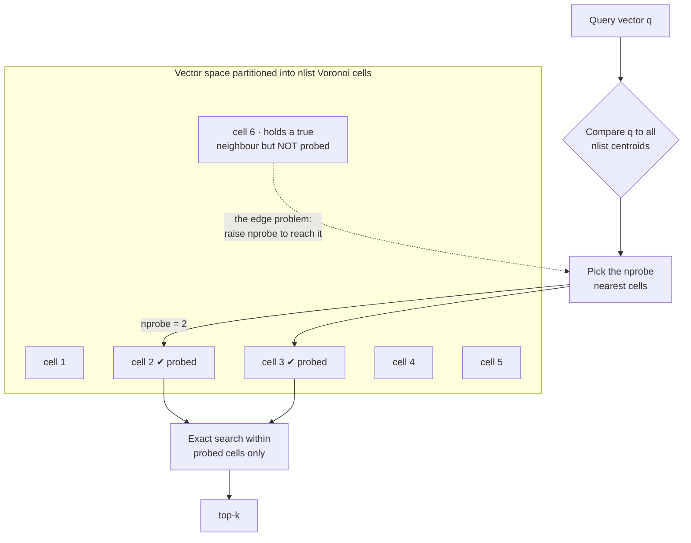
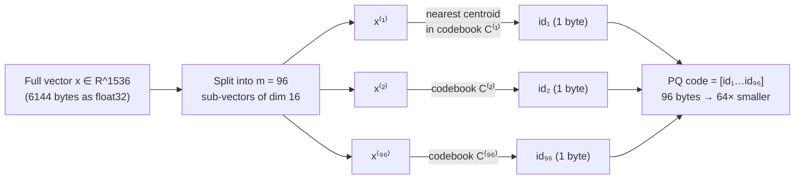
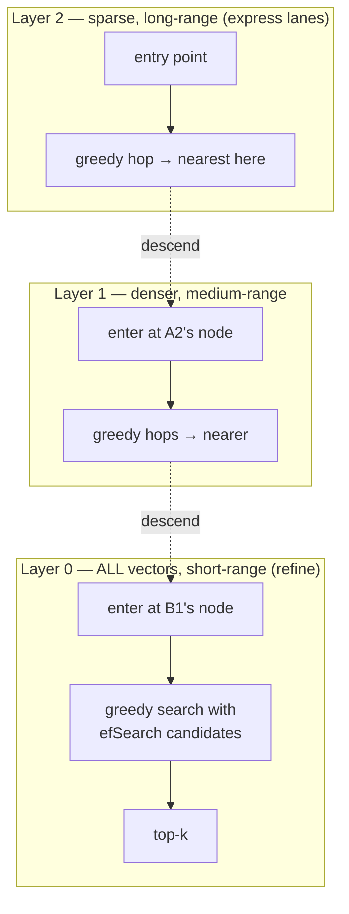

# Vector Indexing & Algorithms: ANN, IVF, PQ & HNSW

Module 1 gave you the space: how similarity is measured and why 1536-dimensional
geometry is so strange. This module answers the question that space raises the
moment your corpus grows past a toy size — **how do you find the nearest vectors
without comparing against all of them?**

The naive answer is to compute the distance to every stored vector and keep the
closest. That is *exact* search, and it is correct, simple, and completely
unusable at scale — it is linear in the number of vectors, and "linear" means a
100-million-vector corpus touches 100 million vectors on *every single query*. The
entire field of Approximate Nearest Neighbour (ANN) search exists to escape that
wall by giving up a sliver of accuracy for orders of magnitude in speed and memory.

Four parts, each an index or idea you will meet in every vector database:

- **Exact vs. approximate search** — the cost of brute-force k-NN and the
  recall/latency/memory trade-off that governs everything after it.
- **Inverted File Index (IVF)** — partition the space into Voronoi cells with
  k-means, then search only the cells near the query. The `nlist`/`nprobe` dial.
- **Product Quantization (PQ)** — compress each vector into a handful of centroid
  IDs, shrinking the memory footprint by 32–96× with a distance you can compute
  from a lookup table.
- **Hierarchical Navigable Small World (HNSW)** — the industry-standard graph
  index: a skip-list-of-graphs that finds neighbours in logarithmic hops.

Every FAISS example here is production-shaped. By the end you'll be able to pick
an index for a corpus and know exactly which knob trades what.

---

## 2.1 — Exact vs. Approximate Search (k-NN vs. ANN)

### The cost of being exact

Exact k-nearest-neighbour search is brute force: given a query $\mathbf{q}$ and a
database of $N$ vectors in $\mathbb{R}^d$, compute the distance to *all* of them
and keep the smallest $k$. The cost is unforgiving:

$$
\text{time per query} = O(N \cdot d) \quad\text{distance work} \;+\; O(N)\ \text{selection}, \qquad \text{memory} = O(N \cdot d)
$$

Put real numbers in. A corpus of $N = 100{,}000{,}000$ vectors at $d = 1536$
dimensions, stored as 32-bit floats:

$$
100{\times}10^6 \times 1536 \times 4\ \text{bytes} = 614\ \text{GB}
$$

That's 614 GB of RAM just to hold the vectors — before any index — and every
query performs on the order of $100{\times}10^6 \times 1536 \approx 1.5 \times
10^{11}$ multiply-adds. No amount of clever caching makes that interactive.

You might hope a tree structure (a kd-tree) prunes the search the way it does in
2-D or 3-D. It does not — this is the curse of dimensionality from Module 1 biting
directly. When distances concentrate (everything drifts toward equidistant), the
bounding boxes a kd-tree uses to prune stop pruning, and the tree degrades to
near-brute-force. Exact search in high dimensions is essentially stuck at $O(N)$.

### The bargain: approximate nearest neighbours

ANN accepts a different contract: **return most of the true nearest neighbours,
most of the time, for a fraction of the cost.** We stop demanding the *exact*
top-$k$ and settle for *approximately* the top-$k$ — and in exchange, latency and
memory drop by orders of magnitude.

The quality metric is **recall@k**: of the $k$ genuinely-nearest neighbours, what
fraction did the index actually return?

$$
\text{recall@}k = \frac{|\,R_k \cap G_k\,|}{k}
$$

where $G_k$ is the true (ground-truth) top-$k$ and $R_k$ is what the index
returned. A well-tuned ANN index hits recall@10 of 0.95–0.99 while searching a
tiny slice of the corpus.

### The trade-off triangle

Every ANN index lives inside one iron constraint: you cannot simultaneously
maximize **recall**, minimize **latency**, and minimize **memory**. Push any
corner and you pay at another.

| | Exact (brute force / `IndexFlat`) | Approximate (ANN) |
| --- | --- | --- |
| Guarantee | True top-$k$, always (recall = 1.0) | Approximate top-$k$ (recall < 1.0, tunable) |
| Query time | $O(N \cdot d)$ — linear in corpus | Sub-linear: $O(\log N)$ (HNSW) or a small fraction of $N$ (IVF) |
| Memory | $O(N \cdot d)$ raw floats | From raw down to a few bytes/vector (PQ) |
| Tuning knob | none | recall ⇄ latency ⇄ memory |

The three indexes in the rest of this module each attack a different corner: **IVF
trades recall for latency** (search fewer vectors), **PQ trades recall for memory**
(compress each vector), and **HNSW trades memory for high recall at low latency**
(store a rich graph). Real systems combine them.

### Exact search as the baseline (and the recall oracle)

You always need exact search for one thing even after you deploy ANN: computing
the ground truth $G_k$ to *measure* your index's recall. FAISS's `IndexFlatL2` is
that baseline.

```python
import faiss
import numpy as np

d = 1536
xb = np.random.randn(1_000_000, d).astype("float32")   # database
xq = np.random.randn(10, d).astype("float32")          # queries
k = 10

# Exact, brute-force L2. This IS the ground truth — and the thing that won't scale.
flat = faiss.IndexFlatL2(d)
flat.add(xb)                      # no training; it just stores the vectors
D_true, I_true = flat.search(xq, k)

def recall_at_k(I_approx, I_true):
    """Fraction of the true top-k that an approximate index recovered."""
    hits = sum(len(set(a) & set(t)) for a, t in zip(I_approx, I_true))
    return hits / (I_true.shape[0] * I_true.shape[1])
```

The pure algorithm, so it's clear there's no magic — just a distance to everything:

```typescript
type Vec = number[];

function bruteForceKnn(query: Vec, db: Vec[], k: number): number[] {
  // O(N·d): score every vector, then take the k smallest. This is the wall.
  const scored = db.map((v, idx) => {
    let dist = 0;
    for (let i = 0; i < v.length; i++) dist += (query[i]! - v[i]!) ** 2; // L2²
    return { idx, dist };
  });
  scored.sort((a, b) => a.dist - b.dist);
  return scored.slice(0, k).map((s) => s.idx);
}
```

> **A note that ties back to Module 1.** For cosine similarity, normalize your
> vectors once and use inner-product search (`faiss.METRIC_INNER_PRODUCT` /
> `IndexFlatIP`). On unit vectors, inner product *is* cosine, and every index in
> this module works identically — you're just swapping the metric the index scores
> with. Normalize at ingest; never re-derive magnitudes at query time.

---

## 2.2 — Inverted File Index (IVF)

### The idea: don't search everything, search nearby

IVF's insight is simple: most of the corpus is nowhere near the query, so don't
look at it. Partition the vector space into regions once, at build time; at query
time, figure out which region(s) the query falls in and search only those.

**Partitioning with k-means.** Run k-means over the dataset to learn `nlist`
centroids $c_1, \dots, c_{\text{nlist}}$. These centroids carve the space into
`nlist` **Voronoi cells** — the cell of centroid $c_i$ is every point closer to
$c_i$ than to any other centroid:

$$
V_i = \left\{ \mathbf{x} \in \mathbb{R}^d : \lVert \mathbf{x} - c_i \rVert \le \lVert \mathbf{x} - c_j \rVert \ \ \forall j \right\}
$$

Each database vector is assigned to exactly one cell — the one whose centroid is
nearest:

$$
\text{cell}(\mathbf{x}) = \operatorname*{arg\,min}_{i}\ \lVert \mathbf{x} - c_i \rVert
$$

The result is an **inverted file**: a map from centroid ID to the list of vectors
in that cell — structurally the same as the inverted index in text search, but
keyed by a learned centroid instead of a word.

**Searching.** For a query:

1. Compute the distance from the query to all `nlist` centroids (cheap, since
   `nlist` ≪ N).
2. Pick the `nprobe` *nearest* centroids — the cells most likely to hold the true
   neighbours.
3. Do exact search only within the vectors of those `nprobe` cells.

You search roughly a $\tfrac{\text{nprobe}}{\text{nlist}}$ fraction of the corpus:

$$
\text{time per query} \approx \underbrace{O(\text{nlist} \cdot d)}_{\text{find cells}} \;+\; \underbrace{O\!\left(\tfrac{\text{nprobe}}{\text{nlist}} \cdot N \cdot d\right)}_{\text{search chosen cells}}
$$

With `nlist = 4096` and `nprobe = 16`, you touch about $16/4096 \approx 0.4\%$ of
the database instead of all of it.



### The two knobs: nlist and nprobe

| Parameter | Set at | What it controls | Turn it up → |
| --- | --- | --- | --- |
| `nlist` | build time | Number of cells (k-means clusters) | Finer partition: fewer vectors per cell (faster per probe), but more centroids to compare and smaller cells (may need more probes). Rule of thumb: `nlist` ≈ $\sqrt{N}$. |
| `nprobe` | **query time** | How many cells to search | Higher recall, higher latency. This is the runtime recall/latency dial — tune it *without rebuilding*. |

`nprobe` is the star. It moves continuously from fast-and-lossy (`nprobe = 1`) to
exact-but-pointless (`nprobe = nlist`, which searches everything). It is tunable
per query, so you can dial recall up for important queries and down for cheap ones.

### The edge problem — IVF's core recall limit

Cells are *hard* partitions, and that's the catch. A query sitting near a cell
boundary can have its true nearest neighbour just across the line, in a cell you
didn't probe (cell 6 in the diagram). With `nprobe = 1` you'll miss it. Raising
`nprobe` searches more boundary cells and recovers those neighbours — which is
exactly *why* the recall/latency dial exists. The finer you partition (`nlist`),
the more boundaries there are, and the more `nprobe` you need to cover them.

### IVF in FAISS

```python
import faiss

d, nlist = 1536, 4096
quantizer = faiss.IndexFlatL2(d)                       # holds the nlist centroids
index = faiss.IndexIVFFlat(quantizer, d, nlist, faiss.METRIC_L2)

index.train(xb)     # k-means learns the nlist centroids (needs enough training pts)
index.add(xb)       # assign every vector to its Voronoi cell (build the inverted lists)

index.nprobe = 16   # the recall/latency dial — change it any time, no rebuild
D, I = index.search(xq, k)

# Idiomatic FAISS: the same index via a factory string.
index = faiss.index_factory(d, "IVF4096,Flat", faiss.METRIC_L2)
```

`IndexIVFFlat` stores the cell vectors *uncompressed* ("Flat"), so it saves query
time but not memory. To save memory too, you compress those cell vectors — which
is the next section.

---

## 2.3 — Product Quantization (PQ)

### The problem PQ solves: RAM

IVF makes search *fast* but the vectors still sit in RAM at full precision — 614 GB
for our 100M-vector corpus. Product Quantization makes them *small*, compressing
each vector to a handful of bytes while keeping distances approximately intact.

### Split, then quantize each piece

The "product" in Product Quantization is a Cartesian product of small codebooks.
Take a vector $\mathbf{x} \in \mathbb{R}^d$ and **split it into $m$ sub-vectors**,
each of dimension $d/m$:

$$
\mathbf{x} = \big[\, \mathbf{x}^{(1)},\ \mathbf{x}^{(2)},\ \dots,\ \mathbf{x}^{(m)} \,\big], \qquad \mathbf{x}^{(j)} \in \mathbb{R}^{d/m}
$$

For each sub-space $j$, learn a **codebook** of $k^{*}$ centroids by running
k-means on that slice across the whole dataset:

$$
C^{(j)} = \big\{\, c^{(j)}_1,\ \dots,\ c^{(j)}_{k^{*}} \,\big\}, \qquad k^{*} = 2^{\text{nbits}}\ (\text{typically } 256)
$$

**Encoding** replaces each sub-vector with the ID of its nearest centroid, so the
whole vector becomes a list of $m$ small integers:

$$
q(\mathbf{x}) = \big[\, i_1,\ \dots,\ i_m \,\big], \qquad i_j = \operatorname*{arg\,min}_{k}\ \lVert \mathbf{x}^{(j)} - c^{(j)}_k \rVert
$$

With $k^{*} = 256$, each ID is one byte, so the storage per vector is just $m$
bytes:

$$
\text{bits per vector} = m \cdot \log_2(k^{*}) = m \cdot 8
$$



Do the arithmetic on our corpus: $d = 1536$ at float32 is 6144 bytes/vector. With
$m = 96$ and $k^{*} = 256$, the code is **96 bytes** — a **64×** compression. The
100M-vector corpus drops from **614 GB to 9.6 GB**, which fits comfortably in RAM
on a single machine.

### Distances from a lookup table (ADC)

Here's the elegant part. You never decompress. To compare a full-precision query
$\mathbf{q}$ against PQ-coded database vectors, use **Asymmetric Distance
Computation** — asymmetric because the query stays exact and only the database is
quantized (less error than quantizing both).

Precompute, once per query, a distance table: for every sub-space $j$ and every
centroid $k$, the squared distance from the query's sub-vector to that centroid.
That's an $m \times k^{*}$ table:

$$
\text{LUT}[j][k] = \lVert \mathbf{q}^{(j)} - c^{(j)}_k \rVert^2
$$

Now the approximate distance to *any* database code is just $m$ table lookups and
adds:

$$
\hat{d}(\mathbf{q}, \mathbf{x})^2 = \sum_{j=1}^{m} \lVert \mathbf{q}^{(j)} - c^{(j)}_{i_j(\mathbf{x})} \rVert^2 = \sum_{j=1}^{m} \text{LUT}[j]\big[i_j(\mathbf{x})\big]
$$

So distance computation drops from $O(d)$ multiply-adds to $O(m)$ lookups — PQ
buys you **less memory *and* faster scoring** at once.

The cost is **quantization error**: each sub-vector is approximated by its nearest
centroid, so distances are approximate and recall drops. More sub-vectors (higher
$m$) or more centroids (higher $k^{*}$) reduce the error but cost more memory. PQ
is the memory corner of the trade-off triangle.

```typescript
type Vec = number[];

// Encode a vector to m centroid IDs given per-subspace codebooks.
function pqEncode(x: Vec, codebooks: Vec[][]): number[] {
  const m = codebooks.length;
  const subDim = x.length / m;
  const code: number[] = [];
  for (let j = 0; j < m; j++) {
    const sub = x.slice(j * subDim, (j + 1) * subDim);
    let best = -1, bestDist = Infinity;
    codebooks[j]!.forEach((centroid, k) => {
      let dist = 0;
      for (let i = 0; i < subDim; i++) dist += (sub[i]! - centroid[i]!) ** 2;
      if (dist < bestDist) { bestDist = dist; best = k; }
    });
    code.push(best); // one byte if k* = 256
  }
  return code;
}

// Asymmetric distance: build the query LUT once, then score codes by table lookup.
function adcDistance(query: Vec, code: number[], codebooks: Vec[][]): number {
  const m = codebooks.length;
  const subDim = query.length / m;
  // LUT[j][k] = ||q^(j) - c^(j)_k||²  (precompute once per query, reuse for all codes)
  const lut = codebooks.map((book, j) => {
    const qsub = query.slice(j * subDim, (j + 1) * subDim);
    return book.map((c) => {
      let dist = 0;
      for (let i = 0; i < subDim; i++) dist += (qsub[i]! - c[i]!) ** 2;
      return dist;
    });
  });
  // Distance to a coded vector = sum of m table lookups — no decompression.
  return code.reduce((sum, id, j) => sum + lut[j]![id]!, 0);
}
```

### PQ (and IVF+PQ) in FAISS

```python
import faiss

d, m, nbits = 1536, 96, 8      # 96 sub-vectors, 8 bits → 256 centroids each → 96 bytes/vec

# Pure PQ: compressed, but still scans all codes (fast per-vector, still O(N) codes).
pq = faiss.IndexPQ(d, m, nbits)
pq.train(xb)                   # learns the m codebooks
pq.add(xb)                     # stores 96-byte codes instead of 6144-byte vectors
D, I = pq.search(xq, k)        # ADC scoring under the hood

# The billion-scale workhorse: IVF for speed + PQ for memory, together.
nlist = 4096
quantizer = faiss.IndexFlatL2(d)
ivfpq = faiss.IndexIVFPQ(quantizer, d, nlist, m, nbits)
ivfpq.train(xb); ivfpq.add(xb)
ivfpq.nprobe = 16              # IVF cuts vectors scanned; PQ shrinks each to 96 bytes
D, I = ivfpq.search(xq, k)

# Idiomatic factory string for the same index:
ivfpq = faiss.index_factory(d, "IVF4096,PQ96", faiss.METRIC_L2)
```

`IndexIVFPQ` is why a single machine can serve billion-vector search: IVF means
each query scans a fraction of the corpus, and PQ means that fraction fits in RAM.
The price is stacked approximation — cell boundaries (IVF) *and* quantization (PQ)
— so you tune `nprobe` and $m$ together against a measured recall target.

---

## 2.4 — Hierarchical Navigable Small World (HNSW)

### The graph approach, and why it won

IVF and PQ partition and compress. HNSW does something different: it builds a
**navigable graph** over the vectors and *walks* it toward the query. It is the
default index in most production vector databases (Qdrant, Weaviate, Milvus,
pgvector, Lucene, FAISS) because it delivers very high recall at very low latency
— at the cost of memory.

**Navigable Small World (NSW)**, the foundation: connect each vector to its near
neighbours in a proximity graph, then search *greedily* — start at some node, hop
to whichever neighbour is closest to the query, repeat until no neighbour is
closer. A "small world" graph mixes short-range links (local accuracy) with a few
long-range links (so any two nodes are a few hops apart). Greedy walk on such a
graph is fast — but plain NSW can stall in local minima and its scaling frays.

**Hierarchical NSW** fixes this by stacking NSW graphs into layers, like a **skip
list** turned into a graph:

- **Layer 0** (the bottom) contains *every* vector, densely connected to close
  neighbours — the fine-grained layer.
- **Higher layers** contain exponentially *fewer* vectors (a random subset), with
  longer-range links — the "express lanes" that cover big distances in few hops.

Each node's top layer is drawn from an exponentially decaying distribution, so
most nodes live only in layer 0 and a handful reach the top:

$$
l = \big\lfloor -\ln(U) \cdot m_L \big\rfloor, \qquad U \sim \text{Uniform}(0, 1), \qquad m_L = \frac{1}{\ln M}
$$

### The search descent

A query enters at the top and falls through the layers, refining as it goes:

1. Start at the entry point in the **top layer**.
2. Greedily walk that layer to the node nearest the query — a few long hops.
3. Drop to the next layer down, using that node as the new entry point; greedy-walk
   again.
4. At **layer 0**, do a thorough greedy search with a candidate list of size
   `efSearch`, collecting the $k$ nearest.

The high layers get you *close* in a handful of hops (coarse, long-range); the low
layers *refine* (fine, short-range) — exactly a skip list's express lanes. That
hierarchy is what buys the logarithmic query time:

$$
\text{query time} \approx O(\log N)
$$



### The parameters

| Parameter | Set at | What it controls | Trade-off |
| --- | --- | --- | --- |
| `M` | build time | Max bi-directional edges per node (layer 0 typically gets $2M$) | Higher $M$ = denser graph = higher recall, but more memory and slower build. Typical 16–64. |
| `efConstruction` | build time | Candidate-list size while *inserting* nodes | Higher = better-quality graph = higher recall, slower build. Typical 100–500. |
| `efSearch` | **query time** | Candidate-list size while *searching* | Higher = more thorough = higher recall, higher latency. The runtime recall/latency dial. |

`M` and `efConstruction` shape the graph once, at build time; `efSearch` is the
query-time dial, the HNSW analogue of IVF's `nprobe`. Memory scales with $M$ —
every node stores up to $M$ neighbour links — and HNSW keeps the full-precision
vectors *and* the graph in RAM, which is its defining cost. It's the "spend memory
to buy recall and speed" corner of the triangle.

```typescript
// The greedy layer walk at the heart of HNSW — pure algorithm, no library.
type Graph = Map<number, number[]>; // node id → neighbour ids (one layer)

function greedySearchLayer(
  query: number[],
  entry: number,
  graph: Graph,
  vectors: number[][],
  dist: (a: number[], b: number[]) => number,
): number {
  let current = entry;
  let currentDist = dist(query, vectors[current]!);
  for (;;) {
    let moved = false;
    for (const neighbour of graph.get(current) ?? []) {
      const d = dist(query, vectors[neighbour]!);
      if (d < currentDist) {           // move to the closer neighbour...
        current = neighbour;
        currentDist = d;
        moved = true;
      }
    }
    if (!moved) return current;        // ...until none is closer: local nearest
  }
}
// HNSW runs this per layer, top-down, each layer's result seeding the next.
```

### HNSW in FAISS

```python
import faiss

d, M = 1536, 32
index = faiss.IndexHNSWFlat(d, M, faiss.METRIC_L2)
index.hnsw.efConstruction = 200      # build-time graph quality
index.add(xb)                        # HNSW builds the graph incrementally — NO train()
index.hnsw.efSearch = 64             # query-time recall/latency dial
D, I = index.search(xq, k)

# Factory string; combine with PQ to reclaim memory: "HNSW32" or "HNSW32,PQ96".
index = faiss.index_factory(d, "HNSW32", faiss.METRIC_L2)
```

Note there's no `train()` — HNSW builds its graph as you `add`. The catch is that
it's memory-hungry (vectors + graph, uncompressed by default) and deletions are
awkward, so for write-heavy or memory-constrained corpora IVF+PQ is often the
better fit.

### Choosing an index

| Index | Speed | Memory | Recall ceiling | Build | Best for |
| --- | --- | --- | --- | --- | --- |
| `Flat` (exact) | Slow ($O(N)$) | High (raw) | 1.0 | none | Ground truth; small corpora (< ~100k) |
| `IVF,Flat` | Fast | High (raw) | High | k-means | Medium corpora where RAM is fine |
| `IVF,PQ` | Fast | **Low** (bytes/vec) | Medium–High | k-means + codebooks | **Billion-scale on one machine** |
| `HNSW` | **Very fast** | **High** (vectors + graph) | **Very high** | incremental | Low-latency, high-recall, RAM available |
| `HNSW,PQ` | Very fast | Medium | High | incremental + codebooks | HNSW speed with a memory budget |

There is no universally best index — only the right point on the recall/latency/
memory triangle for *your* corpus size, latency budget, and RAM. Measure recall
against `IndexFlat` ground truth, then tune the runtime dial (`nprobe` or
`efSearch`) to your target.

---

## Recap

- **Exact k-NN is $O(N)$** in time and memory and dies at scale — 614 GB and
  $10^{11}$ operations per query for 100M×1536 vectors — and the curse of
  dimensionality kills tree-based pruning. ANN trades a measurable slice of
  **recall@k** for orders of magnitude in latency and memory, and every index is a
  point on the recall ⇄ latency ⇄ memory triangle. Keep `IndexFlat` around as the
  recall oracle.
- **IVF** partitions the space into `nlist` Voronoi cells with k-means and searches
  only the `nprobe` cells nearest the query — touching a $\tfrac{\text{nprobe}}
  {\text{nlist}}$ fraction of the corpus. `nprobe` is the query-time recall/latency
  dial; the hard cell boundaries (the edge problem) are its recall limit, and
  raising `nprobe` is the cure.
- **PQ** splits each vector into $m$ sub-vectors and replaces each with a 1-byte
  centroid ID, compressing 64–96× (614 GB → ~10 GB) and scoring via an
  asymmetric-distance lookup table in $O(m)$ instead of $O(d)$. The cost is
  quantization error; `IVF,PQ` combines cell-pruning and compression for
  billion-scale search on one machine.
- **HNSW** builds a skip-list-of-graphs — layer 0 holds every vector, higher layers
  are sparse express lanes — and descends greedily from the top for $O(\log N)$
  queries at very high recall. `M` and `efConstruction` shape the graph at build
  time; `efSearch` is the runtime dial. It's the fastest, highest-recall option
  and the most memory-hungry — the default in most vector databases.

## Exercises

1. **Feel the wall.** Time `IndexFlatL2.search` on 10k, 100k, and 1M random
   vectors at $d = 768$. Plot query time against $N$ and confirm it's linear. Then
   estimate (don't build) the RAM for 100M vectors — and explain why a kd-tree
   wouldn't save you.

2. **Turn the IVF dial.** Build `IVF1024,Flat` on 1M vectors. Sweep `nprobe` over
   $\{1, 4, 16, 64, 256\}$, measuring recall@10 (against `IndexFlat` ground truth)
   and latency at each. Plot the recall/latency curve — that curve *is* the
   trade-off. Then change `nlist` and watch the curve shift.

3. **Watch PQ compress and distort.** Build `PQ` at $m \in \{8, 16, 96\}$ on the
   same 1M vectors. For each, report bytes/vector, total index size, and recall@10.
   Confirm the memory-vs-recall trade-off directly, and explain why higher $m$
   recovers recall.

4. **Race the three indexes.** On one corpus, build `Flat`, `IVF4096,PQ96`, and
   `HNSW32`. Fix a recall@10 target of 0.95 and tune each index's runtime dial to
   hit it. Compare their query latency and index size at equal recall — you'll see
   the triangle's three corners in one table.

## Next: Module 3 — Hybrid Search, Filtering & Metadata

You can now find approximate neighbours fast. But pure vector search has blind
spots Module 1 already warned about — it misses exact terms, rare entities, and
codes, and it has no notion of "only documents from this tenant, in the last 30
days." Module 3 is about production retrieval: fusing dense vector search with
sparse lexical search (the hybrid recipe), the metadata filtering that makes
results usable and secure, and the pre- vs. post-filtering trade-off that decides
whether your filtered search is fast, correct, or both.
