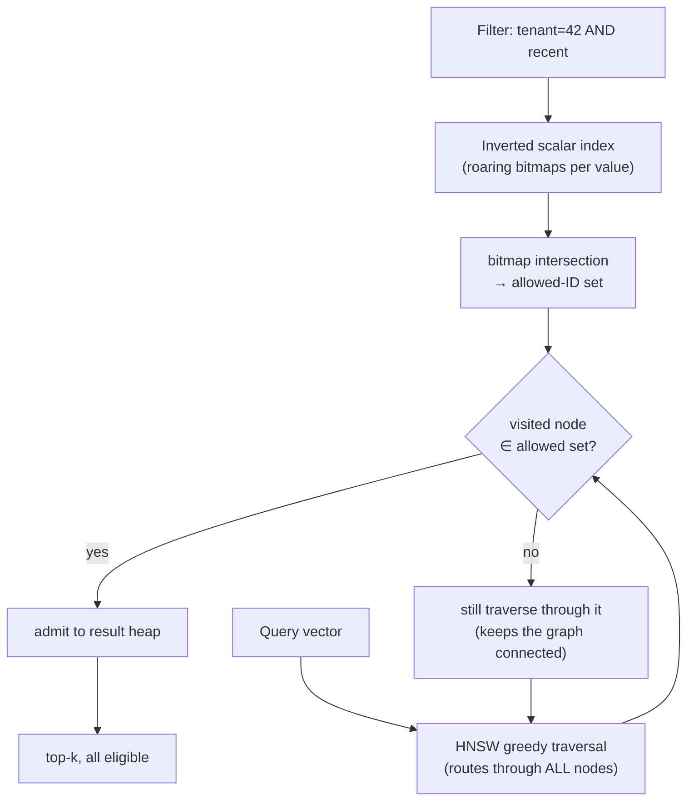
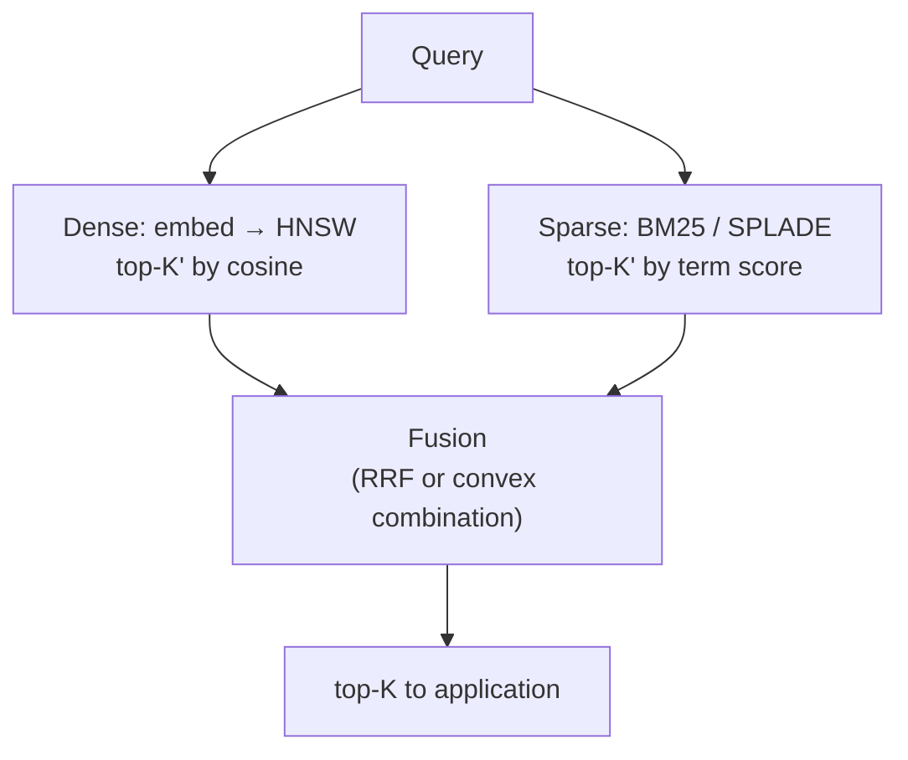
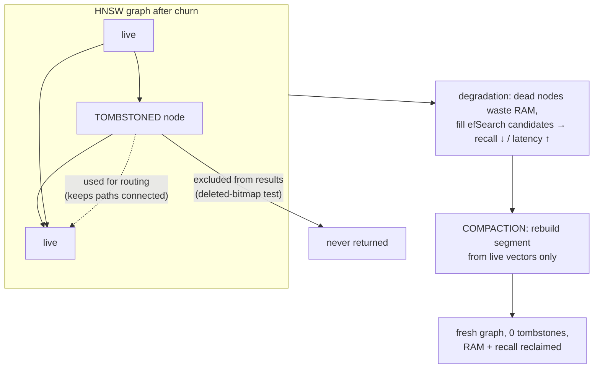

# Vector Database Internals, Filtering & Production Sizing

The RAG course treated filtering as a feature you call. This module opens the
engine and shows how it's *implemented* — because the difference between
pre-filtering and post-filtering is the difference between correct results and an
empty page, and the difference between HNSW and IVF-PQ is a 60× swing in your RAM
bill. Four internals every production deployment forces you to understand:

- **Pre- vs. post-filtering mechanics** — why post-filtering destroys recall, and
  how engines intersect an inverted scalar index with the HNSW walk in one stage.
- **Sparse-dense hybrid engines** — running BM25/SPLADE and dense HNSW
  concurrently and fusing them (RRF, convex combination) before top-$K$ is returned.
- **The CRUD reality** — why you can't remove an HNSW node, how tombstoning works,
  and why compaction is mandatory.
- **Production sizing** — the exact memory formulas for HNSW vs. IVF-PQ across
  `fp32`/`fp16` and node count.

---

## 3.1 — Pre-filtering vs. Post-filtering Mechanics

A filtered query — "nearest vectors **where** `tenant_id = 42 AND created_at >
T`" — can be executed three ways, and they are not equivalent.

**Post-filtering (search → filter).** Run ANN for the top-$K$, then discard the
results that fail the predicate. The search is *filter-blind*: it finds the
globally nearest vectors and only afterward checks the metadata. If the filter is
selective, the nearest $K$ may *all* fail it, and you return almost nothing — the
**empty-results problem**. With selectivity $s = |\text{allowed}| / N$ and a filter
independent of similarity, fetching $K'$ candidates leaves in expectation only

$$
\mathbb{E}[\text{surviving}] \approx K' \cdot s, \qquad \text{so to get } K \text{ results: } K' \approx \frac{K}{s}
$$

As $s \to 0$ the required over-fetch $K/s$ explodes, and any *fixed* over-fetch
returns $K' s \to 0$ results. Post-filtering is only safe for non-selective filters.

**Pre-filtering (filter → search).** Compute the allowed set first from a scalar
index, then search only within it. Recall is preserved because every candidate is
already eligible. Done naively (brute-force over the allowed subset) it's exact but
$O(|\text{allowed}| \cdot d)$ — fine for tiny allowed sets, slow for large ones.

**Single-stage filtered search (the modern engine answer).** Keep an **inverted
scalar index** — for each attribute value, a bitmap (roaring bitmaps in practice)
of the vector IDs that carry it. At query time, intersect those bitmaps into one
**allowed-ID bitmap**, then run the HNSW traversal *through the full graph* but
only admit a node into the result set if it passes a bitmap membership test. Filter
and search happen together — one pass, graph-speed navigation, filter-exact results.



The subtlety, and the honest failure mode: at **very low selectivity** the graph
becomes effectively disconnected *with respect to the allowed set* — the greedy
walk spends its `efSearch` budget on rejected nodes and never reaches the few
eligible ones, so recall collapses. Production engines therefore switch strategy on
an estimated selectivity threshold: below it, **brute-force scan the small allowed
set** (exact and cheap); above it, use filtered graph traversal. (Qdrant adds
extra filtered-subgraph links; Weaviate/Milvus/pgvecto.rs use bitmap-during-traversal
with the brute-force fallback.) The strategy switch is the point — no single method
wins across all selectivities.

| Strategy | Recall under selective filter | Cost | Breaks when |
| --- | --- | --- | --- |
| Post-filter | Collapses ($K's \to 0$) | Cheap ANN + drop | Filter is selective |
| Pre-filter (brute) | Perfect | $O(\lvert\text{allowed}\rvert \cdot d)$ | Allowed set is large |
| Single-stage (filtered HNSW) | High across a wide range | Graph-speed + bitmap test | Very low selectivity → fall back to brute |

```python
# Single-stage filtered traversal: route through everything, admit only allowed IDs.
import heapq

def filtered_search(query, entry, graph, vectors, dist, allowed: set, ef=64, k=10):
    visited = {entry}
    # candidates: min-heap by distance (to expand); results: max-heap of (-d) allowed only
    cand = [(dist(query, vectors[entry]), entry)]
    results: list[tuple[float, int]] = []
    while cand:
        d, node = heapq.heappop(cand)
        if results and -results[0][0] < d and len(results) >= ef:
            break                                   # nothing closer than our worst kept
        for nb in graph[node]:
            if nb in visited:
                continue
            visited.add(nb)
            dnb = dist(query, vectors[nb])
            heapq.heappush(cand, (dnb, nb))         # ALWAYS traverse (keep graph connected)
            if nb in allowed:                       # ...but only ADMIT eligible nodes
                heapq.heappush(results, (-dnb, nb))
                if len(results) > ef:
                    heapq.heappop(results)
    return heapq.nsmallest(k, [(-nd, n) for nd, n in results])
```

```typescript
// The membership gate is the whole idea: traverse all, admit only allowed.
function passesFilter(nodeId: number, allowed: Uint8Array): boolean {
  return allowed[nodeId] === 1; // O(1) bitmap test; roaring bitmaps in production
}
// During HNSW beam search: push every neighbour onto the candidate heap (routing),
// but only insert into the result heap when passesFilter(nb, allowed) is true.
// Below a selectivity threshold, skip the graph and brute-force scan `allowed`.
```

---

## 3.2 — Sparse-Dense Hybrid Engines

Module 1 established the complementarity: dense embeddings capture semantics,
sparse (BM25/SPLADE) capture exact terms and rare entities. A hybrid engine runs
**both retrievers concurrently** — dense over an HNSW index, sparse over an
inverted term index — then fuses the two ranked lists into one before returning
top-$K$ to the application.



The core problem is that the two score scales are incomparable — cosine $\in
[-1,1]$, BM25 $\in [0, \infty)$ — so you can't just add them. Two fusion families
solve it.

**Reciprocal Rank Fusion (RRF)** throws the scores away and fuses on *rank*:

$$
\text{RRF}(d) = \sum_{r \in \mathcal{R}} \frac{1}{k + \text{rank}_r(d)}, \qquad k \approx 60
$$

Rank-based means scale-invariant and tuning-free — which is why RRF is the default
in most engines (Elasticsearch, Qdrant, Weaviate, pgvector). It discards score
*magnitude*, so a document that is #1 by a mile ties one that barely leads.

**Convex combination** normalizes both score lists to $[0,1]$ (min-max or
theoretical bounds) and takes a weighted sum on the convex hull of the two sources:

$$
\tilde{s} = \frac{s - s_{\min}}{s_{\max} - s_{\min}}, \qquad \text{score}(d) = \alpha\,\tilde{s}_{\text{dense}}(d) + (1-\alpha)\,\tilde{s}_{\text{sparse}}(d), \quad \alpha \in [0,1]
$$

It preserves magnitude and lets you weight the sources, but depends on
normalization quality and needs $\alpha$ tuned per corpus.

Both require **over-fetching** ($K' > K$) from each retriever: a document must
appear in at least one list to be fused, so strong-by-one-signal, absent-from-the-other
documents still get considered. Native engines fuse internally in the query planner;
some clients fuse application-side — same math either way.

| | RRF | Convex combination |
| --- | --- | --- |
| Input | Ranks only | Normalized scores |
| Scale handling | Immune (rank-based) | Needs min-max / bounded normalization |
| Tuning | $k$ (robust default 60) | $\alpha$ per corpus + normalization |
| Trade-off | Discards magnitude | Sensitive to score distribution/outliers |
| Use when | Default, robust, mixed retrievers | Scores well-calibrated; want weighting |

```python
def rrf(*ranked_lists, k=60, top=10):
    """Fuse ranked ID lists by reciprocal rank. Scale-free, no score needed."""
    scores: dict = {}
    for lst in ranked_lists:
        for rank, doc_id in enumerate(lst):          # rank is 0-based
            scores[doc_id] = scores.get(doc_id, 0.0) + 1.0 / (k + rank + 1)
    return sorted(scores, key=scores.get, reverse=True)[:top]

def convex_fusion(dense, sparse, alpha=0.5, top=10):
    """dense/sparse: {id: raw_score}. Min-max normalize each, then weighted sum."""
    def norm(d):
        if not d: return {}
        lo, hi = min(d.values()), max(d.values())
        rng = hi - lo or 1.0
        return {i: (s - lo) / rng for i, s in d.items()}
    dn, sn = norm(dense), norm(sparse)
    ids = dn.keys() | sn.keys()
    fused = {i: alpha * dn.get(i, 0) + (1 - alpha) * sn.get(i, 0) for i in ids}
    return sorted(fused, key=fused.get, reverse=True)[:top]
```

```typescript
function rrf(rankedLists: number[][], k = 60, top = 10): number[] {
  const scores = new Map<number, number>();
  for (const list of rankedLists)
    list.forEach((id, rank) => scores.set(id, (scores.get(id) ?? 0) + 1 / (k + rank + 1)));
  return [...scores.entries()].sort((a, b) => b[1] - a[1]).slice(0, top).map(([id]) => id);
}
```

---

## 3.3 — The CRUD Reality: Tombstoning & Graph Degradation

Vectors get inserted, updated, and deleted — and HNSW hates two of those.

**Insert** is native: HNSW adds a node incrementally (assign a layer, search for
its $M$ nearest neighbours, wire the bidirectional links — Module 2). No problem.

**Delete is the hard one.** An HNSW node is woven into the graph: many nodes link
*to* it, and it links to others. Truly removing it means finding every in-edge (HNSW
doesn't track reverse edges by default), repairing each neighbour's link list by
re-running neighbour selection to replace the lost edge, and verifying the removal
didn't partition the graph or leave nodes under-connected. That's expensive and can
itself degrade recall — so almost no implementation does true removal.

**Tombstoning (soft delete)** is the universal answer: mark the node deleted in a
`deleted` bitmap and leave it in the graph. It still serves **routing** (paths
through it stay intact, so connectivity is preserved) but is excluded from
**results** — the exact same exclusion-bitmap gate as the filter in 3.1. Cost:
$O(1)$. An **update** is then just tombstone-old + insert-new, so updates *also*
accrue tombstones.



**Graph degradation** is the accumulating tax. Tombstoned nodes still occupy RAM
(vector + edges), and the traversal still *visits* them — they crowd the `efSearch`
candidate list only to be discarded, shrinking the *effective* candidate budget, so
recall drops or you must raise `efSearch` (more latency). If a live node's
neighbours are mostly tombstoned, it becomes poorly connected for result purposes.
High churn accelerates all of this.

**Compaction is therefore mandatory**, not optional. Periodically rebuild the index
from only the live vectors — a clean graph with zero tombstones — reclaiming memory
and restoring recall/latency. This is why vector DBs adopt **segment-based (LSM-like)
architectures**: data lands in immutable segments, deletes tombstone, and a
background merge rebuilds segments while dropping tombstoned vectors. IVF degrades
differently — deleting from an inverted list is easy (no graph to repair), but
inserts drift the k-means cell balance over time, so IVF needs periodic *retraining*
of centroids rather than graph rebuilds. Both require scheduled maintenance; the
trigger differs.

| Operation | HNSW | IVF / IVF-PQ |
| --- | --- | --- |
| Insert | Incremental add (native) | Append to nearest cell's list |
| Delete | **Tombstone** (true removal is $O(\text{repair})$) | Remove ID from list (cheap) |
| Update | Tombstone + insert | Remove + re-add |
| Degrades via | Tombstone accumulation → recall/latency | Cell drift as distribution shifts |
| Maintenance | **Compaction** (rebuild segment) | Centroid **retrain** + rebalance |

```python
class TombstoneIndex:
    def __init__(self, index):
        self.index, self.deleted, self.live = index, set(), 0
        self.total = 0
    def delete(self, vec_id): self.deleted.add(vec_id)          # O(1) soft delete
    def update(self, vec_id, new_vec):
        self.deleted.add(vec_id); self.index.add(new_vec); self.total += 1
    def tombstone_ratio(self): return len(self.deleted) / max(self.total, 1)
    def should_compact(self, threshold=0.2):
        return self.tombstone_ratio() > threshold             # e.g. compact past 20% dead
```

```typescript
class TombstoneIndex {
  private deleted = new Set<number>();
  private total = 0;
  delete(id: number) { this.deleted.add(id); }               // soft delete, O(1)
  tombstoneRatio() { return this.deleted.size / Math.max(this.total, 1); }
  shouldCompact(threshold = 0.2) { return this.tombstoneRatio() > threshold; }
  // Excluded from results via the deleted-set gate (same pattern as filtering);
  // still traversed for routing until the next compaction rebuilds the segment.
}
```

---

## 3.4 — Production Sizing & Memory Math

Choosing an index *is* choosing your RAM bill. Here are the exact footprints. Let
$b$ be bytes per vector component — $b = 4$ for `fp32`, $2$ for `fp16`, $1$ for
`int8` — and $\ell$ the bytes per graph link / stored ID (4 for `int32`).

**Raw vectors** (and the exact `IndexFlat` baseline):

$$
\text{MEM}_{\text{raw}} = N \cdot d \cdot b
$$

**HNSW** stores the full vectors *plus* the graph. Almost every node lives only in
layer 0 (exponential layer decay from Module 2), whose degree is $M_0 = 2M$, so the
edges are dominated by the layer-0 term; upper layers and node labels fold into a
small per-node overhead $o$:

$$
\text{MEM}_{\text{HNSW}} \approx N\big(\, \underbrace{d\,b}_{\text{vector}} + \underbrace{2M\,\ell}_{\text{layer-0 links}} + \underbrace{o}_{\text{label + upper layers}} \,\big)
$$

**IVF-PQ** stores tiny PQ codes plus IDs; codebooks and coarse centroids are fixed
overhead independent of $N$:

$$
\text{MEM}_{\text{IVFPQ}} \approx \underbrace{N\big(m\tfrac{\text{nbits}}{8} + \ell\big)}_{\text{codes + IDs}} + \underbrace{k^{*} d\, b}_{\text{codebooks}} + \underbrace{\text{nlist}\cdot d\, b}_{\text{coarse centroids}}, \qquad k^{*} = 2^{\text{nbits}}
$$

Put $N = 10^7$, $d = 1536$, $M = 32$, $m = 96$, `nbits` $= 8$ through both. Per-vector:
HNSW `fp32` $= 1536{\cdot}4 + 2{\cdot}32{\cdot}4 = 6400$ bytes; IVF-PQ $\approx 96 + 4
= 100$ bytes. That's the ~60× gap that decides whether your corpus fits on one box.

| Config | Bytes / vector | 10M vectors | vs. HNSW fp32 |
| --- | --- | --- | --- |
| `Flat` fp32 (raw) | 6144 | ~61.4 GB | 0.96× |
| **HNSW fp32** | 6400 | **~64 GB** | 1× |
| HNSW fp16 | 3328 | ~33.3 GB | 0.52× |
| IVF-PQ (m=96) | ~100 | **~1.0 GB** | 0.016× |

`fp16` roughly halves HNSW (the vector term dominates; links are precision-independent)
for a usually-negligible recall hit; PQ collapses it 60×. But **provision above the
index size**: compaction transiently holds the *old and new* index together, so a
rebuild needs ~2× the steady-state footprint, plus room for query buffers, filter/
fusion bitmaps, and the OS:

$$
\text{RAM}_{\text{provision}} = f \cdot \text{MEM}_{\text{index}}, \qquad f \approx 1.5\text{ to }2
$$

If provisioned RAM exceeds a box, the options are shard across nodes, or go
disk-backed (`mmap`/DiskANN, or heavier PQ) and accept the latency.

```python
def index_bytes(n, d, *, index="hnsw", precision="fp32",
                M=32, m=96, nbits=8, nlist=4096, link=4, overhead=16):
    b = {"fp32": 4, "fp16": 2, "int8": 1}[precision]
    if index == "flat":
        return n * d * b
    if index == "hnsw":
        return n * (d * b + 2 * M * link + overhead)
    if index == "ivfpq":
        codes = n * (m * nbits // 8 + link)          # PQ code + vector id
        codebooks = (1 << nbits) * d * b             # m sub-codebooks = k* × d floats
        centroids = nlist * d * b
        return codes + codebooks + centroids
    raise ValueError(index)

def provision_gb(nbytes, headroom=1.75):
    return nbytes * headroom / 1e9                    # ~2× at compaction peak

hnsw  = index_bytes(10_000_000, 1536, index="hnsw")            # ~64 GB
ivfpq = index_bytes(10_000_000, 1536, index="ivfpq")          # ~1.0 GB
print(round(hnsw/1e9, 1), round(ivfpq/1e9, 2), round(provision_gb(hnsw), 1))
```

```typescript
type Precision = "fp32" | "fp16" | "int8";
const BYTES: Record<Precision, number> = { fp32: 4, fp16: 2, int8: 1 };

function indexBytes(
  n: number, d: number,
  o: { index?: "flat" | "hnsw" | "ivfpq"; precision?: Precision;
       M?: number; m?: number; nbits?: number; nlist?: number; link?: number; overhead?: number } = {},
): number {
  const { index = "hnsw", precision = "fp32", M = 32, m = 96, nbits = 8, nlist = 4096, link = 4, overhead = 16 } = o;
  const b = BYTES[precision];
  if (index === "flat") return n * d * b;
  if (index === "hnsw") return n * (d * b + 2 * M * link + overhead);
  const codes = n * ((m * nbits) / 8 + link);        // PQ code + id
  const codebooks = 2 ** nbits * d * b;
  const centroids = nlist * d * b;
  return codes + codebooks + centroids;
}
const provisionGb = (bytes: number, headroom = 1.75) => (bytes * headroom) / 1e9;
```

---

## Recap

- **Post-filtering searches filter-blind then discards**, so a selective filter
  ($s \to 0$) leaves $\approx K's$ results and returns an empty page; the required
  over-fetch $K/s$ explodes. **Single-stage filtered search** intersects a roaring-bitmap
  scalar index into an allowed-ID set and gates HNSW traversal on membership — routing
  through all nodes, admitting only eligible ones — with a brute-force fallback below
  a selectivity threshold where the graph disconnects w.r.t. the allowed set.
- **Hybrid engines** run sparse (BM25/SPLADE inverted index) and dense (HNSW)
  retrieval concurrently and fuse: **RRF** ($\sum 1/(k+\text{rank})$, scale-free,
  the robust default) or **convex combination** (min-max normalize, weight by
  $\alpha$, preserves magnitude but needs tuning). Both over-fetch so a strong-by-one-signal
  doc still competes.
- **HNSW can't cheaply delete** — repairing in-edges and connectivity is expensive
  — so engines **tombstone** (exclude from results, keep for routing) and take
  updates as tombstone+insert. Accumulating tombstones waste RAM and crowd `efSearch`,
  degrading recall/latency, which makes **compaction** (segment rebuild from live
  vectors) mandatory. IVF instead drifts via cell imbalance and needs centroid retrain.
- **Sizing is arithmetic.** HNSW costs $N(db + 2M\ell + o)$ bytes against IVF-PQ's
  $N(m\tfrac{\text{nbits}}{8} + \ell) + k^{*}db + \text{nlist}\,db$ — about 6400 vs.
  100 bytes/vector at 1536-D, a 60x gap. `fp16` halves the HNSW vector term;
  provision 1.5 to 2x the index for the compaction peak, then shard or go
  disk-backed when it won't fit.

## Exercises

1. **Reproduce the empty page.** Index 100k vectors with a boolean attribute true
   for 1% of them. Run post-filtering at fixed over-fetch $K' \in \{10, 100,
   1000\}$ and measure how many results survive; confirm it tracks $K's$. Then run
   single-stage filtered search and confirm full recall at every selectivity.

2. **RRF vs. convex.** Build a dense and a sparse ranking for the same 50 queries
   with known relevance. Fuse with RRF and with convex combination (sweep $\alpha$).
   Compare nDCG; find where convex beats RRF and where its normalization sensitivity
   hurts.

3. **Watch a graph rot.** Insert 200k vectors into HNSW, then tombstone-delete 40%
   in random order, measuring recall@10 and latency at 0%, 10%, 20%, 40% tombstones.
   Plot the degradation, then compact and confirm both metrics snap back.

4. **Size a real deployment.** For $N \in \{1\text{M}, 100\text{M}, 1\text{B}\}$ at
   $d = 1536$, tabulate provisioned RAM for HNSW `fp32`, HNSW `fp16`, and IVF-PQ.
   Mark which fit on a 128 GB box and which force sharding or disk — and state the
   recall you'd trade for each.

## Next: Module 4 — Embedding Pipelines, Evaluation & Production Operations

You can now store, filter, fuse, mutate, and size a vector index. The last module
closes the loop around it: choosing and versioning an embedding model, the ingestion
pipeline that turns raw content into vectors at scale, measuring retrieval quality
with recall/precision/nDCG against a golden set, and the operational concerns —
re-embedding on model upgrades, monitoring drift, and the cost/latency budgets that
decide what ships. The engine internals from this module become the thing you run,
measure, and keep honest in production.
