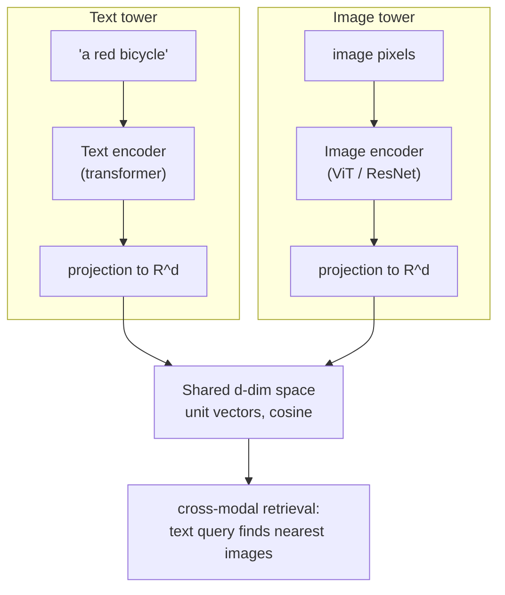
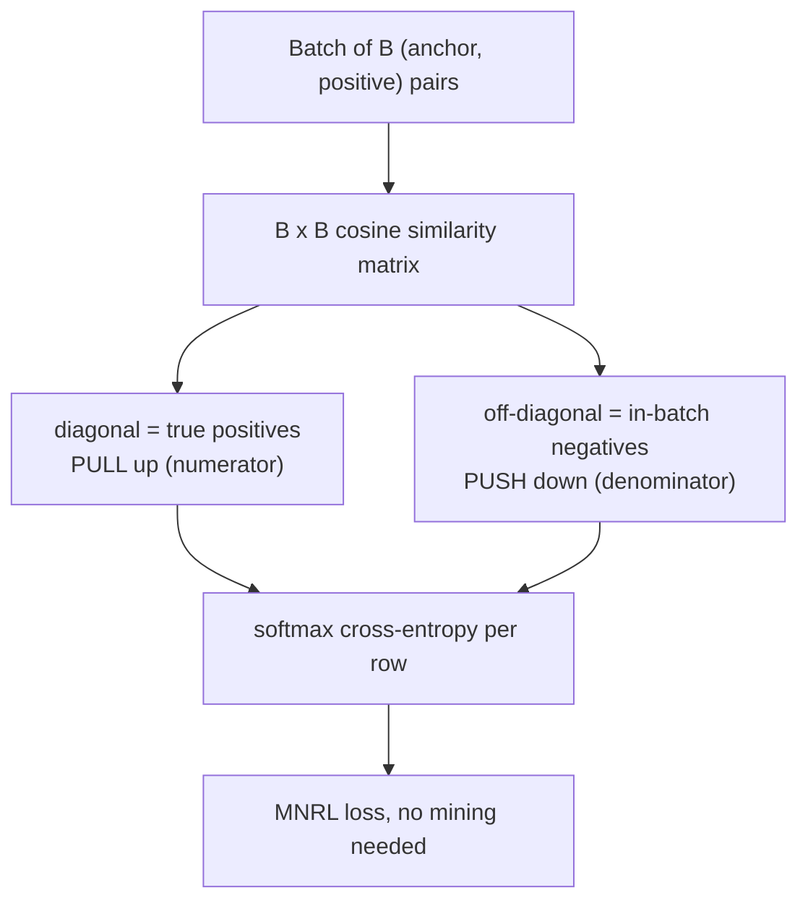
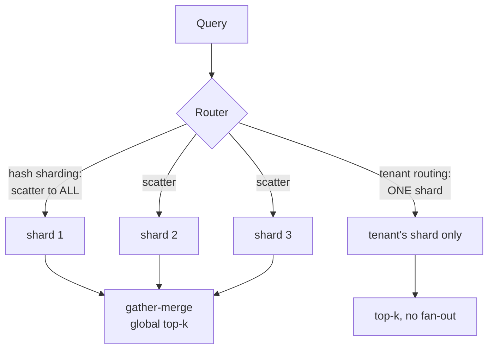

# Custom Embeddings, Multimodal Vectors & Evaluation

You can now measure a vector space (Module 1), index it (Module 2), and run,
filter, and size it in production (Module 3). This finale is about the vectors
*themselves*: making one space hold multiple modalities, reshaping a space for a
domain the base model never learned, proving the model is actually good with hard
numbers, and scaling the whole thing across machines. Four parts:

- **Multimodal vector spaces** — how a dual encoder maps images and text into one
  shared space, enabling text-to-image retrieval by plain cosine.
- **Fine-tuning custom embeddings** — Triplet Loss and Multiple Negatives Ranking
  Loss: the math of pulling positives together and pushing negatives apart.
- **Evaluating vector quality** — Recall@K, MRR, and NDCG, defined and computed.
- **Production architecture & sharding** — hash vs. tenant sharding for
  multi-tenant SaaS, and how to place tenants without OOM.

---

## 4.1 — Multimodal Vector Spaces

The trick behind text-to-image search is that the image and the query end up as
vectors in the **same** $\mathbb{R}^d$, so a cross-modal match is just cosine
similarity. That shared space is built by a **dual encoder** (two-tower)
architecture, the design behind CLIP.

Two separate encoders — an image tower (a ViT or ResNet) and a text tower (a
transformer) — each project their input to the same dimension $d$. They are
trained together so that a matching image-caption pair lands close and a
mismatched pair lands far. After training, "a photo of a dog" and an actual dog
photo sit near each other, because the space encodes *semantic content*, not
pixels versus tokens.



**How the shared space is trained (contrastive / InfoNCE).** Take a batch of $N$
image-text pairs and compute the full $N \times N$ matrix of cosine similarities
between every image and every caption. The diagonal (true pairs) should be high,
everything off-diagonal (mismatches) low. A symmetric cross-entropy loss over rows
(image to text) and columns (text to image), scaled by a learned temperature
$\tau$, enforces exactly that. For image $i$:

$$
\mathcal{L}_i = -\log \frac{\exp\!\big(\cos(I_i, T_i)/\tau\big)}{\sum_{j} \exp\!\big(\cos(I_i, T_j)/\tau\big)}
$$

This is the same objective as MNRL in the next section, applied across modalities
with the other captions serving as negatives.

**Cross-modal retrieval mechanics.** Because both towers output into one space,
retrieval is modality-agnostic and the vector database from Modules 2 and 3
doesn't change at all. Encode the image gallery once (precompute, index in HNSW),
then embed a text query with the *text* tower and search the *image* vectors by
cosine. Text-to-image, image-to-image, and text-to-text all use the identical
index. Normalize to unit vectors so cosine equals dot product (Module 1).

```python
import torch, open_clip

model, _, preprocess = open_clip.create_model_and_transforms(
    "ViT-B-32", pretrained="laion2b_s34b_b79k")
tokenizer = open_clip.get_tokenizer("ViT-B-32")

@torch.no_grad()
def embed_text(queries):
    v = model.encode_text(tokenizer(queries))
    return torch.nn.functional.normalize(v, dim=-1)      # unit vectors, cosine == dot

@torch.no_grad()
def embed_images(images):                                # images: list of PIL.Image
    x = torch.stack([preprocess(im) for im in images])
    return torch.nn.functional.normalize(model.encode_image(x), dim=-1)

gallery = embed_images(images)                           # precompute + index (Modules 2-3)
q = embed_text(["a red bicycle leaning on a wall"])
scores = q @ gallery.T                                   # cross-modal cosine, one space
top = scores.topk(5, dim=-1)                             # nearest images to a text query
```

```typescript
// The query embedding comes from the text tower, gallery embeddings from the
// image tower — same d-dim space, so retrieval is plain cosine over unit vectors.
function crossModalSearch(
  queryEmb: number[],
  gallery: { id: string; emb: number[] }[],
  k = 5,
) {
  const dot = (a: number[], b: number[]) => a.reduce((s, x, i) => s + x * b[i]!, 0);
  return gallery
    .map((g) => ({ id: g.id, score: dot(queryEmb, g.emb) }))
    .sort((a, b) => b.score - a.score)
    .slice(0, k);
}
```

> **Honest caveats.** CLIP-space embeddings exhibit a **modality gap**: image and
> text vectors occupy slightly separated cones, so cross-modal cosines run lower
> than intra-modal ones. Ranking within a direction still works, but absolute
> thresholds must be calibrated per direction (Module 1: absolute cosine is
> space-specific). And web-trained CLIP is weak on fine-grained, OCR, counting,
> and niche domains (medical, legal) — which is exactly when you fine-tune. The
> same dual-encoder contrastive recipe extends to audio (CLAP) and beyond.

---

## 4.2 — Fine-Tuning Custom Embeddings

Off-the-shelf models fail on jargon. A general encoder places "MI" nowhere near
"myocardial infarction," and two legal clauses that a lawyer calls equivalent land
far apart. Fine-tuning reshapes the geometry: take a pretrained encoder and train
it on domain pairs so relevant things pull together and irrelevant things push
apart. Two losses dominate.

### Triplet Loss

Train on triplets: an anchor $a$, a positive $p$ (relevant to $a$), and a negative
$n$ (irrelevant). The objective wants the positive closer than the negative by at
least a margin $\alpha$:

$$
\mathcal{L}_{\text{triplet}} = \max\!\big(0,\; d(a, p) - d(a, n) + \alpha\big)
$$

where $d$ is a distance (Euclidean, or $1 - \cos$). If the negative is already
far enough, the loss is $0$ and no gradient flows. That is Triplet Loss's
weakness: random negatives are usually easy, so most triplets teach nothing. You
need **hard-negative mining** (negatives close to the anchor) to learn, and mining
is expensive and fiddly.

### Multiple Negatives Ranking Loss (MNRL)

MNRL removes the mining problem. Train on just `(anchor, positive)` **pairs**. In a
batch of $B$ pairs, each anchor $a_i$ treats its own $p_i$ as the positive and
*every other positive* $p_j$ in the batch as a negative. You get $B - 1$
in-batch negatives for free, no mining:

$$
\mathcal{L}_{\text{MNRL}} = -\frac{1}{B} \sum_{i=1}^{B} \log \frac{\exp\!\big(\cos(a_i, p_i)/\tau\big)}{\sum_{j=1}^{B} \exp\!\big(\cos(a_i, p_j)/\tau\big)}
$$

The numerator pulls each true pair together; the denominator pushes the anchor
away from every other positive. It is identical to CLIP's loss from 4.1, and it is
the default in modern text-embedding fine-tuning (Sentence-Transformers). Bigger
batches give more in-batch negatives and a stronger signal.



| | Triplet Loss | MNRL (InfoNCE) |
| --- | --- | --- |
| Training data | (anchor, positive, negative) | (anchor, positive) pairs |
| Negatives | Explicit, one per triplet | In-batch, $B - 1$ per anchor, free |
| Hard-negative mining | Required for signal | Optional (helps, not needed) |
| Batch sensitivity | Low | High (bigger batch is better) |
| Use when | You have curated hard negatives | Default; you have positive pairs |

```python
from sentence_transformers import SentenceTransformer, InputExample, losses
from torch.utils.data import DataLoader

model = SentenceTransformer("BAAI/bge-base-en-v1.5")     # start from a strong base
train = [InputExample(texts=[q, passage]) for q, passage in domain_pairs]  # no negatives
loader = DataLoader(train, shuffle=True, batch_size=64)  # bigger batch = more negatives
loss = losses.MultipleNegativesRankingLoss(model)        # the MNRL / InfoNCE objective
model.fit(train_objectives=[(loader, loss)], epochs=1, warmup_steps=100)
```

```python
import torch, torch.nn.functional as F

def mnrl_loss(anchors, positives, scale=20.0):
    """anchors, positives: (B, d). scale = 1/temperature. In-batch negatives."""
    a = F.normalize(anchors, dim=-1)
    p = F.normalize(positives, dim=-1)
    sims = (a @ p.T) * scale                    # (B, B) cosine matrix
    labels = torch.arange(len(a))               # the diagonal is each row's positive
    return F.cross_entropy(sims, labels)        # pull diagonal up, push off-diagonal down
```

```typescript
// Triplet loss: pull the positive within a margin, push the negative beyond it.
function tripletLoss(a: number[], p: number[], n: number[], margin = 0.2): number {
  const dist = (x: number[], y: number[]) =>
    Math.sqrt(x.reduce((s, xi, i) => s + (xi - y[i]!) ** 2, 0));
  return Math.max(0, dist(a, p) - dist(a, n) + margin); // 0 when n is already far enough
}
```

> **Honest caveats.** Fine-tuning needs quality pairs and risks catastrophic
> forgetting — a domain fine-tune can degrade general performance, so evaluate
> before and after (4.3) on both domain and general queries. Often a small
> fine-tune on a few thousand domain pairs beats a much larger general model on
> that domain.

---

## 4.3 — Evaluating Vector Quality

These metrics score the **retriever** against human relevance labels — a query set
$Q$ where each query $q$ has a known relevant set $R_q$ (or graded relevances). This
is distinct from Module 2's ANN recall, which measured the index against exact
search; here the ground truth is human judgment.

**Recall@K** — the fraction of relevant items that appear in the top $K$, averaged
over queries. Where $\hat{R}_q^K$ is the returned top $K$:

$$
\text{Recall@}K = \frac{1}{|Q|} \sum_{q \in Q} \frac{|R_q \cap \hat{R}_q^K|}{|R_q|}
$$

It answers "did we retrieve the relevant context," which is exactly the RAG
question — but it ignores *where* in the top $K$ the hits landed.

**Mean Reciprocal Rank (MRR)** — the reciprocal of the rank of the *first* relevant
result, averaged. Where $\text{rank}_q$ is the position of the first hit ($0$
reciprocal if none):

$$
\text{MRR} = \frac{1}{|Q|} \sum_{q \in Q} \frac{1}{\text{rank}_q}
$$

MRR rewards putting one correct answer high, so it fits single-answer QA. It
ignores every relevant result after the first.

**Normalized Discounted Cumulative Gain (NDCG)** — the gold standard, because it
handles *graded* relevance and *position*. Each result has a grade $rel_i$; gains
are discounted by log of position, then normalized by the ideal ordering:

$$
\text{DCG@}K = \sum_{i=1}^{K} \frac{2^{rel_i} - 1}{\log_2(i + 1)}, \qquad \text{NDCG@}K = \frac{\text{DCG@}K}{\text{IDCG@}K}
$$

$\text{IDCG@}K$ is the DCG of the perfect ranking (grades sorted descending), so
$\text{NDCG@}K \in [0, 1]$ and queries with different numbers of relevant docs
become comparable. The $2^{rel} - 1$ gain sharply rewards surfacing the most
relevant results first.

| Metric | Measures | Graded? | Position-aware? | Best for |
| --- | --- | --- | --- | --- |
| Recall@K | Coverage of relevant set | No | No | RAG context retrieval |
| MRR | Rank of first hit | No | Yes (first only) | Single-answer QA |
| NDCG@K | Full ranking quality | Yes | Yes | Ranked lists, graded relevance |

```python
import numpy as np

def recall_at_k(ranked, relevant, k):
    return len(set(ranked[:k]) & relevant) / max(len(relevant), 1)

def reciprocal_rank(ranked, relevant):
    for i, doc in enumerate(ranked, start=1):
        if doc in relevant:
            return 1.0 / i
    return 0.0

def ndcg_at_k(ranked, rels, k):
    """rels: {doc_id: grade}. Graded NDCG with the 2^rel - 1 gain."""
    dcg = sum((2 ** rels.get(doc, 0) - 1) / np.log2(i + 1)
              for i, doc in enumerate(ranked[:k], start=1))
    ideal = sorted(rels.values(), reverse=True)[:k]
    idcg = sum((2 ** g - 1) / np.log2(i + 1) for i, g in enumerate(ideal, start=1))
    return dcg / idcg if idcg else 0.0

def evaluate(runs, qrels, k=10):
    """runs: {q: [ranked doc ids]}, qrels: {q: {doc: grade}}."""
    rows = {"recall@k": [], "MRR": [], "nDCG@k": []}
    for q, ranked in runs.items():
        rels = qrels.get(q, {})
        relevant = {d for d, g in rels.items() if g > 0}
        rows["recall@k"].append(recall_at_k(ranked, relevant, k))
        rows["MRR"].append(reciprocal_rank(ranked, relevant))
        rows["nDCG@k"].append(ndcg_at_k(ranked, rels, k))
    return {m: float(np.mean(v)) for m, v in rows.items()}
```

```typescript
function ndcgAtK(ranked: string[], rels: Record<string, number>, k: number): number {
  // i is 0-based, so rank = i + 1 and the discount is log2(rank + 1) = log2(i + 2).
  const dcg = ranked.slice(0, k).reduce(
    (s, doc, i) => s + (2 ** (rels[doc] ?? 0) - 1) / Math.log2(i + 2), 0);
  const ideal = Object.values(rels).sort((a, b) => b - a).slice(0, k);
  const idcg = ideal.reduce((s, g, i) => s + (2 ** g - 1) / Math.log2(i + 2), 0);
  return idcg ? dcg / idcg : 0;
}
```

> **Honest caveats.** Evaluate on a labeled set from *your* domain, not just public
> benchmarks (MTEB/BEIR are general and may not predict your corpus). Pick the
> metric that matches the product: MRR or hit-rate for one-answer QA, NDCG for
> ranked lists, Recall@K for RAG. Always re-evaluate after fine-tuning to confirm a
> real gain and no regression on general queries.

---

## 4.4 — Production Architecture & Sharding

When the index outgrows one node's RAM (size it with Module 3's formulas), you
shard: partition the vectors across nodes, each holding a subset plus its own
index. How you partition decides both query cost and whether you hit OOM.



**Sharding by hash.** Assign each vector to a shard by `hash(id) mod N` (consistent
hashing to minimize reshuffle on rebalance). Distribution is uniform, so memory is
balanced and there are no hotspots — but the query's true neighbours could live on
any shard, so *every* query must scatter to *all* shards and gather-merge their
local top-$K$. Query cost scales with shard count. Good for one large corpus with
uniform access.

**Sharding by tenant (metadata routing).** In multi-tenant SaaS, route each
tenant's vectors to a specific shard via a routing table. A tenant's query then
hits only *its* shard — no fan-out — which is a large efficiency win, plus data
isolation for per-tenant limits and deletion. The danger is skew: a whale tenant
can overload its shard and OOM while a tiny tenant wastes one. Avoiding OOM is a
bin-packing problem — using Module 3's per-vector byte formula, pack tenants into
shards so each shard's total stays under its RAM budget, and split a whale tenant
across shards by hashing within it.

| | Hash sharding | Tenant sharding (routing) |
| --- | --- | --- |
| Query pattern | Scatter to all + gather-merge | Route to one shard |
| Memory balance | Even (no skew) | Skewed by tenant size |
| OOM risk | Low | High (whale tenants) unless bin-packed |
| Isolation | None | Per-tenant (co-located) |
| Best for | One large uniform corpus | Multi-tenant SaaS |

```python
import hashlib

def hash_shard(vec_id: str, num_shards: int) -> int:
    """Uniform placement: balanced memory, but queries fan out to ALL shards."""
    h = int(hashlib.blake2b(vec_id.encode(), digest_size=8).hexdigest(), 16)
    return h % num_shards

def bin_pack_tenants(tenant_bytes: dict, shard_budget: int) -> dict:
    """First-fit-decreasing packing so no shard exceeds its RAM budget (Module 3
    sizing gives tenant_bytes). Whale tenants over budget are split elsewhere."""
    routing, loads = {}, []                       # loads[s] = bytes placed on shard s
    for tenant, size in sorted(tenant_bytes.items(), key=lambda kv: -kv[1]):
        for s in range(len(loads)):
            if loads[s] + size <= shard_budget:
                loads[s] += size; routing[tenant] = s; break
        else:                                     # no shard fits -> open a new one
            routing[tenant] = len(loads); loads.append(size)
    return routing                                # tenant -> shard; query routes to one

def gather_merge(shard_results, k):
    """Scatter-gather merge of per-shard top-k into a global top-k (hash sharding)."""
    merged = [hit for res in shard_results for hit in res]
    return sorted(merged, key=lambda h: h.score, reverse=True)[:k]
```

```typescript
function hashShard(id: string, numShards: number): number {
  let h = 2166136261 >>> 0;                       // FNV-1a
  for (let i = 0; i < id.length; i++) {
    h ^= id.charCodeAt(i);
    h = Math.imul(h, 16777619);
  }
  return (h >>> 0) % numShards;
}

// Tenant routing: one lookup, the query hits ONE shard (no fan-out) — the win.
function tenantShard(
  tenantId: string,
  routing: Map<string, number>,
  numShards: number,
): number {
  return routing.get(tenantId) ?? hashShard(tenantId, numShards); // fallback for new tenants
}
```

> **Honest caveats.** Sharding adds routing, rebalancing, and scatter-gather tail
> latency (the query is as slow as its slowest shard). Only shard when a single
> node genuinely can't hold the index — Module 3's math tells you when.
> Replication (copies of each shard) is orthogonal, for availability and read
> throughput. For multi-tenant, tenant routing usually wins, but only with
> size-aware placement to dodge OOM.

---

## Recap

- **Multimodal spaces** come from **dual encoders** (CLIP): separate image and text
  towers project into one $\mathbb{R}^d$, trained contrastively so matching pairs
  are close. Cross-modal retrieval is then plain cosine in the shared space, and the
  vector DB is unchanged — beware the modality gap and calibrate thresholds per
  direction.
- **Fine-tuning** reshapes a space for niche domains. **Triplet Loss** pulls the
  positive within a margin $\alpha$ of the negative but needs hard-negative mining;
  **MNRL** uses in-batch negatives ($B - 1$ per anchor, no mining), is identical to
  CLIP's loss, scales with batch size, and is the modern default.
- **Evaluation** scores the retriever on human labels: **Recall@K** (coverage,
  RAG's question), **MRR** (rank of the first hit, single-answer QA), and **NDCG@K**
  (graded, position-aware, normalized — the gold standard). Evaluate on your own
  domain and re-check after fine-tuning.
- **Sharding** scales past one node's RAM. **Hash** sharding balances memory but
  scatters every query to all shards; **tenant** routing sends a query to one shard
  (the multi-tenant win) but risks OOM on whale tenants unless you bin-pack by size
  (using Module 3's formulas) and split whales. Shard only when the index won't fit.

## Exercises

1. **Cross-modal search.** With open-clip, embed 500 images and a set of text
   queries. Retrieve top-5 images per query by cosine and inspect. Then measure the
   modality gap: compare the mean intra-image cosine to the mean image-text cosine
   and explain why absolute thresholds must differ by direction.

2. **Fine-tune and prove it.** Build a few thousand (query, passage) pairs for a
   niche domain. Evaluate a base model with the 4.3 harness, fine-tune with MNRL,
   and re-evaluate — on both domain and general queries. Confirm domain NDCG rises
   and general NDCG doesn't collapse (catastrophic forgetting).

3. **Implement the metrics.** From qrels and ranked runs, compute Recall@10, MRR,
   and NDCG@10. Construct two runs that tie on Recall@10 but differ on MRR and NDCG,
   and explain what each metric saw that Recall missed.

4. **Pack tenants without OOM.** Given 1,000 tenants with power-law sizes and a
   64 GB shard budget (per-tenant bytes from Module 3's IVF-PQ formula), run
   first-fit-decreasing bin-packing. Report shards used and utilization, identify
   any tenant that exceeds one shard, and design its by-hash split.

## Course complete: Vector Search & Embeddings

You built the retrieval engine from the metal up. Module 1 gave you the geometry —
similarity metrics, the curse of dimensionality, the representation families.
Module 2 made search scale — IVF, PQ, and HNSW, each a corner of the
recall/latency/memory triangle. Module 3 opened the database — filtering that
preserves recall, hybrid fusion, tombstoning and compaction, and the RAM math that
sizes a deployment. Module 4 closed the loop — multimodal spaces, fine-tuning for
your domain, honest evaluation, and sharding across machines.

The through-line: **a vector database is applied high-dimensional geometry, and
every production decision is a trade among recall, latency, and memory.** You can
now choose an embedding model, index and shard it, filter and fuse it, measure it,
and reshape it when the defaults fail.

Where next: the **RAG** course (already in your path) is where this engine becomes
an answer machine, and **Building AI Products** — the next stop on the roadmap —
puts retrieval behind a product that people use, with the UX, streaming, and
trust concerns that turn a good retriever into something worth paying for.
